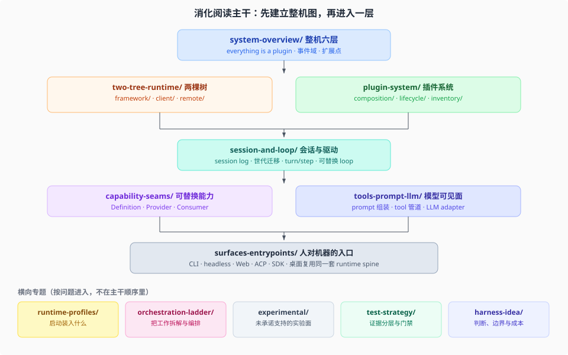

# `_digested` — DeepSeek Harness 源码消化

这个目录是对 DeepSeek Harness 源码的**消化分析**：从 TypeScript 源码出发，理解机制、架构和设计意图。它不是用户指南，也不是给 upstream 的补丁。

> **产品源码审计基线**：以 [`catalog.json`](./catalog.json) 的 `baseline` 为准；当前渲染值见 [`_coverage/00-index.md`](./_coverage/00-index.md)。每次同步产品源码后，在 [`_change_log/`](./_change_log/00-index.md) 记录范围，并按 [`_coverage/`](./_coverage/00-index.md) 逐页复核。合入记录与**执行口径与可照做的同步操作手册**的唯一权威在 [`_change_log/00-index.md`](./_change_log/00-index.md)（`ethan` = 目标 release tag 的原样 + 6 项本地独有内容，按内容级而非路径级验收，没有 merge 这回事）。0008 轮语料维护的**独立复核**见 [`_change_log/0008-independent-recheck.md`](./_change_log/0008-independent-recheck.md)；0009 轮的**独立反查**见 [`_change_log/0009-independent-recheck.md`](./_change_log/0009-independent-recheck.md)。本地维护 `_digested/`、`_faq_on_digested/`、`_dsh_plugin_agent_ready_development/`、`_misc/` 四个语料目录、`.pi/`、`scripts/verify-repository-references.{ts,spec.ts}` 的本地补丁，以及 `_misc/` 下**不入库**的 `_model_vendors/`（多 vendor 研究笔记，高频改动且可能含账号/密钥材料，忽略规则在 `_misc/.gitignore`）。`_misc` 为低重要性杂项：`_references` 冻结存档只随轮更新基线行，`_scratch` 不跟踪内容。

> **维护宪章**：[`CORPUS-CHARTER.md`](./CORPUS-CHARTER.md)。改本目录前先读它——引用形态、版本号能写在哪、升级时改什么不改什么、以及为什么这些规则是强制而不是建议。它优先于任何单轮记录。

## 30 秒看懂

dsh 的进程里运行的是一棵**插件树**：对话循环、读写文件、跑命令、接模型、画 Web 界面，都是树上的插件。本目录按这棵树的主轴切专题，每个专题看它的一个面——所以「插件」不是某个目录的主题，而是所有目录的底座。三个例外：`capability-seams/` 讲同一个能力有多个插件实现时怎么换实现而不改调用方（插件的竞聘位）；`plugin-system/` 把「插件」当成主题本身，分三个轴讲透——有什么（inventory）、怎么变成活树（composition）、怎么走完一生（lifecycle）；`delegation-and-orchestration/` 按**座位**分轴——驾驶座看原语机制与选择，作者座看组合、合同、终态与观测。

`_digested/` 面向已熟悉 agent harness / plugin 运行时，但尚未建立 DeepSeek Harness 概念体系的读者。这里先抓住思想主轴，再进入源码机制——而不是把 `packages/` 目录平铺成分类货架。

每个专题的 `00-map.md` 是按主干顺序阅读的**概念导读**，只建立职责、关系和阅读入口；同目录编号正文是按问题查找的**机制参考**，记录状态对象、算法、失败行为和源码入口。图放在该专题的 `figures/`。

文件不叫 `README.md`：仓库的 bilingual pairing 门禁会把任意 `README.md` 当成产品文档语料。研究目录用 `00-index.md` / `00-map.md`。

## 分支纪律

| 分支 | 上面有什么 |
|------|------------|
| `master` | 干净的 upstream 镜像。不放研究材料，不改产品代码。 |
| `ethan` | 研究分支。源码整树照搬 upstream tag；研究材料位于 `_digested/`、`_dsh_plugin_agent_ready_development/`、`_faq_on_digested/` 与 `_misc/`。 |
| `ethan2` | `ethan` 的工作副本，两者在每次同步后保持指向同一提交。 |

同步方式（权威口径见 [`_change_log/00-index.md`](./_change_log/00-index.md) 的「同步操作手册」）：把产品源码**整树对齐到当前发布版本的 release tag**（取 [`catalog.json`](./catalog.json) 的 `baseline.tag`；不做内容合并、不跟 master 分支头、除 6 项本地独有内容外不留任何本地源码补丁），再按 `_change_log/` 审计过期结论；完成后把另一条分支快进到同一提交。旧口径「非快进 merge + 逐冲突解决」在 0008 退役。**不要读成「跟 master 分支头」**——master 上未发版的提交不属于目标版本；具体领先量记在当轮 `_change_log`。

## 与同级目录的关系

| 目录 | 本质 | 受众 |
|------|------|------|
| **`_digested/`** | 源码消化，机制剖析 | 想彻底搞懂背后发生了什么的人 |
| `_dsh_plugin_agent_ready_development/` | 面向 coding agent 的 SDD、GitHub Flow 与 Development Harness 独立教程 | 想理解规格、交付流程和仓库开发 Harness 怎样协作的读者 |
| `_faq_on_digested/` | 跨消化材料的二次研究 | 我自己（产出者） |

本仓库不另做用户手册。官方怎么用、怎么扩展，仍读 `docs/` 和 package README。

## 子目录

专题按 **Harness 自己的主轴** 切，不按 OpenSpec 的 schema / CLI workflow 切。

| 目录 | 聚焦 | 一句话 |
|------|------|--------|
| `system-overview/` | 总体系统专题 | 按下回车之后，这些插件怎么拼成一次能跑的对话——先读这。 |
| `two-tree-runtime/` | 两个运行时 | 同一套 Cordis 在 Node 与浏览器各长一棵插件树，中间是类型化的线：`framework/` 框架本体、`client/` 浏览器那棵树、`remote/` 两棵树之间。写插件、加 slot、加 `@Remote` 方法都从这里进。 |
| `runtime-profiles/` | 运行时配置 | 五种官方启动方式（web / headless / sdk / sdk-minimal / acp）各自带哪些插件、差在哪。 |
| `session-and-loop/` | 会话与驱动 | 对话存在哪、怎么读回来：session log 的格式、世代与投影。 |
| `agent-loop/` | 推进、边界与 Goal 驱动 | 一次对话怎么推进与收尾：turn/step 边界、goal 状态机、自动续轮。 |
| `delegation-and-orchestration/` | 委派与编排（三类读者） | **驾驶座**：DSH 给了哪些把工作拆解、委派、编排、推进到完成的原语（todo → subagent → workflow → ralph → goal → jobs → schedule → agent-teams），各自保证什么、什么时候用哪个。**作者座**：能力面怎么组合与收窄、合同放哪、深度与通知怎么叠加、终态与图怎么观测。写「会委派的插件」或组 preset 从这里进。 |
| `capability-seams/` | 可替换能力 | 同一个能力（读文件、跑命令……）有多个插件实现时，怎么换实现而不改调用方——插件的竞聘位。 |
| `plugin-system/` | 插件系统（三轴） | 插件系统的三个面：`composition/` 怎么叠成活树、`lifecycle/` 从打包到卸载的七段、`inventory/` 把现成包按组列成清单（数量以该专题为准）。动手写、要交付、或查「装了为什么没生效」都从这里进。 |
| `experimental/` | 可选能力与原型 | 已评估但未承诺产品支持的实验能力。**实验身份与「可选交付」相互独立**：可选包收编进本组，而非 experimental 的包才需要产品用途或显式分类（`scripts/product-package-policy.ts`）。 |
| `tools-prompt-llm/` | 模型可见面 | 模型每一步看见什么：工具清单、系统提示词、历史投影怎么组装。 |
| `surfaces-entrypoints/` | 人对机器的入口 | 人从哪里进去：CLI、headless、Web、ACP、SDK、桌面六个入口怎么复用同一台运行时。 |
| `test-strategy/` | 测试体系 | DSH 怎么测：七层证据形态、录制会话快照、CI 门禁与防假绿、可靠性纪律与测试基建——`docs/testing.md` 测试政策的完整展开。 |
| `_coverage/` | 覆盖矩阵 | 维护索引：每个专题承诺回答什么、最后对到哪个源码 commit。 |
| `harness-idea/` | 消化后的理解与判断 | 判断层：dsh 这种 harness 形态做对了什么、边界与成本在哪。 |
| `canon/` | 词、流程与生态惯例 | 宪章层：每个承重词的 repo 原文与它排除的写法、常规流程的名字与边界、生态做法的证据等级。写页或审页之前先查。 |
| `_change_log/` | 上游同步记录 | 每次 upstream 同步的范围、审计与修复记录。 |

## 术语速查

权威定义在 [`docs/glossary.md`](../docs/glossary.md)；「本卷怎么用这些词」的完整版在 [`canon/`](./canon/00-map.md)。这里只放三条入口，细节不在此重复：

| 你要 | 去哪 |
|---|---|
| 查一个词该写成什么、不要写成什么 | [`canon/GLOSSARY.md`](./canon/GLOSSARY.md) |
| 弄清为什么是这个词（七条设计判断） | [`canon/02-judgements.md`](./canon/02-judgements.md) |
| 查常规流程的名字、或判断一个生态做法能不能借 | [`canon/10-process.md`](./canon/10-process.md)、[`canon/11-ecosystem.md`](./canon/11-ecosystem.md) |

## 阅读路径



- **熟悉 agent / plugin 运行时，但不熟 dsh** → [`system-overview/00-map.md`](./system-overview/00-map.md)
- **想先搞懂 Cordis 在这棵树里到底是什么** → [`two-tree-runtime/framework/00-map.md`](./two-tree-runtime/framework/00-map.md)；两棵树怎么分工见 [`two-tree-runtime/00-map.md`](./two-tree-runtime/00-map.md)，官方入门仍是 [`docs/cordis-primer.md`](../docs/cordis-primer.md)
- **想搞懂 `dsh --profile web` 怎么变成进程的** → [`runtime-profiles/00-map.md`](./runtime-profiles/00-map.md)
- **想搞懂插件系统本身（怎么成树、怎么走完一生、现成有什么）** → [`plugin-system/00-map.md`](./plugin-system/00-map.md)
- **要确认一个词 DSH 到底怎么讲，或动笔前对一遍引用纪律** → [`canon/00-map.md`](./canon/00-map.md)
- **想搞懂一轮对话怎么跑** → [`session-and-loop/00-map.md`](./session-and-loop/00-map.md)
- **想搞懂 DSH 给了哪些工作编排原语、什么时候用哪个** → [`delegation-and-orchestration/00-map.md`](./delegation-and-orchestration/00-map.md)
- **要写一个会委派/会组合的插件、或想知道一条链为什么会断/怎么证明** → [`delegation-and-orchestration/00-map.md`](./delegation-and-orchestration/00-map.md) 的「症状 → 页」与作者座两个子专题
- **想搞懂磁盘上的 session 文件怎么跨格式世代读** → [`session-and-loop/04-格式世代与迁移.md`](./session-and-loop/04-格式世代与迁移.md)
- **想加能力或换后端** → [`capability-seams/00-map.md`](./capability-seams/00-map.md)
- **想研究实验与可选能力** → [`experimental/00-map.md`](./experimental/00-map.md)
- **想搞懂模型看见什么** → [`tools-prompt-llm/00-map.md`](./tools-prompt-llm/00-map.md)
- **想搞懂 CLI / headless / Web / 桌面 / ACP / SDK 怎么复用同一套 runtime spine** → [`surfaces-entrypoints/00-map.md`](./surfaces-entrypoints/00-map.md)
- **想给 Web UI 加功能、或新增一个 `packages/client/*` 插件包** → [`two-tree-runtime/client/00-map.md`](./two-tree-runtime/client/00-map.md)
- **想搞懂一个 `@Remote` 方法怎么变成 `ctx.remote.<ns>` 上的类型化 stub** → [`two-tree-runtime/remote/00-map.md`](./two-tree-runtime/remote/00-map.md)
- **想搞懂 DSH 自己怎么测试（分层、快照、门禁、可靠性）** → [`test-strategy/00-map.md`](./test-strategy/00-map.md)
- **想搞懂 dsh 为什么对读者友好（harness 思想）** → [`harness-idea/00-map.md`](./harness-idea/00-map.md)

推荐主干顺序：

```text
system-overview/
  → two-tree-runtime/
  → plugin-system/
  → session-and-loop/
  → capability-seams/ 或 tools-prompt-llm/
  → surfaces-entrypoints/
```

按推荐顺序读 `00-map.md`，遇到具体机制再进入编号正文。专题承诺的核验范围以 [`_coverage/00-index.md`](./_coverage/00-index.md) 为准；未列问题不隐含完整覆盖。跨专题研究放在 `_faq_on_digested/`。

## 按任务找

不同任务该进哪个专题，比按目录顺序读快：

| 你要做的事 | 从哪进 |
|---|---|
| 给插件加一条委派能力（谁来干、能不能再委派） | [`delegation-and-orchestration/preset-composition-and-contract-placement/`](./delegation-and-orchestration/preset-composition-and-contract-placement/00-map.md) |
| 决定用哪个原语（subagent / workflow / goal / team / jobs） | [`delegation-and-orchestration/primitive-selection/`](./delegation-and-orchestration/primitive-selection/00-map.md) |
| 把一条链的状态看见、画出来、证明它真的跑通 | [`delegation-and-orchestration/completion-and-observation/`](./delegation-and-orchestration/completion-and-observation/00-map.md) |
| 写一个新插件包、接进组合、走完发布 | [`plugin-system/`](./plugin-system/00-map.md) |
| 换掉一个能力的实现（文件、命令、模型、浏览器） | [`capability-seams/`](./capability-seams/00-map.md) |
| 加 Web UI / 客户端投影 | [`two-tree-runtime/client/`](./two-tree-runtime/client/00-map.md) |
| 决定模型每一步看见什么 | [`tools-prompt-llm/`](./tools-prompt-llm/00-map.md) |

## 验证

修改本目录后运行：

```sh
node _digested/render-indexes.mjs   # 从 catalog.json 重生成覆盖矩阵
node _digested/verify.mjs
```

`verify.mjs` 校验：Markdown / SVG / 校验脚本的严格 UTF-8 与单个结尾换行、Markdown 相对链接和锚点、SVG 的 XML 结构与实体、外部链接近 `master`、`catalog.json` 与文件树双向一致、覆盖矩阵与 catalog 渲染一致、Markdown 表列数与表头一致、四份宪章副本逐字一致，以及 `claims.json` 的 claim 与计数指标。

宿主门禁的关系：仓库根的 `verify-repository-references` 拒绝维护文件里出现真实 commit 标识符，但**研究语料已被显式豁免**（`scripts/verify-repository-references.ts:20` 的 `researchPrefixes` 覆盖本目录与 `_faq_on_digested/`、`_dsh_plugin_agent_ready_development/`、`_misc/`），因为本语料仍需要引用历史 commit 作为证据与 `_change_log/` 记录。该门禁对本目录预期为**绿**；它仍对语料做组织 URL 检查。本目录的权威校验器仍是上面的 `verify.mjs`。
