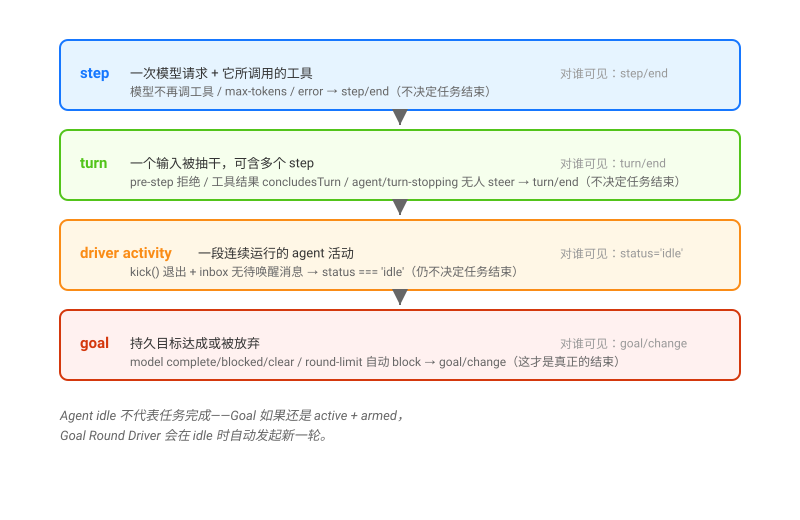
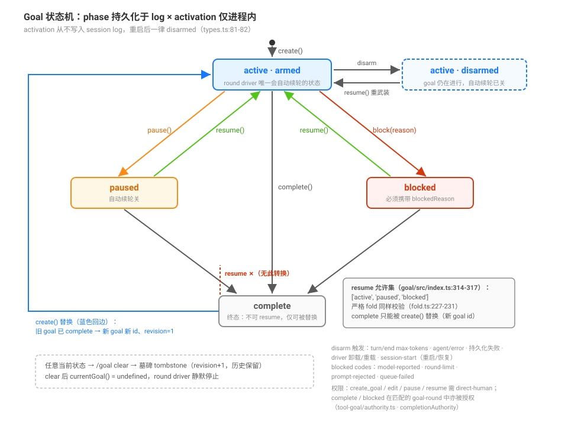

# Agent Loop · 推进、边界与 Goal 驱动

## 一句话

Loop 管推进，结束却分好几层：Loop 不是「模型回答完就结束」——一次 step 结束不等于 turn 结束，agent idle 不等于任务完成，因为 Goal 可能还是 `active`，随时发起新一轮。



## 四层结束边界

| 层 | 什么结束 | 谁决定 | 对谁可见 |
|----|---------|-------|---------|
| **step** | 一次模型请求 + 它所调用的工具 | 模型不再调工具 / `max-tokens` / error | `step/end` 事件 |
| **turn** | 一个输入被抽干（可含多个 step） | 工具结果 `concludesTurn` / `agent/turn-stopping` 无人 `steer` | `turn/end` 事件 |
| **driver activity** | 一段连续运行的 agent 活动（从一次唤醒到重新 idle 的整段，可含多个 turn） | Agent 回到 idle，且 inbox 无待唤醒消息；整段活动运行在以该 agent 为 initiator 的因果边界内（`packages/core/agent-loop/src/agent.ts`） | `agent/status === 'idle'` |
| **goal** | 一个持久目标达成或被放弃 | 模型调用 `update_goal` complete/blocked，或 round-driver 自动 block | `goal/change` 事件 |

**Agent idle 不代表任务完成**——它只说明此刻没有待处理的消息。Goal 如果还是 `active + armed`，Goal Round Driver 会在 idle 时自动发起下一轮。

## 它不是什么

- **没有隐藏的意图理解引擎**：长任务不是系统隐式猜测出来的，而是模型阅读 `create_goal` tool description 与 `tool:goal` system prompt section 后主动调用 `create_goal` 创建，或经 `/goal`、`goals.create`（`@Remote`）触发；四条路径的完整细节、原文引导与授权守卫见 [`01-goal-lifecycle.md`](./01-goal-lifecycle.md)。
- **不拥有底层 turn / step 驱动接口**：turn 开闭、inbox（`followup` / `steer` / `inject`）与必写 session 事件属于 `dsh-agent` 与 `dsh-agent-loop`（归 [`../session-and-loop/`](../session-and-loop/00-map.md)），本专题聚焦「goal 状态机 + Round Driver 在 idle 之后如何续轮 + initiator 因果边界」。

## Goal 状态机



两根轴不要混：`phase`（active / paused / blocked / complete）持久化于 session log；`activation`（armed / disarmed）是进程内状态，从不持久化。`complete` 是终态，不可 resume，只能被 `create()` 替换（新 goal id）；`paused` 的 resume 只能由 human 发起（模型 `update_goal` resume 抛 `GOAL_TOOL_RESUME_PAUSED`）。每个转换的允许集、权限与 CAS 机制见 [`01-goal-lifecycle.md`](./01-goal-lifecycle.md)。

## 分层与职责

```text
goal-round-driver   ← 监听 idle + active·armed goal，followup() 注入下一轮
agent-loop          ← turn/step 驱动：claim → pre-step → step → turn-stopping
dsh-agent           ← Agent 接口：AgentRegistry / AgentFactory / inbox 契约
session             ← 仅追加事件流（turn/*、step/*、surface、tool/*、goal/change）
```

下面三层的接口与时序归 [`../session-and-loop/`](../session-and-loop/00-map.md)；本专题拥有最上面一层与「idle 之后谁在推进」。

## 阅读路径

推荐顺序：先读 goal 的完整生命周期，再读 Goal Round Driver 的自动续轮机制，然后读四层结束边界如何配合，最后读 Agent 运行时身份。

| 文件 | 内容 |
|------|------|
| [`01-goal-lifecycle.md`](./01-goal-lifecycle.md) | Goal 状态机、四条产生路径（模型 tool / human 命令 / Host Remote / 只延续的 driver）、授权两档 |
| [`02-goal-round-driver.md`](./02-goal-round-driver.md) | Round Driver 如何监听 idle、注入 round prompt、pre-step 验证 |
| [`03-activity-vs-goal-boundaries.md`](./03-activity-vs-goal-boundaries.md) | step/turn/activity/goal 四层分别在哪结束、崩溃恢复时序 |
| [`04-agent-runtime-identity.md`](./04-agent-runtime-identity.md) | Agent 运行时身份如何显式传递、initiator 边界为何成为权限判据 |

Agent Loop 内部（turn/step/inbox/claim）的详细时序已在 [`_digested/session-and-loop/02-inbox-与turn-时序.md`](../session-and-loop/02-inbox-与turn-时序.md) 覆盖，这里不再重复。

## 源码入口

| 路径 | 角色 |
|------|------|
| `packages/core/agent-loop/src/agent.ts` | `ReactLoopAgent`：`turn()`、`step()`、tool 执行 |
| `packages/core/agent-loop/src/index.ts` | loop 插件：`ctx.agents.setFactory(this)` |
| `packages/core/agent/src/index.ts` | `AgentRegistry` / `AgentFactory`：`AgentSetup`、`parentAgent` 属主关系 |
| `packages/goal/goal/src/index.ts` | `GoalService`：create / pause / resume / complete / block / clear |
| `packages/goal/tool-goal/src/index.ts` | `create_goal` / `get_goal` / `update_goal` 三个 model-facing tool |
| `packages/goal/command-goal/src/index.ts` | `/goal` human command |
| `packages/goal/goal-round-driver/src/index.ts` | Goal Round Driver：自动续轮、pre-step 验证 |
| `packages/goal/goal-round-driver/src/prompt.ts` | 下一轮注入的 prompt 文本 |
| `packages/goal/goal/src/types.ts` | GoalId、GoalSnapshot、GoalPhase、GoalView、GoalProjection 类型 |
| `packages/goal/goal/src/fold.ts` | 严格的纯函数 fold（回放时重建 goal 状态） |
| `packages/goal/tool-goal/src/authority.ts` | 谁可以操作 goal：direct human 或当前 goal round；subagent 被拒绝 |
| `packages/bundle/base/cordis.patch.yml` | `goal`、`goal-round-driver`、`command-goal`、`tool-goal` 都在 base bundle 的 insert 里 |

## 边界

- **turn / step / inbox 内部机制**：[`../session-and-loop/00-map.md`](../session-and-loop/00-map.md) 与 [`../session-and-loop/02-inbox-与turn-时序.md`](../session-and-loop/02-inbox-与turn-时序.md)（本专题不展开 `claim` 与 request header 构造）。
- **驾驶座与委派用法**：[`../delegation-and-orchestration/delegation-primitives/04-cross-round-goals-and-the-round-driver.md`](../delegation-and-orchestration/delegation-primitives/04-cross-round-goals-and-the-round-driver.md)（objective 写法、轮预算、终结纪律、wrapup 收尾）。

## 症状 → 页

| 你看到的现象 | 去哪 |
|---|---|
| agent 回了话但任务没完、过一会儿又自己动了 | 本页四层边界 + [`03`](./03-activity-vs-goal-boundaries.md) |
| goal 重启后不自动续轮 | [`03`](./03-activity-vs-goal-boundaries.md) 的 restart-rearm 语义 |
| 模型能不能改/暂停/完成 goal 分不清 | [`01`](./01-goal-lifecycle.md) 的授权两档表 |
| round driver 什么时候注入、什么时候不注入 | [`02`](./02-goal-round-driver.md) |

> 承重词按 [`canon/GLOSSARY.md`](../canon/GLOSSARY.md) 的 DSH 原文用；本页自己的分类与指标不是 DSH 的词。
