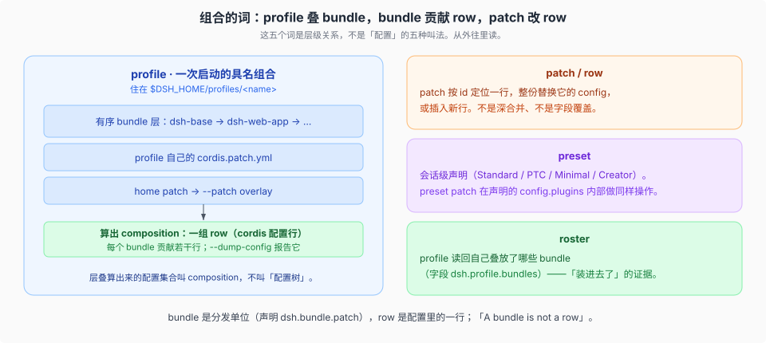
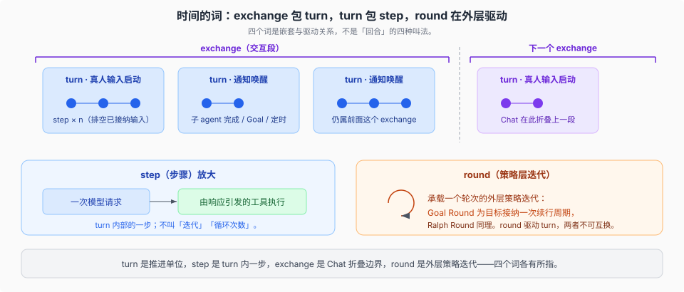
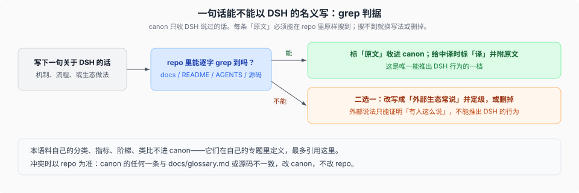

# Canon · DSH 自己的词与规矩

## 为什么需要这一层

你熟悉 agent harness，但还不熟悉 DSH。读 DSH 源码时最先绊住人的往往不是机制，而是**词**：DSH 用一批普通英文词表达精确含义，而且词与词之间的关系和别家 harness 不一样。用错词有两个代价：**检索失效**（拿着自造同义词在 repo 里 grep 不到机制），以及**理解错位**（把两件事读成一件事，或把一件事读成两件）。

canon 就是为这两个代价设的防线：它把 DSH 自己说过的话按主题收在一处，每条都能逐字引用到 `docs/`、包 README、`AGENTS.md` 或源码。它**不是**机制解释（怎么实现归各专题），**不是**评价（好不好归 [`../harness-idea/`](../harness-idea/00-map.md)），也**不是**事实名目录（包名、工具名查生成目录）。

## 先学会三组词

DSH 的承重词分三组，每组内部是**关系**而不是同义替换。先看图建立关系，再查 [`GLOSSARY`](./GLOSSARY.md) 的原文与排除写法。

### 一、组合的词：profile / bundle / preset / patch / row

记住三件事：

1. **层级**：profile 叠 bundle，bundle 贡献 row（配置行），有序层叠算出 composition。它们是层级，不是「配置」的几种叫法。
2. **patch 是整份替换**：按 id 定位一行、整份替换其 config，或插入新行——不是深合并。preset 是在会话级声明的 `config.plugins` 内部做同样操作。
3. **bundle ≠ row**：bundle 是分发单位，row 是配置里的一行；装了 bundle 不等于某行启用。roster 是 profile 读回的 bundle 清单，是「装进去了」的证据。

原文与常见错写见 [`GLOSSARY` 对象与组合节](./GLOSSARY.md#对象与组合)；组合怎么叠成活树归 [`../plugin-system/`](../plugin-system/00-map.md) 与 [`../runtime-profiles/`](../runtime-profiles/00-map.md)。

### 二、时间的词：turn / step / exchange / round

记住三件事：

1. **嵌套**：exchange 包 turn，turn 包 step。turn 是排空已接纳输入的过程，step 是一次模型请求加它引发的工具执行。
2. **exchange 的边界是真人输入**：从首个接纳真人输入的 turn 起，到下一个这样的 turn 止；通知（子 agent 完成、Goal、定时任务）唤醒的 turn 归入前面的 exchange。这是 Chat 折叠的边界。
3. **round 在外层**：round 是承载一个 turn 的策略层迭代（Goal Round、Ralph Round），不是 turn 本身。

原文与常见错写见 [`GLOSSARY` 时间与状态节](./GLOSSARY.md#时间与状态)；驱动机制归 [`../agent-loop/`](../agent-loop/00-map.md) 与 [`../session-and-loop/`](../session-and-loop/00-map.md)。

### 三、能力的词：seam / Definition / Provider / Consumer

读这组之前，若你还不熟 Cordis 的 `ctx` / Service / Fiber，先看 [`../system-overview/00-map.md`](../system-overview/00-map.md#先修cordis-的五个词) 的五行表（`ctx.<key>` 在那里定义）。

记住三件事：

1. **seam 是完整能力**：三角色（Service Definition / Service Provider / Consumer）齐全才叫 seam；单角色只是其中一员，不配这个词。
2. **Definition 不是 interface**：它是占住 `ctx.<key>` 的 Cordis `Service`（抽象类或注册表）。Consumer 只依赖 Definition，绝不依赖具体 Provider。
3. **Consumer 不是客户端**：`client` 在 DSH 里专指浏览器那棵插件树；Consumer 是注入服务的插件，常见是面向模型的 tool。

三角色图见 [`../capability-seams/00-map.md`](../capability-seams/00-map.md)；原文与常见错写见 [`GLOSSARY` 运行时与扩展节](./GLOSSARY.md#运行时与扩展)——这一节要在第一次通读时就扫，不要留到查词时。

## 写页时怎么用 canon

canon 只收 DSH 说过的话。一句话能不能以 DSH 的名义写，判据是 grep：

四条硬规则：

1. **只收 DSH 说过的话。** 本语料自己的分类、指标、阶梯、类比不进本目录——它们在自己的专题里，最多引用这里。
2. **每条都要能 grep。** 标「原文」的句子必须能在 repo 里原样搜到；repo 原文里的粗体、链接标记也是原文的一部分，引文要么带上它们，要么截取连续的纯文本段。这道检查现在由 [`verify.mjs`](../verify.mjs) 的 canon 引文校验逐字执行。
3. **翻译要标明。** repo 是英文、这里给中文时标「译」；翻译不是原文。
4. **冲突以 repo 为准。** 任何一条与 [`docs/glossary.md`](../../docs/glossary.md) 或源码不一致，改 canon，不改 repo。

三档证据：**原文**（逐字可搜，唯一能推出 DSH 行为的一档）、**译**（中译，引用时给原文）、**外部**（第三方说法，只能证明「有人这么说」）。定级与写法详见 [`11-ecosystem`](./11-ecosystem.md)。

## 导航

| 你是 | 路径 |
|---|---|
| **第一次读 DSH** | 本页三组图 → [`GLOSSARY`](./GLOSSARY.md) **三节都扫**（对象与组合 / 时间与状态 / 运行时与扩展——第三组是 `ctx`、surface、scope、waterfall、initiator 这些每天都会用到的词）；再进 [`../system-overview/00-map.md`](../system-overview/00-map.md) 建整机心智模型（`02-judgements` 是动笔时的判据，不是入门页） |
| **查一个词** | [`GLOSSARY`](./GLOSSARY.md)：先定组再定行；可疑写法先查 [`03-retired`](./03-retired.md) |
| **动笔写页 / 审页** | [`04-writing`](./04-writing.md) 引用与措辞纪律 → [`02-judgements`](./02-judgements.md) 判据 → [`10-process`](./10-process.md) 流程原文 → [`11-ecosystem`](./11-ecosystem.md) 外部定级 |

## 边界

- 本目录不解释机制。`seam` 怎么实现归 [`../capability-seams/`](../capability-seams/00-map.md)，`profile` 怎么组合归 [`../runtime-profiles/`](../runtime-profiles/00-map.md)，`turn` 怎么推进归 [`../agent-loop/`](../agent-loop/00-map.md)。
- 本目录不评价 DSH 做得好不好。判断归 [`../harness-idea/`](../harness-idea/00-map.md)。
- 本目录不收包名、工具名、命令名这类事实名：它们是事实，查生成目录。
- DSH 的决策流程机制（Agent Note 生命周期、门禁、归档）归 [`../development-flow/`](../development-flow/00-map.md)；[`10-process`](./10-process.md) 只收流程的**名字与原文**。
