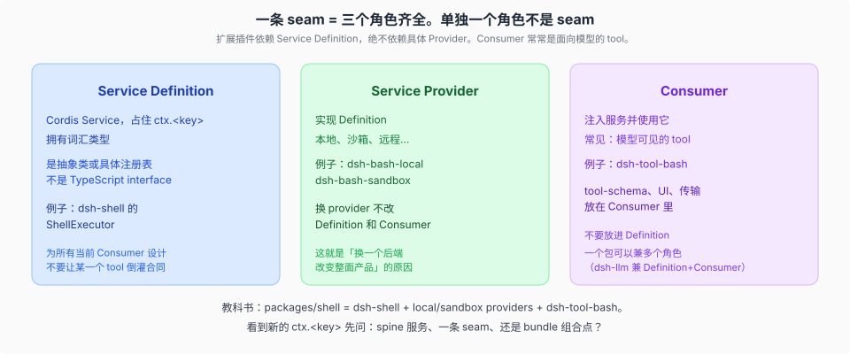
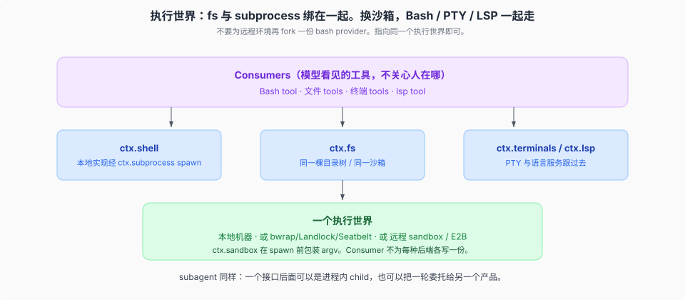

# Capability seams · 可替换能力

产品源码基线：`687f282e8625c6b8d11ff58211a90524be2e4317`（`dsh-v0.2.1-rc.2`）；本专题结论与该 commit 的项目树一致，跨度对照的 OLD 侧为 `639ed015397290b3745d163aafe02ffee4aa3f84`（`dsh-v0.2.0-rc.2`），增量见 [`_change_log/0011`](../_change_log/0011-0.2.0-rc.2-to-0.2.1-rc.2.md)。

## 一句话

一条 **seam** 是可替换的**完整能力**，必须有三个角色：Service Definition、Service Provider、Consumer。单独一个角色不是 seam。加一项能力，意味着把三者一并设计。

扩展插件依赖 Definition，绝不依赖具体 Provider。这就是「换一个后端，整面产品跟着变，Consumer 不用改」的原因。

## 三角色

| 角色 | 它是什么 | 典型落点 |
|------|----------|----------|
| **Service Definition** | 声明 `ctx.<key>` 和词汇的 Cordis `Service`（抽象类或注册表，不是 `interface`） | `dsh-shell` 的 `ShellExecutor` |
| **Service Provider** | 实现它 | `dsh-bash-local` / `dsh-bash-sandbox` / `dsh-pwsh-local` |
| **Consumer** | 注入并使用；常见是面向模型的 tool | `dsh-tool-bash` |

一个包可以兼多个角色——`dsh-llm` 同时拥有 Definition 和 Adapter 注册点，而它的 Consumer 是 loop 本身（`agent-loop`、`compaction-basic`）。角色分包装，是因为它们会独立演化；合在一个包里，是因为它们就是同一件事。

**设计 Definition 时对着所有当前 Consumer。** tool-schema、Loader、UI、传输、某个 provider 的癖好，放在 Consumer 或 provider 里。反味：一个公开服务方法只有一个内部调用者——那多半该是私有闭包，不该抬成合同。

看到新的 `ctx.<key>`，先问它是 spine 服务、一条 seam、还是 bundle 组合点。只有三角色齐全才叫 seam。

跨度 0006（`0.1.2-rc.1` → `0.1.5-rc.1`）新增 `ctx.fileUploads` / `ctx.workspaceFiles` / `ctx.sessionFeedback` 三个 **core** 服务、**0 个新 seam**，并把 `ctx.messageFeedback` 迁到 canonical Session log；三个键的 owner、消费者与判定见 [`04-新增seam与Remote.md`](./04-新增seam与Remote.md)。

## 远程执行世界与本地 confinement

在 E2B 组合里，`dsh-fs-e2b` 与 `dsh-subprocess-e2b` 注入同一个 `ctx.e2b`，因此共享一棵远程 Linux 目录树和进程世界。依赖 `ctx.fs` / `ctx.subprocess` 的 Consumer 随 provider 组合切换，不必为远程再 fork 一份实现。**（0008 复核：E2B 组已随 `dsh-v0.1.7-rc.1` 删除——本地遏制转正为 `packages/sandbox/` 组，远程执行族的新落点是 `packages/ssh/` 组；本段保留为 provider 组合卖点的机制记录，接替面见 [`09-ssh远程执行族.md`](./09-ssh远程执行族.md)）**

本地 shell 经 `ctx.subprocess` spawn；`ctx.sandbox` 在 spawn 前包装 argv。这种 confinement 约束一次本地进程启动，不会自行迁移 `ctx.fs`，也不等于一套完整的远程执行世界。Consumer 面对的是 Definition，不是「我在哪台机器上」。0.1.7 线的远程接替面没有发明新的私有世界键：`packages/ssh/` 的 `fs-ssh` / `subprocess-ssh` / `sandbox-ssh` 三个 provider 共享一条部署自有的 `ctx.ssh` 连接，把三个既有 seam 各自实现到远端主机，helper 在远端就地复用本地的 fs / subprocess / sandbox 包；该组合 opt-in，任何 bundle 都不出货。机制见 [`09-ssh远程执行族.md`](./09-ssh远程执行族.md)。

subagent 是同一模式的另一个例子：一个接口后面，可以是进程内 child agent，也可以是经 ACP 或 JSON-RPC 驱动的独立进程。产品 Codex / Claude Code provider 不在 `dsh-base` 里默认安装；它们是独立 Bundle，随 Profile 选中后各自注册一个 dormant 默认 provider，并把委派工具注册成 Host 全局工具（`ON_DEMAND_BUNDLES`，`packages/boot/app-boot/src/official-bundle-packages.ts:5`-`:6`）。preset 只决定「这个 agent 看见哪个委派工具」，不再用 `backgroundMode` 选路由——0.2.1 线所有委派都走受管 activation，工具返回 `{ kind: 'activation', subagentId }`，结果以父级完成通知送达（upgrade guide [`subagent-activations`](../../docs/upgrade-guide/v0.2.1-alpha.1/subagent-activations/guide.md)）。见 [`03-subagent后台与产品provider.md`](./03-subagent后台与产品provider.md)；parent-owned direct-child 目录与宿主 Queue / Steer 交付见 [`05-subagent-catalog与host交付.md`](./05-subagent-catalog与host交付.md)。

> **subagent model routing**：上游 #2868 给 `SubagentProvider` 增加可选 `agentRouteDefaults`（`packages/subagent/subagent/src/types.ts:330`），dsh-sdk provider 据此声明配置化的 route 默认值（`deepseek-official` / `deepseek-v4-flash`，`packages/subagent/subagent-dsh-sdk/src/index.ts:126`）。调用未指名 provider/model 时落到这组 provider 默认，不是「继承父 agent」；机制是逐调用 `agentOptions` 白名单（provider / model / reasoningEffort / maxTokens）加 route preflight（`packages/subagent/tool-subagent/src/index.ts:308` 的 `preflightChildLlmRoute` 调用），没有「SDK 内置路由」这个对应物。`subagent-dsh-sdk` 无 `prepareContinuable`（`packages/subagent/subagent/src/types.ts:355`），它是 external provider，执行一次、不收后续消息。详见 [`03-subagent后台与产品provider.md`](./03-subagent后台与产品provider.md)。

## 不是 seam 的调度：schedule（host 作用域持久提醒）

`packages/schedule/schedule/` 提供 **host-wide durable reminders**，不是 seam——没有 Definition/Provider 可分包装；0009 起以 core role 进生成表（`ctx.schedule`，单一 owner，`docs/capability-seams.md:682`）。模型经 `schedule_create` / `schedule_list` / `schedule_update` / `schedule_delete` 四个工具创建一次性或固定间隔提醒，0.2.1 线把工具整包拆到 `packages/schedule/tool-schedule/`（`src/index.ts:454`/`:492`/`:539`/`:513`，`inject = ['tools']`，`:29`），到期以 scheduled user message 回到原会话；任务独立于 Session activation 持久化，重启后仍投递。host 侧是自足插件：`ScheduleRuntime` 按 root agent 实例化，`inject = ['agents', 'sessions', 'storageDomain', 'sessionController', 'sessionPersistence']`（`packages/schedule/schedule/src/index.ts:100`），持久化落点是 `storage.ts` / `delivery-history.ts`（旧 `persistence.ts` / `transaction.ts` / `projection.ts` 与 `scheduleProjectionDefinition` 无同名继任）+ Web 侧只读 catalog（`packages/client/ui-schedule/`）。启用路径 0.2.1 线改向：`experimental/schedule-bundle` 退役（upgrade guide [`schedule-bundle-retired`](../../docs/upgrade-guide/v0.2.0-rc.2/schedule-bundle-retired/guide.md)），`@deepseek-ai/dsh-web-app` 在 Web 组合里直接挂 `schedule`（`packages/bundle/web-app/cordis.patch.yml:139`）与 `ui-schedule`（`:398`）两行，工具行由 preset 声明（`presets/standard.patch.yml:35`、`presets/cordis.patch.yml:38`、`presets/ptc.patch.yml:35`，`minimal` 不声明）。它说明：能力可以按需装成插件，不必都切三角色（对照见 [`04`](./04-新增seam与Remote.md)）。更靠边的两个样本是 API Remote（BFF 通信模式，下节）与外发代理策略（进程级库，[`06`](./06-外发代理策略.md)）——都不是插件，也都刻意不切三角色。

## core 而非 seam：Webhook

`packages/experimental/webhook/` 和 `packages/experimental/webhook-github/` 提供了 webhook ingress 能力（0.2.1 线随可选包收编整族从 `packages/webhook/` 迁入 `experimental/`，包名不变）：

- **core 服务**（`experimental/webhook/`）：`ctx.webhookRuntime` — 认证投递分发、Workspace Session 创建。生成表把它的 role 列写成 `core`、implementation 列为 [`webhook`](../../packages/experimental/webhook)（[`docs/capability-seams.md:709`](../../docs/capability-seams.md)）；`docs/architecture.md` 的核心包表不再收录它，扩展点表仍给出「注册受信规则 + 挂 provider adapter」一行（[`docs/architecture.md:151`](../../docs/architecture.md)）
- **消费者 / 适配器**（`experimental/webhook-github/`）：`inject: ['webServer', 'webhookRuntime', 'credentials']`（`packages/experimental/webhook-github/src/index.ts:14`），验签后调 `ctx.webhookRuntime.dispatch(delivery)`（`src/handler.ts:115`）
- **规则注册方**：受信插件在 `ctx.webhookRuntime` 上注册进程内规则，返回非 null 结果即变成普通的 Workspace-backed Session

注意产品文档里的「provider adapter」指的是 **webhook 来源适配器**，不是 capability seam 的 Service Provider 角色——`ctx.webhookRuntime` 没有第二个实现包，因此它是 **core 服务 + 适配器消费者**，不是三角色 seam（FAQ 08 的 35 条 seam 表也不含它）。

## 非三角色 seam：API Remote 架构

**API Remote 控制器**是一个**不是传统三角色**的新模式：`packages/api/remotes/` + `packages/typert/` 提供 Remote 控制器架构，`packages/host/apiproxy/` 已整体删除。

| 角色 | 它是什么 | 典型落点 |
|------|----------|----------|
| **Remote 声明** | Host 侧声明 Remote 控制器及其 schema（typert generator） | `packages/api/remotes/` |
| **Client stub** | 生成器自动导出的 client 侧 stub | `packages/api/remotes/src/client/` |
| **Transit** | 类型安全的序列化/反序列化层 | `packages/typert/` |

Remote 不是传统 seam 因为它没有 `ctx.<key>`、没有 Cordis Service 定义。它纯粹是 BFF 层的**通信协议模式**：Host 提供一组 Remote 控制器、Client 消费生成的 stub，双方通过 Typert 的 schema 保持类型安全。

迁移路径：settings（含 credentials 子命名空间）、subagent control、agent-presets（0.1.7 线随 preset 重设计退役，改述：shipped 声明迁 `packages/bundle/web-app/presets/*.patch.yml`）、workspace-controller、session-controller 已从 apiproxy 迁移到 Remote；`packages/host/apiproxy/` 包已整体删除。directory-picker 不是 Remote——它是 `ctx.directoryPicker` Service seam（native/browse 后端，[`docs/capability-seams.md:704`](../../docs/capability-seams.md)；决策见已归档的 [`2026-07-28-directory-picker-capability-seam`](../../.agents/notes/archived/architecture/2026-07-28-directory-picker-capability-seam.md)）。

教科书路径：顺着 `packages/shell/` 走完 Definition → provider → `dsh-tool-bash`。组级 README 拥有「这个组有哪些包、对应哪个 `ctx` key」——本专题不手抄完整包表，完整图在生成的 [`docs/capability-seams.md`](../../docs/capability-seams.md)。

## 源码入口

| 路径 | 角色 |
|------|------|
| [`docs/glossary.md`](../../docs/glossary.md) `capability-seam` | 术语合同 |
| [`docs/capability-seams.md`](../../docs/capability-seams.md) | 生成的包 / key / 实现 / 消费者图 |
| `packages/shell/` | 范本家族 |
| `packages/fs/`、`packages/subprocess/` | 执行世界的文件与进程能力 |
| `packages/subprocess/subprocess-local/` | 受管范围的本地 provider：Linux scope / Windows Job / 显式回退 |
| `packages/util/http-proxy/` | 进程级外发代理策略（库，刻意不是 seam） |
| `native/system/` | Landlock launcher 与 POSIX flock 的原生绑定 |
| `packages/sandbox/` | 本地进程 argv confinement |
| `packages/ssh/` | `ctx.ssh` 连接与 fs/subprocess/sandbox 三个既有 seam 的远程 provider（opt-in） |
| `packages/browser-use/`、`packages/computer-use/` | 两个执行面的独占注册位；driver 全在 `packages/experimental/`，见 [`10-新执行面与编排seam.md`](./10-新执行面与编排seam.md) |
| `packages/llm/` | Definition 与 Consumer 可同包 |
| `packages/subagent/` | 差异极大的 provider，同一接口 |
| `packages/experimental/ptc-runtime-python/` | PTC runtime 的第二 provider（CPython 子进程后端；0.1.7 线自 `code-runtime-python` 随 PTC 命名重构改名，`ctx.codeRuntime` → `ctx.ptcRuntime`），见 [`../experimental/01-code-runtime-python.md`](../experimental/01-code-runtime-python.md) |
| `packages/schedule/schedule/` | agent 作用域持久提醒的 host 服务（`ctx.schedule`，非 seam） |
| `packages/schedule/tool-schedule/` | `schedule_*` 四个模型可见工具（0.2.1 线自 `schedule` 包拆出） |
| `packages/experimental/webhook/` | `ctx.webhookRuntime` 认证投递（0.2.1 线迁入 `experimental/`） |
| `packages/api/remotes/` | Remote 控制器（非传统 seam） |
| `packages/typert/` | 类型安全的 Remote 序列化 |
| [`2026-06-13-capability-seams`](../../.agents/notes/implemented/architecture/2026-06-13-capability-seams.md) | 为什么这样切 |

## 机制级正文

| 文件 | 内容 |
|------|------|
| [`01-三角色与分包装.md`](./01-三角色与分包装.md) | 分包装的味道；换 E2B 时 tool 源码不动 |
| [`02-一次bash从tool到sandbox.md`](./02-一次bash从tool到sandbox.md) | resolve → confine → spawn；run 的失败合同；受管范围与原生 containment |
| [`03-subagent后台与产品provider.md`](./03-subagent后台与产品provider.md) | 受管 activation 取代前台 / Job 委派；产品 provider 的 host 平面 opt-in |
| [`04-新增seam与Remote.md`](./04-新增seam与Remote.md) | Schedule（刻意不成 seam）与 Webhook（`core` 服务 + 适配器消费者）两个对照；API Remote 非三角色通信模式；三个新 core 服务 |
| [`05-subagent-catalog与host交付.md`](./05-subagent-catalog与host交付.md) | parent-owned direct-child 目录（`subagent/catalog` + projection）；宿主消息的 Queue / Steer 双交付 |
| [`06-外发代理策略.md`](./06-外发代理策略.md) | 进程级外发代理库；唯一安装点、`.env` 豁免与 egress 证据 |
| [`07-原生containment与native-system.md`](./07-原生containment与native-system.md) | 受管范围、Linux scope / Windows Job 两条 native 路径；flock 与 session 写租约 |
| [`08-外部生态桥：MCP与hooks.md`](./08-外部生态桥：MCP与hooks.md) | MCP client 把外部 server 的 tools 注入 `ctx.tools`；CC/Codex hook 桥、共享 wire protocol 与 `tools/pre-execute` 拦截点；两者皆 opt-in |
| [`09-ssh远程执行族.md`](./09-ssh远程执行族.md) | E2B 的接替面：一条 `ctx.ssh` 连接、helper 摘要验证与 TLS-PSK 流；`fs-ssh` / `subprocess-ssh` / `sandbox-ssh` 把三个既有 seam 搬到远端；全 opt-in |
| [`10-新执行面与编排seam.md`](./10-新执行面与编排seam.md) | 执行面与编排新面地图：`browserUse` / `computerUse` 独占注册位（全 experimental driver）、`speechToText`、`deepseekAccount`、`mcpResources`、`officeToPdf`、deliverables 事件族、plugin_manager + config-editor；0.2.1 线新增 `remoteAccess` / `workingDirectory` / `worktrees` / `pluginMarket` / `translator` / `cotTranslation` / `claudeCodeMods` / `webApp` 与 `web-deepseek-api` |

模型可见的 tool 管道在 [`../tools-prompt-llm/00-map.md`](../tools-prompt-llm/00-map.md)。
