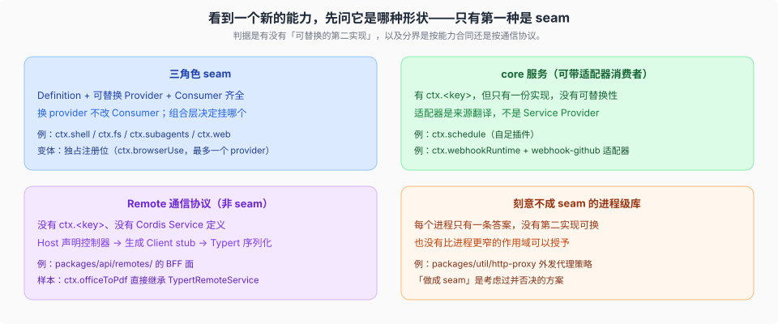

# Capability seams · 可替换能力

## 一句话

一条 **seam** 是一项可替换的**完整能力**，由三个角色共同构成：Service Definition、Service Provider、Consumer。换一个 Provider，整面产品跟着换实现，Consumer 一行不改——这是 DSH 把「能力」做成插件竞聘位的方式。

## 先看你熟悉的问题

在多数 agent harness 里，「跑一条命令」是这样的：bash 工具的实现里直接写着怎么 spawn 进程。想换执行后端——本地换成沙箱、沙箱换成远程机器——通常只有两条路：fork 一份工具实现，或者把「在哪执行」做成参数层层透传。前者让同一个能力长出两份会各自漂移的代码；后者让每个调用方都认识它本不该认识的部署细节。

DSH 的答案是第三条路：**能力本身是一个可替换单元**。工具只认识「执行一条命令」这项能力的合同；本地执行、沙箱执行、远程执行是同一份合同的三个实现，由启动组合决定挂哪一个。工具、UI、模型看到的 schema 全都不动。

这个可替换单元在 DSH 里叫 **seam**。本专题讲它怎么构成、怎么换、以及哪些能力**刻意不做成** seam。

## 读懂本专题需要的三个概念

DSH 的进程里运行着一棵 Cordis 插件树：对话循环、读写文件、跑命令、接模型、画 Web 界面，都是树上的插件。插件之间通过一个共享上下文 `ctx` 协作——一个插件把服务注册到 `ctx.<key>`，别的插件注入这个 key 来使用它。这棵树和它的运行时机制归 [`system-overview/`](../system-overview/00-map.md) 与 [`two-tree-runtime/`](../two-tree-runtime/00-map.md)；这里只需要记住：**`ctx.<key>` 是插件之间唯一可注入的能力接口**。插件之间还有第二条合同面——typed events 与 waterfall（事件合同，归 [`two-tree-runtime/framework/`](../two-tree-runtime/framework/00-map.md)）；seam 锚在 `ctx.<key>` 上，事件通道是另一类扩展点。

一条 seam 就是围绕一个 `ctx.<key>` 的三种分工：


| 角色 | 它是什么 | shell 家族的落点 |
|------|----------|----------|
| **Service Definition** | 声明 `ctx.<key>` 和词汇类型的 Cordis `Service`（抽象类或注册表，不是 TypeScript `interface`） | `dsh-shell` 的 `ShellExecutor` |
| **Service Provider** | 实现这份合同的一个包 | `dsh-bash-local` / `dsh-bash-sandbox` / `dsh-pwsh-local` |
| **Consumer** | 注入并使用服务的插件，常见是面向模型的 tool | `dsh-tool-bash` |

三条规则决定了 seam 的形状：

1. **Consumer 只依赖 Definition，绝不依赖具体 Provider。** 这是「换后端不改调用方」的全部原因。
2. **每个 isolate realm 内，一个 `ctx.<key>` 同一时刻只有一个 Definition 实现。** 同一 realm 里加载第二个同名服务按 Cordis 重复服务失败；换实现靠组合层换行，不是两个 executor 同时挂。**realm 是关键限定**：preset 的服务行可以 `isolate` 出独立实例域，同一 key 在父子 realm 各有一份。
3. **三角色齐全才叫 seam。** 单独一个角色只是其中一员；说某个包时用它的角色名，不用 seam 称呼它（[`docs/glossary.md`](../../docs/glossary.md) 的 `capability-seam` 条）。

一个包可以兼多个角色：`dsh-user-approval` 在同一包里承担 approval seam 的 Definition 与具体实现——「一次审批决定」的定义与实现是同一关注点。角色分包装，是因为它们会独立演化；合在一个包里，是因为它们就是同一件事。注意 `dsh-llm` **不是**合包样本：它的 Adapter 注册点就是注册表形态的 Definition 本身，Consumer（`agent-loop`、`compaction-basic`）在别的包。判断细节见 [`01-三角色与分包装.md`](./01-三角色与分包装.md)。

## 换实现时，什么不动

文件读写和进程执行共享**一个执行世界**。把本地 provider 换成远程 provider，换的是组合里的几行，不是工具源码：


这张图里有两种容易混淆的机制：

- **远程执行世界**：`fs-ssh` / `subprocess-ssh` / `sandbox-ssh` 三个 provider 共享一条 `ctx.ssh` 连接，把三个既有 seam 各自实现到远端主机。依赖 `ctx.fs` / `ctx.subprocess` 的 Consumer 随组合切换，不必为远程 fork 一份实现。
- **本地 confinement**：`ctx.sandbox` 在 spawn 前包装 argv，约束一次本地进程启动。它不迁移 `ctx.fs`，也不等于一套远程执行世界。

Consumer 面对的是 Definition，不是「我在哪台机器上」。机制见 [`09-ssh远程执行族.md`](./09-ssh远程执行族.md)；一次本地 bash 的完整链路见 [`02-一次bash从tool到sandbox.md`](./02-一次bash从tool到sandbox.md)。

subagent 是同一模式的另一个例子：一个接口后面，可以是进程内 child agent，也可以是经 ACP 或 JSON-RPC 驱动的独立进程，还可以是产品 CLI（Codex / Claude Code）的按需 bundle。见 [`03-subagent后台与产品provider.md`](./03-subagent后台与产品provider.md)。

## 不是每个能力都是 seam

看到一个新的 `ctx.<key>`，先问它是哪种形状。DSH 里至少有四种，只有第一种是 seam：



判定程序只有两问：

1. **这个能力有第二个可替换的实现吗？** 没有 → 它是 core 服务（连 `ctx.<key>` 都不设的，是刻意的进程级库）。
2. **它的分界按什么切？** 按通信协议（Host 声明控制器、Client 消费生成的 stub）→ Remote；按进程内能力合同 → seam。seam 有一个变体：**独占注册位**——Definition 只提供一个名字槽，同一部署最多一个 provider，provider 自带工具（`ctx.browserUse` / `ctx.computerUse`，见 [`10`](./10-新执行面与编排seam.md)）。

| 形状 | 判据 | 例子 | 机制页 |
|------|------|------|--------|
| **seam**（含独占注册位变体） | 三角色齐全：Definition + 可替换 Provider + Consumer | `ctx.shell`、`ctx.fs`、`ctx.subagents`；注册位：`ctx.browserUse` | [`01`](./01-三角色与分包装.md) |
| **core 服务**（可带适配器消费者） | 有 `ctx.<key>` 但只有一份实现；来源适配器不是 Provider | `ctx.schedule`、`ctx.ssh` 连接、`ctx.webhookRuntime` + GitHub 适配器 | [`04`](./04-新增seam与Remote.md) |
| **Remote 通信协议** | 按 wire 分界而非多 Provider 竞聘位：Host 侧服务继承 `TypertRemoteService`（占 `ctx.<key>`，如 `ctx.sessionController`、`ctx.goals`），Client 侧挂在 `ctx.remote.<ns>` 上 | `TypertRemoteService` + `packages/typert/` + `packages/api/remotes/` | [`04`](./04-新增seam与Remote.md) |
| **刻意的进程级库** | 连 `ctx` 键都不设：每进程一条答案，没有更窄的作用域可授予 | `packages/util/http-proxy/` | [`06`](./06-外发代理策略.md) |

「为什么这些能力刻意不成 seam」和「为什么这很重要」在 [`04-新增seam与Remote.md`](./04-新增seam与Remote.md) 展开；进程级外发代理是「刻意不成 seam 的库」的样本，见 [`06-外发代理策略.md`](./06-外发代理策略.md)。

## 阅读顺序

**教科书路径**（第一次读，顺着 shell 家族走一遍）：

```text
01 三角色与分包装        为什么是三个包，什么时候可以合
  → 02 一次 bash         从模型 JSON 到进程 argv 的完整链路与失败合同
  → 09 SSH 远程执行族    同一条 seam 怎么搬到另一台机器
```

**按问题找**：

| 你的问题 | 去哪 |
|----------|------|
| 角色什么时候必须分包装？新 `ctx.<key>` 怎么判定形状？ | [`01-三角色与分包装.md`](./01-三角色与分包装.md) |
| 一次 bash 经过哪些政策层？退出码 1 算不算 harness 崩溃？ | [`02-一次bash从tool到sandbox.md`](./02-一次bash从tool到sandbox.md) |
| 委派怎么执行、产品 provider 怎么挂、模型路由怎么解析？ | [`03-subagent后台与产品provider.md`](./03-subagent后台与产品provider.md) |
| schedule / webhook / Remote 为什么不是 seam？ | [`04-新增seam与Remote.md`](./04-新增seam与Remote.md) |
| 父会话怎么找回自己的孩子？宿主消息怎么送达？ | [`05-subagent-catalog与host交付.md`](./05-subagent-catalog与host交付.md) |
| 外发流量怎么走代理？哪些通道刻意直连？ | [`06-外发代理策略.md`](./06-外发代理策略.md) |
| 子进程怎么被保证终止？native 绑定做了什么？ | [`07-原生containment与native-system.md`](./07-原生containment与native-system.md) |
| 外部 MCP server 和 CC/Codex hooks 怎么接进来？ | [`08-外部生态桥：MCP与hooks.md`](./08-外部生态桥：MCP与hooks.md) |
| 远程执行世界怎么共享一条连接？ | [`09-ssh远程执行族.md`](./09-ssh远程执行族.md) |
| 浏览器/桌面控制、语音、账号、交付物等新面长什么样？ | [`10-新执行面与编排seam.md`](./10-新执行面与编排seam.md) |

## 本专题的承重不变量

1. **Consumer 只依赖 Definition，绝不依赖具体 Provider**——换后端不改调用方的原因（见上）。
2. **每个 isolate realm 内，一个 `ctx.<key>` 同一时刻只有一个实现**；换实现靠组合层换行（cross-realm 隔离见上）。
3. **三角色齐全才叫 seam**；判定程序见「不是每个能力都是 seam」。
4. **退出码 1 不是 harness 崩溃**：非零退出、超时、取消都 resolve 成结果，只有基础设施失败走 killed 结算（[`02`](./02-一次bash从tool到sandbox.md) 的失败表）。
5. **Definition 对着所有当前 Consumer 设计**；tool-schema、UI、传输放 Consumer 或 provider（[`01`](./01-三角色与分包装.md)）。

## 症状 → 页

| 你看到的现象 | 去哪 |
|---|---|
| 想换一个能力的后端（本地/沙箱/远程） | [`01`](./01-三角色与分包装.md) → [`09`](./09-ssh远程执行族.md) |
| 工具报退出码 1，分不清是不是崩了 | [`02`](./02-一次bash从tool到sandbox.md) 的失败表 |
| 委派出去的子代理收不到后续消息 | [`03`](./03-subagent后台与产品provider.md) |
| 外发流量没走代理 | [`06`](./06-外发代理策略.md) |
| 子进程杀不干净 | [`07`](./07-原生containment与native-system.md) |
| MCP 工具没出现 / hook 没触发 | [`08`](./08-外部生态桥：MCP与hooks.md) |

## 边界

- 模型可见的 tool 管道（注册、审批、timeout、chunk）归 [`tools-prompt-llm/`](../tools-prompt-llm/00-map.md)；本专题只讲能力合同与 provider。
- 组合怎么叠成活树、bundle/profile 怎么交付归 [`plugin-system/`](../plugin-system/00-map.md) 与 [`runtime-profiles/`](../runtime-profiles/00-map.md)。
- 委派原语的选择与用法归 [`delegation-and-orchestration/`](../delegation-and-orchestration/00-map.md)；本专题只讲 subagent 作为 seam 的合同面。
- 完整的包 / key / 实现 / 消费者图是生成的 [`docs/capability-seams.md`](../../docs/capability-seams.md)，本专题不手抄包表；组级 README 拥有「这个组有哪些包」。

## 源码入口

| 路径 | 角色 |
|------|------|
| [`docs/glossary.md`](../../docs/glossary.md) `capability-seam` | 术语合同 |
| [`docs/capability-seams.md`](../../docs/capability-seams.md) | 生成的包 / key / 实现 / 消费者图 |
| `packages/shell/` | 教科书范本家族 |
| `packages/fs/`、`packages/subprocess/`、`packages/sandbox/` | 执行世界的文件、进程与本地遏制能力 |
| `packages/ssh/` | 一条 `ctx.ssh` core 连接 + 三个既有 seam（fs / subprocess / sandbox）各自的远程 provider（opt-in） |
| `packages/subagent/` | 差异极大的 provider，同一接口 |
| `packages/interaction/user-approval/` | 一包兼 Definition 与 Provider 的样本（approval seam）；`packages/llm/` 是注册表形态 Definition 的样本 |
| `packages/util/http-proxy/` | 进程级外发代理策略（库，刻意不是 seam） |
| `native/system/` | Landlock launcher 与 POSIX flock 的原生绑定 |
| `packages/mcp/`、`packages/experimental/hook-protocol/` 等 | 外部生态桥 |
| `packages/api/remotes/`、`packages/typert/` | Remote 控制器与类型安全序列化（非传统 seam） |
| [`2026-06-13-capability-seams`](../../.agents/notes/implemented/architecture/2026-06-13-capability-seams.md) | 为什么这样切 |

> 承重词按 [`canon/GLOSSARY.md`](../canon/GLOSSARY.md) 的 DSH 原文用；本页自己的分类与指标不是 DSH 的词。
