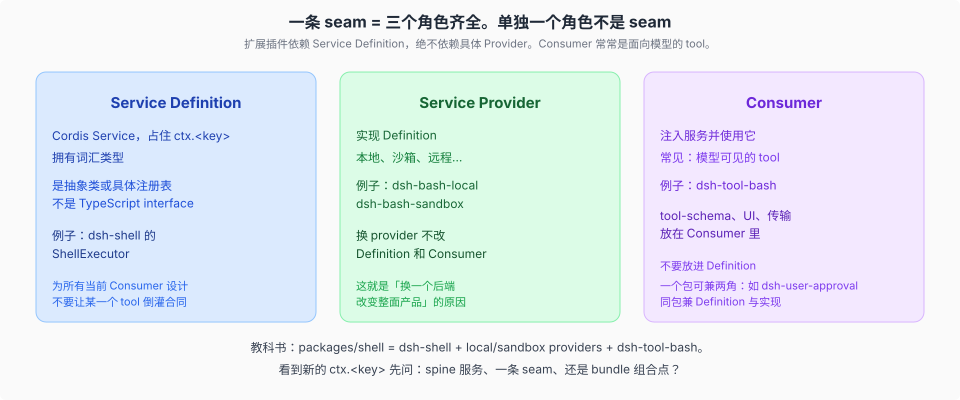
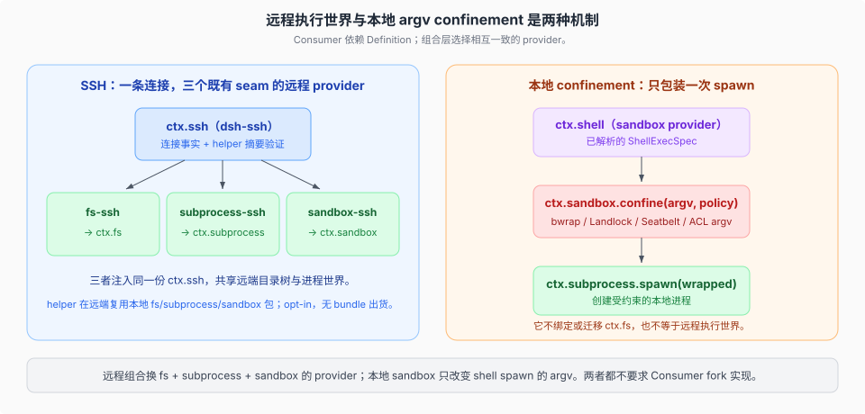

# Capability seams · 可替换能力

## 一句话

一条 **seam** 是一项可替换的**完整能力**，由三个角色共同构成：Service Definition、Service Provider、Consumer。换一个 Provider，整面产品跟着换实现，Consumer 一行不改——这是 DSH 把「能力」做成插件竞聘位的方式。

## 先看你熟悉的问题

在多数 agent harness 里，「跑一条命令」是这样的：bash 工具的实现里直接写着怎么 spawn 进程。想换执行后端——本地换成沙箱、沙箱换成远程机器——通常只有两条路：fork 一份工具实现，或者把「在哪执行」做成参数层层透传。前者让同一个能力长出两份会各自漂移的代码；后者让每个调用方都认识它本不该认识的部署细节。

DSH 的答案是第三条路：**能力本身是一个可替换单元**。工具只认识「执行一条命令」这项能力的合同；本地执行、沙箱执行、远程执行是同一份合同的三个实现，由启动组合决定挂哪一个。工具、UI、模型看到的 schema 全都不动。

这个可替换单元在 DSH 里叫 **seam**。本专题讲它怎么构成、怎么换、以及哪些能力**刻意不做成** seam。

## 读懂本专题需要的三个概念

DSH 的进程里运行着一棵 Cordis 插件树：对话循环、读写文件、跑命令、接模型、画 Web 界面，都是树上的插件。插件之间通过一个共享上下文 `ctx` 协作——一个插件把服务注册到 `ctx.<key>`，别的插件注入这个 key 来使用它。这棵树和它的运行时机制归 [`system-overview/`](../system-overview/00-map.md) 与 [`two-tree-runtime/`](../two-tree-runtime/00-map.md)；这里只需要记住：**`ctx.<key>` 是插件之间唯一可注入的能力接口**。插件之间还有第二条合同面——typed events 与 waterfall（事件合同，归 [`two-tree-runtime/framework/`](../two-tree-runtime/framework/00-map.md)）；seam 锚在 `ctx.<key>` 上，事件通道是另一类扩展点。

一条 seam 就是围绕一个 `ctx.<key>` 的三种分工：

| 角色 | 它是什么 | shell 家族的落点 |
|------|----------|----------|
| **Service Definition** | 声明 `ctx.<key>` 和词汇类型的 Cordis `Service`（抽象类或注册表，不是 TypeScript `interface`） | `dsh-shell` 的 `ShellExecutor` |
| **Service Provider** | 实现这份合同的一个包 | `dsh-bash-local` / `dsh-bash-sandbox` / `dsh-pwsh-local` |
| **Consumer** | 注入并使用服务的插件，常见是面向模型的 tool | `dsh-tool-bash` |

三条规则决定了 seam 的形状：

1. **Consumer 只依赖 Definition，绝不依赖具体 Provider。** 这是「换后端不改调用方」的全部原因。
2. **每个 isolate realm 内，一个 `ctx.<key>` 同一时刻只有一个 Definition 实现。** 同一 realm 里加载第二个同名服务按 Cordis 重复服务失败；换实现靠组合层换行，不是两个 executor 同时挂。**realm 是关键限定**：preset 的服务行可以 `isolate` 出独立实例域，同一 key 在父子 realm 各有一份。
3. **三角色齐全才叫 seam。** 单独一个角色只是其中一员；说某个包时用它的角色名，不用 seam 称呼它（[`docs/glossary.md`](../../docs/glossary.md) 的 `capability-seam` 条）。

一个包可以兼多个角色：`dsh-user-approval` 在同一包里承担 approval seam 的 Definition 与具体实现——「一次审批决定」的定义与实现是同一关注点。角色分包装，是因为它们会独立演化；合在一个包里，是因为它们就是同一件事。注意 `dsh-llm` **不是**合包样本：它的 Adapter 注册点就是注册表形态的 Definition 本身，Consumer（`agent-loop`、`compaction-basic`）在别的包。判断细节见 [`01-three-roles.md`](./core/01-three-roles.md)。

## 换实现时，什么不动

文件读写和进程执行共享**一个执行世界**。把本地 provider 换成远程 provider，换的是组合里的几行，不是工具源码：

这张图里有两种容易混淆的机制：

- **远程执行世界**：`fs-ssh` / `subprocess-ssh` / `sandbox-ssh` 三个 provider 共享一条 `ctx.ssh` 连接，把三个既有 seam 各自实现到远端主机。依赖 `ctx.fs` / `ctx.subprocess` 的 Consumer 随组合切换，不必为远程 fork 一份实现。
- **本地 confinement**：`ctx.sandbox` 在 spawn 前包装 argv，约束一次本地进程启动。它不迁移 `ctx.fs`，也不等于一套远程执行世界。

Consumer 面对的是 Definition，不是「我在哪台机器上」。机制见 [`03-ssh-execution.md`](./execution/03-ssh-execution.md)；一次本地 bash 的完整链路见 [`01-bash-execution.md`](./execution/01-bash-execution.md)。

subagent 是同一模式的另一个例子：一个接口后面，可以是进程内 child agent，也可以是经 ACP 或 JSON-RPC 驱动的独立进程，还可以是产品 CLI（Codex / Claude Code）的按需 bundle。见 [`01-subagent-provider.md`](./subagent/01-subagent-provider.md)。

## 不是每个能力都是 seam

看到一个新的 `ctx.<key>`，判定它是否属于 seam 以及其具体形状，请参照 [`../CONCEPT_INDEX.md`](../CONCEPT_INDEX.md)。

本专题只管 seam 形状（含独占注册位变体），其余核心服务、Remote 协议、进程级库的判据与例子，统一收口至 `CONCEPT_INDEX.md`。

## 阅读路径：从核心到实践

我们已将专题按架构功能分层，建议按照以下顺序消化：

### 1. 核心底座 (Core)
学习 `seam` 的设计哲学与基础合同。
* [`01-three-roles.md`](./core/01-three-roles.md)：为什么三角色是架构解耦的基石？
* [`02-new-seams-remote.md`](./core/02-new-seams-remote.md)：如何判定一个能力是否应成为 seam？

### 2. 执行实现域 (Execution)
深入理解能力如何在具体环境下落地。
* [`01-bash-execution.md`](./execution/01-bash-execution.md)：从调用到 sandbox 的五层防御。
* [`02-native-containment.md`](./execution/02-native-containment.md)：原生 containment 的底层防线。
* [`03-ssh-execution.md`](./execution/03-ssh-execution.md)：同一契约的远程实现。
* [`04-new-execution-surface.md`](./execution/04-new-execution-surface.md)：新扩展执行面探讨。

### 3. 委派与编排 (Subagent)
* [`01-subagent-provider.md`](./subagent/01-subagent-provider.md)：委派 seam 的合同面。
* [`02-subagent-catalog.md`](./subagent/02-subagent-catalog.md)：子代理的交付与编排。

### 4. 集成与扩展 (Integration)
* [`01-egress-proxy.md`](./integration/01-egress-proxy.md)：外部流量治理。
* [`02-external-ecosystem.md`](./integration/02-external-ecosystem.md)：MCP 与 Hooks 的桥接。

## 源码入口

| 路径 | 核心角色 |
|------|-----------|
| `packages/shell/` | 执行家族范本 |
| `packages/fs/` / `subprocess/` / `sandbox/` | 基础执行力 |
| `packages/ssh/` | 远程 provider |
| `packages/subagent/` | 委派 Seam |
| `packages/util/http-proxy/` | 进程级代理 (非 Seam) |

> 承重词按 [`canon/GLOSSARY.md`](../canon/GLOSSARY.md) 的 DSH 原文用；本页自己的分类与指标不是 DSH 的词。
