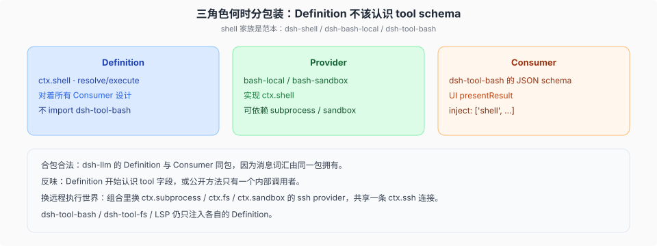

# 三角色、分包装、换执行世界

> 读完 [`00-map`](./00-map.md) 你已经知道 seam 是三个角色构成的完整能力。本篇回答两个设计问题：**角色什么时候必须分成不同的包**，以及**换执行世界时哪些 Consumer 可以一字不改**。一次 bash 的完整链路见 [`02`](./02-一次bash从tool到sandbox.md)，远程 provider 族见 [`09`](./09-ssh远程执行族.md)。

源码核验入口：`packages/shell/shell/src/index.ts` 的 `ShellExecutor`、[`docs/capability-seams.md`](../../docs/capability-seams.md)、[`2026-06-13-capability-seams`](../../.agents/notes/implemented/architecture/2026-06-13-capability-seams.md)。

## 为什么角色要分包装

分包装不是目录美学，是**演化速度不同**：换沙箱提供方不该重发 npm 上的 tool schema；改模型可见参数不该动 spawn 实现；给远程主机加一种连接方式不该碰任何工具。三个角色各自是一个发布单位，才能各自演化。

## 三个角色，一个 `ctx` key

以 shell 为范本：

| 角色 | 包 | 它认识什么 |
|------|----|------------|
| Definition | `dsh-shell` | `ctx.shell`：`resolve(request): ShellExecSpec` 与 `execute(spec): Promise<ShellExecution>` |
| Provider | `dsh-bash-local`、`dsh-bash-sandbox`、`dsh-pwsh-local` | 怎么变成进程；local 走 `ctx.subprocess` |
| Consumer | `dsh-tool-bash` | 模型 JSON schema、`presentResult`、审批文案 |

Definition 是 Cordis `Service` 抽象类，不是 TypeScript `interface`。加载第二个 `ctx.shell` 按 Cordis 重复服务失败。win32 层用 pwsh 行换掉 POSIX 行，不会两个 executor 同时挂。

`resolve(request): Spec` 是默认化的显式一步。`execute` 收 Spec，不收半填的 request。这是包边界「explicit > implicit」的模板：默认化是 owning implementation 里一个可指认的方法，不是藏在执行方法里的 `?? default`。

## 何时必须分包装

必须分开的味道：

- Definition 开始出现 tool 的 JSON 字段名、UI card 类型、ACP 映射。
- 一个公开服务方法只有一个内部调用者——那是私有闭包，不该抬成 `ctx` 合同。
- Consumer 为了「方便」把 schema 倒灌进 Definition，让第二个 Consumer 被迫认识第一个 tool 的参数。

可以合包：`dsh-user-approval` 在同一包里承担 approval seam 的 Service Definition 与具体实现（生成表 Provider 列为空，实现就在 Definition 包内）——定义与实现是同一关注点，拆开反而让审批合同有两个家。对照 `dsh-llm`：它拥有消息/流词汇与 Adapter 注册点，但**注册点就是注册表形态的 Definition，不是第二个角色**；它的 Consumer 是 loop 本身（`agent-loop` 与 `compaction-basic`，见生成表 direct consumers 列），在别的包。所以 llm 演示的是「Definition 可以是注册表」，不是「一包兼多角色」。

**设计 Definition 时对着所有当前 Consumer。** tool-schema、Loader、UI、传输、某个 provider 的癖好，放在 Consumer 或 provider 里。

看到新的 `ctx.<key>`，先用 [00-map 的判定程序](./00-map.md#不是每个能力都是-seam)定形状。`ctx.sessions` 这类支撑整机的核心服务是 core；`ctx.jobs` 有 Definition / 本地 provider / `job_*` tools，三角色齐全，是 seam；`ctx.agentLoop` 是默认驱动插件，连可替换后端都没有，不是「loop seam」。

## 换执行世界时，谁可以一字不改

文件系统和进程共享**一个执行世界**。现行样本是 ssh 组：`dsh-ssh` 拥有连接事实（`ctx.ssh`），`fs-ssh` / `subprocess-ssh` / `sandbox-ssh` 各自实现一个既有 seam 到远端，共享这条连接。

Consumer 只 inject Definition：

- `dsh-tool-bash` → `ctx.shell`（其 provider 再 inject `ctx.subprocess`）
- `dsh-tool-fs` → `ctx.fs`
- `dsh-tool-lsp` / PTY / terminal：跟着 subprocess + fs 走

把组合里的 local subprocess/fs 行换成 ssh 那几行（外加共享连接 owner），这些 tool 源码不用改。要改的是 **bundle / profile patch**，不是 Consumer。机制与启用条件见 [`09-ssh远程执行族.md`](./09-ssh远程执行族.md)。

两条边界值得记住：

- bash-local 的注释写明：执行政策属于 `tools/pre-execute` 或一个会 sandbox 的 executor 子类，不属于 local spawn 自己。
- 远程世界若还要 argv 包装，那是另一条 `ctx.sandbox` 的远程 provider；远程主机按它自己的 OS 选后端，不要假设本地 sandbox 插件在远程仍有同样的语义。

subagent 是同一模式：一个接口后面可以是进程内 child，也可以是经 ACP 或 JSON-RPC 驱动的独立进程。Consumer（`dsh-tool-subagent`）仍只看见 Definition。产品 Codex / Claude Code provider 由按需 bundle 交付（`ON_DEMAND_BUNDLES`，`packages/boot/app-boot/src/official-bundle-packages.ts`）：在 Plugins → Official 里按需装上、restart 后在 host 平面注册 dormant 默认 provider，并把委派工具注册成 Host 全局工具；执行生命期由受管 activation 接管，见 [`03-subagent后台与产品provider.md`](./03-subagent后台与产品provider.md)。
