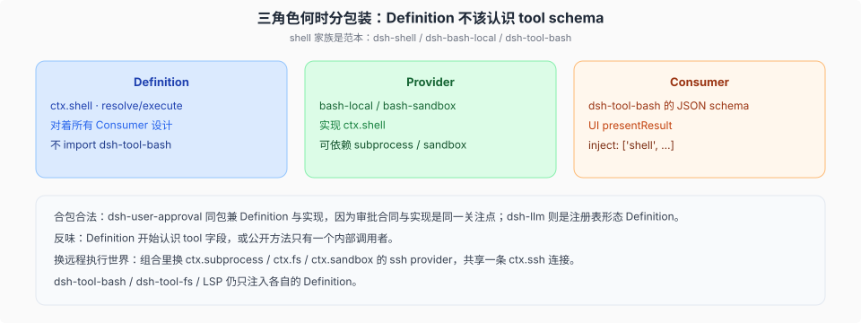

# 三角色、分包装、换执行世界

> **架构师视角**：对于插件系统的理解，最大的误区在于试图用“简单的目录结构”去映射“复杂的演化关系”。本篇揭示为什么 DSH 坚持“三角色拆分”，这是确保系统五年后依然可演进（Evolutionary）的基石。

## 为什么要分包装：演化速度的错位

分包装不是为了拆而拆，是因为它们**演化速度（Velocity）**完全不同：
- **Provider**（如沙箱执行）：常伴随底层系统变更，演化快。
- **Definition**（如 shell 合同）：属于 API 面，极度稳定，演化慢。
- **Consumer**（如工具 schema）：属于 UI/交互面，随产品需求频繁波动，演化最快。

**架构师的选择是：让演化速度对齐演化频率。** 如果合在一个包里，任何一处的改动都会引发无谓的 rebuild 和依赖风暴。

## 三角色运行模型

以 `shell` 为例，理解它们为何构成了一套精妙的竞聘机制：

| 角色 | 契约形态 | 职责 | 演化边界 |
|------|----|---|---|
| **Definition** | Cordis `Service` | 声明 `ctx.shell` 合同 | 纯粹的领域抽象，绝不依赖具体执行实现 |
| **Provider** | 实现类 | 实现怎么做（local vs ssh） | 封装执行细节（argv, spawn 等） |
| **Consumer** | Plugin 插件 | 消费 `ctx.shell` 实现任务 | 只与 `Definition` 打交道，不知 Provider 存在 |

### 架构精妙点：Definition 作为运行时 Anchor

Definition 不仅仅是 TypeScript `interface`，它是 Cordis 的 `Service` 注册锚点。这强制了在每一个 `realm` 内，`ctx.shell` 只有一个实现，从而在底层解决了“多个执行实现竞争”导致的状态不可预测。

## 判定：何时必须拆分？

这是架构治理中最容易产生腐烂的地方。判定标准只有一个：**你是否在 Definition 中注入了本不属于它的逻辑？**

*   **必须分拆的信号**:
    *   Definition 内部出现了 JSON schema 定义、UI card 的类型，或者 ACP 权限规则（这些都属于 Consumer）。
    *   某一个 Consumer 的私有调用方法，被迫写成了 `ctx` 的公开方法。
*   **可以合包的例外**:
    *   如 `dsh-user-approval`。它的定义和实现是完全耦合的关注点，定义它本身就是为了做这件事，不拆分反而能减少不必要的间接性。

**记住架构边界原则：Definition 必须对着“所有”当前 Consumer 设计。** 它不该是某个特定 Provider 的代言人。

---
> 承重词按 `canon/GLOSSARY.md` 的 DSH 原文用；本页自己的分类与指标不是 DSH 的词。
