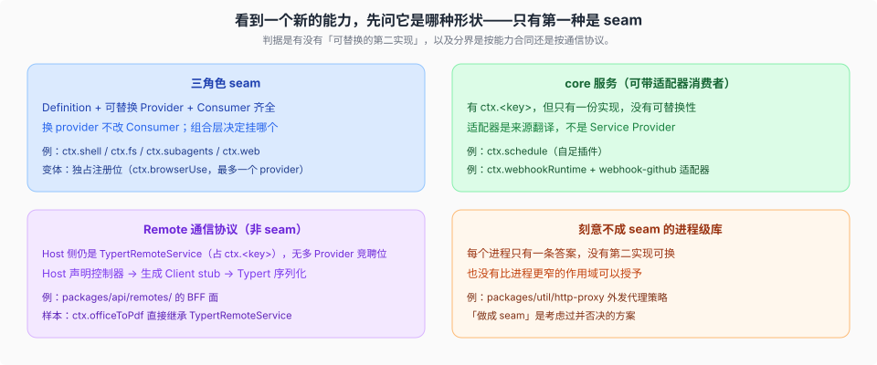

# 能力的四种形状：Seam 与其替代者

> **架构师视角**：不是所有能力都需要被设计为 Seam。引入 Seam 会带来额外的“解耦税（间接性与组合复杂性）”。在设计能力时，我们首先要问：这个能力具备“多实现竞聘”的场景吗？如果不需要，强行设计为 Seam 是架构上的**过度设计**。

## 架构诊断地图

只有当能力确实满足“Definition + 可替换 Provider + Consumer”三角色时，我们才采用 Seam 架构。其余情况应根据其特性选择正确的形状。

## 形状判定矩阵

| 能力形状 | 判据 | 适用场景 |
|---|---|---|
| **Seam** | 三角色齐全，具备可替换性 | 需要动态竞聘能力的系统核心（如 Shell, FS） |
| **Core 服务** | 具备 `ctx` 接口，但单实现 | 系统基础支撑，如提醒服务（Schedule） |
| **Remote 协议** | 按通信边界（wire）切分 | 跨越进程边界的服务调用（BFF 暴露模式） |
| **刻意库 (Utility)** | 连 `ctx` 接口都不需要 | 纯逻辑工具，如外发代理策略 (http-proxy) |

## 案例剖析：为什么它们不是 Seam？

### 1. Schedule：被拒绝的 Seam 候选人
`Schedule` 服务具备 `ctx.schedule` 接口，模型也可以通过工具调用它。但它**不是** Seam。
*   **判断**: 它没有可替换的 Provider 需求。一个部署环境下，提醒服务是确定性的。
*   **设计抉择**: 将其作为 Core 服务，同时将模型交互层（Tools）独立成包。**解耦逻辑而非替换后端**，这是它的架构选择。

### 2. Webhook：Core 服务 + 来源适配器
Webhook 机制涉及 `ctx.webhookRuntime`。它不是 Seam，是因为它没有一个“标准 Provider”来接受 Dispatch。
*   **判断**: `webhook-github` 等是 **来源适配器 (Consumer)**，它们不属于 Seam 范畴的 Provider。Dispatcher 是固定实现的 Core 服务。

### 3. API Remote：进程间通信（非类型内缝合）
API Remote (如 `ctx.sessionController`) 看起来像服务，但它是按**通信协议切分的**。
*   **判断**: 客户端拿到的不是服务本身，而是 `Typert` 自动生成的 stub。这实现了类型安全，但没有 Provider 的竞聘行为。这是分布式的边界。

---
> 承重词按 `canon/GLOSSARY.md` 的 DSH 原文用；本页自己的分类与指标不是 DSH 的词。
