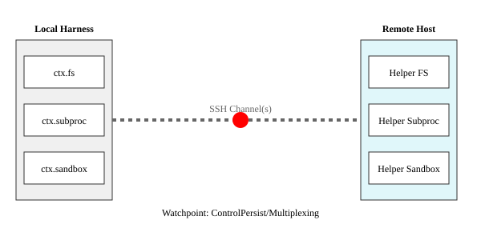

# SSH 远程执行族 (SSH Execution Family)

> [!IMPORTANT]
> SSH 族不发明任何新的「远程世界」私有键，而是给 **三个既有 seam** (`ctx.fs` / `ctx.subprocess` / `ctx.sandbox`) 各提供一个远程 provider，共享一条 SSH 连接。依赖这些 seam 的 Consumer 随 provider 组合切换到远程，tool 源码不改。

## 核心架构：共享连接事实

`dsh-ssh` (`ctx.ssh`) 不是「一个接口多个后端」，而是一份所有远程 provider 共用的**连接事实**。

### 连接与传输生命期 (Watchpoints)
*   **管理 RPC**：走 OpenSSH master 的 exec 流（`start()`）。
*   **程序流**：每条程序流（stdin/stdout/stderr/fd 7 控制流/终端）经 `connectStream()` 转发一条独立 Unix socket，建独立 SSH channel。
*   **安全性**：每流 256-bit TLS-PSK 双向认证，伪造不了管理应答。
*   **[Watchpoint] 如果连接不稳定**：检查 `SSH_PROTOCOL_VERSION = 2` 及 ControlPersist 设置。所有 channel 共享带宽，传输失败会导致 pending operation 全部置废。

## 三个执行面 (Seams)

| 面 | Provider | 职责 |
|---|---|---|
| `ctx.fs` | `SshFileSystem` | 远端文件操作，自动规范化路径。 |
| `ctx.subprocess` | `SshSubprocessRuntime` | 远端可执行命名空间查找，终端与 fd 7 控制。 |
| `ctx.sandbox` | `SshSandboxProvider` | 远端文件效果遏制，继承 OS 后端约束。 |

## 失败与合规语义

*   **不重放原则**：连接丢失后，所有 pending 操作置废 (`fail`)。**从不自动重连、从不重放**可能已执行的启动或变更。客户端如实报告「远端结果未知」。
*   **合规性**：helper 本体（随包发布，`helper-entry.ts`）在远端起最小 Cordis 组合。写入路径与 `confine` 逐调用 policy 规范化。
*   **[Watchpoint] 失败调试**：若 `watch()` 拒绝，检查 `FS_IO_ERROR` 映射；若 `sandbox` 拒绝，检查远端主机是否缺少对应后端安装。

## 源码入口与核验

| 路径 | 角色 |
|---|---|
| `packages/ssh/ssh/src/index.ts` | `SshConnection`：生命期、RPC、流、心跳 |
| `packages/ssh/ssh/src/helper.ts` | 远端 Helper 最小组合配置 |
| `packages/ssh/fs-ssh/src/index.ts` | `ctx.fs` 远程 Provider 实现 |
| `packages/ssh/subprocess-ssh/src/index.ts` | `ctx.subprocess` 远程 Provider 实现 |
| `packages/ssh/sandbox-ssh/src/index.ts` | `ctx.sandbox` 远程 Provider 实现 |

> [!NOTE]
> 上游决策记录于 [`2026-09-11-posix-ssh-runtime.md`](../../../.agents/notes/implemented/architecture/2026-09-11-posix-ssh-runtime.md)。
