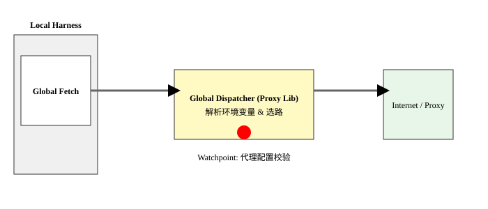

# 外发代理策略：进程级策略

> [!NOTE]
> 传输策略每个进程只有一条答案，**它刻意不成 seam**。DSH 将其实现为一个进程级库，没有第二种实现可换，也没有比进程更窄的作用域。

## 核心语义：全局 Dispatcher

`util/http-proxy` 在进程启动时（`apps/cli/src/profile-boot.ts`）解析环境并安装一个全局 dispatcher。

### 安装与解析逻辑 (Watchpoints)
*   **安装点**：仅在 `runProfile` 内、首个插件挂载前。 shutdown 时自动还原。
*   **配置来源**：launcher 环境快照（而非 `process.env`），确保 `$DSH_HOME/.env` 能生效。
*   **[Watchpoint] 代理不生效**：核查是否使用了 `ALLOW_MARKER = 'proxy-exempt:'` 强制覆盖了 dispatcher，或者环境变量解析后被跳过。

## 策略覆盖范围

*   **全局覆盖**：所有走到 `globalThis.fetch` 的请求（模型、web search、MCP over HTTP）自动继承代理配置。
*   **刻意排除通道**：
    *   **OTLP 遥测**：走 `node:http`，保持直连以防传输协议冲突。
    *   **子进程/Workers**：根据需要显式叠加或清理代理变量 (`proxyEnvironmentForChild`)。workflow/PTC worker 拿不到凭证，强制直连。
    *   **Web pinning**：`web-fetch-http` 的 pinning 路径必须显式跳过 dispatcher (`proxy-exempt:`)。

## 源码与 AST 门禁

| 路径 | 角色 |
|---|---|
| `packages/util/http-proxy/src/install.ts` | 全局 dispatcher 安装与分派 |
| `packages/util/http-proxy/src/policy.ts` | 代理变量解析与路由匹配 |
| `scripts/verify-no-bare-dispatcher.ts` | AST 门禁：防止未经允许的直接覆盖 |

> [!IMPORTANT]
> 任何显式构造 dispatcher 或给 `fetch` 传 `dispatcher` 的行为，必须携带 `proxy-exempt:` 注解，否则将触发 AST 门禁拒绝。
