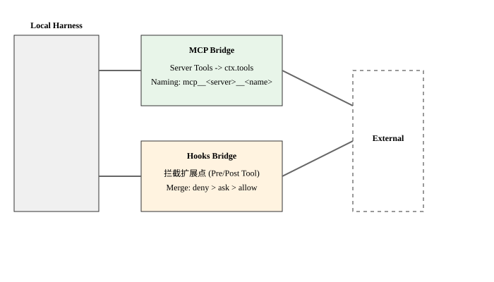

# 外部生态桥：MCP 与 Hooks

> [!IMPORTANT]
> 外部生态桥的核心语义是 **「翻译 + 注册」**。MCP 桥将外部 Tool 定义转化为 DSH `ctx.tools` 格式；Hooks 桥将 Claude Code/Codex 拦截方言转化为 DSH 工具执行流水线中的扩展点。两者均默认不启用。

## 核心架构

### 1. MCP 桥：工具注入
*   **命名空间**：公开名为 `mcp__<serverName>__<rawName>`。避免冲突时追加 12 位 SHA-256 哈希。
*   **同步机制**：两阶段 sync (抓取 -> 注销上一代 -> 注册新代)。所有操作都在 `ctx.effect()` 作用域内，确保连接断开时清理。
*   **[Watchpoint] 工具不见了**：检查 `cordis.yml` 的 server 配置，核验 serverName 是否匹配 `SERVER_NAME_PATTERN`。

### 2. Hooks 桥：决策拦截
*   **执行流**：挂载在 `tools/pre-execute` 瀑布上。
*   **合并语义**：权限优先级为 `deny > ask > allow`，首个 `continue: false` 结果触发 sticky stop。
*   **[Watchpoint] 拦截未生效**：检查 `hook-protocol` 是否正确配置 matcher mode（literal vs regex）。

## 日志与事件语义

*   `hook/invoked` / `hook/result` 为 **Log-only** 事件，持久化保存但不向模型可见。
*   决策通过桥透传给 `tools/pre-execute` 瀑布，由 registry 在 `guard` 之前物化为 `deny`/`ask` 响应。

## 源码入口与核验

| 路径 | 角色 |
|---|---|
| `packages/mcp/mcp-client/src/tools.ts` | MCP 工具命名映射与注册 |
| `packages/mcp/mcp-client/src/connection.ts` | 连接生命期、重连与工具热替换 |
| `packages/experimental/hook-protocol/src/merge.ts` | 拦截决策优先级合并 |
| `packages/experimental/hook-protocol/src/events.ts` | Hook 日志事件追加 |
| `packages/core/tools/src/index.ts` | `tools/pre-execute` 瀑布物化决策点 |

> [!NOTE]
> ACP 客户端有动态激活 MCP 的路径，详见 `packages/acp/acp/src/mcp.ts`。所有插件默认不启用，需显式声明。
