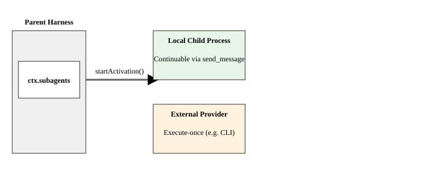

# Subagent 受管 Activation 与产品 Provider

> [!IMPORTANT]
> 委派也是一条 seam：`dsh-tool-subagent` 只认识 `ctx.subagents` 这份合同。无论后端是进程内 child、fork 会话、ACP/JSON-RPC 驱动的进程，还是产品 CLI（Codex / Claude Code），对 Consumer 而言，其激活、控制与终止语义是统一的。

## 核心语义：受管 Activation

每次委派都调用 `ctx.subagents.startActivation`，成功后立即返回子代理的 `subagentId`。

### 委派路径分类 (Watchpoints)
*   **本地 child (spawn/fork)**：具有 `prepareContinuable` 合同，支持通过 `send_message` 继续对话（steer 它最近的 step 或开启新 turn）。
*   **外部 provider**：一次性执行，完成通知带最终答案，不收后续消息。
*   **[Watchpoint] 委派失败**：如果 `maxDepth` 限制未满足，或者无法 `prepareContinuable` 却尝试 `send_message`，会触发对应的 Provider 拒绝。

## 产品 Provider 挂载与解耦

产品 Provider（如 Codex / Claude Code）按 on-demand bundle 交付 (`ON_DEMAND_BUNDLES`)，不直接进入 Agent 核心。

*   **挂载逻辑**：插件安装后，在 host 平面注册一个 dormant 默认 provider，仅在需要时由 Bundle 动态激活。
*   **工具行**：安装 Bundle 后注册 Host 全局工具 (`tool-subagent-codex` / `tool-subagent-claude-code`)，工具仅决定「该 Agent 是否能发起该工具调用」，不负责 Provider 的加载、认证或配置。
*   **[Watchpoint] 安装/部署**：不要尝试把产品 Provider 插进每个 Agent 的 isolate realm。检查是否正确通过 `pnpm dsh` 挂载了所需的官方插件。

## 模型路由与 SDK

`SubagentProvider` 通过 `agentRouteDefaults` 配置默认路由，配合 `subagent-dsh-sdk` (`deepseek-official` 等) 明确模型预设。

> [!NOTE]
> 解析路径为：逐调用 `agentOptions` 白名单 + `preflightChildLlmRoute`。**不继承父 Agent 的路由上下文**。

## 源码入口与核验

| 路径 | 角色 |
|---|---|
| `packages/subagent/subagent/src/types.ts` | 子代理合同、`prepareContinuable` 定义 |
| `packages/subagent/tool-subagent/src/index.ts` | 委派启动逻辑、`startActivation` 实现 |
| `packages/subagent/subagent/src/index.ts` | `sendMessage` (相邻 Agent 消息入口) |
| `packages/subagent/subagent-dsh-sdk/src/index.ts` | DSH SDK 模型路由解析 |

> [!NOTE]
> 更多有关 Subagent 目录枚举与 Host 交互的详情，见 [`05-subagent-catalog与host交付.md`](./05-subagent-catalog与host交付.md)。
