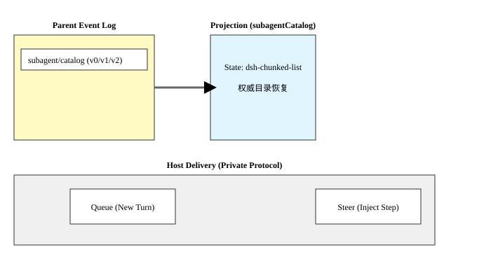

# Subagent 目录与宿主消息交付

> [!IMPORTANT]
> **事件即权威。** 父 Session 的 `subagent/catalog` 事件是持久权威。目录投影负责「父如何枚举与恢复自己的 Direct Child」。宿主交付（Queue / Steer）与模型侧的 `send_message` (单一 Steer) 分开。

## 核心架构：事件即权威

`subagent/catalog` 事件仅在成功创建时写入，payload 包含 `childId`、`mode` (v0/v1/v2) 等信息。

### 目录投影 (Watchpoints)
*   **Projection (`subagentCatalog`)**：委托给 `dsh-chunked-list` (64 项/块)，保持父目录事件顺序。
*   **Fork 隔离**：投影初始化时通过 `Session.inheritedEventCount` fold 忽略继承段，确保子 Session 的目录事实不与父级混淆。
*   **[Watchpoint] 投影恢复失败**：若目录事件格式不合 schema，或 payload 版本不支持，会导致 projection 恢复失败，返回不完整的目录。

## 宿主消息交付：Queue vs Steer

宿主侧交付语义由 `SubagentDelivery` 定义，与模型工具行为解耦：

*   **Queue**：排成 child 的一个独立 turn (`agent.followup()`)。
*   **Steer**：插到 child 最近的 step (`agent.steer()`)。

> [!NOTE]
> 宿主协议走私有 symbol (`dsh.subagent.deliverPrompt`)，保证 Host Adapter 身份。模型侧的 `send_message` 工具始终是 **Steer** 语义，不随 Host 通道扩展。

## 源码入口与核验

| 路径 | 角色 |
|---|---|
| `packages/subagent/subagent/src/catalog.ts` | `subagent/catalog` 事件定义与投影实现 |
| `packages/subagent/subagent/src/manager.ts` | Activation 物化与目录写入 |
| `packages/subagent/subagent/src/internal.ts` | 宿主 Queue/Steer 私有协议实现 |

> [!NOTE]
> 目录决策原文：[`2026-09-01-parent-owned-subagent-catalog`](../../.agents/notes/implemented/architecture/2026-09-01-parent-owned-subagent-catalog.md)。
