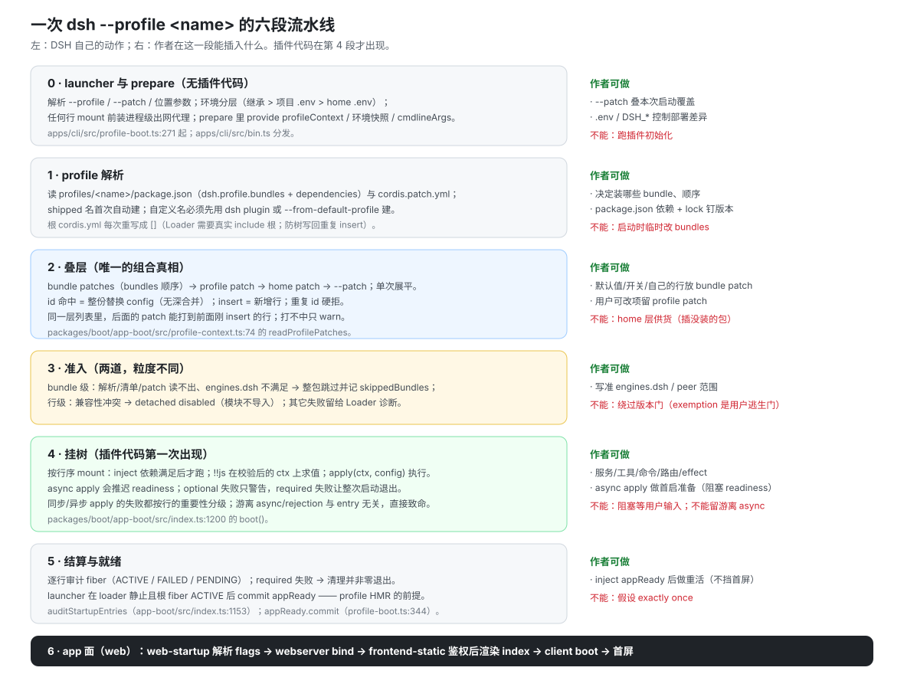
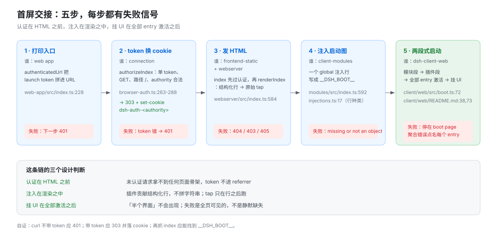
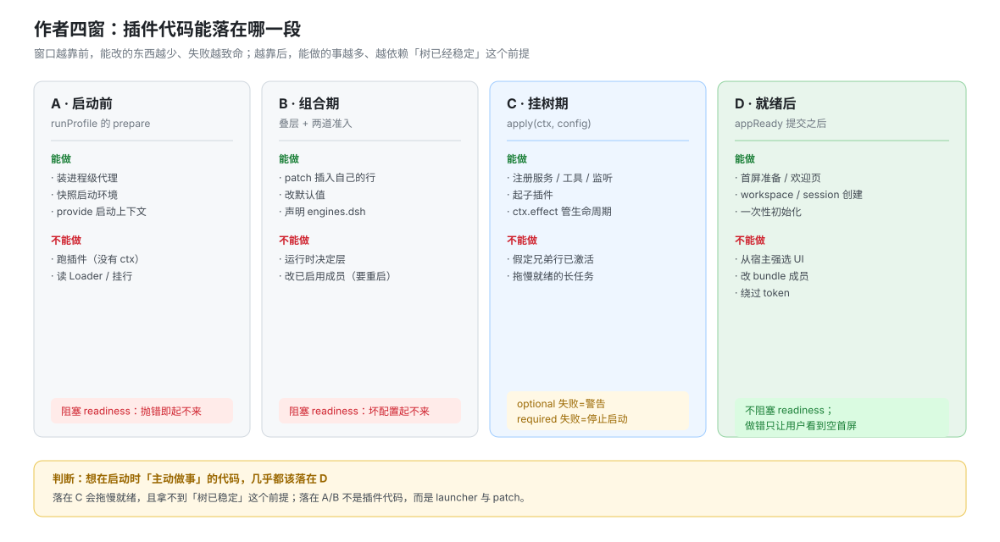

# 启动窗口与首屏交接

产品源码基线：`b830ec950faba0a46dda564be3e2d854afed94f1`（`dsh-v0.2.1-rc.5`）。本篇锚点逐条打印核验。

## 一句话

一次 `dsh --profile <name>` 是六段固定流水线：**launcher 准备 → profile 解析 → 叠层 → 准入 → 挂树 → 结算与就绪**，之后才由 app 面接管首屏。插件代码从第 5 段才出现，所以「启动时做点什么」不是找钩子，而是**认准自己落在哪一段**：每段能做的事不同，做错位置的代码不会报错，只会被静默丢弃或让整棵树起不来。

## 六段流水线



| 段 | 谁执行 | 产物 | 插件在这段能做什么 |
|---|---|---|---|
| 1 launcher 准备 | `runProfile` | 进程环境、代理、profile 目录、根配置 | 不能。此时还没有 `ctx` |
| 2 profile 解析 | `loadProfile` / `loadProfileDirectory` | 有序 bundle 列表 + 层文件路径 | 不能，但**你的 bundle 名在这一段被解析** |
| 3 叠层 | `composeEntries` → `applyEntryPatches` | 一份展平的 entry 列表 | 只能通过 patch 文件参与：插入行、改默认值 |
| 4 准入 | bundle 级 + 行级 | 被跳过的 bundle、被 detached 的行 | 不能，但你的 `engines.dsh` 在这一段决定生死 |
| 5 挂树 | Loader + fiber | `ctx` 服务、监听器、子插件 | **能**：`apply` 从这里开始运行 |
| 6 结算与就绪 | `auditStartupEntries` → `appReady` | 失败诊断、就绪信号 | **能**：在 `appReady` 之后做首屏/会话/workspace |

两个入口函数：`runProfile`（`apps/cli/src/profile-boot.ts:271`）与 `boot`（`packages/boot/app-boot/src/index.ts:1200`）。前者管第 1–3 段与进程生命周期，后者管第 4–6 段。

## 叠层的三个硬事实

1. **根配置文件每次启动都被重写成空列表。** `profile-boot.ts:81` 的 `PROFILE_ROOT_CONFIG` 在 `:198` 与 `:231` 两次写盘——因为 Loader 会把组合好的行写回这个文件，不清空就会在下次启动时重复 insert。
2. **层序固定，且只展平一次**：bundle patches（按 `dsh.profile.bundles` 顺序）→ profile patch → home patch → `--patch`。后层压前层。
3. **`insert` 加行，裸 `id` 是 override target**。打不中目标的 patch 只 warn，bundle 仍在 roster 里——「装了但没生效」最常见的成因。

## 两道准入与挂树失败

这两段的机制正文在 [`04-启动.md`](../plugin-lifecycle/04-启动.md)，这里只记对「窗口」的影响：

- **bundle 级失败 = 整包跳过**，选择不变，记入 `skippedBundles`。作者看不到自己的行，也不会有运行时错误。
- **行级只有兼容冲突才被拒**（`packages/boot/app-boot/src/compatibility-preflight.ts:180`），其它失败留给 Loader 诊断（`:100`）。
- **optional 行失败只是警告，required 行失败停止启动**；`apply()` 返回 Promise 之外的游离异步是**致命**，与 entry id 无关。

## 就绪：`appReady` 是分界线

`appReady` 由 launcher 经 `provideCmdline({ ready })` 提供（`packages/boot/cmdline/src/index.ts:88`），`runProfile` 在根 fiber `ACTIVE` 且 loader 在场时提交。它是两件事的门槛：

- HMR 拿不到它就抛 `Profile HMR requires application readiness`，不挂 watcher（`packages/boot/hmr/src/index.ts:369`）。
- app 面（如首屏、欢迎页）把它当作「树已经稳定」的信号。

**它不保证任何具体 optional 行已激活**——只保证结算已经做完。

## 首屏交接：五步，每步都有失败信号



| 步 | 谁做 | 机制 | 失败信号 |
|---|---|---|---|
| 1 打印入口 | web app | `authenticatedUrl` 把 launch token 拼进 URL（`packages/bundle/web-app/src/index.ts:228`） | 没有 token 的请求下面一步就 401 |
| 2 token 换 cookie | `connection` 的 `authorizeIndex` | 单 token、GET、路径 `/`、authority 合法 → **303 + `set-cookie: dsh-auth-<authority>`**（`packages/client/connection/src/browser-auth.ts:263`–`:288`） | token 错/多值 → 401（`:305`） |
| 3 发 HTML | `frontend-static` + `webserver` | index 响应**先过 `connection` 认证**，再走 `renderIndex`：先渲染结构化注入行，再跑原始 tap（`packages/host/webserver/src/index.ts:584`） | 缺路径 404、越界 403、非 GET/HEAD 405 |
| 4 注入启动图 | `client-modules` | 一个 `global` 注入行把 entry 图写成 `globalThis.__DSH_BOOT__`（`packages/client/modules/src/index.ts:592`；行种类见 `packages/host/webserver/src/injections.ts:17`） | client 侧直接报 `window.__DSH_BOOT__ is missing or not an object` |
| 5 client 两段式启动 | `dsh-client-web` | 模块段 → 插件段 → **每个 entry 激活后**才把 DOM 交给 UI 渲染器（`packages/client/web/src/boot.ts:72`、`README.md:38`、`:73`） | 任一 entry 导入失败或停在非活跃态 → 聚合错误，**整页停在 boot page** |

这条链的设计判断值得记住：**认证在 HTML 之前**，所以未认证请求拿不到任何页面骨架；**注入在渲染之中**，所以插件贡献的是结构化行而不是字符串拼接；**挂 UI 在全部 entry 激活之后**，所以「半个界面」不会出现——失败是全页可见的，不是静默缺失。

## 四个窗口：作者真正能插入的地方



| 窗口 | 位置 | 能做 | 不能做 | 阻塞 readiness？ |
|---|---|---|---|---|
| **A 启动前** | `runProfile` 的 `prepare` | 装代理、快照环境、provide 启动上下文（`profileContext`、命令行） | 跑插件；读 Loader | 是（抛错即起不来） |
| **B 组合期** | 叠层与准入 | 用 patch 插入自己的行、改默认值、声明 `engines.dsh` | 改变已启用成员（要重启）；在运行时决定层 | 是（坏配置起不来） |
| **C 挂树期** | `apply(ctx, config)` | 注册服务/工具/监听、起子插件、`ctx.effect` 管生命周期 | 假定兄弟 optional 行已激活（顺序由 `inject` 决定，不是数组下标） | 否（optional 警告）/ 是（required） |
| **D 就绪后** | `appReady` 之后 | 首屏准备、workspace/session、一次性初始化 | 从宿主强选 UI；改 bundle 成员；绕过 token | 否，但做错会让用户看到空首屏 |

窗口 C 与 D 的分界是**本页最实用的一条**：想在启动时「主动做事」的代码几乎都该落在 D，因为落在 C 会拖慢就绪，而且拿不到「树已经稳定」这个前提。

## 硬限制（附失败信号）

| 想做的事 | 为什么不行 | 你会看到什么 |
|---|---|---|
| 在 launcher 里跑插件逻辑 | 那时没有 `ctx`，树还没挂 | 代码根本不执行，或 `ctx` 为 undefined |
| 用 home patch 给没装的包供行 | home 层能覆盖、不能供货 | `warning: N entry did not activate` + `ERR_MODULE_NOT_FOUND`，服务照常起 |
| 绕过 token 直接访问 | 认证在 HTML 之前 | 401；或 303 后没有 cookie，页面白屏 |
| 从宿主强选 UI 上的 session | 选中在 Client，Host 只 create/attach | 建了 session，界面仍是旧的那个 |
| 改 bundle 成员后期待即时生效 | membership 变化不进 HMR 队列 | 重启前一直是旧组合 |

## 自证配方

```sh
# 1. 只看层，不启动
dsh --profile <name> --dump-config | sed -n '/== /p'

# 2. 真启动，看 stderr 有没有失活与跳过
DSH_HOME=$(mktemp -d) dsh --profile <name> --no-open --port 0 2>&1 | head -40

# 3. 首屏链：未带 token 应 401；带 token 应 303 并落 cookie
curl -s -o /dev/null -w '%{http_code}\n' http://127.0.0.1:<port>/
curl -s -D - -o /dev/null 'http://127.0.0.1:<port>/?token=<token>' | head -12

# 4. 注入是否到达：抓 index，找 __DSH_BOOT__
curl -s -b '<cookie>' http://127.0.0.1:<port>/ | grep -o '__DSH_BOOT__' | head -1
```

失败先看哪里：**层对不对看 dump；行活没活看 stderr；首屏看 401/303/注入标记**。三者顺序固定，别跳步。

## 本页的边界

层序与 patch 算法归 [`00-map.md`](./00-map.md) 与 [`03-user-patch-hmr.md`](./03-user-patch-hmr.md)；准入与失败矩阵归 [`../plugin-lifecycle/04-启动.md`](../plugin-lifecycle/04-启动.md)；首启与产品初始化归 [`../plugin-lifecycle/08-首启与产品初始化.md`](../plugin-lifecycle/08-首启与产品初始化.md)。本页只回答「什么时候能做什么」。
