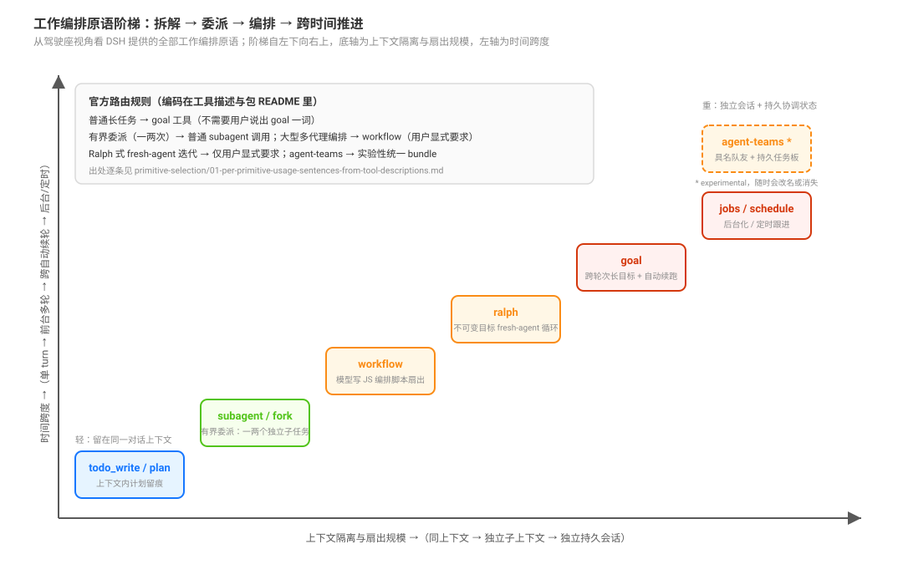

# Delegation and Orchestration · 委派与编排

## 一句话

本组回答一个家族问题：**DSH 给了哪些把工作拆解、委派、编排、推进到完成的原语；它们各自的保证怎么组合成一条链；在 DSH 上搭这套面的插件作者该怎么做。**

外部叙事常把 DSH 描绘成「Captain 规划 + Kahn 入度队列 + Reviewer 门禁」的中心化 Task DAG 调度引擎。当前源码没有一个按 ready 队列自动派工的中心 executor；实际系统由可组合原语、workflow 局部控制流、Teams 任务图准入、Host schedule 和 JobRegistry 等多个机制组成。模型按任务的时间跨度与隔离需求选择原语，工具描述与包 README 携带各自的选择边界（证据见 [`selection/01`](./primitive-selection/01-per-primitive-usage-sentences-from-tool-descriptions.md)）。

## 三类读者，别坐混

本组同时服务三类读者，但页面按座位/用途分开：

| 读者 | 问题 | 入口 |
|---|---|---|
| **驾驶座**（用现成原语干活） | 这个任务该用哪个原语？它保证什么、隔离什么？ | [`primitives/`](./delegation-primitives/00-map.md)、[`selection/`](./primitive-selection/00-map.md) |
| **作者座**（写插件 / 组 preset / 交付一条链） | 能力面怎么组合出来？怎么收窄？合同放哪？失败谁重试？怎么观测？ | [`composition/`](./preset-composition-and-contract-placement/00-map.md)、[`observation/`](./completion-and-observation/00-map.md) |
| **复核者**（同步 pin / 审一条结论） | 这条断言的源码锚在哪？它会怎么漂？ | 每页末尾的「源码入口」，以及本页[可审查性清单](#可审查性清单) |

作者座是本组与「驾驶座机制地图」的分界：`primitives/` 与 `selection/` 回答**引擎怎么样**；`composition/` 与 `observation/` 回答**你在它上面搭的东西会怎么坏、怎么证明**；复核者没有专属页面，走每页末尾的源码入口复核前两者的结论。

## 阶梯总表

| 原语 | 包 | 一句话语义 | 上下文隔离 | 时间跨度 |
|------|----|-----------|-----------|---------|
| `todo_write` | `packages/todo/tool-todo/` | 上下文内计划留痕：多步工作列清单，琐碎单步跳过 | 同上下文 | 单 turn |
| plan mode | `packages/plan/plan-mode/` | 计划先行：先出方案、用户批准后执行 | 同上下文 | 单 turn |
| `subagent` / `subagent_fork` | `packages/subagent/tool-subagent/` | 有界委派：一两个自包含任务交给独立子代理 | 独立子上下文 | 一次性（one-shot / continuable） |
| `workflow` | `packages/workflow/tool-workflow/` | 模型写 JS 编排脚本扇出子代理（`agent`/`pipeline`/`parallel`/`phase`） | 沙箱 PTC 进程 | 前台等待 / 后台 job |
| `ralph` | `packages/experimental/tool-ralph/` | 不可变目标的 fresh-agent 前台循环，轮间只传有界报告 | 每轮全新子代理 | 前台多轮 |
| `goal`（`create_goal`/`update_goal`/`get_goal`） | `packages/goal/tool-goal/` | 跨轮次长目标 + idle 自动续跑（Goal Round Driver） | 同会话跨轮 | 跨自动续轮 |
| `jobs`（后台化 + `job_output`/`job_kill`/`job_list`） | `packages/jobs/tool-jobs/` | 任意工作后台化，随时收结果、可取消 | 后台 job | 异步 |
| schedule | `packages/schedule/schedule/` + `packages/schedule/tool-schedule/` | 定时跟进（直接进 Web 组合） | — | 定时触发 |
| agent-teams * | `packages/experimental/agent-team/` 服务；`packages/experimental/tool-agent-team/` 工具；`packages/experimental/agent-team-profile/` 组合；`packages/experimental/client-ui-agent-team/` UI | Lead + 具名队友 + 持久消息 + 共享任务板 | 独立持久会话 | 持续协作 |

\* experimental：无稳定合同承诺，随时可能改名或消失。

原语的统一比较轴（执行者、记忆、推进者、完成证据）见 [`primitives/00-map`](./delegation-primitives/00-map.md) 的维度矩阵；每个原语的机制、失败面与源码入口在对应页。

## 默认挂载状态

每一级在 shipped 组合里是开箱即用还是要显式打开，全部落在 base bundle 与 optional bundle 清单里；逐项表、出处与“为什么不在 base”见 [`primitives/07`](./delegation-primitives/07-shipped-mount-state.md)。

## 症状 → 页

遇到现象时先查这里，比按目录顺序读快。

| 你看到的现象 | 最可能的机制页 |
|---|---|
| 给了 `agentPreset` 但子代理没变 / 子代理拿到父的全部工具 | [`composition/01`](./preset-composition-and-contract-placement/01-channel-capability-differences-and-inheritance.md) |
| 第三层被拒 / 不知道预算写在哪一行 | [`composition/06`](./preset-composition-and-contract-placement/06-depth-concurrency-and-capacity-limits.md) |
| 合同写进 skill/文档但模型不照做 / skill 被裁半截 | [`composition/04`](./preset-composition-and-contract-placement/04-contract-placement-between-policy-and-engine.md) |
| 改了 preset，跑着的 Agent 没变 | [`composition/02`](./preset-composition-and-contract-placement/02-preset-composition-as-a-static-self-contained-model.md) |
| 父会话看不到整条链 / 想画流程图 | [`observation/05`](./completion-and-observation/05-delegation-graph-node-and-edge-projection.md) |
| 子代理失败，犹豫要不要重试 | [`observation/02`](./completion-and-observation/02-terminal-states-and-bounded-retry-authority.md) |
| 挂载绿了但行为不对 / 想证明模型会选 | [`observation/07`](./completion-and-observation/07-evidence-layers-declaration-mount-mechanism-behaviour.md) |
| 某个节点状态是空的，不知道算不算失败 | [`observation/05`](./completion-and-observation/05-delegation-graph-node-and-edge-projection.md) 的三个缺口词 |
| team 会话里全局 subagent 控制面被替换 / 根会话的控制名让位 | [`primitives/06`](./delegation-primitives/06-persistent-teams-with-a-shared-task-board.md) |
| workflow 分支返回 `null` | [`observation/06`](./completion-and-observation/06-workflow-reproducibility-cancellation-and-missing-results.md)、[`observation/02`](./completion-and-observation/02-terminal-states-and-bounded-retry-authority.md) |

## 组内不变量

这些话在本组每页都成立，重复出现是为了让单页也能独立读：

1. **策略随工具走**：使用边界住在工具的 description 与 prompt section 里，不在部署 persona 里；docs 不会被自动注入（[`perspectives/03`](./design-perspectives/03-why-primitives-instead-of-a-central-scheduler.md)）。
2. **深度是绝对量**：child 深度 = parent 深度 + 1，持久 header 是单调 floor；`maxDepth` 是上限，不是预算分配（[`composition/06`](./preset-composition-and-contract-placement/06-depth-concurrency-and-capacity-limits.md)）。
3. **shipped 里只有 in-process spawn 能钉独立 preset**：fork / workflow / team / 外部 provider 从父组合克隆，能力面不可按子代收窄（[`composition/01`](./preset-composition-and-contract-placement/01-channel-capability-differences-and-inheritance.md)）。
4. **引擎不自动重试**：终态是模型可见的结果，重试是父代理的有界策略（[`observation/02`](./completion-and-observation/02-terminal-states-and-bounded-retry-authority.md)）。
5. **观测是只读投影**：图不调度、不取消、不写状态；缺数据标 `unavailable`，不伪造（[`observation/05`](./completion-and-observation/05-delegation-graph-node-and-edge-projection.md)）。
6. **挂载绿 ≠ 行为绿**：证据分层，每层只证明自己那层（[`observation/07`](./completion-and-observation/07-evidence-layers-declaration-mount-mechanism-behaviour.md)）。

## 子专题

| 子专题 | 回答 | 谁读 |
|---|---|---|
| [`delegation-primitives/`](./delegation-primitives/00-map.md) | 每一级原语的机制、保证、隔离、推进与结算 | 驾驶座：选之前先懂它保证什么 |
| [`primitive-selection/`](./primitive-selection/00-map.md) | 官方边界句、互路由、升级阶梯、没说清的部分 | 驾驶座 / 写提示与合同的人 |
| [`preset-composition-and-contract-placement/`](./preset-composition-and-contract-placement/00-map.md) | 能力面怎么组合、怎么收窄、合同放哪、深度与通知怎么叠加 | 作者座：写插件、组 preset |
| [`completion-and-observation/`](./completion-and-observation/00-map.md) | 终态、重试、谱系、状态三分、图投影、证据分层 | 作者座 / 运维：怎么看见与证明 |
| [`design-perspectives/`](./design-perspectives/00-map.md) | 为什么是这个形状、外部叙事逐条对照、九条陷阱 | 复核者 / 做架构判断的人 |

## 目录简称

正文里的 `primitives/`、`selection/`、`composition/`、`observation/`、`perspectives/` 是下列目录的简称，只为行文短：

| 简称 | 实际目录 |
|---|---|
| `primitives/` | [`delegation-primitives/`](./delegation-primitives/00-map.md) |
| `selection/` | [`primitive-selection/`](./primitive-selection/00-map.md) |
| `composition/` | [`preset-composition-and-contract-placement/`](./preset-composition-and-contract-placement/00-map.md) |
| `observation/` | [`completion-and-observation/`](./completion-and-observation/00-map.md) |
| `perspectives/` | [`design-perspectives/`](./design-perspectives/00-map.md) |

## 与其他专题的关系

- goal 的状态机与 Round Driver 深挖在 [`../agent-loop/00-map.md`](../agent-loop/00-map.md)。
- subagent 的 seam 与多后端在 [`../capability-seams/03-subagent后台与产品provider.md`](../capability-seams/03-subagent后台与产品provider.md)。
- Teams 的服务、任务图与 mailbox 机制在 [`../experimental/02-agent-teams.md`](../experimental/02-agent-teams.md)。
- 客户端 / 两棵树的 UI 机制在 [`../two-tree-runtime/client/00-map.md`](../two-tree-runtime/client/00-map.md)。
- 插件组合与生命周期在 [`../plugin-system/00-map.md`](../plugin-system/00-map.md)。
- 跨语料导航：决策/场景视角见 `_faq_on_digested/27_runtime-orchestration-choice`（另一份语料自包含，不作本组结论依据）。

## 可审查性清单

审查本组或同步到新的产品 commit 时，每个结论页至少应能回答四件事：

1. **事实在哪里实现？** 页面末尾的源码入口必须指向当前产品树中的文件和行号；组页只维护跨页比较轴，不替代机制页的证据。
2. **失败如何暴露？** 检查拒绝、fatal、局部 `null`、`inactive`、`settled`、projection failure 和 provider 差异不能被统一写成“失败”或“完成”。
3. **谁推进下一步？** 区分脚本控制流、Lead/模型对话、Goal Round Driver、Host 时间、JobRegistry 和任务板准入；`ready`、通知或 task `completed` 不自动等于派发或业务完成。
4. **如何验证结果？** 对代码或文档任务，验收条件应指向可执行的测试、构建、引用扫描、diff 检查或人工复核；Agent 自报和任务状态只证明报告或状态提交。

同步流程：先读取产品源码 HEAD（不是文档 commit），再运行 `node _digested/ref-sweep.mjs _digested/delegation-and-orchestration`，检查 SVG XML 和 `node _digested/verify.mjs`，最后复读受影响页面的矩阵、源码入口、失败边界和导航。

> 承重词按 [`canon/GLOSSARY.md`](../canon/GLOSSARY.md) 的 DSH 原文用；本组自己的分类与指标不是 DSH 的词。
