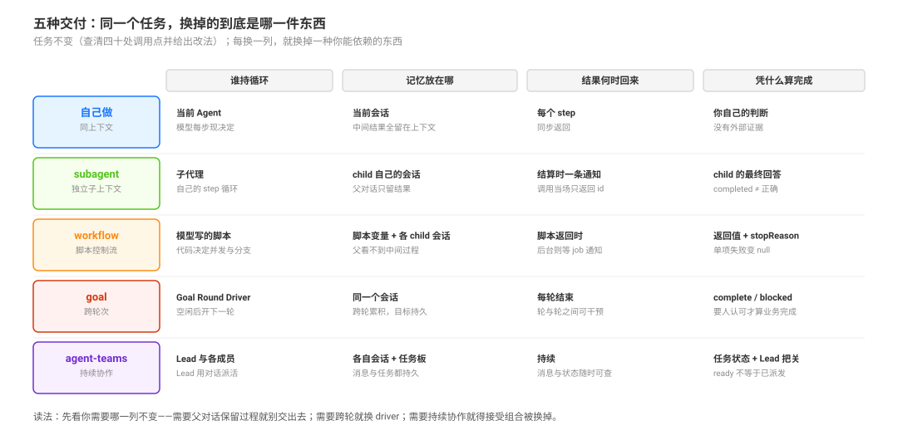
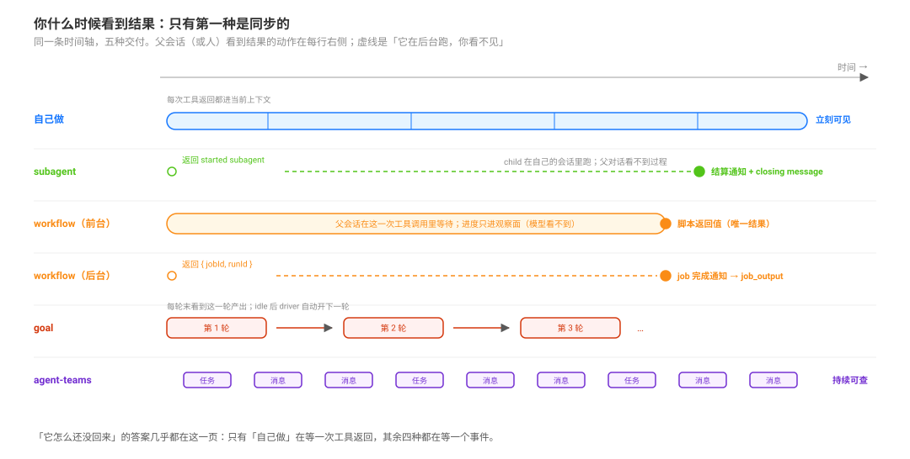

# One Task, Five Deliveries · 同一个任务，五种交付

本页事实的源码入口在页末。它不替代机制页：这里只把同一件事交出去五次，让你看清「换个原语，到底换掉了什么」。

## 先给任务

> `legacy-client` 这个模块刚被删掉。仓库里大约有四十个文件还在 import 它，位置和改法都还没查。帮我找出全部调用点，每处给一行修复建议。

这件事有四个特点，正好让它成为例子：**工作量大于上下文容量**、**每一处互相独立**、**需要判断（不是纯 grep 替换）**、**有明确的完成证据（一份清单 + 改动）**。

下面五种交付都能把它做完。差别不在「能不能」，在**谁持循环、你看得见什么、什么时候算完**。

## 一张表先看完

| 交付 | 谁持循环 | 记忆在哪 | 你什么时候看到结果 | 完成证据 |
|---|---|---|---|---|
| 自己做 | 当前 Agent | 当前会话 | 每个 step | 你自己的判断 |
| `subagent` | 子代理 | child 自己的会话 | 结算时一条通知 | child 的最终回答 |
| `workflow` | 模型写的脚本 | 脚本变量 + 各 child 会话 | 脚本返回时（后台则通知） | 脚本返回值；run 级 `stopReason` 在引擎结果与 run-end 上 |
| `goal` | Goal Round Driver | 同一个会话，跨轮 | 每轮结束 | `complete`（模型自报）；`blocked` 是另一终态，不是完成 |
| `agent-teams` | Lead 与各成员 | 各自会话 + 任务板 | 持续 | 任务状态 + Lead 把关 |

## 一 · 自己做

- **你怎么说**：不用说。直接 `grep -rn legacy-client`，读命中文件，改。
- **谁持循环**：当前 Agent。下一步做什么，模型在每一步现决定。
- **它活在哪**：当前会话、当前上下文。中间读到的每个文件都会留在上下文里。
- **你什么时候看到**：工具调用返回就有，同步。
- **怎么算完成**：你自己判断；没人替你定标准。
- **典型失败**：四十个文件读到第二十个，前面的细节已经挤出上下文窗口，最后靠印象写清单。
- **深读**：这条路没有原语页可读，它就是对 `read` / `grep` / `bash` 的普通使用。

自己做是对照组。后面四种交付都在替换这里的某一件东西：上下文位置、循环位置，或时间位置。

## 二 · 交给一个 subagent

- **你怎么说**：`subagent({ description: "审计 legacy-client 调用点", prompt: "……自包含说明……" })`。
- **谁持循环**：子代理。它有自己的 step 循环，自己决定先读哪个文件。
- **它活在哪**：child 自己的会话（durable），与父会话分开；父对话只留结果。
- **你什么时候看到**：调用**立刻**返回 `started subagent <id>`，不等结果；结算时父会话收到一条通知，带 child 的收尾消息。
- **怎么算完成**：child 交回最终回答；`completed` 只说明它停了，不说明清单是对的。
- **典型失败**：prompt 不自包含——它看不到你刚才读过的三个文件，只能重新找；或者你以为它是同步的，接着往下写才发现结果还没回来。
- **深读**：[`primitives/02`](./delegation-primitives/02-bounded-delegation-with-fresh-and-forked-subagents.md)；它的 `fork` 变体继承你已完成的轮次，适合「接着这段对话往下做」。

一句话：**把中间过程移出父上下文**。适合一两个任务，四十个就轮到下一个形态。

## 三 · 让脚本扇出（workflow）

- **你怎么说**：`workflow({ script: "...pipeline(files, ...)...", meta: { name: "audit-legacy-client", description: "逐文件审计" }, args: { files: [...] } })`。
- **谁持循环**：模型写的 JS 脚本。并发、分支、聚合都由代码决定，不用每步问一次模型。
- **它活在哪**：一个 PTC 子进程里跑脚本；每个 `agent()` 仍是子代理、仍有自己的会话。
- **你什么时候看到**：前台调用等于一次工具调用，返回 `{ kind: 'foreground', runId, agentsStarted, result }`；加 `run_in_background` 则先拿 `{ kind: 'background', jobId, runId }`，完成后收到 job 通知。
- **怎么算完成**：脚本返回值。整跑的结论在 `stopReason` 上：`completed` 才算跑完；`cancelled` / `error` 是另一回事。子代理失败会变成单项 `null`，**要自己 `filter(Boolean)`**。
- **典型失败**：只为两个文件写脚本（启动成本高于收益）；没过滤 `null`，清单少了几项还以为齐了；把「脚本跑完」当成「结果正确」。
- **深读**：[`primitives/01`](./delegation-primitives/01-scripted-workflow-and-sandboxed-fan-out.md)、[`selection/02`](./primitive-selection/02-cross-primitive-routing-and-the-official-upgrade-order.md)。

一句话：**把「下一步做什么」从对话搬进代码**。代价是父对话看不到中间过程。

## 四 · 交给跨轮 goal

任务不变，但约束变了：这四十处分布在三个包里，一次修不完，你希望它自己接着推进，不用每次由人来说「继续」。

- **你怎么说**：`create_goal({ objective: "……" })`。objective 与验收标准写在同一句里。
- **谁持循环**：Goal Round Driver。会话空闲后它开下一轮，模型在轮内自己决定做什么。
- **它活在哪**：**同一个会话**，跨轮累积。目标本身是一条持久事件，恢复会话后还在。
- **你什么时候看到**：每轮结束；goal 工具在某一轮的模型 turn 内调用，轮与轮之间没有 turn，工具用不了（人可以走 `/goal` 命令或 UI）。
- **怎么算完成**：`update_goal complete`，而且只在目标真的达成时用。`blocked` 是另一条终态：自动续轮里要已开始至少 3 轮才允许报（默认门槛；工具只挡早报，不校验是否同一阻塞条件），直接人类 turn 不受这个门槛限制。
- **典型失败**：单轮任务开 goal，答完又自己开一轮；objective 写得太虚，每轮都在重新解释它；恢复会话后以为它还在跑——resume / fork 之后 goal 是 disarmed 的，要显式 `resume`。
- **深读**：[`primitives/04`](./delegation-primitives/04-cross-round-goals-and-the-round-driver.md)；轮次状态机在 [`../agent-loop/01-goal-lifecycle.md`](../agent-loop/01-goal-lifecycle.md)。

一句话：**把循环从「这一次调用」换成「这个会话」**。

## 五 · 交给 team

约束再变：两个同事要各改一半，改到一半要互相看对方的 diff，谁改哪块要留记录，而且这件事会跨天。

- **你怎么说**：这套能力由团队组合提供；Lead 用 `spawn_teammate` 拉人，用任务板登记分工。
- **谁持循环**：Lead 和每个成员各自的循环。Lead 用对话派活，不是引擎派工。
- **它活在哪**：每个成员一个持久会话；任务板与消息也是持久事实。
- **你什么时候看到**：持续——消息、任务状态、成员状态随时可查，不用等一次「跑完」。
- **怎么算完成**：任务 `completed` 只是状态；Lead 必须在给出最终答案前等齐必需的队友，最终验收仍在人这边。
- **典型失败**：装上 Team 才发现 `subagent` 系列工具被替换掉了，原来的委派方式没了；以为任务就绪就会自动开工——**就绪不等于派发**。
- **深读**：[`primitives/06`](./delegation-primitives/06-persistent-teams-with-a-shared-task-board.md)；组合代价见 [`composition/01`](./preset-composition-and-contract-placement/01-channel-capability-differences-and-inheritance.md)。

一句话：**把「一次交付」换成「一个一直在的协作面」**，代价是组合被换掉。

## 你什么时候看到结果

这条时间线解释了大部分「它怎么还没回来」的困惑：**只有第一种是同步的**。其余四种都要等一个事件——结算、脚本返回、轮次结束或成员发消息。

## 换交付时丢什么

| 从 → 到 | 丢掉 | 保住 |
|---|---|---|
| 自己做 → `subagent` | 中间过程 | 结论与上下文空间 |
| `subagent` → `workflow` | 父对话里的过程、单点纠偏 | 规模与并发 |
| `workflow` → `goal` | 脚本的结构、可复现性 | 跨轮连续性与目标 |
| 任意 → `team` | 原来的委派工具面 | 持续协作与共享状态 |

每次迁移只该有一个理由，而且你要能说出丢了什么。诊断表见 [`selection/03`](./primitive-selection/03-unspecified-gaps-and-contradictions-in-usage-policy.md) 与 [`perspectives/04`](./design-perspectives/04-nine-traps-in-delegation-surfaces.md)。

## 本页事实的出处

| 事实 | 出处 |
|---|---|
| `subagent` 立即返回 id、完成时通知，`send_message` 可中途追加 | `packages/subagent/tool-subagent/src/index.ts:215`-`218`、`:273` |
| 结算通知的内容与「closing message」措辞 | `packages/subagent/subagent/src/continuation-messages.ts:138`-`160` |
| workflow 前台 / 后台两种返回物 | `packages/workflow/tool-workflow/src/index.ts:315`、`:463` |
| workflow 只把最终值还给父、子代理失败变 `null` | `packages/workflow/tool-workflow/README.md:38`、`packages/workflow/tool-workflow/src/index.ts:158`-`170` |
| goal 的创建语义、resume/fork 后 disarm | `packages/goal/tool-goal/src/index.ts:51`-`54`、`:117` |
| `blocked` 的轮次门槛默认 3，且只在 goal-round 授权下检查 | `packages/goal/tool-goal/src/index.ts:39`、`:305`-`312`、`packages/goal/tool-goal/src/authority.ts:105`-`116` |
| Team 的默认成员 / 任务上限与 profile 钉值 | `packages/experimental/agent-team/src/index.ts:42`-`45`、`packages/experimental/agent-team-profile/cordis.patch.yml:16`-`22` |
| Team 就绪不派发、Lead 必须等齐 | `packages/experimental/tool-agent-team/src/index.ts:41` |
