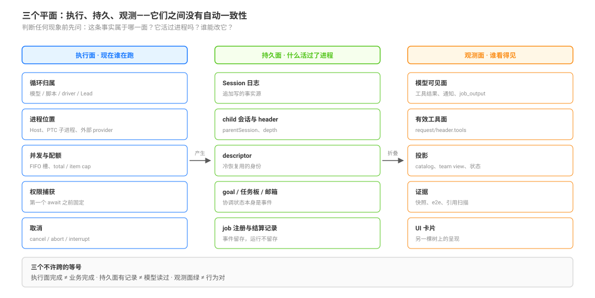

# Terms and Planes · 本组的词与三个平面

本页事实的源码入口在页末。它只做一件事：在你读机制页之前，把**词**和**平面**钉住。

## 一句话

这套系统里，「谁在跑」「什么活下来」「谁看得见」是三件不同的事。本组绝大多数误判，都是把其中一个平面的现象当成另一个平面的结论。

## 三个平面

| 平面 | 回答的问题 | 里面有什么 | 它随进程消失吗 |
|---|---|---|---|
| **执行面** | 现在谁在跑、在哪跑、还能不能跑 | 循环归属、进程位置、并发槽与 cap、权限捕获、取消 | 会。进程结束，运行就结束 |
| **持久面** | 什么事实活过了进程 | 会话日志、child 会话与 header、descriptor、goal 事件、任务板与邮箱、job 的注册与结算记录 | 不会。日志可重放 |
| **观测面** | 谁看得见、看得见的是不是事实 | 模型可见的工具结果与通知、`request/header.tools`、投影、快照与 e2e 证据、UI 卡片 | 取决于源：投影可重建，缓存不可信 |

判别法只有一句：**问这条事实活过什么**。活不过一次工具调用的是执行面；活过进程、能从日志重建的是持久面；只是某次读取的产物、可以重算的是观测面。

这条判别法直接给出三个不许跨的等号（详见 [`observation/01`](./completion-and-observation/01-acceptance-visibility-quiescence-and-disposal.md) 与 [`observation/04`](./completion-and-observation/04-persistent-facts-derived-projections-and-live-authority.md)）：

- **执行面完成 ≠ 业务完成**：`completed` 只说明循环停了。
- **持久面有记录 ≠ 模型读过**：日志里有，不等于进过上下文。
- **观测面绿 ≠ 行为对**：挂载与投影绿，只证明那一层。

## 本组承重词

DSH 自己的词以 [`canon/GLOSSARY.md`](../canon/GLOSSARY.md) 为准（`plugin`、`bundle`、`profile`、`preset`、`seam`、`scope`、`turn`/`step`/`round`、`projection` 等都在那里）。下表只列**本组反复用、且容易用错**的词；标「本组词」的不是 DSH 的类型或字段，不能拿去源码里搜。

| 词 | DSH 怎么说 | 在本组指什么 | 别写成 |
|---|---|---|---|
| **原语**（本组词） | DSH 没有这个类型 | 阶梯上的一级模型可见工具面：`todo_write`、`subagent`、`workflow`、`ralph`、`goal`、`jobs`、`schedule`、`agent-teams` | 「工具类型」「能力」「模式」 |
| 子代理 / child | 「an independently managed subagent」「a separate agent that works in its own context」 | 由 subagent seam 起出来的 Agent 实例 | 「子任务」「worker 进程」 |
| 会话 / Session | session log 是追加写的事实源 | child 有自己的会话；父会话是另一份 | 「聊天记录」「上下文」 |
| Activation | 「一个 durable Session + 至多一个进程内 Activation」 | 驻留期：settled 释放它，再发消息走冷恢复 | 「进程」「实例」 |
| seam | Service Definition + Provider + Consumer 三角色 | `ctx.subagents` 是一个 seam，`spawn`/`fork` 是它的 provider | 「接口」「插件」 |
| provider | 能力的后端实现 | 决定子代理怎么起、能不能续、有哪些能力位 | 「模型供应商」——那是 LLM provider |
| preset | 会话级声明 | 决定 Agent 拿到哪些工具与提示词 | 「模式」`mode` |
| 能力面 / tool face | `request/header.tools` | 模型在**某一次请求**里真正看到的工具集合 | 「工具列表」「权限」 |
| 收窄 | 无对应类型 | 让子代理比父更窄；现役杠杆只有给 spawn 行钉一个薄 preset | 「沙箱」「权限」 |
| 合同载体 | 无对应类型 | 承载规则的五个位置：工具 description、prompt 段、`SKILL.md`、`AGENTS.md`、`docs/` | 「文档」 |
| 终态 | 五个成员，merge-extensible | 一次子代理运行的结局分类 | 「完成」「失败」 |
| 结算 / settle | 无 pending inbox 且无 owned children | 结果固定与资源释放；通知只对 parent delivery 发 | 「完成」 |
| 谱系 / lineage | `parentSession` 链 | 谁是谁的父；深度从根往下数 | 「调用栈」 |
| 证据层（本组词） | 无对应类型 | 声明 / 挂载 / 有效工具面 / 行为，四层各证各的 | 「测试」 |

## 五组最容易混的词

1. **`subagent`（工具）vs child（Agent）**：前者是一次调用，后者是会持久存在的 Agent 与会话。工具返回的是启动结果（child id），child 此时已经在跑。
2. **Session vs Activation**：会话是日志，Activation 是驻留。`settled` 只释放 Activation，会话还在，所以还能冷恢复。
3. **preset vs profile**：profile 是进程级装入什么，preset 是会话级组合。子代理能不能钉自己的 preset，取决于通道，不取决于 profile。
4. **终态 vs 完成**：五个终态是运行的结局，不是任务的成功证明。`completed` 与「用户要的东西做对了」是两件事。
5. **通知 vs 结果**：结算通知里带的是 child 的收尾消息，也就是**它的自报**；父侧的验收不在通知里。

## 去哪儿查权威定义

| 你要 | 去哪 |
|---|---|
| 一个词的 repo 原文、它排除的写法 | [`canon/GLOSSARY.md`](../canon/GLOSSARY.md) |
| 官方术语表 | `docs/glossary.md`、`docs/glossary.zh.md` |
| 会话、turn、step 的时序 | [`../session-and-loop/00-map.md`](../session-and-loop/00-map.md) |
| seam 三角色与多 provider | [`../capability-seams/00-map.md`](../capability-seams/00-map.md) |
| 组合与 preset 的层叠 | [`../plugin-system/composition/00-map.md`](../plugin-system/composition/00-map.md) |

## 本页事实的出处

| 事实 | 出处 |
|---|---|
| child 是独立上下文里的 Agent，返回结果而非中间步骤 | `packages/subagent/tool-subagent/src/index.ts:113`-`137`（fresh / fork 两份边界句） |
| 一个 durable Session、至多一个进程内 Activation | `docs/subsystems/subagent.md`、`.agents/notes/implemented/feature/2026-07-28-continuable-subagent-conversations.md` |
| 有效工具面记录在 `request/header.tools` | `docs/subsystems/session.md` |
| job 进程内、随 harness 结束；已持久的事件仍可读 | `packages/jobs/jobs-local/README.md:12`、`:32`、`:61` |
