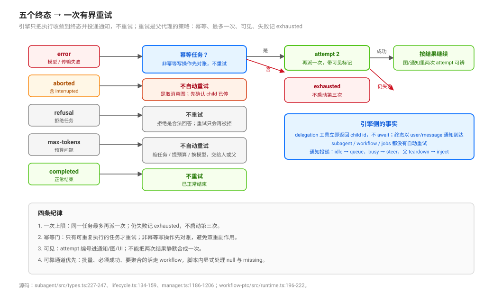

# Completion and Observation · 终态与观测

## 一句话

本组回答：**一次委派/一次 run 结束时到底发生了什么，以及你怎么把它看见、证明、不撒谎。** 机制在 [`../delegation-primitives/`](../delegation-primitives/00-map.md)，能力面与合同在 [`../preset-composition-and-contract-placement/`](../preset-composition-and-contract-placement/00-map.md)。

## 五个时刻，别混成一个“完成”

「完成」在这套系统里至少分成四件机制上的事：**结果被接受**、**模型看得见**、**运行静止**、**资源被处置**；**业务上完成**是第五件，但它推不出来，需要人/合同判断（[`01`](./01-acceptance-visibility-quiescence-and-disposal.md)）。混用会直接导致错误报告：`completed` 不等于正确，`settled` 不等于读过，`delivered` 不等于处理。

## 页面

| 页 | 回答 |
|---|---|
| [`01`](./01-acceptance-visibility-quiescence-and-disposal.md) | 接受、可见、静止、处置、业务完成五个时刻；跨日志崩溃窗口 |
| [`02`](./02-terminal-states-and-bounded-retry-authority.md) | 五终态、turn-end 折叠、通知投递、为什么引擎不重试、父侧重试判据 |
| [`03`](./03-session-lineage-and-agent-incarnation.md) | Session 谱系、Agent incarnation、Activation epoch：冷恢复后哪些边还在 |
| [`04`](./04-persistent-facts-derived-projections-and-live-authority.md) | 持久事实、派生 projection、内存 authority（状态三分法） |
| [`05`](./05-delegation-graph-node-and-edge-projection.md) | 委派图能画什么：持久源、节点/边字段、三个缺口词 |
| [`06`](./06-workflow-reproducibility-cancellation-and-missing-results.md) | workflow 结果为什么不可复现；取消与 `null`/`missing` |
| [`07`](./07-evidence-layers-declaration-mount-mechanism-behaviour.md) | 四层证据各证什么；fake 只证明 fake；挂载绿 ≠ 行为绿 |

## 入口问题

| 你在问 | 进入 |
|---|---|
| 子代理 `completed` 了，是不是就成功了？ | [`01`](./01-acceptance-visibility-quiescence-and-disposal.md) |
| 子代理失败了，要不要自动重试、几次？ | [`02`](./02-terminal-states-and-bounded-retry-authority.md) |
| 重启后哪些 child 还在？`interrupted` 算什么？ | [`03`](./03-session-lineage-and-agent-incarnation.md)、[`01`](./01-acceptance-visibility-quiescence-and-disposal.md) |
| 这个状态是持久事实还是投影？能当依据吗？ | [`04`](./04-persistent-facts-derived-projections-and-live-authority.md) |
| 父会话为什么看不到整条链？ | [`05`](./05-delegation-graph-node-and-edge-projection.md) |
| workflow 分支返回 `null` 是失败还是没输出？ | [`06`](./06-workflow-reproducibility-cancellation-and-missing-results.md)、[`02`](./02-terminal-states-and-bounded-retry-authority.md) |
| 挂载绿了为什么行为不对？ | [`07`](./07-evidence-layers-declaration-mount-mechanism-behaviour.md) |

## 与其他组的关系

- 原语机制：[`../delegation-primitives/`](../delegation-primitives/00-map.md)。
- session log / projection 的底层机制：[`../../session-and-loop/`](../../session-and-loop/00-map.md)。
- UI 机制：[`../../two-tree-runtime/client/`](../../two-tree-runtime/client/00-map.md)。
