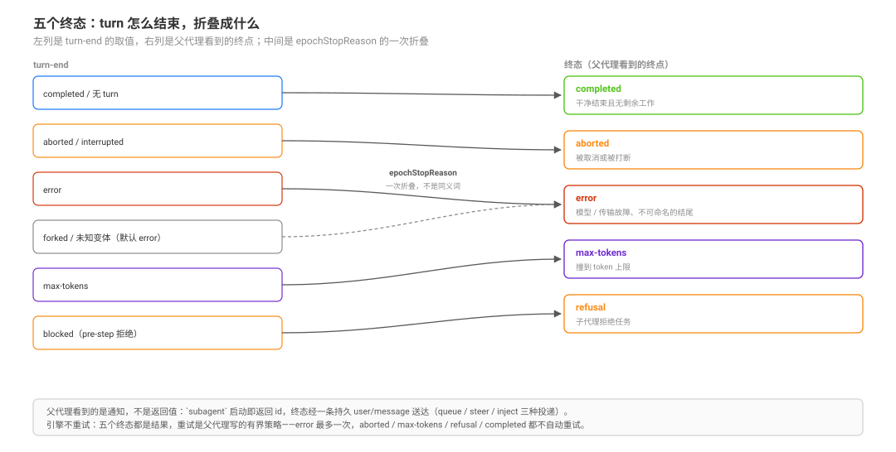

# Terminal States and Bounded Retry Authority · 终态与有界重试权威

源码核验入口：`packages/subagent/subagent/src/{types,lifecycle,activation,manager,continuation-messages,out-of-process}.ts`、`packages/workflow/workflow-ptc/src/runtime.ts`、`packages/workflow/tool-workflow/src/index.ts`、`packages/jobs/`。

本页回答：**一次委派/一次 run 结束时到底有哪几种下场？父代理怎么知道？谁有权重试、最多几次、什么不该重试？** 五个“完成时刻”的区分见 [`observation/01`](./01-acceptance-visibility-quiescence-and-disposal.md)，workflow 的不可复现性见 [`observation/06`](./06-workflow-reproducibility-cancellation-and-missing-results.md)。

## 读完你能回答

- 五个终态分别是什么，`interrupted` 与 `lost` 各属于哪一层？
- 父代理怎么知道 child 结束了？
- 为什么引擎不重试，父侧该按什么判据重试？

## 心智模型

核心判断：**终态是运行的结局，不是任务的成败；通知是一条持久消息，不是返回值。**

- 五个成员：`completed` / `aborted` / `error` / `max-tokens` / `refusal`，表是 merge-extensible。
- `interrupted` 是 turn-end 标记，折叠到 `aborted`；`lost` 是观测面的缺口词，不是引擎状态。
- 重试发生在父侧，有界、有停止条件；引擎只负责把结局记下来。

## 一句话

DSH 的委派 / workflow / 作业单元**不重试**（模型请求的重试是 provider 的 retry policy，属另一层）：引擎只把一次执行收敛到一个可命名的终态，并把抓到的结果以一条持久消息交给父代理。重试是**父代理的策略**，必须可见、有界、过幂等门；把“引擎没重试”误读成“父代理应该兜底”是这类事故的起点。

## 终态词表（五元，可扩展）

`SubagentStopReason` 的 known 值只有五个，且是 merge-extensible（后端可以加变体，消费者走 `default`）：

| 终态 | 含义 | 父代理看到的那句话 |
|---|---|---|
| `completed` | 子代理正常结束 | `… finished and will do no further work unless you send it more.` |
| `aborted` | 被取消（信号或处置） | `… was stopped before it finished.` |
| `error` | 模型或传输失败 | `… failed before it finished.` |
| `max-tokens` | 撞到 token 上限 | `… ran out of room before it finished.` |
| `refusal` | 子代理拒绝任务（含 pre-step `blocked`） | `… declined the task.` |

证据：`packages/subagent/subagent/src/types.ts:227`-`247`；结算提示文案在 `continuation-messages.ts:106`-`129`。

### turn-end → 终态的折叠规则

子代理终态不是“turn 怎么结束”的同义词，而是 `epochStopReason` 的一次折叠：

| turn-end | 折叠成 | 为什么 |
|---|---|---|
| `max-tokens` | `max-tokens` | 预算问题，不是故障 |
| `aborted` / `interrupted` | `aborted` | 两者都是“被打断”，不是子代理的失败；`interrupted` 只在恢复/冷读时出现 |
| `error` | `error` | 模型/传输故障 |
| `blocked` | `refusal` | pre-step 拒绝（hook deny、policy）丢弃了已认领的输入——是“拒绝”，不是“做完” |
| `completed` / 无 turn | `droppedUnrun ? 'aborted' : 'completed'` | 干净结束且没有剩余工作才算完成；队列被取消则算中断 |
| `forked` / 未知变体 | `error` | `forked` 只出现在 fork 种子历史里，这里是防御性默认；不可命名的结尾不能报成成功 |

证据：`packages/subagent/subagent/src/lifecycle.ts:134`-`159`；`droppedUnrun` 来自 `packages/core/agent/src/consumed-work.ts:18`-`31`。

**这条折叠表是“不要把失败写成完成”的机械保证**：未知变体与 `forked` 默认落到 `error`，而不是 `completed`；`completed` 本身仍是完成。

## 父代理怎么知道：一条持久消息，不是返回值

`subagent` 工具在启动后立即返回 `{ kind: 'activation', subagentId }`（`tool-subagent/src/index.ts:337`），**不 await 子代理**。终态通过结算通知送达：

- 通知是一条 `user/message`，`source.kind = 'subagent-settled'`，带 `summary` 与 `senderSessionId`（`continuation-messages.ts:29`-`44`）。
- 投递方式取决于父的状态：idle → `queue`（开新 turn）；busy → `steer`（最近 step）；父正在 teardown → `inject`（下一 pre-step，不唤醒）（`manager.ts:1195`-`1206`）。
- 只有 `delivery: 'parent'` 且已经 announce 过的 activation 才通知；`caller` 只把结果返回给调用方（`types.ts:42`-`43`、`manager.ts:1188`）。
- 通知用**捕获到的 result** 构造；teardown 失败会把 `subagent/end` 与 `dispose()` 标成错误，但不会替换已经抓到的结果（`types.ts:52`-`58`、`manager.ts:1177`-`1183`）。

所以走 parent delivery 的 shipped `subagent`/`subagent_fork`，失败在模型侧表现为**一条消息**，而不是启动工具返回的 `isError`；seam 合同确实定义了“非 `completed` → `isError`”的映射（`types.ts:229`-`231`），但它服务于直接消费结果的 caller/上层消费者，不适用于“启动即返回”的委派工具。

## `result` 什么时候 reject

`SubagentRun.result` 的合同是：**子代理级失败 resolve 成非 `completed` 的 result；只有基础设施故障才 reject**（`types.ts:287`-`297`）。实现上要分两种：**捕获失败**会 reject（`manager.ts:1181`-`1183` 的 `resultFailure`）；**teardown 失败**改的是生命周期终态并让 `dispose()` 抛错，不替换已经抓到的 result（`types.ts:52`-`58`）。发布前启动失败也会 reject（`:982`-`992`）。

这决定了重试的判据：**reject 是基础设施问题，重试要谨慎；非 `completed` 的 resolve 是业务结果，按终态分类处理。**

## 委派 / workflow / 作业单元没有自动重试

| 包 | 有没有重试 | 证据 |
|---|---|---|
| `packages/subagent` | 没有子代理 run 重试；出现的 `retry` 是结算观察者的重查（`SettlementState`）、一次消息投递的重试（“delivery that lost the disposal cutoff”）、模型侧提示语、子代理 prompt 文本 | `manager.ts:117`、`:1034`-`1086`、`:1253`-`1280`；`tool-subagent/src/index.ts:316`；`child-agent.ts:174` |
| `packages/workflow` | owned source 里没有 retry 记号（生成的 `lib/tsconfig.tsbuildinfo` 不算） | `grep -rni retry packages/workflow/*/src` 零命中 |
| `packages/jobs` | 只有 id 冲突的铸造循环与容量上限提示语（“kill 后重试”是给模型的建议，不是自动路径） | `jobs-local/src/index.ts:223`、`:228`-`232` |

因此重试只能是**上层**（父代理或脚本）的行为；模型请求自身的 retry policy 属于 provider 层，不是委派重试。把“父代理应该会看到失败”当作兜底，等于把可靠性押在模型的注意力上——而 notice 可能落在 `steer`、`queue` 或 `inject`，三种投递的时机不同。

## 父侧重试：一张判据表

| 终态 | 是否重试 | 理由 |
|---|---|---|
| `error` | 幂等任务最多一次 | 可能是一次性模型/传输故障；重试要带 attempt 标记 |
| `aborted`（含 `interrupted`） | 不自动重试 | 是取消意图；先确认 child 不在跑，再由人/父决定 |
| `max-tokens` | 不自动重试 | 重试大概率再撞；缩任务、提预算或换模型 |
| `refusal` | 不重试 | 是合法回答/边界，不是故障 |
| `completed` | 不重试 | 已完成 |
| 基础设施 reject | 不自动重试 | 先修环境；盲目重试会重复副作用 |

机制建议（模式，不是 DSH 的词）：

1. **一次上限**：同一任务最多再派一次，带 `attempt: 2` 可见标记；仍失败记 `exhausted`，不启动第三次。
2. **幂等门**：只有可重复执行的任务才重试；非幂等写操作先对账再决定。
3. **可见**：两次 attempt 都要在通知/图/UI 里可分辨，不能静默把两次结果合成一次。
4. **可靠通道优先**：批量、必须成功、要聚合的活用 workflow（脚本内可显式处理 `null` 与 `missing`），不要靠 subagent 的 best-effort。

## workflow 的失败语义（与 subagent 不同）

- **分支失败 → `null`**：子代理非 `completed`，或请求了 `schema` 但没拿到结构化结果，`agent()` 返回 `null`（`workflow-ptc/src/runtime.ts:207`-`222`）。
- **基础设施 reject → fatal**：不是 `null`，而是 `WorkflowError('child agent run failed', 'AGENT_RESULT')`，会杀掉整个脚本（`:196`-`206`）。
- **run 终态是闭合三元组**：`completed | cancelled | error`；前台运行里非 `completed` 由工具侧抛错，转成 `isError`（`workflow/src/types.ts:57`-`71`；`tool-workflow/src/index.ts:456`-`460`）。后台运行不抛：`cancelled` 映射成 job 的 `killed`、`error` 映射成 `failed`，结果经 `job_output` 读（`tool-workflow/src/index.ts:219`-`236`）。
- **结果截断不可恢复**：`maxResultChars` 默认 50000（`:61`），超出后是行内截断 + 计数提示，**没有 spill 指针**（`tool-workflow/src/index.ts:47`-`48`、`:61`、`:239`-`246`）。把大结果交回父代理前先想清楚“父代理拿到的是不是被裁过的”。

## 结果可读性优先于“能不能继续问”

续驶（`send_message`）是“结果不可读”的补丁，不是默认设计。判断一条委派是否合格，先看父代理能不能**直接消费**结果：

- 结构化结果（`outputSchema` / `structured`）优先于自由文本；文件引用优先于大段粘贴。
- 子代理**对自身截断/长度的自述不可信**：它看不到自己收到的工具结果被 pruner 裁过；父代理要用日志/指针独立核对。
- workflow 的返回值超过 `maxResultChars` 会被行内截断且没有 spill 指针（[`observation/06`](./06-workflow-reproducibility-cancellation-and-missing-results.md)）；要交回大结果时先改成“文件 + 摘要”的形状。

## 失败面

| 现象 | 机制 |
|---|---|
| 父代理说“我没收到失败” | notice 是消息；`inject` 不唤醒，`steer` 落在 step 边界；也可能被压缩/略读 |
| 重试两次、结果写了两遍 | 没有幂等门；重试前没确认第一次是否已生效 |
| 把 `max-tokens` 当普通错误重试 | 预算问题被当故障处理，通常再撞一次 |
| 把 `refusal` 当失败重试 | 拒绝是合法结果；重试只会再被拒 |
| workflow 分支 `null` 被当成“没输出” | `null` 同时覆盖“子代理失败”与“schema 未满足”；`agent-end.outcome` 只有 `completed/failed/cancelled`，只能告诉你“没成功”，区分两者要回看子结果/会话 |
| 以为 workflow 结果会自动落盘 | 截断后没有 spill 指针；大结果无法找回 |

## 常见误解

| 你以为 | 实际上 |
|---|---|
| 终态只有四个 | 五个，还有 `refusal`；表是 merge-extensible |
| `interrupted` 是第六个终态 | 它是 turn-end 标记，折叠到 `aborted` |
| `lost` 是引擎状态 | 它是观测面的缺口词 |
| 子代理失败会自动重试 | 不自动；重试是父代理自己写的有界策略 |

## 待证（不要写成已证）

- 模型在真实任务里**是否会按上表重试**：需要真模型探针（fake provider 只能证明机制，不证明行为）。
- notice 在不同父状态下被模型实际处理的概率：需要录制会话统计，而不是读源码推断。

## 源码入口

| 路径 | 一句话 |
|------|--------|
| `packages/subagent/subagent/src/types.ts:227`-`247`、`:287`-`297` | 五终态与 `result` 的 reject/resolve 合同 |
| `packages/subagent/subagent/src/lifecycle.ts:134`-`159` | turn-end → 终态的折叠 |
| `packages/subagent/subagent/src/activation.ts:154`-`160` | 结构化捕获失败如何改判 `error` |
| `packages/subagent/subagent/src/manager.ts:966`-`979`、`:1186`-`1206` | announce 与结算投递（queue/steer/inject） |
| `packages/subagent/subagent/src/continuation-messages.ts:29`-`167` | 通知的 source 形状与逐终态文案 |
| `packages/workflow/workflow-ptc/src/runtime.ts:196`-`222` | 分支 null vs fatal |
| `packages/workflow/workflow/src/types.ts:57`-`71` | run 终态闭合三元组 |
| `packages/workflow/tool-workflow/src/index.ts:47`-`48`、`:239`-`246`、`:456`-`460` | 截断、渲染、isError 映射 |
