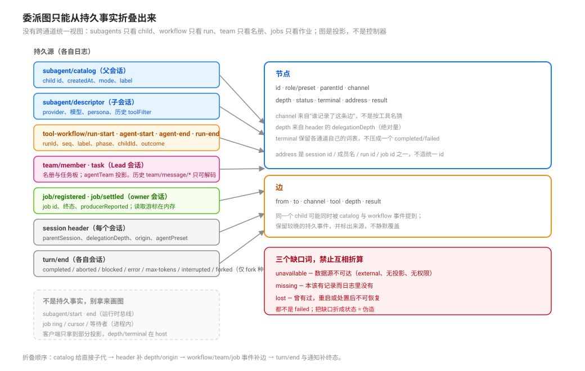

# Delegation Graph as a Node-and-Edge Projection · 委派图：节点与边的只读投影

源码核验入口：`packages/subagent/subagent/src/{catalog,descriptor,list-children,manager}.ts`、`packages/workflow/tool-workflow/src/index.ts:73`-`148`、`packages/experimental/agent-team/src/{journal,projection,types}.ts`、`packages/jobs/jobs/src/types.ts:53`-`66`、`packages/core/session/src/types.ts:95`-`132`。

本页回答：**一条混合链（spawn → workflow → spawn → team）的状态图从哪来、能保证什么、缺数据时怎么标？** 五个完成时刻见 [`observation/01`](./01-acceptance-visibility-quiescence-and-disposal.md)，状态三分见 [`observation/04`](./04-persistent-facts-derived-projections-and-live-authority.md)。

## 读完你能回答

- 委派图能画什么、明确不能画什么？
- 节点与边来自哪些持久源？
- 三个缺口词分别是什么意思，为什么不能互相折算？

## 心智模型

核心判断：**图是只读投影：它不调度、不取消、不写状态。**

- 持久源只有几处：subagent catalog/descriptor、workflow 记录、team 投影、job 事件、session header、`turn/end`。
- 缺数据要标 `unavailable` 一类缺口词，不能补一个看起来合理的值。
- runtime 的 bus 事件（`workflow/*`、`subagent/start|end`）不是持久源。

## 一句话

DSH **没有**跨通道的统一委派视图：`ctx.subagents` 只管 child，workflow 只管自己的 run 与分支，team 只管名册/任务/消息，jobs 只管作业；没有任何一个组件把它们合成一张图。能画出来的图只能由**持久事实折叠**而成；折叠不出来的格子必须标 `unavailable`，不能拿 `parentId` 硬折出一个看起来像状态的空。

## 图是什么、不是什么

| 是 | 不是 |
|---|---|
| 从会话日志与持久记录派生的**只读投影** | 调度器（不派工、不取消、不改状态） |
| 回答“链现在长什么样、哪里断了、谁还没结算” | 回答“业务上对不对” |
| 节点/边/深度/终态/寻址的视图 | workflow 脚本控制流的可视化（那是代码，不是数据） |

“只读”有源码依据：引擎拒绝拓扑调度，projection 不成为新事实来源（见 [`perspectives/01`](../design-perspectives/01-graph-computation-essence-invariant-derivation-and-execution.md)）。

## 持久源：每个源给一段

| 源 | 在哪本日志 | 给什么 | 不给什么 |
|---|---|---|---|
| `subagent/catalog` | 父会话 | child id、`childCreatedAt`、`mode`（`one-shot/continuable/external/unknown`）、label | 子代内部状态、终态（终态在结算通知与子会话 `turn/end` 里，不在 catalog 行） |
| `subagent/descriptor` | 子会话 | mode、provider、label、模型/推理、persona、历史 toolFilter；log-only、不进模型历史 | 父侧视角的边（要配 catalog） |
| `tool-workflow/run-start` / `agent-start` / `agent-end` / `run-end` | 父会话 | run-start `{runId,name}`；agent-start `{runId,seq,label,phase?,childId}`；agent-end `{runId,seq,outcome}`；run-end `{runId,stopReason}` | 分支内部步骤、脚本变量 |
| `team/member` / `team/task`（`team/message/queued\|delivered` 是历史 mailbox 事件，现已无生产者） | Lead 会话 | 名册、任务板；由 `agentTeam` projection 消费 | 成员内部 turn 细节；当前消息在目标会话的 `user/message`（`agent-message`）里 |
| `job/registered` / `job/settled` | owner 会话 | job id、终态、producer 报告 | “模型读过结果”（读取游标在内存里） |
| 会话 header | 每个 session | `parentSession`、`delegationDepth`、`origin: 'subagent'`、`agentPreset`（subagent 的 fork 也是子代理，同样有 depth；只有**会话级 fork** 是 `parentSession`+`isSeeded`、无 `origin`/depth） | external 子代理没有子会话，因此没有这条边 |
| `turn/end` | 各自会话 | 终态原因（`completed/aborted/blocked/error/max-tokens/interrupted/forked`） | 归属关系 |

## 投影形状（本页建议，不是 DSH 类型）

节点：`id`、`role/preset`、`parentId`、`channel`（`spawn|fork|workflow|team|external`）、`depth`、`status`、`terminal`、`address`、`result`（引用/摘要）。
边：`from`、`to`、`channel`、`tool`、`depth`、`result`。

字段的合法来源与缺口标记：

| 字段 | 首选来源 | 缺失时 |
|---|---|---|
| `id` / `parentId` / `depth` | 子会话 header（`parentSession` / `delegationDepth`） | external：只有 catalog 行，没有 header → 标 `unavailable` |
| `channel` | catalog 的 `mode` + 谁记录的边（workflow 事件 / team member / job） | 推不出就 `unavailable`，不要按工具名猜 |
| `status` | `turn/end` 折叠 + catalog/team 的 phase | 没有终态记录 → `missing`（本该有）或 `lost`（曾有过、重启后没了） |
| `address` | 该通道的寻址面（session id / 成员名 / run id / job id） | 不适用就 `null`，不要编造统一 id |
| `terminal` | 各词表自己的终态子集：`JobStatus` 去掉 `running/stopping`；subagent 取五种；workflow 取 `completed/cancelled/error` | 不要用一个统一词表把三者压成 `completed/failed` |

## 三个缺口词，禁止互相折算

| 词 | 定义 | 典型来源 |
|---|---|---|
| `unavailable` | 这条边的数据源在当前会话不可达（外部 provider、无投影、无权限） | 外部子代理、客户端拿不到的 host 字段 |
| `missing` | 本该有记录但日志里没有（可能写入失败或数据被删） | 有 catalog 行但找不到 descriptor |
| `lost` | 曾经有过终态/结果，重启或处置后不可恢复 | 内存 registry 的 cursor、被清理的 job ring |

这三者都不是 `failed`。把它们统一显示成“失败”或空白，等于伪造状态。**`parentId` 硬折**是典型反例：客户端只有 sessions/team 投影时，用 parentId 反推 depth/terminal，会把“缺数据”说成“某个状态”（见 [`perspectives/04`](../design-perspectives/04-nine-traps-in-delegation-surfaces.md)）。

## 折叠顺序

1. **先读 catalog**：父会话里的 `subagent/catalog` 给出直接子代集合；external 也在里面（没有子会话）。
2. **再补 header**：能打开子会话的，用 header 补 `depth`、`origin`、`agentPreset`；打不开的保持 `unavailable`。
3. **再叠 workflow/team/job 事件**：这些是**边上的事件**，不是节点本身；用 `runId`/成员名/job id 关联到 catalog 节点。
4. **最后叠终态**：`turn/end` 与结算 notice 的 `stopReason`；workflow 用 run 的 `stopReason`；job 用 `JobStatus`。
5. **冲突处理**：两个源给出不同的终态时，保留较晚的持久事件并在图上标出来源；不要静默覆盖。

## 失败面

| 现象 | 机制 |
|---|---|
| 图上看不到第三层 | 父会话只记录**直接** child；`listChildren` 只列直接子代，递归要用 `listDescendants`（`list-children.ts:31`-`126`） |
| 外部子代理没有子节点 | external 只有 catalog 行，没有子会话 header（`catalog.ts:156`-`169`） |
| 重启后节点“消失” | 内存 registry（job ring、cursor、等待者）不持久；持久的是 `job/registered\|settled` 与 session log |
| 把 `subagent/start/end` 当持久事件 | 它们只是运行时总线事件，不在 `SessionEventMap` 里（`subagent/src/index.ts:149`-`166`） |
| 在客户端硬折 parentId | 客户端拿到的是 projection；depth 可从 catalog/header 投影推，terminal 只存在于父会话通知与子会话 `turn/end`，未必在客户端可达（见 [`observation/07`](./07-evidence-layers-declaration-mount-mechanism-behaviour.md)） |

## 推论与模式（不是 DSH 的词）

- **图是消费者，不是控制器**：需要取消/续驶时调用现有工具，不要给图加“写”能力。
- **一个源一段、缺了标缺**：每个字段都写清来源；不知道就 `unavailable`，这比“猜一个看起来合理的值”长期便宜。
- **跨通道用 id 关联，不造统一 id**：`childId`（session id）、`runId`、成员名、`jobId` 各是各的；一张图里可以并存，但不要伪造一个“全局委派 id”。
- **只投影已证明的字段**：图上的每个字段都应有源码/日志证据；扩展字段等有证据再加。

## 常见误解

| 你以为 | 实际上 |
|---|---|
| 图能取消或调度 | 只读投影，没有控制面 |
| 父会话能看到整条链 | 本会话能列 direct children，并用 `list_agents(descendants)` 走完整棵子树（one-shot 行被过滤、深层只能 interrupt）；看不到的是其它会话或其它通道的链 |
| 空状态就是失败 | 可能是三个缺口词之一，各自含义不同 |
| runtime 事件可以当持久源 | `workflow/*` 与 `subagent/start\|end` 是 runtime bus 事件 |

## 待证（不要写成已证）

- 冷恢复后 catalog walk 对**外部 provider** 子代的覆盖：源码显示 external 无 header，实际能否从 catalog 还原边与终态需要一次重启会话验证。
- 客户端可拿到的投影范围（哪些字段必须由 host 补）：需要一次真实 Web 会话核对，而不是读类型推断。

## 源码入口

| 路径 | 一句话 |
|------|--------|
| `packages/subagent/subagent/src/catalog.ts:38`-`49`、`:144`-`169` | `subagent/catalog` 事件声明与 external 行 |
| `packages/subagent/subagent/src/descriptor.ts:29`-`39` | `subagent/descriptor` 的持久身份 |
| `packages/subagent/subagent/src/list-children.ts:56`-`126` | 递归 catalog walk 与诊断 |
| `packages/workflow/tool-workflow/src/index.ts:73`-`148` | 四个 log-only 事件与载荷 |
| `packages/experimental/agent-team/src/{journal,projection}.ts` | Team 的 Lead-log 事务与 `agentTeam` 投影 |
| `packages/jobs/jobs/src/types.ts:53`-`66` | `job/registered` / `job/settled` |
| `packages/core/session/src/types.ts:95`-`132` | header 的谱系与深度字段 |
| `packages/subagent/subagent/src/index.ts:149`-`166` | `subagent/start\|end` 只是运行时事件 |
