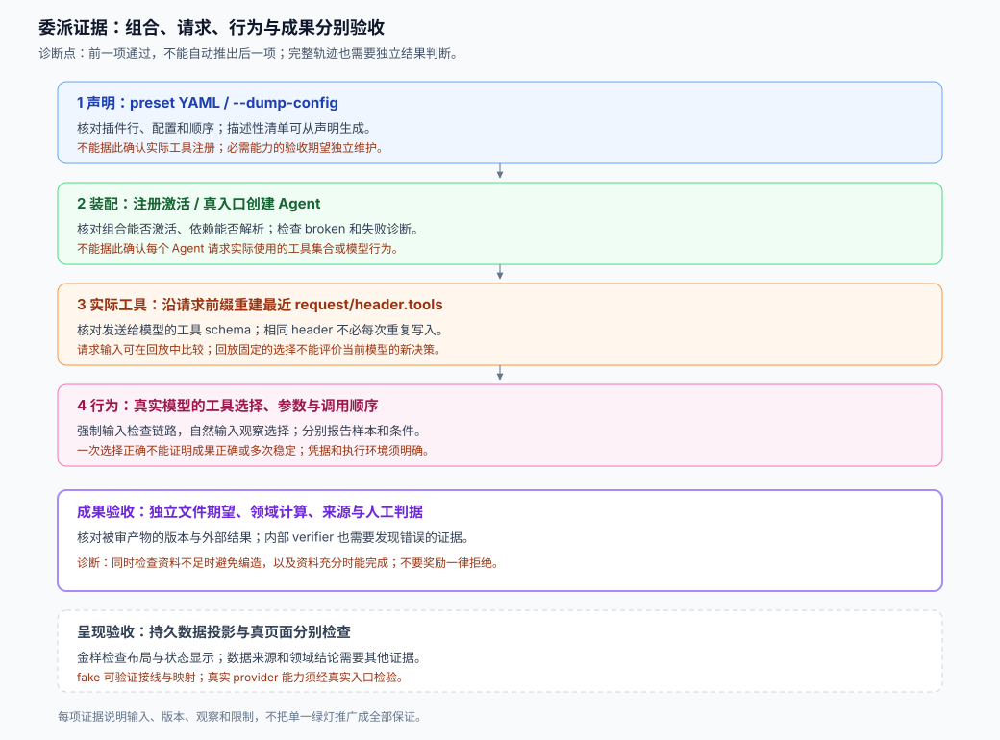

# Evidence Layers: Declaration, Mount, Mechanism and Behaviour · 证据分层

> 本页回答：**怎么证明一条委派链真的按你写的组合工作？每一层证据能证明什么、不能证明什么？** 图的字段来源见 [`observation/05`](./05-delegation-graph-node-and-edge-projection.md)，终态见 [`observation/02`](./02-terminal-states-and-bounded-retry-authority.md)。

> 源码核验入口：`packages/preset/agent-preset-registry/src/{index,definition}.ts`、`apps/cli`（`--dump-config`）、`packages/core/session/src/types.ts:241`-`247`、`packages/core/agent-loop/src/agent.ts:616`-`699`、`packages/subagent/subagent/src/{catalog,descriptor}.ts`。

## 读完你能回答

- 四层证据各证明什么，层与层之间能不能互相替代？
- 为什么 fake 只证明 fake？
- 挂载绿之后，还差哪两步？

## 心智模型

核心判断：**声明 → 挂载 → 实际工具面 → 行为，每层只证明自己那层。**

- 声明：工具/能力写在组合里；挂载：组合真的把它装上了。
- 实际工具面：某次请求里模型真正看到的工具集合（`request/header.tools`）。
- 行为：模型在自然条件下真的用了它；强制路径与自然路径要分别跑。

## 一句话

「挂了组合」「跑起来了」「模型照着做了」是三件不同的事。DSH 里有四层可分别取得的证据，**上一层证明不了下一层**；把它们混成一句“测试通过”，就是假绿。

## 四层

| 层 | 证据 | 证明 | 不能证明 | 成本 |
|---|---|---|---|---|
| **1 声明面** | preset 的 YAML / `--dump-config` 打出的入口列表 | 你**写下**了什么组合（行、配置、顺序） | 会话实际拿到的工具面；模型会不会用 | 零模型、可进 `pnpm test` 的纯解析/比对 |
| **2 装配** | `agentPresets.register` 的激活结果、`broken` 行、`session/create` 真挂载 | 这棵子树能立起来、依赖在场、服务能解析 | 运行时每个 Agent 的工具面；行为 | 零模型，但要真入口（host/CLI） |
| **3 实际工具面** | `request/header` 的 `tools` 字段（`EpochHeader.tools`） | 这次请求真实发给模型的工具 schema 集合 | 模型选得对不对、用得好不好 | 需要一次真实请求（可录制回放） |
| **4 行为** | 真模型会话/探针的调用序列与参数 | 模型在给定提示下怎么选、怎么用 | 最终成果正确；稳定性（单次 ≠ 稳定）；生产分布 | 真模型，所需凭据与执行环境须明确 |
| **成果验收** | 独立文件期望、领域计算、权威来源与验收任务 | 指定版本的产物是否满足独立判据 | 未覆盖任务的稳定性、未来修改的质量 | 按成果类型选择自动检查与人工判断 |
| **呈现验收** | 真页面 / 金样 / 客户端投影 | 用户看到的流程与状态 | 底层数据与领域结论的正确性 | 浏览器/宿主，单独门禁 |

### 每层的落点

1. **声明面**：`--dump-config` 是 boot-free 的入口列表 YAML，preset 定义包含组合字段与子行。它能核对“写下的组合”，不能核对“会话里真的有什么”；机制与源码见 [dump 与 boot](../../plugin-system/composition/02-dump-and-boot-fidelity.md)。
2. **装配**：注册表会在注册时 eager 激活并挂载；激活失败被收敛成 `broken` 并记日志（`agent-preset-registry/src/index.ts:106`-`118`）。`session/create` 能证明“这棵树能起一个 Agent”，不证明工具面。
3. **实际工具面**：`buildRequest` 在初次、恢复、内容变化或新 series 时写入完整 `request/header`；相同 header 不必每次重复。沿请求前缀读取最近快照，可重建该次请求使用的工具 schema，发现“声明了但没注册／被遮蔽”的差异。具体时点由 [Agent 请求装配](https://github.com/deepseek-ai/deepseek-harness/blob/master/packages/core/agent-loop/src/agent.ts)与 [EpochHeader](https://github.com/deepseek-ai/deepseek-harness/blob/master/packages/core/session/src/types.ts)定义。
4. **行为**：真模型探针要写清假设与判据（例如“委派前是否加载了 policy skill”“选的通道是否符合合同”），一次只证一个假设；失败/未触发如实记。
5. **呈现**：UI 的正确性由“数据是否正确 + 呈现是否符合金样”两部分组成；金样只冻结后者。

## 行为层要跑两遍：强制与自然

同一个行为假设至少要两种输入：

- **强制型**：在提示里明确要求“用 X 通道 / 委派给 Y”，用来证明**链路能通**（工具、寻址、深度的组合没问题）。
- **自然型**：只给任务，不点名通道或 worker，用来证明**提示面内化**（模型自己会选对）。

混跑会把两类故障混成一类：强制型失败是“链路坏了”，自然型失败是“提示面歪了”。报告时分开写，不要把一次混合会话当成两层都通过。

## 路由成功之后，仍要验收成果

工具和 worker 选择正确，只证明执行路线。模型声称已完成、内部 verifier 输出通过、委派图出现完整节点，都不能替代独立的成果检查。内部 verifier 本身也是产品的一部分，需要验证它能发现错误，并确认裁决对应的是当前产物版本。

需要分别检查“资料不足时避免编造”和“资料充分时能够完成”；只测前者可能奖励一律拒绝。领域输出应采用独立计算、来源或人工判据，文件修改应比较实际外部结果。调用轨迹、结果内容和多次任务稳定性分别报告，不把一次选对工具计成任务质量认证。

[测试决策流](../../test-strategy/execution/05-dsh-testing-decision-procedure.md)拥有按行为选择证据的方法，[会话快照](../../test-strategy/mechanisms/10-dsh-snapshot-machinery.md)拥有独立工作区期望与固定决策回放的说明。这里的任务成对检查是验收建议，不是引擎自动评分机制。

## UI 是验收面（模式，不是 DSH 的词）

DSH 没有“验证 UI”的引擎能力；能成立的做法是把呈现当成独立一层：先做**纯视图模型**（输入是已持久的事实），再做**静态渲染**，最后接**真页面/金样**。三层各自可测：

- 纯模型：给定事件序列，节点/边/状态是否正确（不需要浏览器）。
- 静态渲染：给定模型，文案与布局是否符合金样（不需要模型）。
- 真页面：槽位、页签、滚动与状态是否被破坏（需要宿主/浏览器，单独门禁）。

这条顺序的价值在于：UI 失败时能立刻分清是“数据错”还是“呈现错”，而不是在一个端到端测试里猜。

## 与 `test-strategy/` 的分工

[`test-strategy/`](../../test-strategy/00-map.md) 拥有整个仓库的七层**证据形态**与门禁（哪些测试证明什么、mock 放在哪、CI 怎么防假绿）；本页只拥有**委派面**的四层，回答“这条链的组合/工具面/行为分别怎么证”。要写仓库级测试政策或门禁，去 test-strategy；要证明一条委派链，读本页。

## fake 只证明 fake

用 fake provider / fake service 做的测试证明的是**接线与映射**（消息是否投递、字段是否透传、错误是否正确分类），不证明真实 provider 在场、不证明模型会行动。典型事故：隔离组里拿不到真 provider，fake 版门禁仍然绿，于是“真实装配缺失”被隐藏。判断规则：**这条断言里有没有一个“真实存在”的前提？** 有，就必须加一层真入口证据。

## 单次 ≠ 稳定

一次真跑成功只证明“这条路径在这次输入下走通了”，不证明：
- 模型下次还会这样选；
- 并发/深度上限下的行为；
- 冷恢复后的边与终态。

所以行为证据要标“单次/多次”，并把稳定性问题单列为待证，而不是用一次绿掩盖。

## 一张检查清单（给新能力用）

| 你要证明 | 最少需要的层 |
|---|---|
| preset 里确实有这行、这个配置 | 1 |
| 这个 preset 能挂起来、依赖齐全 | 2（真入口） |
| 子代理这次真的拿到了这些工具 | 3 |
| 模型会在该委派时委派、在结束时收尾 | 4（按假设多次） |
| 指定版本的文件或领域成果符合要求 | 独立成果验收；模型自报和内部 verifier 也须核查 |
| 用户在页面上看到的状态有事实依据 | 持久数据投影 + 呈现验收，分别检查 |

## 失败面

| 假绿 | 真相 |
|---|---|
| “挂载绿了，所以行为对” | 挂载只证明组合能起；模型行为在另一层 |
| “dump 和预期一致，所以工具面对” | dump 只证声明；实际面在 `request/header.tools` |
| “fake 测试过了，所以 provider 没问题” | fake 绕过了真实 provider 的能力位与错误路径 |
| “跑了一次真模型，绿了” | 单次证据；稳定性未证 |
| “金样过了，所以数据对” | 金样冻结呈现，不校验数据来源 |
| “工具选对、verifier 通过，所以成果正确” | 仍需独立判据，并绑定被审产物版本 |

## 常见误解

| 你以为 | 实际上 |
|---|---|
| 工具注册了就算上线 | 还要过组合、preset 与实际工具面 |
| e2e 绿就说明行为对 | 行为层要跑两遍：强制与自然 |
| mock 或 fake 通过等于真实可用 | fake 只证明 fake |
| 单次通过等于稳定 | 单次 ≠ 稳定 |

## 源码入口

| 路径 | 一句话 |
|------|--------|
| `packages/preset/agent-preset-registry/src/index.ts:106`-`118` | 声明校验、激活失败收敛为 `broken` |
| `packages/preset/agent-preset-registry/src/definition.ts:5`-`11` | 声明面字段全集 |
| [CLI YAML dump](https://github.com/deepseek-ai/deepseek-harness/blob/master/apps/cli/src/dump-config.ts) | `--dump-config` 的入口列表与 boot-free 输出 |
| `packages/core/session/src/types.ts:241`-`247` | `EpochHeader.tools`：实际工具面 |
| `packages/core/agent-loop/src/agent.ts:616`-`699` | `request/header` 的构建与写入 |
| `packages/subagent/subagent/src/catalog.ts`、`descriptor.ts` | 会话侧可回读的子代身份 |
| `packages/core/system-prompt/src/index.ts:293` | 空文本不进 prompt（能力域证据的一个细节） |
