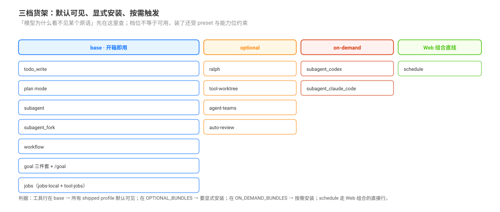

# Shipped Mount State · shipped 组合里的默认开关

源码核验入口：`packages/bundle/base/cordis.patch.yml`、`packages/bundle/web-app/cordis.patch.yml`、`packages/boot/app-boot/src/profile.ts`、`packages/boot/app-boot/src/official-bundle-packages.ts`、`packages/experimental/ralph-bundle/cordis.patch.yml`。

本页回答：**阶梯上每一级在 shipped 组合里是开箱即用，还是要显式打开？** 这是「充分利用 DSH」的第一手事实，也是判断“模型为什么看不见某个原语”的起点。

## 读完你能回答

- 每一级原语落在 base、optional、on-demand 还是 Web 直挂？
- 某个原语为什么不在 base，放进去会付什么代价？
- 不改代码的前提下，怎么把它打开？

## 心智模型

一句话：**「模型看不见」多数是档位问题，不是 bug。**

- 三档货架：base 随任何 shipped profile 可见；`OPTIONAL_BUNDLES` 要显式安装；`ON_DEMAND_BUNDLES` 由工具按需触发安装。schedule 是第四种：直接挂在 Web 组合里。
- 档位只回答「默认开不开」，不回答「装着能不能用」——还要过 preset 行、provider 能力位与深度预算。
- 默认不装的东西通常有理由：ralph 的完成是 worker 自报，实验性能力没有稳定性承诺。

| 原语 | 默认状态 | 出处 |
|------|---------|------|
| `todo_write` | base 挂载，`allowParallelInProgress: true` | `packages/bundle/base/cordis.patch.yml:437`-`441` |
| plan mode | base 挂载（plan-mode 行含 plan-mode 行为段注入） | `packages/bundle/base/cordis.patch.yml:332`-`340` |
| `subagent` | base 挂载：`provider: spawn`、`toolName: subagent`；`backgroundMode` 配置已不存在，continuable 由 per-delegation-tool 选择（base 注释 `:373`-`374`，`send_message` 由 `tool-subagent-control` 注册） | `packages/bundle/base/cordis.patch.yml:380`-`384` |
| `subagent_fork` | base 挂载：`provider: fork`、`toolName: subagent_fork`；fork 不选模型，让 provider/model 与父级一致、继承历史仍符合 KV Cache 前缀复用条件（注释明说） | `packages/bundle/base/cordis.patch.yml:391`-`396` |
| `workflow` | base 挂载，执行链 `workflow-ptc`（`provider: spawn`）→ `ptc-runtime-node` | `packages/bundle/base/cordis.patch.yml:397`-`405` |
| `ralph` | **不在 base**：由 optional bundle `packages/experimental/ralph-bundle/` 提供（`id: tool-ralph`，`subagentProvider: spawn`、`maxRounds: 64`），默认不装；理由是完成是 worker 自报而非独立评估 | `packages/experimental/ralph-bundle/cordis.patch.yml:12`-`16`、`packages/boot/app-boot/src/profile.ts:223`-`236` |
| goal 三件套 + `/goal` | base 挂载（`goal`、`goal-round-driver`、`command-goal`、`tool-goal`） | `packages/bundle/base/cordis.patch.yml:323`-`332`、`444` |
| jobs | base 挂载（`jobs-local` 服务 + `tool-jobs` 工具） | `packages/bundle/base/cordis.patch.yml:97`、`289` |
| `tool-worktree` | **不在 base**：`OPTIONAL_BUNDLES` 成员，按需给并行工作提供 `ctx.worktrees` 隔离目录 | `packages/boot/app-boot/src/profile.ts:223`-`236`、`packages/experimental/tool-worktree/src/index.ts:39` |
| schedule | **不在 optional bundle**：直接进 Web 组合（`experimental/schedule-bundle` 已退役，历史见 `_change_log/`；组合行 `id: schedule` 与 `id: ui-schedule`） | `packages/bundle/web-app/cordis.patch.yml:139`-`140`、`:398`-`399` |
| agent-teams / auto-review | 不在 base：experimental optional bundle（`OPTIONAL_BUNDLES` 成员） | `packages/boot/app-boot/src/profile.ts:223`-`236` |
| `subagent_codex` / `subagent_claude_code` | 不在 base、也不在 `OPTIONAL_BUNDLES`：**按需安装档位** `ON_DEMAND_BUNDLES` 提供（进程外 provider 行，`maxDepth: provider-managed`） | `packages/boot/app-boot/src/official-bundle-packages.ts:4`-`7`、`packages/subagent/subagent-codex/cordis.patch.yml:1`-`10` |

> 组合会随版本变化；本页只写当前 pin 的 shipped 状态，历史差异见 `_change_log/`。

## 怎么读这张表

1. **先看 base**：工具行在 `packages/bundle/base/cordis.patch.yml` 里 → 所有 shipped profile 默认可见；配置也在那一行。
2. **不在 base 再看 optional / Web**：`OPTIONAL_BUNDLES` 成员要显式安装；schedule 走 Web 组合的直接行，不在 optional 清单里。
3. **外部 provider 看 on-demand**：codex / claude-code 走 `ON_DEMAND_BUNDLES`，且行上 `maxDepth: provider-managed`。

这张表只回答“默认开不开”，不回答“装上后能不能用”：装了 bundle 仍受 preset 行、provider 能力位与深度预算约束（见 [`composition/01`](../preset-composition-and-contract-placement/01-channel-capability-differences-and-inheritance.md)、[`composition/06`](../preset-composition-and-contract-placement/06-depth-concurrency-and-capacity-limits.md)）。

## 常见误解

| 你以为 | 实际上 |
|---|---|
| ralph 在 base 里，只是默认关掉 | 它在 optional bundle，默认根本没装 |
| schedule 要额外装一个 bundle | 它直接进 Web 组合，不在 `OPTIONAL_BUNDLES` 清单里 |
| optional 与 on-demand 是一回事 | 两个机制：`OPTIONAL_BUNDLES` 显式安装，`ON_DEMAND_BUNDLES` 按需安装 |
| 工具行挂上了，模型就一定看得见 | 还要过 preset 作用域；能力面以 `request/header.tools` 为准 |

## 源码入口

| 路径 | 关注点 |
|------|--------|
| `packages/bundle/base/cordis.patch.yml` | base 组合里挂了哪些原语与默认配置 |
| `packages/bundle/web-app/cordis.patch.yml` | Web 组合的 schedule / UI 行 |
| `packages/boot/app-boot/src/profile.ts:223`-`236` | `OPTIONAL_BUNDLES` 清单 |
| `packages/boot/app-boot/src/official-bundle-packages.ts:4`-`7` | `ON_DEMAND_BUNDLES` 清单 |
| `packages/experimental/ralph-bundle/cordis.patch.yml:12`-`16` | ralph 的可选 bundle 行与 `maxRounds` |
