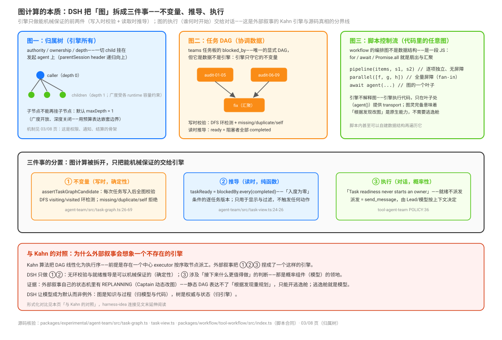

# External Narratives versus Source Truth · 外部叙事与源码真相

源码核验入口：`docs/architecture.md:43`（应用启动面）、`packages/experimental/auto-review/README.md`、`packages/telemetry/otel/README.md`、`packages/bundle/base/cordis.patch.yml`、`docs/subsystems/workflow.md`、`AGENTS.md`，以及本组各页已核验的事实。

本页回答：流传的二手分析（把 DSH 描绘成「Captain 规划 + Kahn 入度调度 + Reviewer 门禁 + DAG 看板 + task 级 rollback」的中心化 Task DAG 引擎）逐条对照源码，哪些真、哪些是风格化、哪些不存在？判定三态：✅ 真实 / 🟡 风格化（有真实对应物，形态不同）/ ❌ 不存在。

## 读完你能回答

- 外部叙事里哪些说法在源码里找不到对应物？
- 逐条对照的判据是什么？
- 哪些是类比、哪些是虚构？

## 心智模型

核心判断：**名词迁移会制造不存在的机制；判据只有一条——能不能指到源码。**

- Captain 规划器、Kahn 入度派工、`dsh rollback --task`、KV Cache 看板都是外来的图景。
- 类比可以借来解释，但不能当成 DSH 的组件清单。
- 对照过一次不等于永远成立：叙事会变，源码也会变。

## 逐条核对表

| # | 外部声称 | 源码真相 | 判定 |
|---|---------|---------|------|
| 1 | `dsh-agent-teams` 插件＝显式 Task DAG 依赖建模 + Kahn 拓扑就绪调度引擎 | 没有 Kahn 引擎。依赖建模真实存在于 teams 任务板（`blocked_by`，"use task dependencies when work must be ordered"，[`primitives/06`](../delegation-primitives/06-persistent-teams-with-a-shared-task-board.md) POLICY），但那是**人/模型协作的任务板**；workflow 的执行拓扑是脚本自身的 JS 控制流（for / Promise.all，[`primitives/01`](../delegation-primitives/01-scripted-workflow-and-sandboxed-fan-out.md)）；并发控制是 FIFO 槽位（workflow `acquireSlot`、subagent ActivationPool），不是入度队列 | 🟡 |
| 2 | Captain 动态拓扑规划器：规划模型输出 JSON DAG | 不存在 Captain。真实的"模型生成编排产物"是两样：模型写 JS 编排脚本（workflow 的 `script` + `meta`，[`primitives/01`](../delegation-primitives/01-scripted-workflow-and-sandboxed-fan-out.md)）；teams 的 Lead 把工作分解到任务板（[`primitives/06`](../delegation-primitives/06-persistent-teams-with-a-shared-task-board.md)） | 🟡 |
| 3 | Reviewer 工件验收门禁 | 不存在工件验收。近名包 `experimental/auto-review` 是**权限预审**："Before each native or PTC inner tool call, the current agent's provider and model assess the pending action; an allowed call executes with Full access"（`packages/experimental/auto-review/README.md:12`）——审的是待执行动作的权限，不是产出工件的质量；ralph 的完成判定明文是 worker 自报（"Completion is worker self-declaration"，[`primitives/03`](../delegation-primitives/03-fresh-agent-iteration-loop-and-round-handoff.md) 已知限制） | ❌ |
| 4 | 七状态任务生命周期（PENDING→READY→RUNNING→REVIEWING→SUCCESS/FAILED→REPLANNING） | 不存在这套状态机。真实状态机家族：jobs `running/stopping/completed/killed/failed`（[`primitives/05`](../delegation-primitives/05-background-jobs-and-wall-clock-schedules.md)）；team tasks `pending/in_progress/completed`（[`primitives/06`](../delegation-primitives/06-persistent-teams-with-a-shared-task-board.md)）；goal `active/paused/blocked/complete`（[`../agent-loop/01-goal-lifecycle.md`](../../agent-loop/01-goal-lifecycle.md)）。无 REVIEWING、无 REPLANNING | ❌ |
| 5 | Append-only 事件溯源会话（TASK_CREATED / TASK_READY / ARTIFACT_COMMITTED…） | 事件溯源真实且是系统根基：append-only SessionEvent 日志 + 投影 + "模型可见 ⟺ 已记录"的仓库级铁律（`AGENTS.md`；[`../session-and-loop/00-map.md`](../../session-and-loop/00-map.md)）。但事件词汇不同——durable 的是 `subagent/catalog`、`subagent/descriptor`、`team/task`、`goal/change`、`tool-workflow/run-start` 这类；`workflow/start` 等只是运行时总线事件 | ✅（机制真实；事件名是虚构的） |
| 6 | `dsh rollback --task <id>`：保留无关节点、只重置该任务与下游 | CLI 没有任何 rollback 子命令——应用启动面只有 profile 启动、`plugin` 管理命令与 `--patch`/`--dump-config` 选项（`docs/architecture.md:43`）。真实的恢复语义是**会话级**的另一套：durable session + `--resume`；goal resume 后一律 disarmed（[`primitives/04`](../delegation-primitives/04-cross-round-goals-and-the-round-driver.md)）；continuable child 冷恢复不经 provider（[`primitives/02`](../delegation-primitives/02-bounded-delegation-with-fresh-and-forked-subagents.md)）；fork 继承的是创建时一次性快照，父的后续轮次不进种子（新消息仍可经 `send_message` 到达） | ❌（命令不存在；"保留已完成、重做其余"的真实形态是会话级恢复而非任务级回滚） |
| 7 | Web 端动态 DAG 实时看板（拓扑染色） | 不存在 DAG 拓扑看板。真实的实时编排可观测：session-header job 列表流式显示 `phase()`/`log()`/成员生命周期行并跟踪当前 phase（[`primitives/05`](../delegation-primitives/05-background-jobs-and-wall-clock-schedules.md)）；`ui-workflow-run` 把四类 workflow 事件折成一个 `workflow-run` Chat 节点，phase 分组只来自实际成员启动、保字符串精确（`docs/subsystems/workflow.md:128`）；teams UI 的名册/任务板/队友导航（[`primitives/06`](../delegation-primitives/06-persistent-teams-with-a-shared-task-board.md)） | 🟡 |
| 8 | 节点 Telemetry：生成速率 tokens/sec、TTFT、KV Cache 命中率 92.4%、沙箱容器信息、租约与重试配额 | 不存在该指标面。dsh 的遥测是 **OTLP 导出管道**：`dsh-otel` 创建 ordinary-event 与 session-log 上报通道，"Mounting alone creates no transport or identity and sends nothing… the service has no deployment defaults or automatic collection policy of its own"（`packages/telemetry/otel/README.md:12`）——它是给业务消费者配的导出通道，自身不采集任何推理指标。沙箱真实：workflow PTC 跑在调用方 Session 的文件沙箱策略下（[`primitives/01`](../delegation-primitives/01-scripted-workflow-and-sandboxed-fan-out.md)） | ❌（指标看板不存在；沙箱真实） |
| 9 | KV Cache 前缀对齐优化：全局前缀固定排列，命中 85%~95% | 前缀稳定性是**真实的设计目标**，但形态是一组组合纪律而非运行时优化器：fork 工具行省略模型选择、让 provider/model 与父一致保继承前缀复用资格（`packages/bundle/base/cordis.patch.yml:382-390`）；prompt section 顺序与稳定前缀（[`../tools-prompt-llm/01-section顺序与前缀.md`](../../tools-prompt-llm/01-section顺序与前缀.md)）；工具目录跨模式不变以保 request-cache 稳定（plan-mode 部署 guidance，`packages/bundle/base/cordis.patch.yml:340`）；continuable 回传指引排在继承历史之后保字节稳定（[`primitives/02`](../delegation-primitives/02-bounded-delegation-with-fresh-and-forked-subagents.md)）。具体命中率数字无源 | 🟡（设计目标真实；数字无源） |
| 10 | "业界首个模型推理指标与图工程拓扑合一的可观测性平台" | 见 #7 与 #8：两种形态都不存在 | ❌ |

## 三条最重要的形态纠正

图的完整分置（三个真实的图、写时校验与读时推导、为什么分界画在这里）见 [`01`](./01-graph-computation-essence-invariant-derivation-and-execution.md)。

**一、当前产品不是一个由任务 DAG 自动派工的中心引擎。** 外部叙事把多种真实能力组合成了 Captain/Kahn 体系；源码中对应的实现是原语阶梯、workflow 脚本控制流、Teams 任务图准入与 Lead 派发。goal 与 ralph 的两策略决策确实没有引入通用 `LoopDriver` 或 generic `loop` 工具（`.agents/notes/archived/feature/2026-07-16-harness-level-loop.md`），但这项观察不推出系统没有全局 projection、FIFO slot 或其他局部调度机制。逐项证据见 [`00-map`](../00-map.md)、[`composition/05`](../preset-composition-and-contract-placement/05-ownership-depth-and-notification-channels.md) 与 [`01`](./01-graph-computation-essence-invariant-derivation-and-execution.md)。

**二、恢复是会话级，不是任务级。** 没有 task 回滚命令；durable session + resume + disarmed goal + continuable 冷恢复 + fork 一次性快照共同构成真实的恢复语义（[`primitives/02`](../delegation-primitives/02-bounded-delegation-with-fresh-and-forked-subagents.md)、[`primitives/04`](../delegation-primitives/04-cross-round-goals-and-the-round-driver.md)）。叙事里的"外科手术式回退"是对"事件溯源可重建状态"这个真机制的过度具体化。

**三、前缀复用是组合纪律，不是优化器。** KV Cache 意识真实存在于至少四处组合决策（见 #9），但没有一个运行时组件叫"前缀对齐优化"；具体命中数字（85%~95%、92.4%）在仓库中无源。

## 为什么外部叙事会长成这样

包名是主要误导源：`agent-team(s)` 接近"多代理 DAG 编排"的想象，`auto-review` 接近"Reviewer 门禁"的想象——而前者是协作任务板（[`../experimental/02-agent-teams.md`](../../experimental/02-agent-teams.md)），后者是权限预审。能力存在、形态虚构，是这批叙事的共同模式；核对方法是本专题全专题的路径：每条声称找到 path:line 或判"无源"。

## 常见误解

| 你以为 | 实际上 |
|---|---|
| 外部文章说的 Captain/Kahn 是 DSH 机制 | 源码里没有这些组件 |
| 没有中心调度器是功能缺失 | 是刻意取舍 |
| 对照一次就永久有效 | 叙事与源码都会变，需要重核 |

## 源码入口

| 路径 | 一句话 |
|------|--------|
| `docs/architecture.md:43` | 应用启动面：无 rollback 子命令的权威出处 |
| `packages/experimental/auto-review/README.md:12` | auto-review 的真实身份：权限预审 |
| `packages/telemetry/otel/README.md:12` | 遥测的真实形态：OTLP 导出通道，无自动采集 |
| `packages/bundle/base/cordis.patch.yml:340`、`:386`-`390` | 前缀稳定性的两处组合决策 |
| `docs/subsystems/workflow.md:128` | ui-workflow-run 的真实编排展示形态 |
| `.agents/notes/archived/feature/2026-07-16-harness-level-loop.md` | 明文拒绝通用编排引擎 |
| `AGENTS.md` | "模型可见 ⟺ 已记录"铁律 |
| 本组各页 | 全部真实对应物的 path:line 落点 |
