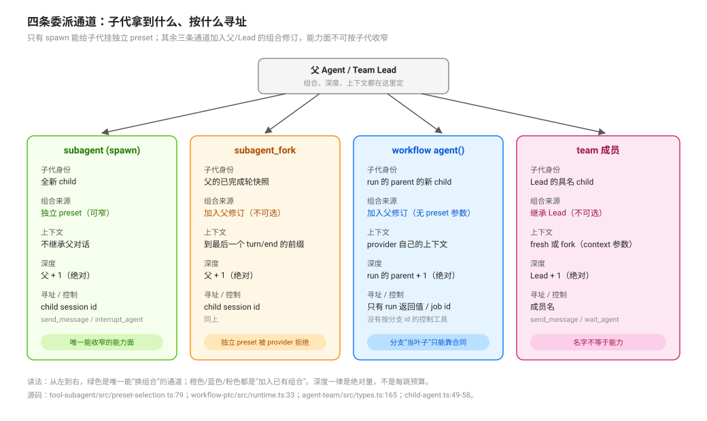

# Preset Composition and Contract Placement · 组合与合同

## 一句话

本组是**作者座的核心**：回答「一条委派链的能力面是怎么组合出来的、怎么收窄、规则放哪、深度与通知怎么叠加」。机制在 [`../delegation-primitives/`](../delegation-primitives/00-map.md)，终态与观测在 [`../completion-and-observation/`](../completion-and-observation/00-map.md)。

## 四个问题

1. **能力面从哪来？** 委派通道决定子代拿到什么组合：只有 spawn 能钉独立 preset，fork / workflow / team 从父组合克隆（[`01`](./01-channel-capability-differences-and-inheritance.md)）。
2. **怎么收窄？** 唯一的现役杠杆是给 spawn 行钉一个薄 preset；没有 per-agent 工具白名单（[`03`](./03-worker-profiles-and-the-only-narrowing-lever.md)）。
3. **规则放哪？** 政策与引擎事实是两种生命周期，载体与作用域不同；docs 不是模型面（[`04`](./04-contract-placement-between-policy-and-engine.md)）。
4. **叠加后怎么算？** 深度是绝对量、通知有四条通道、收尾有严格顺序（[`05`](./05-ownership-depth-and-notification-channels.md)、[`06`](./06-depth-concurrency-and-capacity-limits.md)）。

## 页面

| 页 | 回答 |
|---|---|
| [`01`](./01-channel-capability-differences-and-inheritance.md) | 四条通道换掉了什么：子代身份、独立 preset、上下文、深度、寻址 |
| [`02`](./02-preset-composition-as-a-static-self-contained-model.md) | preset 是什么、能力藏哪、为什么“能力清单”必须派生 |
| [`03`](./03-worker-profiles-and-the-only-narrowing-lever.md) | 怎么让子代理更窄；省略 preset 为什么等于角色克隆 |
| [`04`](./04-contract-placement-between-policy-and-engine.md) | 政策与引擎事实两种生命周期；四种载体的可见性与成本 |
| [`05`](./05-ownership-depth-and-notification-channels.md) | 组合后的三个结构事实与五个协同模式、跨模式收尾顺序 |
| [`06`](./06-depth-concurrency-and-capacity-limits.md) | 深度、并发、总量、owner 容量与 Teams 上限如何叠加 |

## 入口问题

| 你在问 | 进入 |
|---|---|
| 为什么子代理拿到了父的全部工具？ | [`01`](./01-channel-capability-differences-and-inheritance.md)、[`03`](./03-worker-profiles-and-the-only-narrowing-lever.md) |
| 给了 `agentPreset` 为什么不生效？ | [`01`](./01-channel-capability-differences-and-inheritance.md)（provider 能力位） |
| 改了 preset，跑着的 Agent 为什么没变？ | [`02`](./02-preset-composition-as-a-static-self-contained-model.md) |
| 合同写进 skill 了，模型为什么没照做？ | [`04`](./04-contract-placement-between-policy-and-engine.md) |
| 一条链最多几层，预算写在哪？ | [`06`](./06-depth-concurrency-and-capacity-limits.md) |
| 收尾时先收 job 还是先 complete goal？ | [`05`](./05-ownership-depth-and-notification-channels.md) |

## 与其他组的关系

- 原语机制：[`../delegation-primitives/`](../delegation-primitives/00-map.md)。
- 终态、图与证据：[`../completion-and-observation/`](../completion-and-observation/00-map.md)。
- 插件组合与 bundle 层叠：[`../../plugin-system/composition/`](../../plugin-system/composition/00-map.md)。
