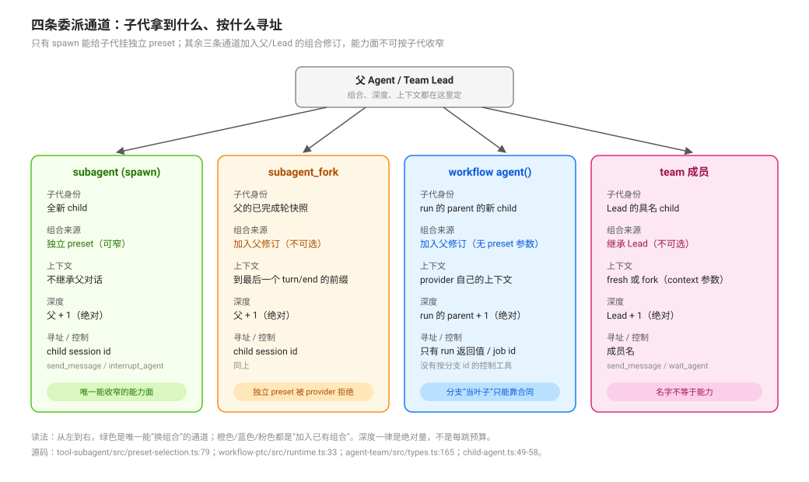

# Channel Capability Differences and Inheritance · 通道能力差异与继承

源码核验入口：`packages/subagent/tool-subagent/src/preset-selection.ts`、`packages/subagent/subagent/src/{types,index,manager,child-agent,depth}.ts`、`packages/subagent/subagent-spawn-in-process/src/index.ts`、`packages/subagent/subagent-fork-in-process/src/index.ts`、`packages/workflow/workflow-ptc/src/{runtime,host}.ts`、`packages/experimental/agent-team/src/{types,roster}.ts`。

本页回答：**同样是「把活交给别人」，spawn / fork / workflow 分支 / team 成员这四条通道，换掉的到底是什么？** 机制细节见 [`primitives/02`](../delegation-primitives/02-bounded-delegation-with-fresh-and-forked-subagents.md)、[`primitives/01`](../delegation-primitives/01-scripted-workflow-and-sandboxed-fan-out.md)、[`primitives/06`](../delegation-primitives/06-persistent-teams-with-a-shared-task-board.md)；深度与容量的完整叠加见 [`composition/06`](./06-depth-concurrency-and-capacity-limits.md)。

## 一句话

四条通道的差别不在「能不能派人」，而在三件事：**子代拿到什么组合、按什么寻址控制、深度从哪里算。** 其中**在 shipped provider 里只有 in-process spawn 能给子代挂一个与父不同的 preset**——这不是配置口味，是 provider 能力位与上下文契约共同决定的；ACP / Codex / Claude Code / SDK 都声明 `agentPreset: false`。

## 能力矩阵

| 通道 | 子代身份 | 独立 preset | 上下文 | 深度 | 控制 / 寻址 |
|---|---|---|---|---|---|
| `subagent`（spawn） | 全新 child | **支持**（`agentPreset` / `allowedAgentPresets`） | 不继承父对话 | 父 + 1（绝对） | `send_message` / `interrupt_agent`，按 child session id |
| `subagent_fork`（fork） | 父的已完成轮快照 | **不支持**（provider 能力位为 false 且继承上下文） | 到最后一个 `turn/end` 的前缀，一次性捕获 | 父 + 1（绝对） | 同上 |
| `workflow` 的 `agent()` | run 的 parent 的新 child | **不支持**（`agent()` 只认 `label/phase/schema/provider/model`） | 该 provider 自己的上下文（spawn 即全新） | run 的 parent + 1（绝对） | 只有 run 的返回值 / 后台 job；没有按分支 id 的控制工具 |
| `team` 成员 | Lead 的 child | **不支持**（`SpawnTeammateRequest` 没有 preset 字段） | `fresh` 或 `fork`，由 `context` 参数选 | Lead + 1（绝对） | `send_message` / `wait_agent`，按成员名 |

矩阵里每一格都能回到源码：

- spawn 的 provider 声明 `agentPreset: true`、`inheritsParentContext = false`（`packages/subagent/subagent-spawn-in-process/src/index.ts:39`-`46`）；fork 声明 `agentPreset: false`、`inheritsParentContext = true`（`packages/subagent/subagent-fork-in-process/src/index.ts:61`-`68`）。
- 工具在挂载时直接拒绝不满足条件的 provider：`if (this.configured && (!provider.capabilities.agentPreset || provider.inheritsParentContext)) throw`（`packages/subagent/tool-subagent/src/preset-selection.ts:79`-`81`）；服务侧在 `startActivation` 前再拒一次（`packages/subagent/subagent/src/index.ts:632`-`636`）。
- workflow 的合法选项是一个闭合集合：`const SUPPORTED_AGENT_OPTIONS = new Set(['label', 'phase', 'schema', 'provider', 'model'])`，其他键抛 `UNSUPPORTED_OPTION`（`packages/workflow/workflow-ptc/src/runtime.ts:33`、`:253`-`257`）。
- team 的请求字段只有 `name/description/prompt/context/provider/signal`（`packages/experimental/agent-team/src/types.ts:165`-`172`），spawn 时 `startActivation({ request: { prompt, parent: root } })` 不带 preset（`packages/experimental/agent-team/src/roster.ts:264`-`274`）。

## 两种「继承」，别混

| 说法 | 实际语义 | 证据 |
|---|---|---|
| fork 继承父上下文 | 到最后一个 `turn/end` 的**已完成轮前缀**，创建时捕获一次；in-flight turn 不在内；父之后的轮不进种子（新消息仍可经 `send_message` 到达） | `subagent-fork-in-process/src/index.ts:5`-`6`、`:39`-`41`、`:73`-`77` |
| spawn/fork/workflow/team 省略 preset | 子代**加入父当前的那一代 preset**（引用同一修订，不是复制一份 YAML）；显式给 id 才挂“当前可用修订” | `manager.ts:896`、`child-agent.ts:200`、`agent-preset-registry/src/index.ts:292`-`310` |

第二行是作者座最常踩的坑：**「继承组合」不等于「复制能力」**。子代加入的是父的修订引用，所以父有什么工具行，子代就有什么；改 preset 只影响**同进程内之后创建**的 Agent，跑着的父及其子代仍用旧修订（`packages/preset/agent-preset/README.md:12`、`:78`）；进程重启后的冷恢复改用该 id 的当前定义（`agent-preset-registry/README.md:99`、`:60`）。

## 深度从哪里算

三种「parent」决定深度从谁算起：spawn/fork 是发起委派的 Agent，workflow 分支是 **run 的 parent**（`host.ts:211`），team 成员是 **Lead**（`roster.ts:271`）。深度是绝对量、持久 header 是单调 floor——完整算术、`maxDepth` 取用顺序与「没有闸不等于不计数」的展开在 [`composition/06`](./06-depth-concurrency-and-capacity-limits.md)，本页不重复。

## 失败面

| 你做了什么 | 什么时候炸 | 报什么 |
|---|---|---|
| 给 fork 行配 `agentPreset` | 挂载时（工具）或 `startActivation` 前（服务） | `provider "fork" does not support independent agent preset selection` |
| 在 workflow `agent()` 里传 `agentPreset` / `maxDepth` | 脚本执行到该调用时 | `agent() option "…" is not recognized (supported: label, phase, schema, provider, model)` |
| 以为 team 成员名字等于能力（如起名 `vp-eng`） | 不炸——静默地拿到 Lead 的组合 | 无错误，只有行为差异 |
| 以为改了 preset 会影响在跑的链 | 不炸——旧修订仍被引用（重启后的冷恢复才改用当前定义） | 无错误，只有“为什么没变” |

## 推论与模式（不是 DSH 的词）

- **worker 只能是 spawn**：想在子代上收窄工具面 / 换 persona，唯一通道是给 spawn 行钉一个薄 preset；fork/workflow/team 都不接受独立 preset（详见 [`composition/03`](./03-worker-profiles-and-the-only-narrowing-lever.md)）。
- **workflow 分支的“收窄”只能靠合同**：因为分支克隆父的组合，若父有 `subagent` 行，分支也有；要它当叶子，只能靠 prompt/skill 约束，不能靠组合闸。
- **team 成员的能力面 = Lead 的能力面**：需要“某个成员更窄”时，DSH 当前没有这个选项；可行做法是让成员只做 Lead 能做的事，或把窄活交给 spawn 的 child。
- **控制面按通道分家**：`send_message` 到不了非成员的命名 child、workflow 分支没有按 id 的取消工具、job 的终态不等于模型读过结果（见 [`observation/05`](../completion-and-observation/05-delegation-graph-node-and-edge-projection.md)）。

## 待证（不要写成已证）

- `allowedAgentPresets` 打开后，模型在真实任务里的**误选率**：需要一次真模型探针（记录 `agent_preset` 参数与任务匹配度）。
- 外部 provider（ACP / Codex / Claude Code / SDK）的能力位差异对继承与寻址的影响：本页只覆盖进程内 spawn/fork；外部后端按其 provider 合同另算。
- team 成员在 `context: 'fork'` 下与 Lead 的修订关系是否与 `fresh` 完全相同：源码路径一致，但缺少真会话证据。

## 源码入口

| 路径 | 一句话 |
|------|--------|
| `packages/subagent/tool-subagent/src/preset-selection.ts:8`-`11`、`:79`-`95` | preset 默认/枚举/成员校验与 provider 拒绝 |
| `packages/subagent/subagent/src/types.ts:123`-`129`、`:318`-`323` | `SubagentCapabilities` 与 `inheritsParentContext` |
| `packages/subagent/subagent/src/out-of-process.ts:56`-`61` | `NO_START_CAPABILITIES`：外部 provider 的 `agentPreset: false` |
| `packages/subagent/subagent-acp/src/index.ts:83`、`subagent-dsh-sdk/src/index.ts:100`-`103` | ACP/SDK 的 shipped 能力位 |
| `packages/subagent/subagent/src/index.ts:632`-`636` | 服务侧 capability 断言 |
| `packages/subagent/subagent/src/child-agent.ts:158`-`163`、`:186`-`202` | `composeFrom` 加入父修订、persona/toolFilter 覆盖 |
| `packages/subagent/subagent/src/manager.ts:445`-`451`、`:883`-`896` | 子会话 meta 与组合应用点 |
| `packages/preset/agent-preset-registry/src/index.ts:292`-`310` | 加入“父保留的那一代”修订 |
| `packages/workflow/workflow-ptc/src/runtime.ts:33`、`:232`-`257` | workflow 的合法选项与拒绝 |
| `packages/workflow/workflow-ptc/src/host.ts:203`-`219` | 分支 child 的 parent 与请求字段 |
| `packages/experimental/agent-team/src/types.ts:165`-`172`、`src/roster.ts:264`-`274` | 队友请求与创建 |
