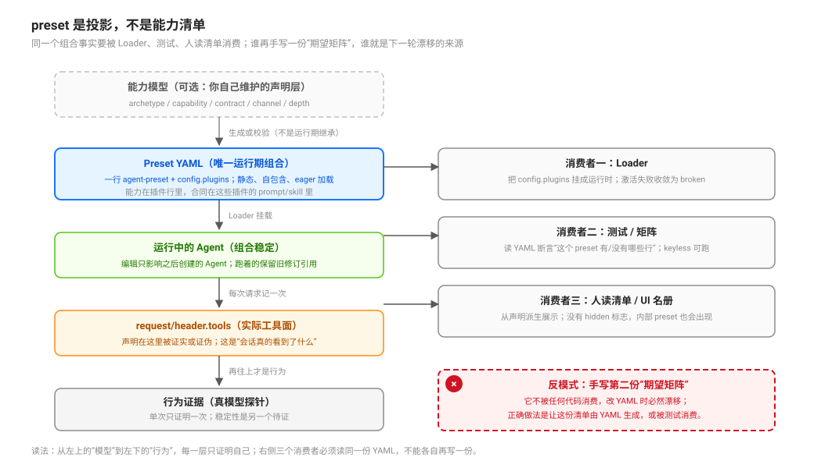

# Preset Composition as a Static Self-Contained Model · preset 作为静态自包含模型

源码核验入口：`packages/preset/agent-preset/src/index.ts`、`packages/preset/agent-preset-registry/src/{index,definition}.ts`、`packages/preset/agent-preset/README.md`、`packages/bundle/base/cordis.patch.yml`、`apps/cli`（`--dump-config`）。

本页回答：**一个 preset 到底声明了什么？它是模型还是投影？能力面藏在哪、怎么被证明？** 通道差异见 [`composition/01`](./01-channel-capability-differences-and-inheritance.md)，收窄见 [`composition/03`](./03-worker-profiles-and-the-only-narrowing-lever.md)，合同见 [`composition/04`](./04-contract-placement-between-policy-and-engine.md)。

## 读完你能回答

- 一个 preset 到底声明了什么，能力面藏在哪几处？
- 为什么「能力清单」必须从声明派生，而不能手写？
- 改了 preset，为什么跑着的 Agent 没变？

## 心智模型

核心判断：**preset 是一份静态、自包含的声明，Agent 在创建时 join 一次。**

- 声明 = `id` + `plugins` 子列表；没有 hidden 标志，也没有工具过滤字段。
- Agent 加入的是「那一代 revision」；显式给 id（哪怕等于父的 id）挂的是当前可用修订，不是父那一代。
- 所以改 preset 影响之后创建的 Agent，不影响已经跑着的会话。

## 一句话

preset 不是一份能力清单，而是**一株静态、自包含、eager 加载的插件子树**：能力在子插件行里、合同在这些插件的 prompt/skill 里、深度在行配置里——**没有任何一个字段声称「这个 preset 能做什么」**。想知道它实际能做什么，只能读组合、挂载、看会话实际工具面。

## 它是什么

| 事实 | 证据 |
|---|---|
| 一个 preset 就是一行普通 Cordis 插件，`config` 即定义；`config.plugins` 是子插件入口列表 | `packages/preset/agent-preset/src/index.ts:9`、`:16`-`23` |
| 定义里的字段只有 `id / name / description / order / plugins` | `packages/preset/agent-preset-registry/src/definition.ts:5`-`11` |
| 声明行的 `id` 给 Loader 编辑用；`config.id` 才是 session 保存的 preset 身份 | `packages/preset/agent-preset/README.md:48` |
| 定义 **eagerly 加载**：注册即激活、即挂载；激活失败留在名册里可见 | `agent-preset/README.md:12`；`agent-preset-registry/src/index.ts:77`、`:98`-`110` |
| 编辑会退役旧修订；**跑着的 Agent 保留引用**，新 Agent 才看到新定义（仅同进程；重启后冷恢复用该 id 的当前定义） | `agent-preset/README.md:78`；`agent-preset-registry/README.md:56`、`:93`、`:99` |
| **没有运行期继承**：没有 `extends`/`base`/parent 字段；用户覆盖是整份子列表替换，不合并 | `definition.ts:5`-`11`；`agent-preset-registry/README.md:99` |
| 唯一的分层是加载期 YAML patch 在 `config.plugins` 内做操作 | `docs/architecture.md:25` |
| 注册表不扫目录、不接受 preset 路径 | `agent-preset-registry/README.md:46` |
| 子条目 id 可省略、由 Loader 分配；`!!js` 保留到子插件加载 | `agent-preset/README.md:48`；`agent-preset/src/index.ts:14`-`15`、`:26`-`29` |

## 能力面藏在四处，没有单一声明

| 你以为的“能力” | 实际住在哪 | 读它要付出什么 |
|---|---|---|
| 有哪些工具（能不能委派、能不能开 workflow） | `config.plugins` 里的 tool 行 | 读 YAML + 理解每个插件的 Config |
| 行为约束（何时用哪条通道、失败怎么办） | 那些插件的 description / `systemPrompt.section` / 挂载的 skill | 读模型可见文本，不是读配置 |
| 递归预算 | 每个 delegation 行自己的 `maxDepth` | 逐行看，链的总预算没有单点声明 |
| 模型与 persona | 组合行里的 model / persona 段 | 读行配置与注入文本 |

这个形状的后果是：**「这个 preset 能干什么」是一个需要计算的结论**，不是一个可查询的字段。把 shipped 的四份 preset（`packages/bundle/web-app/presets/` 的 cordis/minimal/ptc/standard）并排读，你能看出哪些行共有、哪些是 delta，但看不出“它是否允许三层委派”——那要沿 delegation 行、bundle 组合与深度默认值一起推。

## 一个 shipped preset 里通常有什么

以 Web 组合的 `standard` 为例（`packages/bundle/web-app/presets/standard.patch.yml:6`-`127`），一株 preset 的子行按职责可以分成六类：

| 类别 | 典型行 | 作用 |
|---|---|---|
| 身份与上下文 | `persona`、`agent-instructions`、`time-context` | 模型看见的角色前缀、工作区指令、时间 |
| 工具面 | `tool-bash`/`tool-pwsh`（按平台 disable）、`tool-fs`、`tool-fs-search`、`tool-web` | 能读写、搜索、执行什么 |
| 计划与账本 | `tool-todo`、`plan-mode`（group）、`tool-goal` + `command-goal`、`tool-ask-user` | 轻量计划、审批门、跨轮目标、问人 |
| 委派 | `tool-subagent-control`（含 `list-agents`）、两条 `tool-subagent`（spawn / fork）、`workflow-ptc` + `tool-workflow` | 谁能委派、走哪条通道 |
| 技能 | `skill-filesystem` + `tool-skill` | 按需加载方法与 references |
| 上下文治理 | `compaction-basic`、`command-compact`、`tool-result-pruner`（8192/4096/1024） | 压缩与工具结果裁剪 |
| 产品能力 | `tool-present`、plugin-manager / plugin-market 的 tools | 呈现与插件管理（按部署增减） |

这张表的用法不是“抄一份 standard”，而是判断**你缺哪一类**：例如只有 `tool-subagent` 没有 `tool-subagent-control`，就没有 `send_message`/`interrupt_agent`；只有 `tool-workflow` 没有 `workflow-ptc`，工具挂载会失败；如果你的共享合同 skill 不在默认扫描根（`.dsh/skills` 等），又没配 `customSkillDirs`，它就发现不了。

## 名册、编辑与锁定

- **名册是给 UI 的，不是给模型的**：`agentPresets/list` 返回 id、`isDefault`、名称与 `broken`，`agentPresets/read` 读一份声明的 YAML；模型只有在某个工具的 `agent_preset` 参数里才看得到候选（`preset-selection.ts:46`-`50`、`:65`-`70`）。
- **编辑落点是 profile patch**：Web 组合把用户编辑持久化到 `$DSH_HOME/profiles/web/cordis.patch.yml`（`packages/bundle/web-app/README.md:91`）；仓库里每个 shipped preset 自己一份 patch 文件，按 manifest 顺序应用（`packages/bundle/web-app/README.md:123`、`package.json` 的 `dsh.bundle.patch`）。
- **会话开始后不能换**：session 已启动再选 preset 会被拒（`agent-preset/locked`），未知 id 与非法声明分别报 `agent-preset/not-found` / `agent-preset/invalid`（`agent-preset-registry/src/index.ts:207`、`:243`、`:353`）。
- **坏声明不会拖垮整棵名册**：激活失败被记成 `broken` 并告警，已有 Agent 保留它们正在用的组合（`index.ts:106`-`118`）。

## 三个消费者，一份真相

同一个组合事实会被三种东西消费，它们必须指向同一份声明：

1. **Loader**：真正把子插件挂成运行时（`agent-preset-registry` 的 mount）。
2. **人读的清单/矩阵**：如果手写第二份，下一轮改 YAML 就会漂移。
3. **测试**：只有被测试消费的声明才不是第四份副本（见 [`observation/07`](../completion-and-observation/07-evidence-layers-declaration-mount-mechanism-behaviour.md)）。

`--dump-config` 是 keyless 的声明面证据：它打印 boot-free 的入口列表 YAML，用来核对“写下的组合”。但**它不证明会话实际拿到的工具面**——那是 `request/header.tools`（`packages/core/session/src/types.ts:241`-`247` 的 `EpochHeader.tools`）记录的东西。两者混用会得出“声明对 = 行为对”的假结论。

## 失败面

| 现象 | 机制 |
|---|---|
| 改了 preset，正在跑的 Agent 没变 | 旧修订被引用；编辑只影响之后创建的 Agent（`README.md:78`） |
| 用户覆盖后内置新增行不见了 | 覆盖是整份子列表替换，不自动合入内置更新（`agent-preset-registry/README.md:99`） |
| preset 激活失败但名册里还在 | 失败定义保留可见（`agent-preset-registry/README.md:2`；`registry/src/index.ts:77`） |
| 以为 preset 能隐藏内部 worker | 没有 hidden 标志；`AgentPresetRow` 只有 `id/isDefault/name/description/broken`（`agent-preset-registry/src/types.ts:8`-`19`）；`order` 属于 `AgentPreset`（`preset.ts:4`-`10`），不在对外行类型里 |
| 以为 preset 能按 agent 过滤工具 | 定义里没有工具过滤字段；工具侧的 `toolFilter/persona` 配置已退役，加载即报迁移错误（`tool-subagent/src/index.ts:147`-`150`）；描述符里的历史 `toolFilter` 仍会在冷恢复时重放（`child-agent.ts:160`-`163`、`:217`） |

## 推论与模式（不是 DSH 的词）

- **把组合当投影，而不是当源**：如果你的仓库需要“能力清单”，让它由组合派生（生成或测试读取），不要手写第二份；否则它会在下一次改 YAML 时变成谎言。
- **一处声明、三类消费者**：Loader 消费它、人读清单从它生成、测试从它断言。发现第二份期望矩阵就停。
- **改动的作用域是“之后创建的 Agent”**：把 preset 当成不可变修订理解，才能解释为什么热改不生效、为什么跑着的子代仍用旧修订。
- **运行期没有继承，所以重复是结构性的**：想消除重复只能在构建期做（模板/生成器），并且生成物要被回读校验；不要在运行期等一个不存在的 base。

## 待证（不要写成已证）

- 生成器保真：注释、`!!js` 表达式、行序在“生成 → 回读 → 与 dump 比对”里能否逐字保持——需要一次原型。
- 名册/选择器在大规模 preset（数十个）下的可读性——属产品体验，不是引擎合同；触发条件是预设数超过一屏或出现误选报告。

## 常见误解

| 你以为 | 实际上 |
|---|---|
| preset 是运行时开关 | 静态声明；改动只影响之后创建的 Agent |
| preset 之间是继承树 | 每份自包含，组合是 join，不是继承 |
| 能力清单可以手写 | 必须从声明派生，否则与实际挂载漂移 |
| 给子代理同名 preset 会跟随父的修订 | 显式给 id 挂的是当前可用修订 |

## 源码入口

| 路径 | 一句话 |
|------|--------|
| `packages/preset/agent-preset/src/index.ts:9`-`29` | 定义 schema、eager 注册、`!!js` 保留 |
| `packages/preset/agent-preset-registry/src/index.ts:77`-`152` | 注册、激活、挂载、修订保留与回收 |
| `packages/preset/agent-preset-registry/src/definition.ts:5`-`11` | 定义字段全集（没有继承字段） |
| `packages/preset/agent-preset/README.md:12`、`:48`、`:78` | eager、身份、KV 稳定性 |
| `packages/preset/agent-preset-registry/README.md:46`、`:56`、`:93`、`:99` | 不扫目录、修订引用、覆盖语义 |
| `packages/core/session/src/types.ts:241`-`247` | `EpochHeader.tools`：会话实际工具面的持久记录 |
| `apps/cli/tests/dump-config-schema.expected.e2e.ts:355` | `--dump-config` 的 boot-free 声明面定位 |
| `packages/preset/agent-preset-registry/src/index.ts:195`-`207`、`:243`、`:353` | 名册/读取远程、未知/非法/锁定三类拒绝 |
| `packages/preset/agent-preset-registry/README.md:99`、`:60` | 重启后冷恢复使用该 id 的当前定义；旧修订不跨进程保留 |
| `packages/bundle/web-app/README.md:91`、`:123` | 用户编辑落点与 shipped preset 的 patch 文件 |
| `packages/bundle/web-app/presets/standard.patch.yml:6`-`127` | standard preset 的子行全貌（六类职责） |
