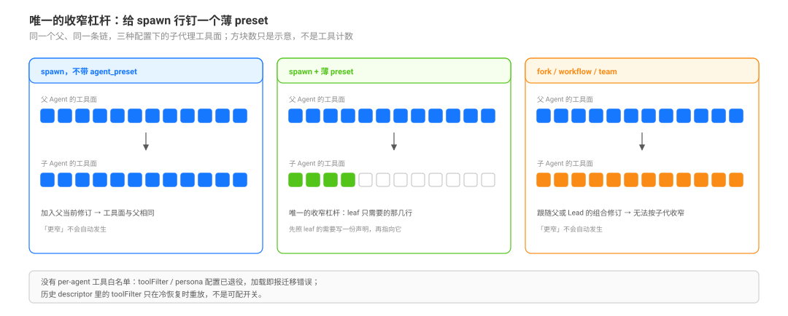

# Worker Profiles and the Only Narrowing Lever · worker 组合与唯一的收窄杠杆

源码核验入口：`packages/subagent/tool-subagent/src/preset-selection.ts` 与 `src/index.ts`、`packages/subagent/subagent/src/{child-agent,manager,descriptor,depth}.ts`、`packages/preset/agent-preset-registry/src/{index,definition}.ts`、`packages/core/tools/src/index.ts`。

本页回答：**怎么让子代理比父“更窄”？DSH 给不给 per-agent 的工具白名单？为什么子代理常常拿到父的全部工具？** 通道差异见 [`composition/01`](./01-channel-capability-differences-and-inheritance.md)，preset 是什么见 [`composition/02`](./02-preset-composition-as-a-static-self-contained-model.md)。

## 读完你能回答

- 子代理为什么默认拿到父的全部工具？
- DSH 给不给 per-agent 的工具白名单，为什么？
- 省略 `agent_preset` 到底等于什么？

## 心智模型

核心判断：**收窄不是过滤工具，是换一个更薄的 preset。**

- 省略 preset = 加入父当前修订：工具面与父相同。
- 没有 `toolFilter` / `allowedTools`；`persona` / `toolFilter` 配置已退役，加载即报迁移错误。
- 要更窄：先把 leaf 需要的那几行做成一份 preset，再让 spawn 行指向它。

## 一句话

DSH 里把子代理收窄的**唯一现役杠杆**是：让它是 spawn，并给它钉一个薄 preset。省略 `agentPreset` 的子代理不是“权限更少的 worker”，而是**加入父当前那一代 preset 的新成员**——工具面与父相同。没有 per-agent 的工具允许列表；工具侧的 `persona`/`toolFilter` 配置已退役，加载即报迁移错误；描述符里的历史 `toolFilter` 只在冷恢复时重放。

## 机制：省略 = 加入父修订

| 事实 | 证据 |
|---|---|
| `agentPreset` 省略时，本地子代理**加入父当前的 preset 修订**（引用同一条目，不复制 YAML） | `packages/subagent/subagent/README.md:65`；`manager.ts:896`；`child-agent.ts:200`；`agent-preset-registry/src/index.ts:292`-`310` |
| 显式给 id（哪怕等于父的 id）会挂载**当前可用修订**，不是父那一代 | `packages/subagent/subagent/README.md:65` |
| 子会话把继承到的 preset id 写进 header | `child-agent.ts:142`-`145`；`manager.ts:445` |
| 子代理的工具面 = 组合完成后注册进该 scope 的工具；与父共用同一修订意味着同一份工具行 | `child-agent.ts:186`-`202`；`applyChildOverrides` 只加 delegation context / persona / 历史 toolFilter |

## 为什么没有“工具白名单”

| 你可能会找的开关 | 现状 |
|---|---|
| `tool-subagent` 的 `toolFilter` / `persona` 配置 | **已退役**：加载时抛 `no longer supported; configure persona and tool plugins in an Agent Preset and select it with agentPreset (spawn only)`（`tool-subagent/src/index.ts:147`-`150`） |
| preset 定义里的工具过滤字段 | 不存在；定义字段只有 `id/name/description/order/plugins`（`agent-preset-registry/src/definition.ts:5`-`11`） |
| per-agent 的 `allowedTools` / allowlist | `packages/preset`、`packages/core/agent` 中无此字段（搜索范围：`toolFilter`、`allowedTools`、`allowlist`） |
| 低层 `ctx.tools.restrict({ allow, deny })` | 存在，但只能绑在**紧作用域**上调用。树内生产调用点有两个：子代理冷恢复重放历史 toolFilter（`child-agent.ts:160`-`163`、`:217`）与 browser-use 的 MCP 掩码（`packages/experimental/browser-use-runtime/src/mcp.ts:121`）；过滤结构见 `core/tools/src/index.ts:701`-`706`、`:1105`-`1108` |
| 隐藏内部 preset | 没有 hidden 标志；`AgentPresetRow` 只有 `id/isDefault/name/description/broken`（`agent-preset-registry/src/types.ts:8`-`19`） |

所以“worker”在 DSH 里不是一个内建类型，而是一种**组合技法**：把 leaf 需要的那几行单独做成一个 preset，然后让 spawn 行的 `agentPreset` 指向它。

## 升级口：默认最窄，显式放宽

`allowedAgentPresets` 是唯一“把选择权交给模型”的原生机制：

- 非空数组才会把 `agent_preset` 参数暴露给模型；省略则完全禁用模型选择（`preset-selection.ts:10`-`11`、`:91`-`95`）。
- 校验时机随挂载位置：Host 挂载的工具在加载时校验，preset 内的工具在每个 Agent 初始化时校验（`tool-subagent/README.md:70`）；重复 id、默认值不在集合内都直接失败（`:24`-`32`）；每个 id 都会被 `readDocument` 读一遍，但**不激活**候选（`:65`-`70`）。
- provider 必须满足 `capabilities.agentPreset && !inheritsParentContext`，否则挂载或启动前拒绝（`:79`-`81`；`subagent/src/index.ts:632`-`636`）。
- 模型可见的措辞随配置生成：省略时说 `Omit to use <preset>.`，没配默认时说 `Omit to inherit the parent agent's current preset.`（`:46`-`49`）。

**何时该放宽、放宽到哪一档，必须由随工具走的合同文本约束**（见 [`composition/04`](./04-contract-placement-between-policy-and-engine.md)）；引擎只保证“选中的 id 合法”，不保证“选得对”。

## 一张可复用的 worker 形态表（模式，不是 DSH 的词）

| profile | 组合形状 | 能力面 | 行上的 `maxDepth`（绝对深度上限） | 适用 |
|---|---|---|---|---|
| `worker.leaf` | 只列取证/读写/命令/搜索/计划这类行 | 无 `subagent`、无 `workflow`、无 team、无控制工具 | `0`（禁止再委派） | 读码、盘点、测量；只回证据 |
| `worker.orchestrator` | leaf + 一条 `subagent` 行 | 能再派一层 | 父深度 + 1（根下的 orchestrator 行填 `2`） | 小工头带一两个叶子手 |
| `worker.workflow` | leaf + `workflow` 两行 | 能扇出；分支继承父组合，再派/再扇出仍计绝对深度 | workflow 行不收 `maxDepth`（分支按绝对深度算） | 并行取证、批量审计 |
| `worker.full` | 完整角色组合 + 显式预算 | 与角色同权 | 按预算显式写 | 受信任的子负责人；需要单独评审 |

这张表是**组合配方**：每一格都要落到真实的插件行；DSH 不认识 `worker.leaf` 这个名字，也不会替你校验“leaf 真的没有 subagent 行”——校验只能由读组合的测试做（见 [`observation/07`](../completion-and-observation/07-evidence-layers-declaration-mount-mechanism-behaviour.md)）。

## 失败面

| 现象 | 机制 | 怎么发现 |
|---|---|---|
| 子代理拿到了父的全部工具 | 省略 `agentPreset` → 加入父修订 | 读子会话的 `request/header.tools`（`subagent/descriptor` 只给身份，不给工具面） |
| 给 worker 加了 `toolFilter` 以为能收窄 | 配置已退役，加载即报错 | 挂载失败信息 |
| 给 fork 钉 worker preset | provider 能力位不允许 | 挂载/启动前拒绝 |
| worker 出现在用户的选择器里 | 没有 hidden 标志 | 名册/UI 可见；需要产品侧自行标注 |
| 升级到 orchestrator 后链路变深、撞上限 | `allowedAgentPresets` 只改名册，不改深度；行内 `maxDepth` 优先，省略时每次委派读 Host `subagent.maxDepth`（初始 1） | [`composition/06`](./06-depth-concurrency-and-capacity-limits.md) |

## 推论与模式（不是 DSH 的词）

- **默认窄、显式放宽**：`agentPreset` 指向 leaf，`allowedAgentPresets` 只列 leaf/orchestrator；升级条件写进随组合走的合同文本（section/skill），不要只靠工具描述里一句口号。
- **worker 是“组合差异”，不是“角色克隆”**：判断一个 worker 是否真的窄，看它钉的 preset 里有没有 `subagent`/`workflow`/team/控制行，而不是看它的名字。
- **名字不等于能力**：team 成员继承 Lead 组合，把成员起名 `vp-eng` 不会让它获得 `vp-eng` 的 workflow 行（[`composition/01`](./01-channel-capability-differences-and-inheritance.md)）。
- **可见性要产品自己负责**：没有 hidden 标志，内部 worker 会出现在选择器里；要么接受，要么在客户端按 id 过滤（那是产品决定，不是引擎能力）。

## 待证（不要写成已证）

- `allowedAgentPresets` 打开后模型的**误选率**与升级条件是否被遵守：需要真模型探针，记录每次 `agent_preset` 与任务类型的匹配。
- 薄 preset 是否真的减少了误用（例如嵌套委派、控制面混淆）：需要对照会话，而不是静态读数。

## 常见误解

| 你以为 | 实际上 |
|---|---|
| 可以给子代理一个工具白名单 | 没有 per-agent allowlist；低层 `tools.restrict` 只在紧作用域里由生产代码调用 |
| `toolFilter` / `persona` 还能配 | 已退役，加载即报错；历史 descriptor 只在冷恢复时重放 |
| 省略 preset 会得到一个最小代理 | 等于角色克隆：加入父的当前修订 |
| 显式给 id 会跟随父的修订 | 挂的是当前可用修订 |

## 源码入口

| 路径 | 一句话 |
|------|--------|
| `packages/subagent/tool-subagent/src/preset-selection.ts:8`-`95` | 默认/枚举/校验/provider 拒绝/模型措辞 |
| `packages/subagent/tool-subagent/src/index.ts:96`-`98`、`:147`-`158` | Config schema、退役字段、maxDepth 校验（`provider-managed` 语义） |
| `packages/subagent/subagent/src/child-agent.ts:135`-`163`、`:186`-`217` | 子会话 header、加入父修订、覆盖顺序 |
| `packages/subagent/subagent/src/manager.ts:445`-`451`、`:883`-`896` | 组合选择与子会话 meta |
| `packages/preset/agent-preset-registry/src/index.ts:292`-`310` | 加入父保留的修订 |
| `packages/preset/agent-preset-registry/src/definition.ts:5`-`11` | 没有工具过滤/继承字段 |
| `packages/core/tools/src/index.ts:701`-`706`、`:1105`-`1108` | `ToolRestriction` 与 scoped `restrict()` |
