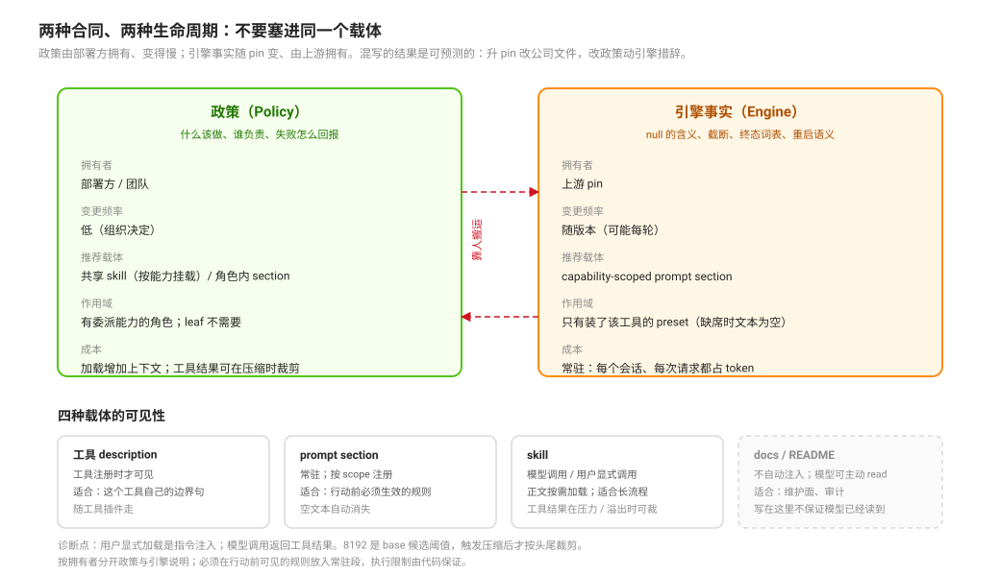

# Contract Placement between Policy and Engine · 合同归属：政策与引擎

> 本页回答：**一条委派规则该写在哪，才能既被模型看见、又不在下一轮漂移？** 载体有四种：工具 description、常驻 prompt section、按需 skill、人读 docs。它们的可见性、成本与生命周期不同，混用就是漂移的来源。

> 源码核验入口：`packages/core/system-prompt/src/index.ts`、`packages/skill/skill-filesystem/src/index.ts`、`packages/skill/tool-skill/`、`packages/bundle/base/cordis.patch.yml`、`packages/workflow/tool-workflow/src/index.ts:324`-`326`、`packages/subagent/tool-subagent/src/index.ts:113`-`137`。

## 读完你能回答

- 一条委派规则该写在四个载体中的哪一个，各自的可见性与成本是什么？
- 为什么政策与引擎事实要分两层？
- `docs/` 为什么不是模型面？

## 心智模型

核心判断：**规则要么在模型这次请求的视野里，要么不在；不在的那部分必须由代码保证。**

- 四个载体：工具 description（该工具在作用域内注册时才可见）、常驻 prompt section（按作用域注入）、按需 skill（加载才进）、人读 docs（不自动注入）。
- 政策靠文本约束模型，引擎事实靠代码约束系统；把后者写成文本等于没有约束。
- `AGENTS.md` / `CLAUDE.md` 与 skill 是文件→上下文的载体，`docs/` 不是。

## 一句话

先分清两种合同，再选载体：**政策**（什么该做、谁负责，稳定、由部署方拥有）与**引擎事实**（某个工具怎么结算、怎么截断、随 pin 变、由上游拥有）。两者生命周期不同，不能塞进同一个载体；而 docs 不会被运行时自动注入——模型仍可按需 `read`，但没有任何机制保证它读到。

## 四种载体

| 载体 | 模型可见 | 作用域 | 成本 | 生命周期 | 适合 |
|---|---|---|---|---|---|
| 工具 description / 参数 description | 该工具注册时才可见 | 每个工具实例 | 每次请求都在 | 随工具插件走 | 这个工具自己的边界句（何时用、何时别用） |
| `ctx.systemPrompt.section` | 在该 scope 的每次请求里常驻 | 注册它的 scope（Agent / 子上下文） | 每个会话的常驻 token | 随注册它的插件走；dispose 即消失 | 必须先于行动生效的规则；安全/顺序约束 |
| skill（`tool-skill` + `skill-filesystem`） | 模型调用 `skill`，或用户显式调用允许用户调用的 skill 时加载正文 | 调用 Agent 可见的 skill providers 与目录 | 加载正文增加上下文；工具结果可在压缩时被裁剪 | 正文按需读取；已加载文本留在历史 | 长流程、方法、references |
| docs / README | 不自动注入（模型仍可 `read`） | 人 | 零 | 由维护者改 | 维护面、审计、交接 |

### 关键源码事实

- `systemPrompt.section()` 是**按 scope 注册的常驻段**：同名 scoped section 会遮蔽 global；注册/释放会发 `system-prompt/change`；顺序由中心表给出（`packages/core/system-prompt/src/index.ts:471`-`495`）。
- 工具插件的做法是**工具自己注册自己的策略段**：`tool-workflow` 在注册工具的同时 `ctx.systemPrompt.section({ name: \`tool:${toolName}\`, ... })`，注释写明 “Usage policy ships with the tool (the master convention: tool guidance lives in tool plugins as prompt sections, not in the deployment persona)”（`packages/workflow/tool-workflow/src/index.ts:324`-`333`）。
- skill 目录由 `skill-filesystem` 的 `customSkillDirs` 追加（`packages/skill/skill-filesystem/src/index.ts:58`、`:80`）——所以“共享合同 skill”在机制上可行：多个 preset 挂同一个目录即可。
- skill 有模型工具调用和用户显式调用两条入口：前者返回工具结果，后者把正文注入本步指令上下文，并检查用户调用权限；两者均按调用 Agent 的作用域查找。目录与正文更新、历史保留见[skill 输入生命周期](../../tools-prompt-llm/07-skill-input-lifecycle.md)。
- 模型调用产生的 skill 工具结果属于 pruner 的候选。base 配置 `thresholdChars: 8192`、head 4096、tail 1024；**只有压缩压力或溢出触发条件成立才运行裁剪**，未达压力时超长结果也不会仅因长度立即被裁。阈值按文本 Unicode 码点计数；原始结果仍留在日志，后续请求使用替换后的内容。触发与保留规则由 [tool-result pruner](https://github.com/deepseek-ai/deepseek-harness/blob/master/packages/compaction/compaction-tool-result-pruner/README.md#when-trimming-runs)拥有；用户显式注入不是这类工具结果。
- 包 README 是**部署者视角的转述**，不进模型上下文（见 [`selection/01`](../primitive-selection/01-per-primitive-usage-sentences-from-tool-descriptions.md) 的同一结论）。DSH 里**自动**把文件送进模型上下文的只有两类：工作区指令（`AGENTS.md` / `CLAUDE.md`，由 agent-instructions 加载）与 skill 的 `SKILL.md`；`docs/` 与包 README 不会被运行时自动注入，但模型可以用 `read` 主动读取——shipped 的 creator/agent-experience skill 就明确要求读包 README（`packages/context/agent-instructions/src/config.ts:12`、`packages/skill/skill-filesystem/src/index.ts:735`-`736`、`packages/preset/agent-preset/README.md:50`）。

## 为什么必须分两层

| | 政策 | 引擎事实 |
|---|---|---|
| 例子 | 什么任务该派、brief 怎么写、升级到哪个 worker、失败怎么回报 | `null` 的含义、截断阈值、终态词表、重启后什么会丢 |
| 谁拥有 | 部署方 / 团队 | 上游 pin |
| 变更频率 | 低（组织决定） | 随版本（可能每轮） |
| 出错后果 | 行为不合意图 | 断言过期、把“引擎行为”写成“我们的规则” |

把两者写进同一份 skill 的后果是可预测的：升一次 pin 就要改公司政策文件；改一条政策会顺带改动引擎事实的措辞；而没挂这份 skill 的角色/worker 永远拿不到引擎事实（这正是 [`composition/03`](./03-worker-profiles-and-the-only-narrowing-lever.md) 里 worker 收窄失败的常见原因之一：合同没跟着 worker 走）。

## 按能力注入，而不是按角色复制

正确的形状是**按能力存在性注入**：

- 有 `workflow` 工具行的 preset 才需要 workflow 的引擎段；没有该工具时，那段文字是纯 token 税，还会诱导模型调用不存在的工具。DSH 已有这种形状：`tool-fs` 的读段在工具缺席时返回空串（空串不进 prompt），`tool-subagent` 的并发提示也只在 delegation 工具可见时非空（`packages/fs/tool-fs/src/read.ts:72`-`73`、`packages/subagent/tool-subagent/src/index.ts:368`-`380`）。
- 有委派能力的角色才需要委派政策；leaf worker 不需要“如何升级到 orchestrator”的段落。
- 同一份政策被多个角色使用时应挂同一个 skill 目录（或由同一个 host 插件注入同一段），而不是在每个角色的 skill 里复制一份。

## 失败面

| 现象 | 机制 | 证据 |
|---|---|---|
| 合同写进某个角色的 skill，其他角色/worker 不遵守 | 只有挂载该目录的 preset 才加载它 | `customSkillDirs` 是按 preset 配置的 |
| 工具加载的 skill 正文中段消失 | 压缩压力或溢出触发 pruner，超过配置阈值的工具结果被替换成头尾 | [pruner 触发规则](https://github.com/deepseek-ai/deepseek-harness/blob/master/packages/compaction/compaction-tool-result-pruner/README.md#when-trimming-runs)；base 阈值配置 |
| 常驻段对所有角色生效、token 变贵 | `section` 注册在哪个 scope 就进哪个 scope；全局注册 = 所有 Agent | `system-prompt/src/index.ts:470`-`495` |
| docs 改了但模型行为没变 | docs 不会被自动注入；模型不 `read` 就看不到 | master convention 注释 + 上面的加载器证据 |
| 修一个 bug 加一句、合同越写越长 | 没有分层：政策、引擎事实、事故注解混在一起 | 本页「为什么必须分两层」；判据见 [`perspectives/04`](../design-perspectives/04-nine-traps-in-delegation-surfaces.md)（判断，不是机制） |

## 推论与模式（不是 DSH 的词）

- **一个事实一个家**：引擎事实只在引擎段里出现一次，政策只在政策载体里出现一次；其他地方链接，不复制。
- **载体按可见性选**：必须在行动前生效的 → section；工具自身的边界 → description；可以按需读的长流程 → skill；只给人看 → docs。
- **预算先算再写**：工具加载的 skill 应按部署的 pruner 预算组织正文，并把细节拆到按需读取的 references；超过阈值增加压缩时丢失中段的风险。常驻 section 会持续占用后续请求的上下文。
- **能力域即作用域**：合同跟着能力走（有 workflow 才有 workflow 段），不要用“给所有角色都加一段”来省事。

## 常见误解

| 你以为 | 实际上 |
|---|---|
| 写进 docs，模型就会遵守 | docs 不自动注入；可以读，但没有保证 |
| skill 是硬约束 | 正文是加载后的指令文本；工具结果还可能在压缩时被裁剪，执行限制须由代码保证 |
| skill 超过 8192 就立即被裁 | 长度只决定候选；压缩压力或溢出触发条件成立后才裁剪工具结果 |
| 合同放哪都一样 | 载体决定可见性、加载时机与维护成本 |
| `AGENTS.md` 与 docs 同类 | `AGENTS.md` / `CLAUDE.md` 与 skill 才是文件→上下文载体 |

## 待证（不要写成已证）

- 共享 skill 在真实任务里是否**在委派前被加载**：需要真模型会话，区分模型自主调用与用户显式调用，并观察随后是否按政策行动。显式加载只证明入口可用，不能证明模型会自主选择。
- 常驻 section 与 skill 两种载体的**行为差异**：同一句话放两处，模型的遵守率是否不同——需要对照探针，不能靠直觉。

## 源码入口

| 路径 | 一句话 |
|------|--------|
| `packages/core/system-prompt/src/index.ts:471`-`495` | `section()` 的 scope、遮蔽、disposer 与顺序；空文本被丢弃 |
| `packages/workflow/tool-workflow/src/index.ts:324`-`333` | master convention 与工具自带 section |
| `packages/skill/skill-filesystem/src/index.ts:58`、`:80`、`:735`-`:736` | `customSkillDirs` 配置与默认值；`SKILL.md` 发现路径 |
| `packages/bundle/base/cordis.patch.yml:425`-`430` | `tool-result-pruner` 的 8192 / 4096 / 1024 |
| [tool-skill 加载入口](https://github.com/deepseek-ai/deepseek-harness/blob/master/packages/skill/tool-skill/src/index.ts#L128-L205) | 模型调用返回工具结果；用户显式调用注入指令上下文 |
| [tool-result pruner README](https://github.com/deepseek-ai/deepseek-harness/blob/master/packages/compaction/compaction-tool-result-pruner/README.md#when-trimming-runs) | 只有压力或溢出触发条件成立才运行裁剪 |
| [压缩与裁剪测试](https://github.com/deepseek-ai/deepseek-harness/blob/master/packages/compaction/compaction-basic/tests/compaction-basic.spec.ts#L945-L1001) | 未达压力不裁剪；裁剪可独立解除压力或先于总结执行 |
| `packages/subagent/tool-subagent/src/index.ts:113`-`137` | 同包双实例各带各的 wording |
