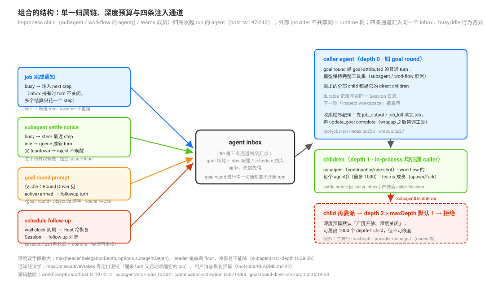

# Ownership, Depth Budget and Notification Channels · 归属链、深度预算与通知通道

源码核验入口：本页是专题综合页——**不引入新机制**，把 [`primitives/01`](../delegation-primitives/01-scripted-workflow-and-sandboxed-fan-out.md)-[`primitives/06`](../delegation-primitives/06-persistent-teams-with-a-shared-task-board.md) 已核验的事实组合成协同模式；新增的直接源码引用只有三处：`packages/workflow/workflow-ptc/src/host.ts:200`-`212`（扇出归属）、`packages/goal/tool-goal/src/wrapup.ts:27`/`:37`（收尾禁工具）、`packages/jobs/tool-jobs/src/index.ts:254`（收 job 纪律）。

本页回答：原语叠起来用时，结构性的事实是什么？哪些协同形态被源码直接支撑？收尾时要守哪些跨原语纪律？选择语义（单原语什么时候用）见 [`selection/01`](../primitive-selection/01-per-primitive-usage-sentences-from-tool-descriptions.md)。

## 读完你能回答

- 原语叠起来之后有哪三个结构性事实？
- 通知有几条通道，各自投递到哪？
- 跨模式收尾为什么要守顺序？

## 心智模型

一句话：**收尾是顺序问题：先收下游，再报结算，最后放所有权。**

- 父在 owned children 非空时不能被结算（holdOwnership）。
- 结算通知先于所有权释放（`releaseSlot → notifySettlement → releaseOwnership`）。
- 收尾清单的顺序，就是这三步的展开。

## 为什么是这个形状：设计考量

本页不重新定义原语，也不重复 [`00-map`](../00-map.md) 的总矩阵；它只记录几个组合时会改变操作顺序的局部事实：in-process 子代理的归属与生命周期关系、通知通道的 busy/idle 分工，以及深度/并发/总量共同组成的资源预算。原语选择边界见 [`selection/01`](../primitive-selection/01-per-primitive-usage-sentences-from-tool-descriptions.md)，生命周期语义见 [`observation/01`](../completion-and-observation/01-acceptance-visibility-quiescence-and-disposal.md)，资源上限见 [`06`](./06-depth-concurrency-and-capacity-limits.md)。

## 三个结构性组合事实

一切组合都建立在这三条已核验的事实上：

**事实一：in-process 子代理的 parent 关系是明确的，但不是所有 provider 都共享同一 runtime 树。** workflow 的每个 `agent()` 经 `this.subagents.startActivation({ provider, delivery: 'caller', request: { prompt, parent: this.parent } })` 发布，`this.parent` 是 workflow run 的 parent（`packages/workflow/workflow-ptc/src/host.ts:200`-`212`）；普通 in-process continuable child 也保存 durable direct parent。Agent Teams 复用 spawn/fork provider 创建具名成员，但外部 ACP、Codex、Claude Code、SDK provider 的运行时身份和恢复合同不同，不能统一描述为 host 内 child 树。归属、权限和结算必须按 provider 能力与原语合同判断。

**事实二：深度预算允许 fan-out，但不代表无限广度。** 默认 `maxDepth = 1`（[`primitives/02`](../delegation-primitives/02-bounded-delegation-with-fresh-and-forked-subagents.md)）：顶层 agent（depth 0）可以经 workflow 扇出 depth-1 child，但受 workflow 的并发、总调用和每次项目数量上限约束（[`primitives/01`](../delegation-primitives/01-scripted-workflow-and-sandboxed-fan-out.md) caps 节）；continuable 子代理还受默认 `maxActiveSubagents = 8` 的活体容量限制。任何 child 再委派就是 depth 2 > 1 的 `SubagentDepthError`。例外是工具行配 `'provider-managed'`（递归预算归 child runtime，codex/claude-code 行即如此）。**组合的纵向深度由预算表达，横向并发由各运行时容量共同限制。**

**事实三：四条注入通道汇入同一个 inbox，busy/idle 行为各异。**

| 通道 | 触发 | busy agent | idle agent |
|------|------|-----------|-----------|
| job 完成通知（[`primitives/05`](../delegation-primitives/05-background-jobs-and-wall-clock-schedules.md)） | 后台 job 结算 | 注入 next step（inbox 持有通知时 turn 不关闭，多个结算只花一个 step） | 唤醒 turn |
| subagent settle notice（[`primitives/02`](../delegation-primitives/02-bounded-delegation-with-fresh-and-forked-subagents.md)） | child 结算（`delivery: parent` 且已公告） | steer 最近 step；父正在 teardown 时改为 inject（下一 pre-step，不唤醒） | queue 成新 turn |
| goal round prompt（[`primitives/04`](../delegation-primitives/04-cross-round-goals-and-the-round-driver.md)） | Round Driver 见 idle + armed goal | —（只在 idle 发生） | followup turn |
| schedule follow-up（[`primitives/05`](../delegation-primitives/05-background-jobs-and-wall-clock-schedules.md)） | wall-clock 到期（Host 冷恢复 Session） | —（排队为消息） | follow-up turn |

推论一：goal round 进行中，job 完成与 settle notice 都**不开新 turn**——它们以 step 注入/steer 的方式并入当前轮；只有 schedule 到期会作为新消息排队。推论二：idle 是三条通道的交汇点——"idle 时该发生什么"由 goal（续轮）、jobs（唤醒）、schedule（到点）三方竞争，先到先得。推论三：`caller` 投递的 activation 不通知，只把结果返回调用方（`subagent/src/types.ts:42`-`43`）；`send_message` 返回的是投递确认，不是对方的回答（`tool-subagent-control/src/index.ts:32`）。

## 模式 A：goal 驱动的扇出-收敛循环

一个 goal round 内：`todo_write`（并行模式，shipped 即 `allowParallelInProgress: true`——该开关的存在理由就是"agents that may run work concurrently (subagents, background commands, workflow fan-out)"，`packages/todo/tool-todo/README.md:36`）→ 起若干 subagent 有界委派（读码/研究/评审）→ **不忙轮询**（[`selection/01`](../primitive-selection/01-per-primitive-usage-sentences-from-tool-descriptions.md) tool:jobs 纪律）→ settle notice steer 进当前 step 或 queue 成 turn → 回写产物 → agent idle → Round Driver 注入下一轮 `<goal_round>`（"inspect workspace instead of assuming earlier narration"，[`primitives/04`](../delegation-primitives/04-cross-round-goals-and-the-round-driver.md)）。

支撑事实：goal round 是全工具普通 turn（05）；subagent continuable 默认后台 + settle notice 三态投递（03）；fork 可让子任务建立在已完成轮次上且保 KV 前缀（03）。

## 模式 B：后台扇出 + 跨轮收割

`workflow run_in_background: true` → 立即拿 job id（[`primitives/01`](../delegation-primitives/01-scripted-workflow-and-sandboxed-fan-out.md)）→ 本轮继续别的活 → 完成通知注入 step → `job_output` 收割结果（**wait: true 只在真被堵住时用**，[`selection/01`](../primitive-selection/01-per-primitive-usage-sentences-from-tool-descriptions.md)）。跨 goal 轮的长扇出由此成立：一轮发起、任意后续轮收割。

**收尾顺序纪律（goal × jobs 的真实张力）**：goal 的 wrapup 指令在 `update_goal complete` **之后**注入且明令 "Do not call any more tools in this run"（`packages/goal/tool-goal/src/wrapup.ts:27`、`:37`）；而 tool:jobs 纪律要求 "Before giving a final answer, collect every still-relevant job with job_output … and job_kill jobs that stopped mattering"（`packages/jobs/tool-jobs/src/index.ts:254`）。两者相遇的唯一正确顺序：**先 `job_output`/`job_kill` 清完 job，再调 `update_goal complete`，最后让 wrapup 收尾**——complete 之后才想起来的 job 只能等用户的下一条消息。

## 模式 C：fork 的对话延续链

子任务需要"建立在这次对话已完成轮次上"时用 `subagent_fork`（继承 balanced completed-turn 前缀、KV 前缀字节复用，[`primitives/02`](../delegation-primitives/02-bounded-delegation-with-fresh-and-forked-subagents.md)）→ child 可经 `send_message` 回话给父（relay 语义）→ 父随时 `send_message` 续命 / `interrupt_agent` 打断（keepInbox 保留未领工作）→ child settled 后仍可冷恢复。组合要点：**fork 的省钱前提是别动 provider/model**（任何变更毁掉继承前缀的复用资格）；`persona`/`toolFilter` 是历史描述符字段，不是现役配置面。

## 模式 D：两种长任务形态的选择（goal vs ralph）

[`primitives/03`](../delegation-primitives/03-fresh-agent-iteration-loop-and-round-handoff.md) 的两策略表是组合层的最终判据：**同会话持久目标（保留对话上下文、goal-attributed 轮）用 goal；有意丢弃对话上下文、只信 workspace + 有界报告的 fresh 迭代用 ralph**（仅人类显式要求）。两者都是"外层策略迭代"，Round 语义不同源，不可混用。

## 模式 E：长驻协作（teams）的进入与退出

需要持久任务板 + 双向邮箱 + 具名队友时上 teams（[`primitives/06`](../delegation-primitives/06-persistent-teams-with-a-shared-task-board.md)）——同时接受组合代价：全局 subagent 控制面与 subagent/fork 工具被 disable；**workflow 的 spawn 保留**，所以 teams 会话里的大扇出仍走 workflow。

## 跨模式收尾纪律清单

1. **goal complete 前收 job**（模式 B 的顺序纪律）；
2. **最终答案前收 job**（tool:jobs 原文，对一切 final answer 生效，[`selection/01`](../primitive-selection/01-per-primitive-usage-sentences-from-tool-descriptions.md)）；
3. **Lead 必须等 required teammates 才能给最终答案**（teams POLICY，[`primitives/06`](../delegation-primitives/06-persistent-teams-with-a-shared-task-board.md)）；
4. **plan → todo 的顺序**：plan 模式内不用 todo_write（计划本身属于 `exit_plan_mode`）；批准后的**实施**才用 todo 跟踪（`packages/bundle/base/cordis.patch.yml:340`）；
5. **wait_agent 醒后 re-list、不轮询**；**send_message 成功即持久勿重发**（[`primitives/06`](../delegation-primitives/06-persistent-teams-with-a-shared-task-board.md)）；
6. **KV 前缀经济**：fork 不选模型（保前缀）；组合链上保持 child 的 provider/model 与前缀稳定（persona/toolFilter 只作为历史描述符字段存在，不是现役配置面，见 [`composition/03`](./03-worker-profiles-and-the-only-narrowing-lever.md)）。

## 常见误解

| 你以为 | 实际上 |
|---|---|
| 父 idle 就会被结算 | 有 owned children 时被 hold，不能结算 |
| 通知在所有权释放之后发 | 通知先于释放 |
| 收尾顺序无关 | 顺序决定会不会丢通知或丢结果 |
| 组合只影响工具数量 | 它同时改变所有权、通知与收尾 |

## 源码入口

| 路径 | 一句话 |
|------|--------|
| `packages/workflow/workflow-ptc/src/host.ts:200`-`212` | 事实一：每个 `agent()` child 归属 run 的 parent |
| `packages/goal/tool-goal/src/wrapup.ts:27`、`:37` | 事实四：终结后 wrapup 禁再调工具 |
| `packages/jobs/tool-jobs/src/index.ts:254` | 事实五：最终答案前收 job 纪律 |
| `packages/todo/tool-todo/README.md:36` | todo 并行开关的组合理由 |
| `packages/bundle/base/cordis.patch.yml:340` | plan 与 todo 的顺序纪律 |
| `packages/subagent/subagent/src/manager.ts:1186`-`1206` | 结算通知的三种投递（queue/steer/inject）与公告门 |
| `packages/subagent/subagent/src/types.ts:42`-`43` | `delivery: parent \| caller` 的语义差异 |
| `packages/subagent/tool-subagent-control/src/index.ts:32` | `send_message` 返回投递确认，不是回答 |
| 本组 `primitives/01`-`06` 与 `composition/03` 各页 | 模式支撑事实的全部出处（页内已带 path:line） |
