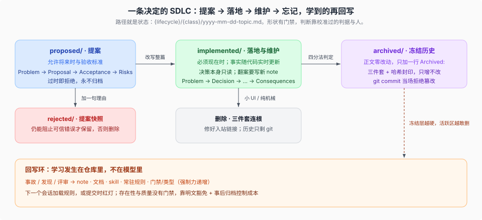

# Development Flow · DSH 的决策 SDLC

## 一句话

DSH 把「一个决定为什么是这样」做成了仓库里的一等语料：它有自己的目录树、自己的生命周期、自己的门禁、自己的遗忘策略，以及自己的双语文档契约。`.agents/notes/` 不是博客归档，也不是 ADR 目录的别名——**它是把「想法 → 已落地事实 → 冻结历史」做成状态机的通道：形状（位置、骨架、封印）有机器判据，判断（写不写、写得对不对、何时忘记）靠校准过的判据与人读**（哪一半没有门禁，见 [`06`](./06-honest-gaps.md)），而 `docs/` 只写当前状态，读者不必从 git log 反推意图。

## 先看你熟悉的问题

在 agent 驱动的开发里，「为什么」比「是什么」更容易蒸发。模型没有跨会话记忆：这次会话里做下的取舍，下次会话只剩代码本身。人类 reviewer 也一样——半年后看一段奇怪的默认值，git log 告诉你它何时改的，但不告诉你它**为什么必须是这样、当时否决了什么、什么条件下才能改回去**。

常规补救是写 ADR 或设计文档。但 ADR 目录有两个熟知的腐化模式：文件变陈旧没人维护，或者有人把结论悄悄改成相反方向。DSH 的答案是把决策记录当成一条**有生命周期、有门禁、有遗忘纪律的 SDLC 管线**来工程化——不是「写下来就好」，而是每个状态转换都有操作定义，每种形状都有红灯，每次忘记都可复核。

## 一条决定的全程

| SDLC 阶段 | DSH 的落点 | 关键纪律 | 机制页 |
|-----------|-----------|----------|--------|
| **提案** | `proposed/{class}/` | 允许将来时；必须写验收标准与风险 | [`01`](./01-lifecycle.md) |
| **决策落地** | proposed → implemented | 改写整篇为现在时；提案期标题禁入 | [`03`](./03-transitions.md) |
| **维护** | `implemented/{class}/` | 事实随代码实时更新；**决策本身只读**，翻案要写新 note | [`01`](./01-lifecycle.md)、[`03`](./03-transitions.md) |
| **拒绝** | proposed → rejected | 最小化操作：状态行加一句理由，正文冻结 | [`03`](./03-transitions.md) |
| **忘记** | implemented → archived / 删除 | 四分法判据；归档只加一行，哈希封印永不篡改 | [`04`](./04-forgetting.md) |
| **回写** | 事故/发现 → 规则/门禁/skill/note | 学习发生在仓库里，不在模型里 | [`05`](./05-writeback-loop.md) |

这套管线**在形状上是硬的**（位置、骨架、封印都有红灯），**在判断上是软的**（写不写、写得对不对、何时忘记，靠校准过的判据加人读）。哪些规则真的会红、哪些只靠人，[`02`](./02-gates.md) 与 [`08`](./08-enforcement-sites.md) 逐条列；没有闭环的地方，[`06`](./06-honest-gaps.md) 给出可证伪的缺口清单。

## 两个设计出来的轴

整棵树的形状只有两个轴，两者相乘成 `{lifecycle}/{class}/`：

- **lifecycle（状态）**：`proposed/` → `implemented/` 或 `rejected/`，加一个终态 `archived/`。
- **class（决策种类）**：`feature` / `bug-fix` / `simplification` / `architecture` / `process` / `testing`，闭集。

由 [`walkAgentNoteTree`](../../scripts/agent-note-tree.ts) 走出来、由 `verify-agent-note-classification` 强制。除此之外的排布——每个 class 里同时住着三件套（`.md` / `.zh.md` / `.i18n.yaml`）、文件名前缀日期、每篇正文必须同骨架——都不是「再加一个维度」，而是**同一件事的三个侧面**：可寻址、可配对、可校验。树的深度为什么钉死在三层、负载怎么分布，详见 [`01`](./01-lifecycle.md)。

## 十个问题，九篇入口

| 你的问题 | 入口 | 一句话答案 |
| --- | --- | --- |
| **一条决定活在哪、状态怎么表达？** | [`01-lifecycle.md`](./01-lifecycle.md) | 路径就是状态：`{lifecycle}/{class}/yyyy-mm-dd-topic.md`，两个正交轴相乘，禁止集中索引 |
| **六个 class 怎么判定？refactor 为什么没有？** | [`09-agent-note-decision-classification.md`](./09-agent-note-decision-classification.md) | 先问「改变的是什么」：改交付源码的四个类 + 围绕代码的两个类；refactor 与 simplification 重合，判别式已编码；附 class × lifecycle 矩阵 |
| **note 太多了，能不能再分子目录？** | [`01-lifecycle.md`](./01-lifecycle.md#树的深度被钉死在三层所以子目录怎么组织这个问题不存在) | 不能：深度必须是 3，20 个叶子目录平摊千篇级负载；放弃第四层换来「分类只有一套且有校验收口」 |
| **哪些规则真的会红？** | [`02-gates.md`](./02-gates.md) | 三个 leaf 门禁各自管一段；能机械判的进红灯，判不了的明文交给人和一个校准过的 skill |
| **状态之间怎么走、走错了会怎样？** | [`03-transitions.md`](./03-transitions.md) | proposed→rejected 是一条最小化操作；proposed→implemented 要求改写整篇，而这道改写**只有一半有门禁** |
| **什么时候该忘记？** | [`04-forgetting.md`](./04-forgetting.md) | 四分法（删除/保留/归档/拒绝）+ 明文排除体量与年龄 + 哈希封印；一次批量归档可被逐字节复核 |
| **学到的东西怎么回到仓库？** | [`05-writeback-loop.md`](./05-writeback-loop.md) | 学习外置成规则/门禁/skill/note 等形态；存在性与质量没有门禁，靠明文豁免 + 事后归档控制成本 |
| **这套制度哪里没有闭环？** | [`06-honest-gaps.md`](./06-honest-gaps.md) | 六条缺口逐条附一个能把它推翻的观察：分类门禁不读 README、口径两个计数、改写纪律无内容检查等 |
| **命名和日常写法的规矩从哪来？** | [`07-naming-and-house-style.md`](./07-naming-and-house-style.md) | 三层命令文件、与 `docs/` 的管辖权对偶、动词命名五律、闭集章节词汇、链接代替叙述 |
| **这些规则究竟由谁执行、什么时候响？** | [`08-enforcement-sites.md`](./08-enforcement-sites.md) | `doc-sync` 只是六类执法者之一：git 钩子、十余道门禁的排除谓词、六份 skill、PR review 各管一段 |

## 谁拥有哪一段

| 事实 | 家 |
| --- | --- |
| 生命周期、class 闭集、归档与删除判据、正文骨架 | [`.agents/notes/README.md`](../../.agents/notes/README.md) |
| `implemented/` 的「保持最新、不得改决策」规则 | [`.agents/notes/implemented/AGENTS.md`](../../.agents/notes/implemented/AGENTS.md) |
| `archived/` 的冻结与唯一允许的 seal 变更 | [`.agents/notes/archived/AGENTS.md`](../../.agents/notes/archived/AGENTS.md) |
| 结构性规则的可执行版本（闭集、深度、文件名、`INDEX.md` 禁令） | [`scripts/agent-note-tree.ts`](../../scripts/agent-note-tree.ts) |
| 正文骨架与提案期禁行 | [`scripts/verify-agent-note-format.ts`](../../scripts/verify-agent-note-format.ts) |
| 三件套完整性、归档元数据、哈希封印 | [`scripts/archived-agent-notes.ts`](../../scripts/archived-agent-notes.ts)、[`verify-archived-agent-notes.ts`](../../scripts/verify-archived-agent-notes.ts) |
| 归档四分法的判定程序与校准样例 | [`.agents/skills/dsh-archive-agent-notes/SKILL.md`](../../.agents/skills/dsh-archive-agent-notes/SKILL.md) |
| 冻结层在什么时机被强制（`pre-commit` / `pre-merge-commit`） | [`lefthook.yml`](../../lefthook.yml) |
| 「归档算不算源散文」这一判断 | [`scripts/repo-files.ts`](../../scripts/repo-files.ts) 的 `isArchivedAgentNotePath`，及三个各自写死前缀的门禁 |
| 纪律的分片载体（六份 skill 各管一段） | `.agents/skills/dsh-{archive-agent-notes,code-review,find-simplifications,prose-standard,trim-cot-leakage,doc}/SKILL.md` |
| 双语文档契约（pair 三文件、sidecar、切换器） | [`docs/i18n/README.md`](../../docs/i18n/README.md) |

跨文件只允许「摘要 + 链接」；本专题不复制 `docs/i18n/README.md` 的配对契约，也不复制 README 的完整判据表。

## 阅读路径

- **10 分钟，抓住形状**：本页的 SDLC 阶段表 → [`01`](./01-lifecycle.md) 的两轴表与三生命周期义务表 → [`02`](./02-gates.md) 的门禁职责表。
- **30 分钟，抓住纪律**：加读 [`03`](./03-transitions.md)（转换为什么不对称）与 [`04`](./04-forgetting.md)（忘记如何被写成判据）。
- **要动手审计语料**：[`04`](./04-forgetting.md) 的四分法校准 → [`06`](./06-honest-gaps.md) 的缺口清单 → 回到 DSH 自己的 `dsh-archive-agent-notes` skill 执行。
- **要写一篇 note**：`harness-idea/` 的 [`08`](../harness-idea/08-judgement-discipline.md) 讲出处纪律，本专题 [`02`](./02-gates.md) 讲骨架会拒绝什么，[`07`](./07-naming-and-house-style.md) 讲命名与措辞习惯。
- **要判断「这条规则到底能不能拦住我」**：[`08`](./08-enforcement-sites.md) 的时机对照表——六类执法者按「什么时候会响」重排，编辑期那一格是空的。

## 边界

- 本专题不解释 Agent Note **该记什么内容**（那是每条 note 自己的事），只解释它的容器与处置规则。
- 机制页把「测试政策、扩充 cookbook、升级指南」当作相邻资产提及，但它们的机制归 [`test-strategy/`](../test-strategy/00-map.md) 与 [`canon/10-process.md`](../canon/10-process.md)。
- 「这套外置让 agent 更容易做对」是可迁移判断，归 [`harness-idea/`](../harness-idea/00-map.md)；本专题只在需要证据时引用它。
- 流程的**名字与原文**（六条成文规则）在 [`canon/10-process.md`](../canon/10-process.md)；本专题是它们的机制深挖。

> 维护注记：上游同步触及 `.agents/notes/`、`scripts/verify-agent-note-*.ts`、`scripts/archived-agent-notes.ts`、`.agents/skills/dsh-archive-agent-notes/` 或 `lefthook.yml` 的归档 job 时，按 [`_coverage/`](../_coverage/00-index.md) 的口径复核本专题；具体核验点见 [`catalog.json`](../catalog.json)。
