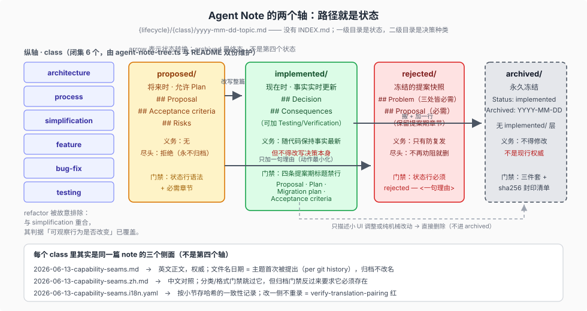
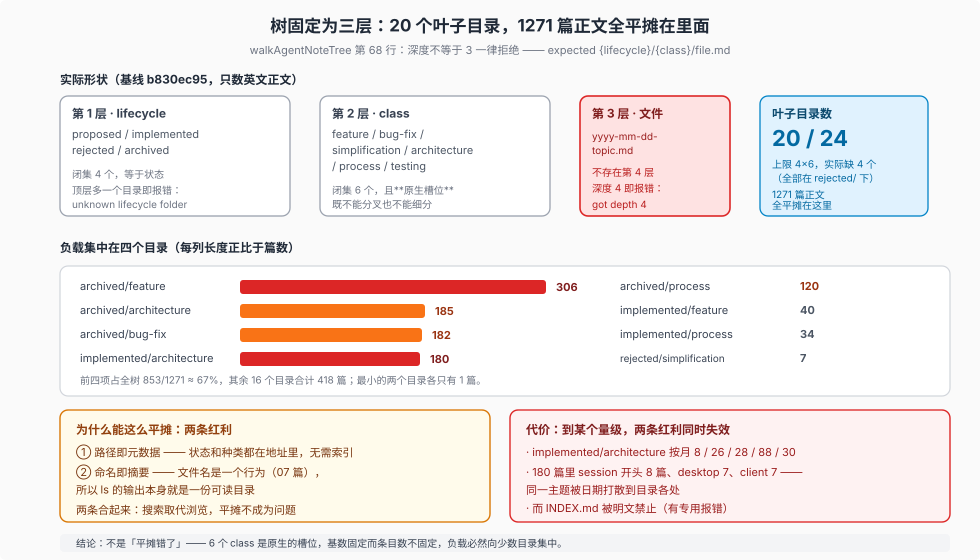

# 01 — 一条决定活在哪：两个设计轴、三种义务、固定三层的树

> 本篇讲 Agent Note 的**位置语义**：路径怎么编码状态与种类、三种生命周期各自背什么义务、为什么剩下的那些排布不是第三个轴，以及树的深度为什么被钉死在三层。门禁细节见 [02](./02-gates.md)，状态之间的走动见 [03](./03-transitions.md)，终态的忘记见 [04](./04-forgetting.md)。

## 目录树：两个设计出来的轴

`walkAgentNoteTree`（[`scripts/agent-note-tree.ts:46-84`](../../scripts/agent-note-tree.ts)）定义了整棵树的形状：顶层是生命周期，第二层是 class，第三层必须是 `yyyy-mm-dd-topic.md`。规则表在 [`.agents/notes/README.md`](../../.agents/notes/README.md) 的 Layout 与 Classification 两节。

```text
.agents/notes/
├── proposed/     feature/ bug-fix/ simplification/ architecture/ process/ testing/
├── implemented/  同上六个 class
├── rejected/     同上六个 class
└── archived/     同上六个 class（无 implemented/ 这一层）
```



**class 是闭集**，六个名字写死在 `AGENT_NOTE_CLASSES` 里，加一个 class 是「deliberate act」：要同时改 `scripts/agent-note-tree.ts` 与 README 的 Classification 表，否则门禁直接拒。README 还给了一条划界："**architecture** is about the source we ship; **process** is the surrounding tooling and workflow"，并说明 `refactor` 被**故意排除**——它与 `simplification` 重合，而 `simplification` 的判别标准「可观察行为是否改变？」已经覆盖了它。

**生命周期也是闭集**（`['proposed', 'implemented', 'rejected']` 加 `archived`）。这条闭集检查有个具体的理由，写在源码注释里：任何不被识别的顶层目录会让整批 note 「invisible to the walk below」——所以在顶层多建一个 `draft/` 不会得到宽容，只会得到一条 `unknown lifecycle folder`。

### 一个被明确禁止的东西

门禁里有一条专用报错，针对的不只是文件，而是一种设计方案：

> `structure: INDEX.md — centralized Agent Note indexes are forbidden; browse the lifecycle/class tree or search the repository`

README 给的理由是两条叠加：集中索引**重复**了路径里已有的元数据，且会让所有无关的笔记修改争用同一个生成文件。换句话说，这里的「索引」由路径本身承担，检索由全仓搜索承担。

## 三种生命周期，是三种义务而不是三个等级

| | 写时态 | 骨架（`verify-agent-note-format` 强制） | 维护义务 | 处置尽头 |
| --- | --- | --- | --- | --- |
| `proposed/` | 允许将来时、计划、验收标准 | `## Problem` → `## Proposal` → `## Acceptance criteria` → `## Risks` | 无，可以放着 | 过时就**拒绝**，永不归档 |
| `implemented/` | **必须现在时** | `## Problem` → `## Decision` → … → `## Alternatives considered` → `## Consequences` | **随代码保持事实最新**，但不得改决策 | 归档或（小改动）删除 |
| `rejected/` | 冻结的提案原文 | `## Problem` → `## Proposal`（其余保留提案期章节） | 只有「防复发」这一条 | 不再劝阻任何人就删除 |

三点值得单独说：

**其一，`implemented/` 的那对矛盾规则。** [implemented/AGENTS.md](../../.agents/notes/implemented/AGENTS.md) 把它拆成两句：「Keep paths, symbols, defaults, and mechanisms current in the same change that alters them. Rewrite stale facts in place; do not append change history.」以及「A reversal of the decision or its rationale requires a new Agent Note and cross-link」。也就是说，**事实实时更新是义务，决策本身却是只读的**。这一条正面回答了 ADR 最常见的两种腐化：文件变陈旧，或者有人把 ADR 悄悄改成相反结论。

**其二，`rejected/` 不需要保持最新。** 它是提案期的快照，判决写在 `Status:` 行上（`Status: rejected — <one line why>`），因为读者来这里要的就是那句理由。正文保留提案时的章节，包括 `## Acceptance criteria` 和 `## Plan`——这些在 `implemented/` 里是被禁的。

**其三，归档只接受一种是入口。** `archived/{class}/` 没有 `implemented` 这一层，README 说得很直白：「`implemented` is deliberately absent because only implemented notes can enter it」。

## 树的深度被钉死在三层，所以「子目录怎么组织」这个问题不存在



这一节回答一个在使用中一定会冒出来的问题：**notes 越积越多，能不能按主题/按月再分子目录？**
答案是不能，而且这是设计出来的。`walkAgentNoteTree` 对深度的判断是等号：

```js
if (segs.length !== 3 || cls === undefined || base === undefined) {
  errors.push(`structure: ${match} — expected {lifecycle}/{class}/file.md (got depth ${segs.length})`)
}
```

`globSync('{lifecycle}/**/*.md')` 虽然写的是 `**`，但任何走出来的路径只要不是恰好三段就被拒绝。所以在 `.agents/notes/` 底下：

| 深度 | 是什么 | 基数 | 能不能动 |
| --- | --- | --- | --- |
| 1 | lifecycle（`proposed` / `implemented` / `rejected` / `archived`） | 闭集 4 | 不能；多一个即 `unknown lifecycle folder` |
| 2 | class（`feature` / `bug-fix` / `simplification` / `architecture` / `process` / `testing`） | 闭集 6 | 不能；多一个即 `unknown class folder` |
| 3 | 三件套文件（`.md` / `.zh.md` / `.i18n.yaml`） | 每目录 N 篇 | 只能加文件，不能加目录 |
| 4 | — | **不存在** | 出现即 `got depth 4` |

叶子目录**最多**是 4×6=24 个，实际存在 **20** 个——`rejected/` 下只有 `architecture/` 与 `simplification/` 两个，其余四个 class 目录从未被创建（[01 矩阵](#设计出来的两个轴真的负载) 里 rejected 那列的 0 就是它们的缺席）。这 20 个叶子目录合计承载 **1270** 篇英文正文，全部平摊其中（`.md` 与 `.zh.md` 的成对计数口径见 [`06`](./06-honest-gaps.md) 缺口二）；实测**没有任何三级以下的目录**。

### 实测负载：分布在 20 个目录，而不是均匀分布

逐目录的数字不在本页重列——它就是把[下面那张 class × lifecycle 矩阵](#设计出来的两个轴真的负载)换成目录视角。从这个视角能直接读出两件事：

- **负载高度集中。** 最大的四个目录 `archived/feature`(306)、`archived/architecture`(185)、`archived/bug-fix`(182)、`implemented/architecture`(180) 合计 853 篇，占 20 个叶子目录合计 1270 篇的 853/1270 ≈ **67%**；最小的两个目录各只有 1 篇。
- **目录的存在与否本身是信息。** 20 而非 24，缺的四个全在 `rejected/`——`rejected/` 只接纳过架构类与简化类的被否提案。**class 是每个 lifecycle 各自的一个槽位，不是全树共享的一层**；这也是为什么它不能当第二层的分类轴来「切话题」：切出来的每一格都要在四个状态里各存在一次。

### 为什么平摊能撑住：两条红利

**红利一：路径即元数据。** 状态在深度 1、种类在深度 2，所以「活跃的架构决策」是一个目录名，不需要索引、不需要标签、不会与真实位置不同步。这就是上文「一个被明确禁止的东西」里那条 `INDEX.md` 禁令的本钱。

**红利二：命名即摘要。** [07](./07-naming-and-house-style.md) 讲的动词命名法让单个文件名自解释——看到 `fold-session-persistence-interface` 就知道那条决定了什么，不必点开。这**只保证每一行可读，不保证几千行可读**，所以它撑住的其实是 grep 的结果质量，不是 `ls` 的输出质量。

两条合起来看：红利一让「找某一类决策」不需要索引，红利二让「搜到的每一条」一眼可判。README 那句 `browse its lifecycle/class folders or search the repository` 在这个层面成立——但它是在**目录还小**的前提下写的。

### 什么时候这两条会失效

红利一不随篇数变化（路径永远只三段），变的是红利二：**当单个目录越过几十篇，`ls` 输出的信息密度就掉到不可读**。可观测的迹象有三条：

1. **时间切片丢失。** `implemented/architecture` 按月是 8 / 26 / 28 / **88** / 30——2026-09 那一波彼此强相关的架构决策在目录结构里完全不可见。
2. **主题被日期打散。** 那 180 篇里 `session-` 开头 8 篇、`desktop-` 7 篇、`client-` 7 篇，本该聚在一起的一组被 `yyyy-mm-dd-` 前缀均匀摊开。
3. **唯一替代品被禁止。** 想靠索引补回可浏览性时，`INDEX.md` 的专用报错会挡住——它的理由是「重复路径元数据 + 让无关修改争用同一文件」，两条都成立，所以不能靠放开它来解决。

### 为什么仍然不加第四层

这是本专题最愿意承认的一处**结构性取舍**，两边的账都要摆出来：

| | 加第四层（`{class}/{topic-group}/file.md`） | 维持三层 |
| --- | --- | --- |
| 分组的判据 | **没有闭集**：分组名谁定、如何校验、两个组重名算谁 | class 是闭集 6，README 与源码双份维护（[06](./06-honest-gaps.md#缺口一分类门禁不读-readme闭集的双份副本)） |
| 移动成本 | 归档要搬整只三件套，路径多一段就多一处断链面 | 只有一次移动，且深度固定 |
| 失效保护 | 分错组后仍然只能 grep，且多了一套要维护的分类 | 分类错了至少还落在对的状态里 |
| 可预测性 | 「这属于哪个组」在每次写入时重新争论一次 | 「这属于哪个 class」有 README 的 6 行表可查 |

换句话说：**放弃第四层换取的是「分类只有一套、且有校验收口」**。代价是 `browse` 在 180 篇这个量级已经不堪用，检索事实上只剩 grep 一条路。

所以准确的读法是：`browse its lifecycle/class folders or search the repository` 这句话在**小规模时是两条路**，在**当前规模下已经退化成一条**。这不是缺陷报告，而是维护者在考虑「要不要放开第四层」时必须先承认的现状——因为一旦承认 browse 已失效，`INDEX.md` 禁令的理由也要重新称量。

这条现状与「判据没有门禁」是不同性质的：前者是**结构决定的可扩展上限**，后者是**判断无法机械化**。前者可以靠改结构解决，后者不能。它也与下文「处置频率」那条辅轴不冲突——那条说的是**分布随 class 变化**，这里说的是**目录容量不随 class 变化**：无论 class 长成什么样，每个叶子目录都只有一层。

## 三个看似维度、其实不是的东西

`.agents/notes` 底下每个 class 文件夹里其实是：

```text
2026-06-13-capability-seams.md          ← 英文正文（权威）
2026-06-13-capability-seams.zh.md       ← 中文对照
2026-06-13-capability-seams.i18n.yaml   ← 配对一致性记录（按小节存哈希）
```

这三件套容易被读成「第四个维度（语言）」或「第五个维度（日期）」。更准确的读法是：**它们是同一个可寻址单元的三个侧面**。

- **日期前缀**属于地址，不属于内容：README 规定文件名里的日期是「when the topic was **first proposed** (per git history)」，其余时间信息一律交给 git。所以它不能当「最后修改时间」用，也不能当排序依据——排序靠 git。
- **`.zh.md` 是同一篇 note，不是另一篇。** `walkAgentNoteTree` 直接把它跳过（`if (match.endsWith('.zh.md')) continue`，注释写「is the SAME Agent Note, indexed via its English filename」）；`verify-agent-note-format` 也不看它，结构校验交给 `verify-translation-pairing`；**但归档门禁反过来要求它必须存在**（见 [02](./02-gates.md#三归档封印verify-archived-agent-notes)）。两个门禁职责相反而不冲突，因为它们看的是不同的阶段。
- **`.i18n.yaml` 是按小节存哈希的一致性记录**，机制归 [`docs/i18n/README.md`](../../docs/i18n/README.md)。对流程而言它只有一条后果：改一侧而不重录配对，`verify-translation-pairing` 会红——**「谁先写」不影响权威，只有「两侧说的是不是同一件事」被检查**。

## 各轴的测试

两个轴都有**正交设计**和**真实辅轴**两面，分开说才诚实。

### 设计出来的两个轴：真的负载

矩阵（基线 `b830ec95`，按 `git ls-tree` 计数，只数英文正文 `.md`）：

| class | proposed | implemented | rejected | archived |
| --- | ---: | ---: | ---: | ---: |
| feature | 9 | 40 | 0 | 306 |
| bug-fix | 1 | 11 | 0 | 182 |
| simplification | 9 | 13 | **7** | 92 |
| architecture | 15 | **180** | 1 | 185 |
| process | 6 | 34 | 0 | 120 |
| testing | 2 | 18 | 0 | 39 |
| **合计** | **42** | **296** | **8** | **924** |

两个非均匀现象值得读出来：

1. **`simplification` 的拒绝率 7/20，其它 class 近乎为零。**「删掉 X」正是最容易被否掉的诱惑，把它单独归成一类，等于建了一个「曾经想删但被否掉」的清单，防止反复重提。
2. **`implemented/` 里 `architecture` 占 180/296。** 架构决策大多落地并长期留任，而 `process`（34）与 `testing`（18）更多是「讲清一次即可归档」。

### 第一个真实辅轴：class 的语义强度

class 不只是标签，它在两个地方**改变规则**：

| class | 它在流程里的特殊地位 |
| --- | --- |
| `architecture` | 决定「该不该有这条决定的替代方案」——README 划的线是「source we ship」 |
| `process` | 与 architecture 的分界同样由 README 定义；它管的是**围绕**代码的工装 |
| `simplification` | 唯一一个**失败率可读**的类别（7 篇 rejected 全在这里），也是「可观察行为是否改变？」这条判别标准的落点 |
| `feature` | 唯一带「合并删除」特判的类别：README 规定 feature-addition note 只有在功能从生产代码、配置、schema、持久化/wire 格式、迁移、兼容行为里**全部消失**时，才能被后续的移除 note 吸收 |

最后一条值得展开一秒，因为它是这套制度里少见的**负向证明**要求：吸收方必须保留原始动机、为什么它不再成立、完全移除的替代方案、放弃的能力、重新引入的条件，以及「完全不存在」的验证。「Removing one transport, default, implementation, or presentation is partial supersession, as is any surviving durable data or compatibility handling」——部分取代不算，只能两篇并存并交叉链接。

### 第二个真实辅轴：处置频率，而且它看起来像第三个轴

如果把 `implemented/` 和 `archived/` 合起来看，六个 class 的规模是：`feature` 346、`architecture` 365、`bug-fix` 193、`process` 154、`simplification` 105、`testing` 57。活跃与冻结的比例约 1:3；`architecture` 的冻结量仅略高于活跃量（185 : 180，约 1.03），`feature` 则是最极端的（306 : 40，约 7.7）。

**诚实的读法**：这看起来像「class 还决定寿命」，但证据只支持一个更弱的说法——**它描述已观测到的分布，不构成规则**。README 的归档判据里没有一处按 class 区分（判据是逐篇的：rationale、alternatives、负向保证、durable/wire 语义、所有权边界、安全规则、重新引入条件）。任何想从这张表推出「architecture 类型的 note 该留久一点」的读法，都会在门禁里找不到依据。

## 边界

- 本篇不解释门禁怎么实现，见 [02](./02-gates.md)。
- 「一篇 note 应该写什么内容」不在这里：容器管形状，内容归每篇 note 自己与 `docs/AGENTS.md` 的散文标准。
- 数量只以本页矩阵为准；`claims.json` 的 `notes-*` 指标口径不同（含 `.zh.md`），两者不要混用，见 [06](./06-honest-gaps.md#缺口二口径缺口同一批文件的两个计数)。
