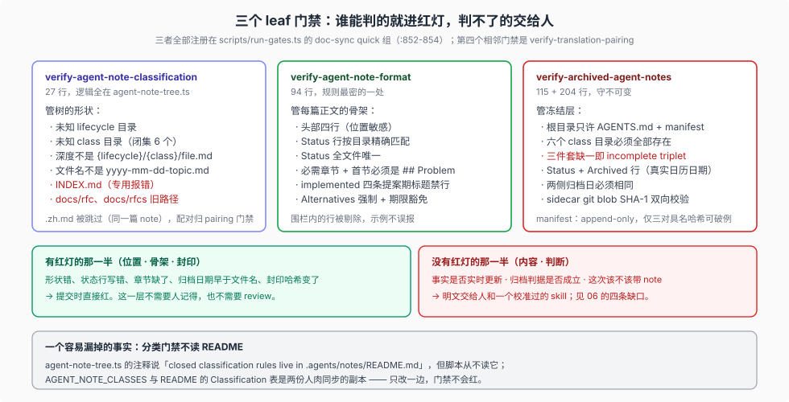

# 02 — 哪些规则真的会红：三个 leaf 门禁的逐条规则

> 本篇把 `.agents/notes/README.md` 的成文纪律翻译成**可执行的检查**：哪一条有红灯、红灯在什么条件下亮、哪一条只有一句话而没有检查。三个门禁都注册在 `doc-sync` 的 quick 组里（[`scripts/run-gates.ts:852-854`](../../scripts/run-gates.ts)）。

## 职责表

| 门禁 | 管什么 | 相关文件 |
| --- | --- | --- |
| `verify-agent-note-classification` | 树的形状：生命周期闭集、class 闭集、目录深度、文件名格式、`INDEX.md` 禁令、旧路径禁令 | [`verify-agent-note-classification.ts`](../../scripts/verify-agent-note-classification.ts)（27 行）+ [`agent-note-tree.ts`](../../scripts/agent-note-tree.ts)（84 行） |
| `verify-agent-note-format` | 每篇正文的骨架：头部四行、`Status:` 语法、必需章节、提案期禁行、Alternatives 强制、废标记禁令 | [`verify-agent-note-format.ts`](../../scripts/verify-agent-note-format.ts)（94 行） |
| `verify-archived-agent-notes` | 冻结层：class 树、三件套完整性、归档元数据、sidecar 哈希、append-only 封印清单 | [`verify-archived-agent-notes.ts`](../../scripts/verify-archived-agent-notes.ts)（115 行）+ [`archived-agent-notes.ts`](../../scripts/archived-agent-notes.ts)（204 行） |

三个门禁都跑在 `doc-sync` 里；`translation-pairing` 是第四个相邻门禁，它管三件套的另外两面（配对一致性、结构镜像），但不在本篇逐条展开——它的契约归 [`docs/i18n/README.md`](../../docs/i18n/README.md)。

## 一、结构守卫：`verify-agent-note-classification`

这个门禁本身只有 27 行，几乎所有逻辑都在共享的 `walkAgentNoteTree()` 里——分类规则与 README 是**同一份事实的两个表达**，注释写明了这个分工：「Structural rules are shared with `agent-note-tree.ts`; the closed classification rules live in `.agents/notes/README.md`.」

它拒绝的六类形状：

1. **未知生命周期目录**。`.agents/notes/` 下的任何一级目录，除了 `archived` 和三个生命周期，都报 `unknown lifecycle folder`。源码注释给了理由：否则这些目录里的 note 会「invisible to the walk below」。
2. **未知 class 目录**。六个 class 之外的任何二级目录报 `unknown class folder`，报错里列出全部允许值。
3. **错误深度**。不是 `{lifecycle}/{class}/file.md` 的路径（例如 `implemented/2026-…md` 直接躺在生命周期根下）报 `expected {lifecycle}/{class}/file.md`。例外只有生命周期根下的 `AGENTS.md` / `CLAUDE.md`（`ROOT_ALLOWLIST`）。
4. **错误文件名**。第三层必须匹配 `/^\d{4}-\d{2}-\d{2}-.+\.md$/`。
5. **`.zh.md` 被跳过**。它不进本门禁的索引，因为它是同一篇 note；配对由 `verify-translation-pairing` 管。
6. **`INDEX.md` 与旧路径**。顶层出现 `INDEX.md` 直接报错（理由见 [01](./01-lifecycle.md#一个被明确禁止的东西)）；`docs/rfc`、`docs/rfcs` 若存在也报错，注释是「Keep the former homes unavailable so new notes cannot silently escape this tree.」

### 这里有一条 README 规则没有被实现

`scripts/agent-note-tree.ts` 的模块注释说分类规则由 README 拥有。**但脚本从来不读 README。** 两边的接触面是靠人同步的两份字面副本：`AGENT_NOTE_CLASSES` 数组与 README 的 Classification 表。

后果是可检测的：如果有人在 README 的 class 表里加一行而不动源码，门禁**不会红**；反过来，如果只改源码不改 README，门禁也不会红。也就是说「Adding a class requires updating the canonical set and this section」这句话目前是**书面约定**，不是检查。详见 [06](./06-honest-gaps.md#缺口一分类门禁不读-readme闭集的双份副本)。

## 二、骨架校验：`verify-agent-note-format`

这个门禁是整套制度里**规则最密**的一处。它先按生命周期索引每篇 note，然后逐条检查：

### 头部四行是位置敏感的

```text
line 1: # Agent Note: <title>     ← 正则 /^# Agent Note: \S/，标题不能空
line 2: (空行)
line 3: Status: <按生命周期>       ← 每个生命周期一个精确正则
line 4: (空行)
```

`Status:` 语法按目录分三种，且必须**精确匹配**（`STATUS` 常量）：

| 目录 | 正则 |
| --- | --- |
| `proposed/` | `/^Status: proposed$/` |
| `implemented/` | `/^Status: implemented$/` |
| `rejected/` | `/^Status: rejected — .+$/`（破折号后必须有内容） |

所以「状态由父目录决定」这件事被双向锁住：文件名住在 `proposed/` 而状态行写 `implemented` 会红；写了日期或括号补注也会红——README 明确说「The status carries no dates and no parentheticals: the filename holds the first-proposed date, git holds everything else」。

门禁还额外保证 `Status:` 行**全文件唯一**（防止有人在正文里补一行状态）。

### 章节骨架按生命周期分叉

`REQUIRED` 常量是这份门禁的核心：

| 生命周期 | 必需章节 |
| --- | --- |
| `proposed/` | `## Problem`、`## Proposal`、`## Acceptance criteria`、`## Risks` |
| `implemented/` | `## Problem`、`## Decision`、`## Consequences` |
| `rejected/` | `## Problem`、`## Proposal` |

`## Problem` 永远是第一节——`h2s[0] !== '## Problem'` 就报错，报错文案里还给出了实际值。

### 提案期禁行只对 `implemented/` 生效

```js
const BANNED_IMPLEMENTED = /^## (?:Proposal\b|Plan\b|Migration plan\b|Acceptance criteria\b)/i
```

四条被禁：`## Proposal`、`## Plan`、`## Migration plan`、`## Acceptance criteria`。报错文案直接给出去处：「an implemented Agent Note states what is (fold it into Decision/Consequences/Testing)」。这就是 [03](./03-transitions.md) 里「改写纪律」的机器面，但它**只检查标题在不在，不检查内容改没改**。

### Alternatives 是强制的，且有一条期限精确的豁免

规则是一个三元判定：

| 有 `## Alternatives considered` | 有 grandfather 注释 | 结果 |
| --- | --- | --- |
| 是 | 否 | 通过 |
| 否 | 是，且文件名日期 `< 2026-07-05` | 通过 |
| 否 | 是，但日期 `>= 2026-07-05` | **报错**（豁免只对旧文件有效） |
| 是 | 是 | **报错**（「drop the comment」） |
| 否 | 否 | **报错**（缺章节） |

豁免注释是逐字的 `<!-- agent-note-format: alternatives-not-recorded (pre-format Agent Note) -->`，期限常量 `FORMAT_ADOPTED = '2026-07-05'` 也逐字写在源码里。README 解释了这个严格性的动机：「A decision recorded without what it beat invites re-litigation — the failure Agent Notes exist to prevent.」

### 两条容易忽略的实现细节

- **代码围栏被剔除。** 门禁先扫一遍三反引号标记，把围栏内的行过滤掉再判定章节与状态行——注释是「Format tokens inside fenced examples are not document structure」。所以示例里的 `## Proposal` 不会误报。
- **废标记被永久禁止。** `LEGACY_MARKERS` 里有两条历史债务标记（`XXX: legacy ADR/RFC body format` 与 `XXX: legacy ADR/Agent Note body format`），等于在正文里任何位置出现都报错。注释的说法是「banned so it cannot creep back」。

## 三、归档封印：`verify-archived-agent-notes`

这个门禁的强度远高于前两个，因为它守的是**不可变**。它的检查分四组：

### 树与文件形态

- `archived/` 根只允许 `AGENTS.md` 与 `manifest.json` 两个普通文件，其余普通文件报错。
- 二级目录必须是六个 class 之一，**且六个都必须存在**（缺一个就报 `required kind directory is missing`）。
- class 目录内只允许普通文件，不允许多级目录。
- 文件名必须匹配 `{kind}/yyyy-mm-dd-topic.{md,zh.md,i18n.yaml}`。

### 三件套完整性

每篇归档 note 必须同时有 `.md`、`.zh.md`、`.i18n.yaml`，缺任何一个报 `incomplete archived triplet`。这是 `.zh.md` 在这里**从豁免变成必需**的地方，与格式门禁恰好相反。

### 归档元数据（两侧都要）

`validateMetadata()` 要求：

- 有一行精确的 `Status: implemented`；
- 紧随其后的下一行是 `Archived: YYYY-MM-DD`，且是**合法日历日期**（它真的构造 `Date` 并对年/月/日回读校验，所以 `2026-02-30` 会被拒）；
- 归档日期不得早于文件名日期（`archived < sourceBase.slice(0,10)` 报错）；
- **英文与中文的归档日期必须相同**。

### 一致性记录与哈希封印

- `.i18n.yaml` 必须**恰好**记录两条，键是 `<base>.md` 与 `<base>.zh.md`，值是两侧当前的 **git blob SHA-1**（`gitBlobHash`，不是 sha256）。少一条、多一条、或哈希不符都报错。
- `manifest.json` 的解析是封闭 schema：字段必须恰好是 `version` 与 `files`，`version` 必须是 `1`，每个值必须匹配 `/^sha256:[0-9a-f]{64}$/`。渲染时按路径排序，保证字节稳定。

封印的语义由两个函数分工：

| 函数 | 保证 |
| --- | --- |
| `validateArchiveManifestExtension(baseline, current)` | 基线里的每条**必须还在且未变**——这是 append-only 的「不可删、不可改」 |
| `extendArchiveManifest(existing, artifacts)` | 已有条目必须能在磁盘上找到且哈希一致；新条目才被追加。普通模式下，任何未封印的工件都报 `archived artifact is not sealed in manifest.json` |

基线从哪来：`DSH_ARCHIVE_BASE_REF` 环境变量（CI 注入受信的变更前提交），本地缺省是 `HEAD`。这是全套制度里少见的**把「相对于什么不可变」做成显式输入**的地方。

### 唯一被允许的封印例外

`archived-agent-notes.ts` 里硬编码了三条精确的 before/after 哈希对（`figmaLinkRemovals`），对应 `feature/2026-08-10-durable-workflow-runs-in-chat` 的英/中/sidecar 三件套。只有 `before === 基线哈希 && after === 当前哈希` 这一种组合能通过，函数注释是「Reject sealed changes except the exact authorized Figma-link removal hashes」。

这个例外的存在本身是有信息量的：**冻结不是靠善意维持的，任何一次破例都必须以「一对具名哈希」的形式进入代码**，并在 [archived/AGENTS.md](../../.agents/notes/archived/AGENTS.md) 里被点名。

## 门禁没管的那一半



把三个门禁的规则并起来看，能机械判定的部分是**位置、骨架、封印**；不能判定的部分是**内容与判断**：

| 明文规则 | 有红灯吗 |
| --- | --- |
| 路径形状、class 闭集、`INDEX.md` 禁令 | 有（classification） |
| 头部四行、`Status:` 语法、必需章节、提案期禁行、Alternatives 强制 | 有（format） |
| 三件套、归档日期、sidecar 哈希、append-only 封印 | 有（archived） |
| 「Keep paths, symbols, defaults and mechanisms current」（[implemented/AGENTS.md](../../.agents/notes/implemented/AGENTS.md)） | **无** |
| 「归档判据按未来决策价值而非体量或年龄」（README） | **无** |
| 「Add or update an Agent Note in the same PR」这条存在性要求 | **无**（见 [05](./05-writeback-loop.md)） |
| 「Adding a class requires updating this section」 | **无**（见上文） |

这张表的右列不是缺陷清单，而是**设计选择**：能机械判的进红灯，判不了的明文交给人和一个校准过的 skill（[04](./04-forgetting.md)）。诚实的补充是：**没有红灯的那一栏，正是纪律最容易被稀释的地方**，见 [06](./06-honest-gaps.md)。
