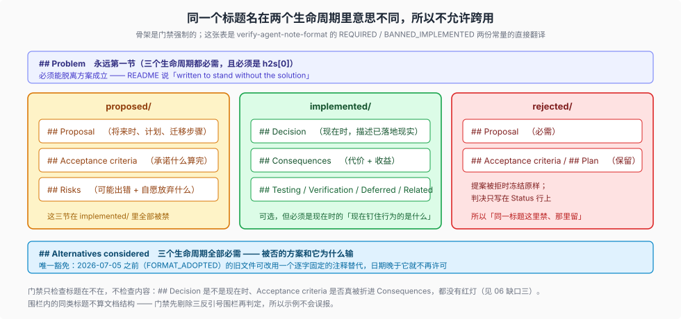

# 03 — 状态之间怎么走：两套判据、一次最小化、一处门禁空白

> 三个生命周期之间有三条边。本篇讲每条边的**操作定义**：动什么、由谁判定、哪一步有红灯。位置语义见 [01](./01-lifecycle.md)，门禁逐条规则见 [02](./02-gates.md)。

## 三条边，两种判据



```text
          ┌─────────────── 改写整篇 ───────────────┐
          │                                        ▼
      proposed/                                 implemented/ ──── 归档 ───▶ archived/
          │                                        │
          └──────────── 加一句理由 ──────▶ rejected/│
                                                   └──── 小改动 ────▶ 删除
```

- **`proposed/` → `rejected/`**：一个**最小化**操作，几乎只是加一句理由。
- **`proposed/` → `implemented/`**：要求**改写整篇**，从提案语气翻成落地语气。
- **`implemented/` → `archived/` 或删除**：由[归档四分法](./04-forgetting.md)判定。

值得注意的是这三条边**用了两套完全不同的判据**：前两条判的是「这个提案该不该活」，由人按语义判；第三条判的是「这条已落地的理由还值不值得占着活跃区」，走一个校准过的 skill。**没有任何一条边是纯机械的**，机械的部分只负责在事后检查形状。

## 边一：proposed → rejected

README 的定义只有一句：

> `proposed/` → `rejected/` only adds the reason to the `Status:` line and freezes the file.

具体操作：

1. 把 `Status: proposed` 改成 `Status: rejected — <一句话理由>`；
2. 正文**一个字不改**（`## Proposal`、`## Acceptance criteria`、`## Plan` 全部保留）；
3. 三件套一起搬（`.md`、`.zh.md`、`.i18n.yaml`）；
4. 重录 `.i18n.yaml`。

门禁只检查形式：`verify-agent-note-classification` 要求目录名是 `rejected`；`verify-agent-note-format` 要求状态行匹配 `/^Status: rejected — .+$/`，且必需章节里有 `## Problem` 与 `## Proposal`。**理由写得好不好、是否真的成立，没有任何检查。**

这条边的设计意图非常清楚：**拒绝要便宜**。如果拒绝需要重写整篇，人就会倾向「先放着」，于是提案区缓慢腐化成一堆永远不会被推动的死案。README 对此的措辞是 `Never archive a proposed note: reject an obsolete proposal.`

### 顺带一条：rejected 不是垃圾桶

[`dsh-archive-agent-notes`](../../.agents/skills/dsh-archive-agent-notes/SKILL.md) 给出的保留条件是「only when the losing proposal remains a tempting, meaningful mistake and the note explains why it loses」。八篇留存样本在基线下的分布很说明问题：

| class | rejected 篇数 | 例子 |
| --- | ---: | --- |
| `simplification` | 7 | `fold-compaction-package-split`（拆开的冲动仍在）、`truncate-interrupted-turns`、`fold-session-persistence-interface` |
| `architecture` | 1 | `typed-event-schemas` |

七比一的倾斜不是巧合：**「删掉 X」是最容易反复重提的诱惑**，所以 rejection 在这里的寿命最长。

## 边二：proposed → implemented（改写纪律）

README 对这一段的描述是整套制度里最具体的一段，而且它把自己的目的说成了「把要求机械化」：

> `proposed/` → `implemented/` rewrites `## Proposal` into a present-tense `## Decision`, folds `## Acceptance criteria` and `## Risks` into `## Consequences` (or a present-tense `## Testing`/`## Verification` section for what now pins the behavior), and drops plans in favor of what shipped — the rewrite `implemented/AGENTS.md` requires, made mechanical.

把它展开成操作：

| proposed 侧 | implemented 侧 | 为什么 |
| --- | --- | --- |
| `## Proposal`（将来时） | `## Decision`（现在时） | 落地后的事实陈述 |
| `## Acceptance criteria` | 折进 `## Consequences`，或写 `## Testing` / `## Verification` | 验收标准在提案期是承诺，落地后是**钉住行为的证据** |
| `## Risks` | 折进 `## Consequences` | 风险在提案期是预测，落地后是**已付出的代价** |
| 计划、迁移步骤 | 删除 | 已完成的东西留在 git 里，不在 note 里 |
| `## Problem` | 保留 | 动机不因落地而改变 |

`implemented/AGENTS.md` 还补了这条边的**长期义务**：这条路走完不等于结束，之后每次改动都要「Keep paths, symbols, defaults, and mechanisms current in the same change that alters them. Rewrite stale facts in place; do not append change history.」

### 这道改写的门禁覆盖面：只有一半

`verify-agent-note-format` 的 `BANNED_IMPLEMENTED` 能挡住四条提案期标题：

```js
const BANNED_IMPLEMENTED = /^## (?:Proposal\b|Plan\b|Migration plan\b|Acceptance criteria\b)/i
```

它保证**标题**不在 `implemented/` 里出现。它**不能**保证：

- `## Decision` 写的是现在时而不是将来时；
- `## Acceptance criteria` 的内容真的被折进了 `## Consequences`（人可以只删标题）；
- `## Risks` 不是被直接删掉而是被折进去；
- 计划确实没有以普通段落形式残留。

所以准确的表述是：**「不要把提案期标题带进来」有红灯；「把内容翻译成落地语气」没有。** README 用 `made mechanical` 来描述这一步，比现状略强——真正的机械保证是「位置能到位」，不是「内容被改写」。这条差别的可证伪观察留给 [06](./06-honest-gaps.md#缺口三改写纪律没有内容检查)。

### 一条容易忽略的附加要求

返回 `implemented/` 之后，**note 必须与它描述的代码同步**，但**决策本身只读**。implemented/AGENTS.md 的措辞是「Update factual realization in place. A reversal of the decision or its rationale requires a new Agent Note and cross-link」。

推论：**撤销一条已落地的决定，不是把 note 改写成相反的结论。** 路径有三条，README 都给了：

| 情形 | 做法 |
| --- | --- |
| 完全被取代 | 新 note 拥有决定，旧的被「consolidation」吸收后删除（须保留每一条独有理由、替代方案、后果、验证、coverage gap，并修好入站链接） |
| 部分被取代 | 两篇并存并交叉链接，各自更新仍然成立的事实 |
| 功能被移除 | `feature` 类有特判：只有功能从生产代码、配置、schema、持久化/wire、迁移、兼容行为**全部消失**时才可合并删除 |

## 边三：implemented → archived / 删除

这条边是唯一有**专门 skill** 的一条，也是唯一判据被明确排除掉两个常见代理指标的一条。完整四分法与一次真实批量归档的复核见 [04](./04-forgetting.md)，这里只给边本身的机制面：

- **归档**：整只三件套搬进 `archived/{class}/`，在两处 `Status: implemented` 下各插一行相同的 `Archived: YYYY-MM-DD`，重录 sidecar，然后 `pnpm run verify-archived-agent-notes --write` 追加封印。**正文零改动**。
- **删除**：三件套连根删除，并修好或删除入站链接。判据只有一条——「small UI adjustments or purely mechanical changes」。
- **两侧的共同后果**：`archived/` 一旦封印就永久冻结；`verify-archived-agent-notes` 会拒绝任何封印哈希的变化，除非是 `archived-agent-notes.ts` 里那三对具名 before/after 哈希。

## 一次真实的走：`a7a5be1703`

这套转换纪律的样本不多，但有一个规模足够大的：`a7a5be1703` 在**一个提交**里同时走了三条边。

该提交的判据、四分法与逐字节复核归 [`04`](./04-forgetting.md)。本节只取它对**边**的启发，且每条都在别处有完整的家：

- **三条边同时被走**：归档（边三）、拒绝（边一）、删 rejected（边一之后）、合并删除（边三的同级）。这说明四条通路不是文档里的假设——它们在同一个提交里全部发生过。
- **归档带走了 51 篇「已被后续活跃 note 完全取代」的记录**：这是 [README 的 consolidation 规则](../../.agents/notes/README.md)（合并即删除）在实践中被真正用掉的证据。
- **归档同时是一次跨仓引用迁移**：同一个提交重写了 242 篇入站链接并修正了点名归档记录的所有权句。引用为何能机器验证，见 [`07`](./07-naming-and-house-style.md)；语料侧的断链代价见 [`_change_log/0006`](../_change_log/0006-0.1.2-rc.1-to-0.1.5-rc.1.md)。

> 那 7 篇被拒的提案如今在树上只剩 **1 篇**，其余在后续 `rc.1 → rc.5` 窗口里被删除——删除的条件是「不再阻止一个可信的错误」，与归档是两回事。**归档保留的历史记录不会因为「不再有用」而消失，被拒的提案会。**

## 一张对照表

| | proposed → rejected | proposed → implemented | implemented → archived | implemented → deleted |
| --- | --- | --- | --- | --- |
| 判据 | 提案前提消失 / 已以修改后的形态落地 | 工作落地 | 逐篇按未来决策价值 | 只描述小 UI 调整或纯机械改动 |
| 动作幅度 | 状态行加一句理由 | 改写整篇语气与章节 | 搬 + 加一行日期 | 三件套连根删除 |
| 正文可改吗 | **否**（冻结为提案快照） | **是**（必须改写） | **否**（只有那一行） | — |
| 门禁 | 只有状态行语法 | 只有标题禁行 | 元数据 + 三件套 + 哈希封印 | 无（链接完整性靠 `verify-md-links`） |
| 可逆吗 | 可（再改状态行） | — | **不可**（封印后永久冻结） | 不可（只剩 git 历史） |
