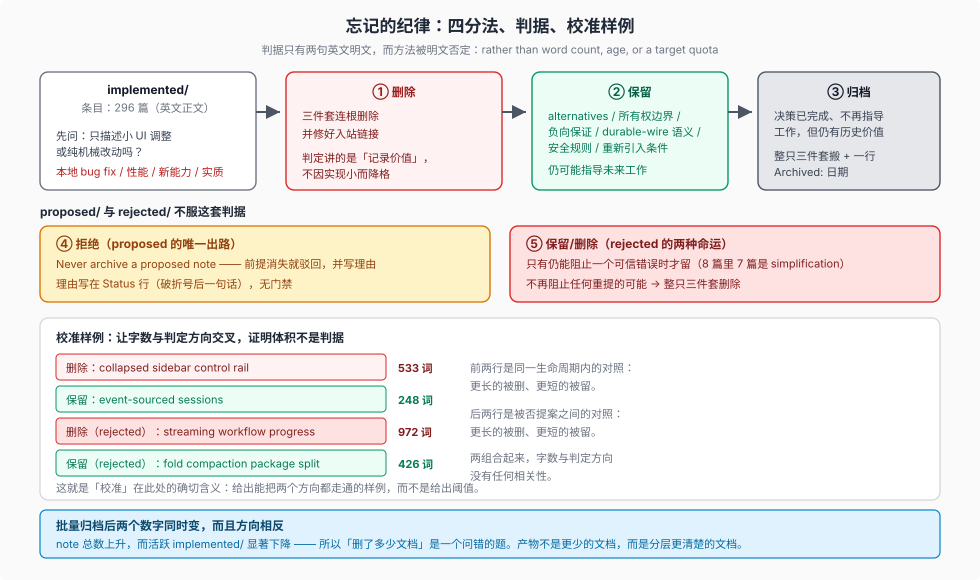

# 04 — 忘记的纪律：四分法、校准样例与一次可复核的批量归档

> 这是本专题最核心的一篇。「记住什么」通常有制度，「忘记什么」很少被写成判据 + 流程 + 封印三件套。DSH 把两者都写了。边的机制面见 [03](./03-transitions.md#边三implemented--archived--删除)，门禁实现见 [02](./02-gates.md#三归档封印verify-archived-agent-notes)。

## 判据成文，且明文排除两个代理指标

判据只有两句英文，写在校准过的 skill 里：

> Archive other implemented notes only when the shipped decision **is complete**, its rationale **is unlikely to guide future work**, and the record **still has historical decision value**.

保留条件被逐条列出（README 的 Archiving and deletion 一节）：alternatives、ownership boundary、negative guarantee、durable-or-wire semantics、security rule、reintroduction condition。

而方法被明文否定：

> Use the calibrated [`dsh-archive-agent-notes`](../../.agents/skills/dsh-archive-agent-notes/SKILL.md) workflow rather than **word count, age, or a target quota**.

这一句是整篇的题眼。三个被排除的代理指标恰好是绝大多数文档治理实际在用的三个：字数、年龄、配额。它们都便宜、都可自动化、都和「这条理由还会不会指导未来工作」**没有因果关系**——旧的可以仍然关键，短的可以仍然承重，达到配额的清理只是在制造好看的数字。

## 四分法：不是「删或留」，是四种归宿



skill 把每篇 note 分类到四种**不同**的命运，每种有自己的判据：

| 归宿 | 判据 | 关键鉴别 |
| --- | --- | --- |
| **删除**（implemented） | 只描述小 UI 调整或纯机械改动 | **先于**「保留/归档」判定；本地 bug fix、性能改动、新能力、实质行为或所有权决策**不因为实现小**而降格 |
| **保留**（implemented） | rationale / alternatives / 负向保证 / durable-or-wire 语义 / 所有权边界 / 安全规则 / 重新引入条件**仍可能指导未来工作** | 判的是**决策**，不是实现的机械程度：「a mechanical rename or type extraction can still record lasting naming, compatibility, or ownership rules」 |
| **归档**（implemented） | 决策已完成、不太可能指导未来工作，但仍值得作为历史保留 | 与「删除」的分界就是「还有没有历史决策价值」 |
| **拒绝**（proposed） | 提案不再值得推动 | **永远不归档提案**：驳回它，并写清理由 |
| **保留 / 删除**（rejected） | 只有仍能阻止一个可信错误时才留 | 被否的想法过时、被取代、不再可信或不再能防重提，就删整只三件套 |

权威一句话在 skill 的开头：「Reduce the active decision corpus without erasing history that can still guide work. Judge every note semantically; **word count and age are discovery aids, never archive criteria**.」

## 校准样例：为什么它需要「校准」

四分法如果只给判据，不同人会给出不同答案。skill 的做法是给出**成对的反例**，并特意让字数与判定方向**相互矛盾**，以此证明体积不是标准：

| 判定 | 样例 | 英文词数 | 理由 |
| --- | --- | ---: | --- |
| 删除 | collapsed sidebar control rail | 533 | 封闭的小 UI 行为 |
| 删除 | issue-policy module ownership | — | 已完成的功能搬迁 + import 重连，行为不变 |
| **保留** | event-sourced sessions | **248** | 基础性的权威与持久化边界 |
| 保留 | single Harness-home resolver | 596 | 跨产品的所有权规则 |
| 保留 | project session directories | 628 | 持久化存储与身份策略 |
| 保留 | parallel pre-push gates | 400 | 「borderline」，但仍指导门禁调度与资源调优 |
| 保留 | dropped image content block | 334 | 留到多模态落地，因为它写明了**协同重新引入的条件** |
| 保留（rejected） | fold compaction package split | 426 | 「合并这两个包的诱惑仍然真实」 |
| 删除（rejected） | streaming workflow progress via tool calls | **972** | ACP/UI 前提已过时 |

读法：533 词的小 UI 记被删，248 词的基础决定被留；972 词的被否提案被删，426 词的被否提案被留。**四个格子两两交叉，字数与判定完全没有相关性。** 这就是「校准」在此处的确切含义：给出能把两个方向都走通的样例，而不是给出阈值。

skill 还要求判断「生成上下文」而不是只看文本：「Use current code, configuration, package docs, generated catalogs, newer Agent Notes, and inbound links to establish whether a rationale still owns or constrains anything.」

## 一次真实执行：`a7a5be1703`

这套纪律有一个规模足够大的实测样本。`a7a5be1703`（`docs(notes): archive low-future-value Agent Notes`，作者日期 2026-09-04）在一个提交里对全量活跃 note 做了一次审计。

### 提交自述的账本

- 归档 **453** 个双语三件套（自述 417,882 英文词）；
- 保留 **201** 篇，理由是所有权规则、负向保证、durable/wire 语义、安全规则、重新引入条件、仍具诱惑力的被否方案；
- 驳回 **7** 篇提案（前提消失，或已以修改后的形态在别的记录下落地）；
- 删除 **2** 篇不再能阻止可信错误的 rejected note；
- 封印 **1,359** 个新冻结工件，既有封印不变；
- 让 51 篇被后续活跃 note 完全取代的 implemented note 合并删除。

### 可复核的部分：无 rename 检测时的逐文件增删行

`git show --numstat` 默认做 rename 检测，会把「移入 `archived/`」显示成 `R099` 或整对删除/新增。**关掉它（`-M0`）才能看到动作的真实形状**——这是本页最实用的一个取证技巧：

```text
git show a7a5be1703 --format='' --numstat -M0 -- '.agents/notes/archived'
```

按它统计该提交对 `archived/` 的写入：

| 口径 | 结果 |
| --- | --- |
| 英文正文 `.md` | **452** 个文件，新增 21,325 行，**删除 0 行** |
| 中文 `.zh.md` | **452** 个文件 |
| `.i18n.yaml` | 452 个文件 |
| 合计三件套 | 1,356 个文件 |

「删除 0 行」这一项就是**「归档不是修订」的机器证据**：每篇正文逐字节保持原样，新增的只有那行 `Archived:`。同一提交对既有 note 的其它改动（入站链接重定向、242 篇 `.md` 的目标改写）因此与归档动作**可分辨**。

三个数字需要并报才不失真：提交自述 453 个三件套，该提交对 `archived/` 的写入是 452 组。差额来自 rename 检测的显示方式——123 个文件（41 组）被 git 识别为既有 `.i18n.yaml` 的改名，只有真正**新增**的才出现在 `--numstat -M0` 的 452 组里。**这不是矛盾，是同一动作的两种视图**；把 452 与 453 当成互相否证，是这类取证最常犯的错。

### 可复核的部分：那一行到底是什么

任取一篇，diff 的形状是：

```text
 new file mode 100644
 --- /dev/null
 +++ b/.agents/notes/archived/architecture/2026-06-11-runtime-arg-validation.md
@@ -0,0 +1,25 @@
+# Agent Note: Runtime arg validation at the model boundary
+
+Status: implemented
+Archived: 2026-09-04
```

注意 `Status: implemented` 保持原样——归档**不**把状态改成 `archived`，因为 `archived/` 是位置，不是状态。这条与 `validateMetadata()` 要求「exactly `Status: implemented`」完全一致。

### 封印怎么被验

`archived/manifest.json` 的 `files` 条目在基线 `b830ec95` 上是 **2,772** 条。它只增不改：`validateArchiveManifestExtension` 逐条比对基线与当前，任何一条缺失或哈希变化都报错；只有 `extendArchiveManifest` 允许追加。唯一例外是三对具名 before/after 哈希（见 [02](./02-gates.md#唯一被允许的封印例外)）。

## 最容易误读的那个读数

一次批量归档会让两个数字同时动，而且方向相反：

| 读数 | 变化 | 怎么读 |
| --- | --- | --- |
| note 文件总数 | **上升** | 归档不删文件 |
| 活跃 `implemented/` | **显著下降** | 记录从活跃区移入冻结层 |

所以**「删了多少文档」是一个错误的问句**。正确的读法是：这套制度的产物不是更少的文档，而是**分层更清楚的文档**——活跃区只留仍会指导工作的理由，冻结区保留全部历史且不当权。

反过来也成立：只看总量会得到「文档在膨胀」的错误结论，只看活跃数会得到「决策被抛弃」的错误结论。这也是 `claims.json` 同时登记 `notes-md-total`、`notes-implemented-md`、`notes-archived-md` 三项指标的原因。

## 为什么这套流程能长期维持

三条支撑，缺一条就会退化成缓慢的腐化：

1. **判据不依赖人的勤奋**——「理由是否仍指导工作」可以在读代码、读生成目录、读更新过的 note 之后回答，不需要记忆。
2. **动作足够小**——归档只加一行，因此「做过了」可被逐字节验证；如果归档允许顺手修事实，就再也分不清「归档」和「修订」。
3. **封印是硬的**——`manifest.json` + 门禁让冻结层不可能被悄悄修改，于是「冻结区不是现行权威」这句话才有执行基础。

第三点还有一个反直觉的副产品：**冻结层越硬，活跃区就越敢删**。因为知道历史不会丢，删除当前价值不高的记录就不再是「烧掉档案」，而只是「把它挪到不参与判断的地方」。
