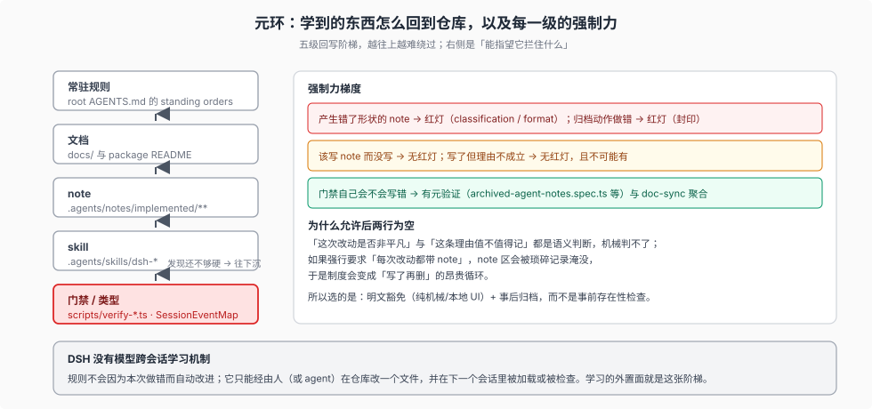

# 05 — 学到的东西怎么回到仓库：元环与它的强制力梯度

> 前四篇讲的是「一条决定怎么被记录和处置」。本篇讲**记录本身为什么会发生**：DSH 的学习不是发生在模型里，而是发生在仓库里。判断层对这件事的结论见 [`harness-idea/09`](../harness-idea/09-feedback-loop.md) 的三环结构；本篇只给流程面——学到的东西落成什么形态，每种形态的强制力有多强。

## 环在哪里

系统里有三个环，学习的那个环在仓库这一层，不在会话里：

| 环 | 时间尺度 | 学到的内容落在哪 | 谁来强制 |
| --- | --- | --- | --- |
| 轮内环 | 一次工具调用 | 无（失败只被塑形成模型可见信号） | — |
| 会话环 | 一个 turn / 一次 resume | 会话日志（事实，不是规则） | 门禁检查格式，不检查判断 |
| **元环** | 一次 PR | **仓库资产：规则 / 门禁 / skill / note** | `doc-sync` 与元验证 |

第三行是关键：DSH **没有模型跨会话学习机制**。规则不会因为某个模型这次做错了就自动改进；它只能经由人（或 agent）在仓库里改一个文件，并让那个文件在下一个会话里被加载或被检查。这条判断的可证伪观察写在 [`harness-idea/08`](../harness-idea/08-judgement-discipline.md) 的 claim register 里。

## 学习落成的五种形态

事故或发现要变成「不再犯」，在 DSH 里通常走一条五级阶梯，越往下越难绕过：

| 形态 | 例子 | 加载时机 | 强制力 |
| --- | --- | --- | --- |
| **note** | `.agents/notes/implemented/**` | 按需阅读 | 存在性：弱；格式：强（[02](./02-gates.md)） |
| **文档** | `docs/testing.md`、package README | 按需阅读 | 链接/预算/引用位置可机械检查 |
| **skill** | `.agents/skills/dsh-*` | 显式调用 | 被 `verify-skill-invocation-metadata` 检查元数据，不检查判定质量 |
| **常驻规则** | root `AGENTS.md` 的 standing orders | 每个会话都在上下文里 | 词预算门禁；但「遵守」本身不可检查 |
| **门禁 / 类型** | `scripts/verify-*.ts`、`SessionEventMap`、品牌类型 | 提交时红灯 | 最硬：改错了就红；冻结层更进一步，在 `git commit` 当场拒绝 |

事故（postmortem）本身不是一种形态，它是**来源**：`docs/postmortem/` 记录机制、为什么逃过检查、代价多大，然后向上滋养某一个或几个形态。`docs/postmortem/README.md` 的写作门槛正好对应这条：要**微妙**（不写下来别人会重新踩）、**系统性**（逃过检查的原因是测试/工装/约定上的缺口，不是笔误）、**重新发现的代价高**。

## 存在性强制 vs 质量强制

这是本篇最需要说清的一层，因为它决定了这套制度**哪些部分真的是制度、哪些只是纪律**。

DSH 有一条明文要求：

> Add or update an Agent Note in the same PR only for lasting decision rationale that code, tests, and existing documentation do not explain.

但有门禁检查「这次改动有没有配套 note」吗？**没有。** 全部 note 门禁（含冻结层那道 `pre-commit` 钩子，见 [08](./08-enforcement-sites.md)）检查的都是**已经存在的 note 有没有违反形状规则**，没有一个检查「这个 PR 该不该带 note 而没带」。

所以准确的强制力分层是：

| 层面 | 没有它会怎样 |
| --- | --- |
| 写了一个**存在但格式错**的 note | **红灯**（classification / format） |
| 归档/删除动作做错 | **红灯**（archived 封印） |
| 该写 note 而没写 | **无红灯** |
| 写了 note 但理由质量差 | **无红灯**（且无法红灯） |

第三、四行不是疏漏，而是不可能被机械判定的部分：「这次改动是不是非平凡」和「这条理由值不值得记」都是语义判断。README 也正好在这个位置划了豁免范围：「Mechanical or local edits, including local UI presentation and interaction changes, are exempt.」

这条豁免的存在说明设计者清楚成本在哪里：如果要求「每次改动都带 note」，note 区会被大量琐碎记录淹没，而过滤这些记录的正是[归档纪律](./04-forgetting.md)——于是制度会变成一个昂贵的循环。**用「明文豁免 + 事后归档」替代「事前存在性检查」**，是这套设计里最容易被忽略的取舍。

## 回写被元验证把关

「门禁自己会不会写错」也有检查。测试期的三条元验证（[`test-strategy/04-anti-omission.md`](../test-strategy/04-anti-omission.md)、[`07-ci-gates.md`](../test-strategy/07-ci-gates.md)）保证门禁本身有 spec；对 note 治理这条链，元验证的具体形态是：

- `scripts/archived-agent-notes.spec.ts` 覆盖封印助手（解析、渲染、扩展、三件套校验）；
- `doc-sync` 把三个 leaf 门禁与 `translation-pairing` 一起跑，所以一次 note 改动会同时撞上形状、配对两组规则；
- 本语料自己的 `verify.mjs` 对 `_digested/` 做另一层检查（[06](./06-honest-gaps.md)）。

## 语料侧的一次真实代价

元环不是无摩擦的。上游一次批量归档会立刻在下游产生引用迁移成本，`_change_log/0006` 记了具体数字：一次上游 batch archive（1256 文件变更）在本语料侧造成了 **20 处 note 归档断链**（`_digested` 12、`_faq_on_digested` 6、`_dsh_plugin_agent_ready_development` 2），全部按 448 篇归档清单重指向；归档插入的 `Archived:` 行让 archived 副本正文**整体 +1 行**，据此修正了 5 处指向 archived note 的行号。

这条记录值得放在流程专题里，因为它说明一件常被忽略的事：**归档在源仓是一次文件移动，在所有下游是一次重定向。** 「永久冻结、只增不改」的封印保护了历史内容，但没有（也不应该）保护引用的稳定性。

## 小结

| 问题 | 答案 |
| --- | --- |
| 学习发生在哪里 | 仓库，不在模型 |
| 学到的东西变成什么 | note / 文档 / skill / 常驻规则 / 门禁（五级阶梯） |
| 哪一级最硬 | 门禁与类型：错误在提交时红灯 |
| 存在性有强制吗 | 没有；靠明文豁免 + 事后归档控制成本 |
| 质量有强制吗 | 没有；靠校准样例 + 人读 |
| 回写会被检查吗 | 门禁自身有 spec；下游引用要靠 `_change_log` 追 |

下一节把「没有强制的地方」逐条列成可证伪的缺口：[`06-honest-gaps.md`](./06-honest-gaps.md)。
