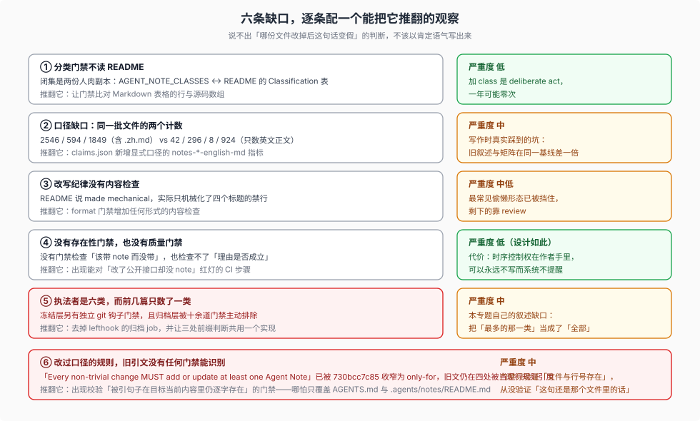

# 06 — 这套制度哪里没有闭环：五条可证伪的缺口

> 前几篇都在讲它成立的部分。本篇讲不成立的部分，而且**每条都给一个能把它推翻的观察**。这是本专题对自己的要求：说不出「哪份文件改掉后这句话变假」的判断，不该以肯定语气写出来。

## 缺口一：分类门禁不读 README（闭集的双份副本）

**观察。** [`scripts/agent-note-tree.ts`](../../scripts/agent-note-tree.ts) 的注释声明规则归属：「Structural rules are shared with `agent-note-tree.ts`; the closed classification rules live in `.agents/notes/README.md`.」但该脚本从不读取 `README.md`。闭集 `AGENT_NOTE_CLASSES` 与 README 的 Classification 表是两份独立维护的字面副本。

**后果。** README 说「Adding a class requires updating the canonical set and this section」——这半句**没有检查**。加一个 class 到 README 而不动源码，门禁通过；加进源码而 README 不提，门禁也通过。真正的红灯只对「出现了两边都没有的目录」亮。

**可证伪。** 若 `agent-note-tree.ts` 或某个门禁开始从 README 解析 class 表（例如比对 Markdown 表格的行与 `AGENT_NOTE_CLASSES`），这条缺口随即消失。

**严重度判断：低。** 加 class 是「deliberate act」，一年可能发生零次；但它是本项目最常被引用为「规则由 README 拥有」的一处，值得写清楚它不是机械保证。

## 缺口二：口径缺口——同一批文件的两个计数

**观察。** 同一棵 `.agents/notes/` 在基线 `b830ec95` 上，存在两组都在使用、口径不同的数字：

| 口径 | 实现 | 值 |
| --- | --- | --- |
| 古早指标 `notes-md-total` / `notes-implemented-md` / `notes-archived-md` | `git ls-tree -r --name-only <commit> .agents/notes` 后筛 `.md`，**含 `.zh.md`** | 2546 / 594 / 1849 |
| 本专题 [01](./01-lifecycle.md) 的分类矩阵 | 只数英文正文 `.md`（排除 `.zh.md` 与 `AGENTS.md`） | 各 class 的 42 / 296 / 8 / 924 |

两组的差值正好是中文对照文件的数量，所以**它们都不是错的**，但混用会得出荒谬结论（例如把「296 篇活跃」和「594 篇活跃」同时当真）。

**可证伪。** 若 `claims.json` 新增或改名为 `notes-*-english-md` 一类显式口径的指标，并且语料里不再有地方用旧口径做叙述，这条缺口消失。

**严重度判断：中。** 这是本专题写作过程中真实踩到的坑：`harness-idea/08` 的旧叙述（「1288 → 584」）与本页矩阵（「296」）在同一个基线上相差一倍，原因是前者含 `.zh.md`。已在本专题全程只用一种口径。

## 缺口三：改写纪律没有内容检查

**观察。** README 把 `proposed/` → `implemented/` 的转换描述为「the rewrite implemented/AGENTS.md requires, **made mechanical**」。实际机械化的只有标题：`BANNED_IMPLEMENTED` 正则挡得住 `## Proposal`、`## Plan`、`## Migration plan`、`## Acceptance criteria` 四个标题。

**未被检查的四件事。** `## Decision` 是否现在时；`## Acceptance criteria` 的内容是否真的折进了 `## Consequences`（只删标题即可通过）；`## Risks` 是否被折进去而非删除；计划是否以普通段落形式残留。

**可证伪。** 若 `verify-agent-note-format` 增加任何形式的内容检查（例如要求 `## Decision` 不含将来时助动词，或要求 `## Consequences` 非空且引用被折入的小节），这条缺口部分消失。

**严重度判断：中低。** 标题禁行已经挡住了最常见的偷懒形态（把提案原样搬过去），剩下的靠 review。但「made mechanical」这个说法比现状强，引用时需要加限定。

## 缺口四：没有存在性门禁，也没有质量门禁

**观察。** 全部 note 门禁检查的都是「已存在的 note 是否违反形状规则」（执法者有六类，见 [`08`](./08-enforcement-sites.md)）；没有门禁检查「这次改动该带 note 而没带」，也没有门禁能检查「写下的理由是否成立」。

**这不是疏漏。** 判定「这次改动是不是非平凡」与「这条理由值不值得记」都是语义判断，机械无法从事。设计的应对是把成本问题交给两处成文豁免与一处事后纪律：

- 豁免：`Mechanical or local edits, including local UI presentation and interaction changes, are exempt`；
- 豁免：`An implemented Agent Note that is fully superseded may be consolidated … and deleted`；
- 事后纪律：[归档四分法](./04-forgetting.md)，把「留多了」变成一次可复核的清理。

**可证伪。** 若出现一个门禁（或 CI 步骤）能对 PR 提出「本改动触及了 `packages/` 的公开接口却没有 note」这类判定并红灯，这条缺口消失。

**严重度判断：低（设计如此），但需要说明代价。** 没有存在性检查意味着**时序控制权在作者手里**：可以永远不写 note，而系统不会提醒。README 里同一条规则的措辞「only for lasting decision rationale that code, tests, and existing documentation do not explain」也是一条只有人能判的门槛。

## 缺口五：执法者是六类，而本专题前几篇只数了一类

**观察。** [`05`](./05-writeback-loop.md) 与 [`02`](./02-gates.md) 的强制力叙述都以 `doc-sync` 的三个 leaf 门禁为轴。实际上冻结层还有一道**独立的 git 钩子**门禁（`lefthook.yml` 的 `pre-commit` / `pre-merge-commit`，不受 `doc-sync` 分组影响），而归档层被十余道全仓门禁**主动排除**，且「排除」这个判断由三处各自写死的路径前缀字面量实现（逐处列举见 [`08`](./08-enforcement-sites.md) 第三节）。

**后果。** 只说 `doc-sync` 会把两件事读错：① 冻结层其实比活跃区更硬（钩子当场拒绝提交）；② 归档层的出站链接被**明文放弃检查**，而「归档不破坏引用」常被当成一项保证来引用。

**可证伪。** 若 `lefthook.yml` 的归档 job 被移除、或 `isArchivedAgentNotePath` 成为三处前缀判断的唯一实现，这条缺口随之消失或转化。

**严重度判断：中。** 这不是设计缺陷，是本专题自己的叙述缺口——把「最多的那一类」当成了「全部」。

## 一并登记的：本专题自身的可执行边界

本专题和 `_digested/` 其它专题一样，落在散文层，只有最小的第三层：

- [`verify.mjs`](../verify.mjs) 检查相对链接与片段、UTF-8、表格列数、`catalog.json` 与页面树的双射、覆盖矩阵是否过期、页面是否被专题 map 链接（孤儿页检查），以及 `harness-idea/claims.json` 的证据路径与 14 项指标重算；
- 它**不**判断任何一句关于 note 制度的结论是否为真。

因此本专题每条结论都按 `harness-idea/` 的出处标记约定处理：`[原文]`（可逐字 grep）与 `[源码]`（对着基线源码核对过）可以当事实引用；`[推断]` 必须能回答「哪份文件改掉后这句话变假」——本篇五条缺口就是按这个格式写的。

## 一句话总结

这套制度**在形状上是硬的**（位置、骨架、封印都有红灯），**在判断上是软的**（写不写、写得对不对、何时忘记，全靠校准过的判据加人读）。把它当成前者读会高估它，当成后者读会低估它。中间那层——判据被写成可执行形式、可执行不了的部分被写成明文与样例——才是它真正的内容。
