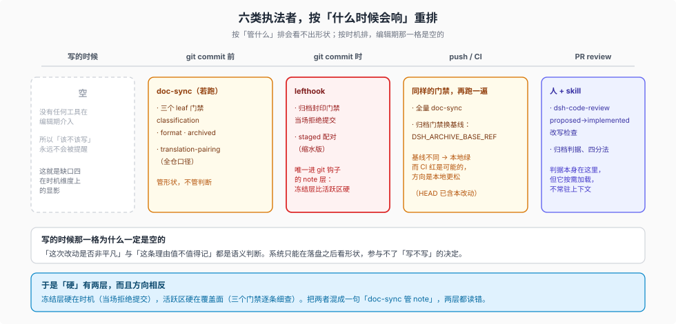

# 08 — 谁在强制：`doc-sync` 之外还有五类执法者

> 此前各篇把强制力的轴放在 `doc-sync` 的三个 leaf 门禁。但仓库里**不止一处**在强制 Agent Note 的纪律，而且这六类执法者的检查时机、检查对象、失败后果都不一样。把它们并列看清，「这套制度有多硬」才有一个准确的答案。生命周期机制归 [01](./01-lifecycle.md)，三个 leaf 门禁逐条规则归 [02](./02-gates.md)，缺口归 [06](./06-honest-gaps.md)。

## 六类执法者

| 执法者 | 检查对象 | 时机 | 失败后果 | 由谁配置 |
| --- | --- | --- | --- | --- |
| **三个 leaf 门禁** | 活跃区的树形状与正文骨架 | 提交前（`doc-sync`） | 红灯，并指明文件与行 | [`scripts/run-gates.ts:852-854`](../../scripts/run-gates.ts) |
| **`verify-archived-agent-notes` + lefthook** | 冻结层的封印与三件套 | **`pre-commit` / `pre-merge-commit`** | 提交被拒 | [`lefthook.yml:13-15`](../../lefthook.yml) |
| **`translation-pairing`** | 双语三件套的一致性 | 提交前（`doc-sync`）+ `pre-commit`（仅 staged 记录） | 红灯 | 同上 + `run-gates.ts` |
| **全仓文本门禁的排除规则** | 「归档文件算不算源散文」 | 提交前（`doc-sync`） | 决定这些门禁查不查归档层 | [`scripts/repo-files.ts:33`](../../scripts/repo-files.ts) |
| **人读的 skill** | 判据、四分法、改写与回写纪律 | 人显式阅读 | 无 | `.agents/skills/dsh-*/SKILL.md` |
| **PR review** | 「实现落地的 PR 里那篇 proposed 有没有被改写」 | 审阅时 | 要求修改 | [`.agents/skills/dsh-code-review/SKILL.md`](../../.agents/skills/dsh-code-review/SKILL.md) |

## 一、`pre-commit` 上真的有一道 note 门禁

这是最容易漏掉的一条，因为前几篇讲的三道门禁都在 `doc-sync` 里，而 `doc-sync` 是**提交前**跑的，不是 git 钩子。`lefthook.yml` 里另有一道：

```yaml
    - name: archived agent notes
      glob: '.agents/notes/archived/**'
      run: node_modules/.bin/tsx scripts/verify-archived-agent-notes.ts
```

它同时在 `pre-commit` 与 `pre-merge-commit` 上注册，并且**不受 `doc-sync` 的 quick 组影响**：只要 staged 里有 `.agents/notes/archived/` 下的文件，它就独立执行。

这带来三条后果：

- **冻结层是唯一进入 git 钩子的 note 层。** 活跃区写错 shape 靠 `doc-sync` 拦，冻结层被改动则在 `git commit` 当场被拒——两层的「硬」不在同一个机制里。
- **同一道门禁被 `pre-commit` 与 CI 跑两遍**，含义不同：钩子用默认基线（本地 `HEAD`），CI 注入受信的 `DSH_ARCHIVE_BASE_REF`（见 [02](./02-gates.md#唯一被允许的封印例外)）。所以「本地绿了但 CI 红了」在这道门禁上是可能发生的，方向是**本地更松**（`HEAD` 已含本次改动）。
- **配对门禁在钩子里是缩水的。** `translation-pairing` 的钩子版本带 `--cached {staged_files}`，只检查本次 staged 的 `.i18n.yaml`，且显式排除 `.agents/notes/archived/**`；`doc-sync` 里的版本才是全仓。这正是 `lefthook.yml` 开头那句注释的意思：「Keep these local checkpoints fast; CI owns the full repository-wide gate matrix.」

## 二、归档层被十余道门禁**主动排除**

`scripts/repo-files.ts` 导出一个判断：

```ts
/** Whether a repository path is frozen Agent Note history, not evolving source prose. */
export function isArchivedAgentNotePath(path: string): boolean
```

它被 `doc-typecheck`、`verify-md-links`、`verify-md-wrap`、`verify-mermaid`、`verify-package-paths`、`verify-type-equiv` 等门禁当作**排除谓词**使用：归档层不参与这些检查。

这条设计有明确动机，也有明确代价：

| | 内容 |
| --- | --- |
| **动机** | 冻结层是历史快照，按当前标准重排它是**篡改历史**；把归档纳入散文检查会逼着人去改一个明令不许改的层。 |
| **代价一** | **归档层的出站链接从不被检查。** `verify-md-links` 跳过它，所以归档 note 里指向活跃 note 的链接即使断了也不会红。[`dsh-archive-agent-notes`](../../.agents/skills/dsh-archive-agent-notes/SKILL.md) 甚至明说了这一点：「Do not claim archived outbound links are valid: the archive verifier intentionally never checks them.」 |
| **代价二** | **入站链接没有门禁保护。** 归档要「repair or delete inbound links」，但没有任何检查能在没有前置改动的情况下证明「该改的都改了」；实际保障来自 `verify-md-links` 会红 + 那一次提交改完了 242 篇（见 [07](./07-naming-and-house-style.md#引用习惯链接代替叙述)）。 |

所以「归档不破坏引用」这句要写准确：**指向归档的链接**是可机器验证的（归档目录本身存在于工作树，链接目标存在）；**归档发出的链接**被明文放弃检查。两者不是同一件事，混着说会把一个刻意留下的空白读成一项保证。

## 三、有五个脚本各写各的副本，谁都没用共享谓词

`repo-files.ts` 导出一个排除谓词 `isArchivedAgentNotePath`，有六个门禁引用它（`doc-typecheck`、`verify-md-links`、`verify-md-wrap`、`verify-mermaid`、`verify-package-paths`、`verify-type-equiv`）。但「归档层要排除」这个判断在共享谓词之外还有副本，而且写法各不相同：

| 文件 | 怎么处理归档层 | 写法 |
| --- | --- | --- |
| [`scripts/verify-concrete-terms.ts`](../../scripts/verify-concrete-terms.ts) | 排除 | 自己的 `excludedPrefixes` 字面量 |
| [`scripts/verify-public-repository-links.ts`](../../scripts/verify-public-repository-links.ts) | 排除 | 自己的 `archivedAgentNotePrefix` 字面量 |
| [`scripts/verify-repository-references.ts`](../../scripts/verify-repository-references.ts) | 排除 | 自己的 `uncheckedPrefixes` 字面量 |
| [`scripts/verify-no-unknown-casts.ts`](../../scripts/verify-no-unknown-casts.ts) | 排除 | 自己的 `isSource` 谓词里一行字面量 |
| [`scripts/translation-pairing.ts`](../../scripts/translation-pairing.ts) | 排除 | 自己的 `TRANSLATION_SCOPE_GLOB_EXCLUDES` 与路径谓词，两处 |
| `lefthook.yml` | 配对门禁排除，归档门禁专门覆盖 | glob |

**这五个脚本都没引用那个共享谓词**。改归档目录名要同时动六处，而且每一处都是独立发现、独立维护的。

另有一类不能说成「排除」：`verify-doc-budgets`、散文与 catalog 一族门禁的默认作用域里根本没有 `.agents/`，它们既不排除也不检查，因为本来就不看那里。所以准确的说法不是「归档层被所有门禁豁免」，而是「归档层只被那些本来会扫到它的门禁显式豁免，其余门禁的默认作用域就不包含它」。

这也解释了为什么 [06](./06-honest-gaps.md) 的缺口一（分类门禁不读 README）和缺口三（改写纪律无内容检查）迟迟没有补上：**补充检查的成本不是加一条规则，而是要决定「这条规则管不管归档层」**，而归档层一动就要走封印流程。

顺带一个由此推出的行为：活跃正文**可以**链接归档 note（`active prose may still link into an archived note when it intentionally cites history`），但被链接的那篇是冻结的。同一句话的两半由两个执法者分管——「可以链」是散文自治，「链过去的东西别再改」是封印强制。

## 四、六份 skill 各管一段：纪律不集中

`.agents/skills/` 下没有任何一个 skill 拥有整条生命周期，而是六个各管一段，靠**互相指路**拼接：

| skill | 管哪一段 |
| --- | --- |
| `dsh-archive-agent-notes` | 归档四分法、校准样例、三件套搬运、封印命令、报告口径 |
| `dsh-code-review` | 「PR 实现了 proposed note → 同一 diff 内移动并改写成现在时」，并核对路径、名字、机制 |
| `dsh-find-simplifications` | 写新 note 前必须做**有范围的取代检查**，并声明「代码巡检不等于全仓 note 审计」 |
| `dsh-prose-standard` | 全仓排除 `vendor/` 与 `.agents/notes/archived/`；implemented note 保留理由与证据，删计划清单 |
| `dsh-trim-cot-leakage` | 推理转录泄漏在 note 里的形态；引用 `#1470` 保留在 README，不得挪进 note |
| `dsh-doc` | 手册类文档与 note 的分工；写出当前状态，理由交给 note |

读这六份 skill 能看出一件 [05](./05-writeback-loop.md) 没展开的事：**纪律的载体本身就是分片的**。`dsh-archive-agent-notes` 只在自己被调用时生效，`dsh-code-review` 只在 review 时生效——而 [05](./05-writeback-loop.md) 的阶梯把 skill 排在「按需阅读」这一档，正对应这个事实：**没有哪一份 skill 常驻上下文**，所以判据被反复指路、反复重述，而不是集中一次讲清。

## 五、跨层回写：note 的理由进得了 `docs/`，进不了 `AGENTS.md`

`docs/AGENTS.md` 的 Placement 行规定了理由的流向：

> standing orders → root `AGENTS.md` **with a rationale link**

也就是说：一条理由升格成常驻规则时，`AGENTS.md` 只写那句话，理由仍留在 note 里。反过来，`docs/` 的多数页面**不允许**解释理由：`docs/AGENTS.md` 的层级表把「decision rationale」列在 `docs/architecture.md` 的排除栏，指向 Agent Notes。按 Placement 行写成「一句规则 + 一个理由链接」的实例是 `AGENTS.md` 里指向 `docs/architecture.md#application-launch` 的那条启动规则；本页不主张它是唯一的。

所以「回写」不是一条单向通道，而是三层之间的分工：

| 层 | 写什么 | 理由在哪 |
| --- | --- | --- |
| `AGENTS.md` | 一句可执行的常驻规则 | note（链接过去） |
| `docs/**` | 当前状态 | note（排除栏点名） |
| `.agents/notes/**` | 为什么、放弃了什么、怎么验 | 自己 |

## 一张时机对照表

把六类执法者按**什么时候会响**重排，比按「管什么」排更能说明这套制度的形状：



| 时机 | 会响的执法者 | 不会响的 |
| --- | --- | --- |
| 写的时候 | 无（没有任何工具在编辑期介入） | 全部 |
| `git commit` 前 | `doc-sync` 三个 leaf 门禁、`translation-pairing` 全仓（若跑） | 存在性与质量判断 |
| `git commit` 时 | lefthook：归档封印门禁、staged 配对 | 活跃区的骨架门禁（它不在钩子里） |
| push / CI | 全量 `doc-sync`、`DSH_ARCHIVE_BASE_REF` 基线下的归档门禁 | 同上 |
| PR review | `dsh-code-review` 的 proposed→implemented 改写检查；人读归档判据 | 机械性（全凭审阅者记得） |

**没有一格是「编辑期」**，这一格空白是 [06](./06-honest-gaps.md) 缺口四在时机维度上的显影：系统只在落盘之后才知道发生了什么，所以它只能检查形状，不能参与决定写不写。

## 边界

- 本篇不重复 [02](./02-gates.md) 的逐条规则，只回答「这些规则由谁、在何时、以什么后果执行」。
- `doc-sync` 门禁的聚合树与 quick/full 分组归 [`test-strategy/07-ci-gates.md`](../test-strategy/07-ci-gates.md)，本篇只取与 note 有关的那一段。
- `translation-pairing` 的配对契约归 [`docs/i18n/README.md`](../../docs/i18n/README.md)。
