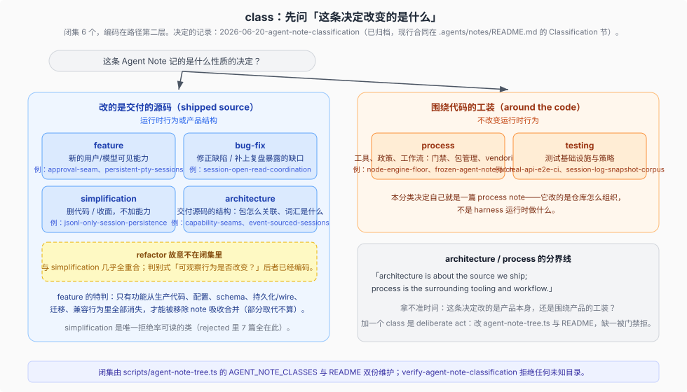

# 09 — class：六个决策种类，一条分界线

> 第二轴回答「这条决定**是什么性质**」。lifecycle 只告诉你它处于哪个状态，class 告诉你它在改什么：产品能力、缺陷、代码量、源码结构、周围工装，还是测试策略。本篇讲六个类的判定问题、那条最有名的 architecture / process 分界线、`refactor` 为什么故意缺席、以及各类在真实语料里的分布。位置语义与三件套见 [01](./01-lifecycle.md)，门禁实现见 [02](./02-gates.md)。

源码核验入口：[`.agents/notes/README.md`](../../.agents/notes/README.md) 的 Classification 节、[`scripts/agent-note-tree.ts`](../../scripts/agent-note-tree.ts) 的 `AGENT_NOTE_CLASSES`、[`scripts/verify-agent-note-classification.ts`](../../scripts/verify-agent-note-classification.ts)。

## 为什么会有第二个轴

只有 lifecycle 的树（`proposed/` / `implemented/` / `rejected/`）回答不了「这条 note 记的是哪一种决定」：浏览同一个 lifecycle 目录，读者分不清一条是新能力、一次移除，还是一项工具政策，除非逐篇打开。这套分类的引入决定本身是一篇 Agent Note——[`2026-06-20-agent-note-classification`](../../.agents/notes/archived/process/2026-06-20-agent-note-classification.md)（已归档，现行合同由 README 的 Classification 节拥有）——它的核心裁决是：

> Add a second axis — the Agent Note's **class** — and encode it in the path: `{lifecycle}/{class}/yyyy-mm-dd-topic.md`. The folder *is* the label.

被否决的替代方案是每个文件里加一行 `Classification:` 元数据、由门禁解析。否决理由值得记住：**路径编码让标签与它的存储是同一个东西，没有需要保持同步的两份事实**；一行元数据可以和目录不一致，路径不会。

## 六个类：先问「改变的是什么」



| class | 判定问题 | 它覆盖 | 真实样本 |
|---|---|---|---|
| `feature` | 加了新能力吗？ | 新的用户或模型可见能力 | `approval-seam`、`persistent-pty-sessions` |
| `bug-fix` | 修的是缺陷吗？ | 修正缺陷、补上复盘暴露的缺口 | `session-open-read-coordination` |
| `simplification` | 只删不加吗？ | 删代码 / 收窄行为或表面，**不新增能力** | `jsonl-only-session-persistence` |
| `architecture` | 改的是交付源码的结构吗？ | 包怎么关联、运行时词汇是什么 | `capability-seams`、`event-sourced-sessions` |
| `process` | 改的是周围的工装吗？ | 工具、政策、工作流——门禁、包管理、vendoring | `node-engine-floor`、`frozen-agent-note-archive` |
| `testing` | 改的是测试本身吗？ | 测试基础设施与策略 | `real-api-e2e-ci`、`session-log-snapshot-corpus` |

拿不准时先切的是**那条分界线**：这条决定改的是产品本身，还是围绕产品的工装？分类决定自己就是示范——它改变仓库怎么组织与怎么过门禁，不改变 harness 运行时行为，所以它是 `process`。

## 两条最容易踩的边界

**architecture / process 的分界线。** README 的原话：「architecture is about the source we ship; process is the surrounding tooling and workflow」。同一件事在两侧各有一个化身：改打包后的运行时词汇是 architecture，改「怎么打包」的门禁是 process。判据永远是**改动落在哪一层**，不是改动大不大。

**`refactor` 故意缺席。** 引入决定里被明确否决的一类：

> It overlaps `simplification` almost entirely; the only discriminator anyone reached for was "does observable behavior change?", which `simplification` already encodes (it does not). One class, not two.

「重构」不携带 simplification 之外的判别信息——两个类会共享同一个判定问题。这背后是闭集的一般纪律：**一个类的价值在于它能排除的误分类，不在于它名字顺口**；加一个与现有类重合的类，只会让每次写入多一次无信息量的选择。

## feature 的特判：合并删除的负向证明

`feature` 是唯一带「合并删除」特判的类：feature-addition note 只有在功能从生产代码、配置、schema、持久化/wire 格式、迁移、兼容行为里**全部消失**时，才能被后续的移除 note 吸收合并。部分取代不算——「Removing one transport, default, implementation, or presentation is partial supersession, as is any surviving durable data or compatibility handling」。吸收方必须保留原始动机、为什么它不再成立、完全移除的替代方案、放弃的能力、重新引入的条件，以及「完全不存在」的验证。这是整套制度里少见的**负向证明**要求（完整判据在 README 的 When to write one 节，机制面见 [03](./03-transitions.md)）。

## 闭集怎么被执行

- 闭集 6 个名字写死在 `AGENT_NOTE_CLASSES`（`scripts/agent-note-tree.ts`），与 README 的 Classification 表**双份维护**；`verify-agent-note-classification` 拒绝任何未知 class 目录。
- **加一个 class 是 deliberate act**：改脚本常量与 README 两处，缺一即门禁拒——这是引入决定的原文措辞（"a deliberate act"）。双份副本的缺口（门禁不读 README）见 [06](./06-honest-gaps.md) 缺口一。
- class 是每个 lifecycle 各自的一层槽位，不是全树共享的话题轴：`archived/{class}/` 里没有 `implemented` 层（只有 implemented note 能进归档），`rejected/` 下实际只有 `architecture` 与 `simplification` 两个类被用过——**目录的存在与否本身就是信息**。

## 真实负载：class × lifecycle 矩阵

矩阵按 `git ls-tree` 计数（只数英文正文 `.md`，排除 `.zh.md` 与各级 `AGENTS.md`/`README.md`；与 `claims.json` 的 `notes-*` 指标口径不同——后者含 `.zh.md`，见 [06](./06-honest-gaps.md#缺口二口径缺口同一批文件的两个计数) 缺口二）：

| class | proposed | implemented | rejected | archived |
| --- | ---: | ---: | ---: | ---: |
| feature | 9 | 40 | 0 | 306 |
| bug-fix | 1 | 11 | 0 | 182 |
| simplification | 9 | 13 | **7** | 92 |
| architecture | 15 | **180** | 1 | 185 |
| process | 6 | 34 | 0 | 120 |
| testing | 2 | 18 | 0 | 39 |
| **合计** | **42** | **296** | **8** | **924** |

复现命令（在仓库根执行，对当前 checkout 计数；数字随归档与迁移漂移，以命令输出为准）：

```sh
git ls-tree -r --name-only HEAD .agents/notes \
  | grep -E '\.md$' | grep -vE '\.zh\.md$|/(AGENTS|CLAUDE|README)\.md$' \
  | awk -F/ '{print $3"/"$4}' | sort | uniq -c
```

三个非均匀现象值得读出来：

1. **`simplification` 的拒绝率 7/20，其它 class 近乎为零。**「删掉 X」是最容易被否掉的诱惑；把它单独归类，等于建了一个「曾经想删但被否掉」的清单，防止反复重提。
2. **`implemented/` 里 `architecture` 占 180/296。** 架构决策大多落地并长期留任；`process`（34）与 `testing`（18）更多是「讲清一次即可归档」。
3. **`implemented/architecture` 的时间切片在目录结构里不可见**：按月是 2026-06 起的 8 / 26 / 28 / **88** / 30——2026-09 那一波彼此强相关的架构决策（其中去日期前缀后 `session-` 8 篇、`desktop-` 7 篇、`client-` 7 篇）被日期前缀均匀摊开。这是 [01](./01-lifecycle.md#什么时候这两条会失效)「平摊红利何时失效」的证据。

**处置频率的诚实读法**：把 `implemented/` 与 `archived/` 合并看，六类规模是 architecture 365、feature 346、bug-fix 193、process 154、simplification 105、testing 57，活跃:冻结约 1:3。这**描述已观测到的分布，不构成规则**——README 的归档判据没有一处按 class 区分（判据逐篇：rationale、alternatives、负向保证、durable/wire 语义、所有权边界、安全规则、重新引入条件）。想从矩阵推出「architecture 的 note 该留久一点」，在门禁里找不到依据。

## 源码入口

| 路径 | 角色 |
|---|---|
| [`.agents/notes/README.md`](../../.agents/notes/README.md) Classification 节 | 现行合同：六类定义、分界线、refactor 缺席 |
| [`scripts/agent-note-tree.ts`](../../scripts/agent-note-tree.ts) | `AGENT_NOTE_CLASSES` 闭集与树行走 |
| [`scripts/verify-agent-note-classification.ts`](../../scripts/verify-agent-note-classification.ts) | 未知 class 目录即红 |
| [`2026-06-20-agent-note-classification`](../../.agents/notes/archived/process/2026-06-20-agent-note-classification.md) | 引入决定（已归档）：路径编码 vs 元数据行、refactor 否决、双门禁 |
