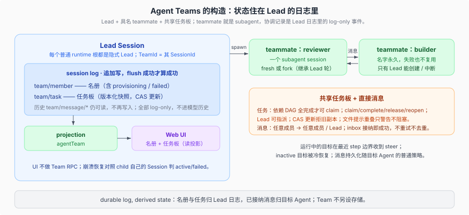
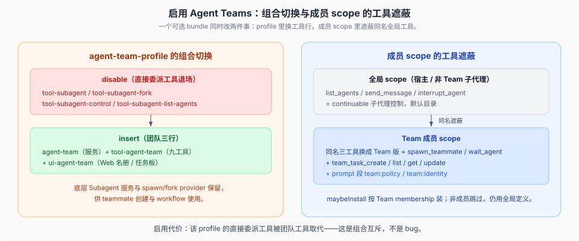

# Agent Teams：多代理编组

> 你熟悉 subagent：派一个一次性 worker 出去，拿回结果。但有些工作需要的不是临时工，而是一支**常驻团队**——有名字的成员、可以反复发消息、共享一块任务板，而且重启之后名册和任务还在。Agent Teams 就是在 subagent seam 上搭出的这种持久编组：一个 Lead Session 带一组 teammate，协调状态全部落在 Lead 的会话日志里。它仍是 experimental 能力（完整公开合同在评估、无产品支持承诺），但已作为可选 bundle 随安装出货，Web 插件管理器里默认关、一键开——experimental 与 optional 互不蕴含，口径见 [`00-map.md`](./00-map.md)。

## 从一次委派到一支常驻团队

先对比你已经熟悉的模型：

| | 一次性 subagent | Team teammate |
|---|---|---|
| 身份 | 一个 child session id | 一个**永久名字**（如 `reviewer`），失败创建也不复用 |
| 记忆 | 任务结束即止 | 持久名册成员；inactive 也能被消息冷恢复 |
| 通信 | 父 → 子委派，结果通知回父 | **任意成员 → 任意成员 / Lead** 的直接 inbox 消息 |
| 协调 | 无共享状态 | 共享任务板（依赖 DAG、claim/complete、CAS 更新） |
| 创建者 | 任何有委派工具的 agent | **只有 Lead** 能创建 / 中断 teammate |

三个概念要点：

- **Lead 是隐式的**：每个普通 runtime 根都是一个 Team 的 Lead，`TeamId` 就是其 `SessionId` 的 branded 别名（`packages/experimental/agent-team/src/types.ts`）；没有创建事件，durable 团队状态从第一条成员或任务记录开始。
- **teammate 就是 subagent**：成员创建直接复用 subagent seam 的 spawn / fork provider。fresh child 不带 Lead 历史；fork child 一次性继承 Lead 已完成轮的前缀。创建请求选哪种。
- **服务要持久存储才激活**：`TeamService extends Service`（`src/index.ts`，`super(ctx, 'agentTeams')`），inject 五项 `agents` / `sessions` / `sessionPersistence` / `sessionProjections` / `subagents`。它不是 Remote 宿主服务。

## 跑起来是什么样

把机制落到一个具体任务上，Team 的操作序列就是六步（每步都是模型可见的工具调用）：

1. **建队**：Lead 调 `spawn_teammate` 造 `reviewer` 与 `builder`——名字唯一、永久，`builder` 用 fork（继承 Lead 已完成轮），`reviewer` 用 fresh（不带历史）。
2. **建任务**：`team_task_create` 加「实现 X」与「审查 X」，后者 `dependsOn` 前者；带 `writeScopes` 提示会碰的文件。
3. **派工**：Lead `send_message` 把任务描述发给对应成员（对等成员之间也可以直接发）。
4. **推进**：成员 `team_task_list` 看到自己能 claim 的（依赖已完成的）任务，`team_task_update` claim 开工；`builder` 完成后 complete。
5. **等待**：Lead 用 `wait_agent` 等下一次团队变化（名册 / 消息接纳 / 任务更新），而不是轮询；超时后重读当前状态。
6. **收尾**：`reviewer` 的依赖解锁后 claim 审查任务；Lead 汇总。

**边界**：`ready` 或 task `completed` 只表示状态提交，不等于业务完成；`wait_agent` 只报告是否超时（没有其他 `running`/`provisioning` 成员时立即返回带 `noProgress: { reason: 'no-active-peer' }` 的短路结果），不返回结论；中断（`interrupt_agent`）只停当前 turn，不释放任务所有权也不删排队消息。驾驶座视角的完整工作流与协作纪律见 [`../delegation-and-orchestration/delegation-primitives/06-persistent-teams-with-a-shared-task-board.md`](../delegation-and-orchestration/delegation-primitives/06-persistent-teams-with-a-shared-task-board.md)。

## 状态住在 Lead 的日志里

这是全页最重要的架构事实：**durable log, derived state**。Team 不另设存储——

- 名册与任务变更往 Lead Session 追加 `team/member` / `team/task` 事件，**flush 成功才算操作成功**（`TeamJournal.appendAndFlush`，`src/journal.ts`）。历史的 `team/message/queued` / `team/message/delivered` 记录仍可读，但不再写入；成员消息的持久化跟随目标 Agent 的普通策略。
- 四类事件都是 **log-only**：不进对话面，派生模型历史不受协调记录影响。
- 浏览器端读 Lead Session 的 `agentTeam` 投影（`ctx.root.sessionProjections.register(teamProjectionDefinition)`，`src/index.ts`），**不做任何 Team RPC**。
- 崩溃恢复挂 `agent/created`（session-start 边）：把未终结的 provisioning 记录对照 child 自己持久化的 Session 判成 active / failed。

## 成员之间怎么协作

**直接消息。** 任意成员可发给另一成员或 Lead；每次发送要么返回目标 inbox 的 `MessageId`，要么 throw。运行中的目标在最近 step 边界收到 steer，inactive 目标被启动或冷恢复。**成功 = inbox 接纳**，不是模型已处理；Team 不保留未接纳的发送意图、不在重启后重试新消息、不去重显式重发。每条消息都是某次成员工具调用经服务发出的——服务方法收 exact live calling `Agent`，自身不产生消息；大小校验按序列化后 JSON 的 UTF-8 字节数 `Buffer.byteLength(JSON.stringify(content), 'utf8')` 与 `maxMessageBytes` 比较（对等消息以发送者名字开头，名字计入预算）。

**共享任务板。** 任何成员可加任务（标题、详情、可选依赖、可选文件提示）；依赖全部完成才可 claim。任务有 owner：claim 开工、complete 完成、release 放回、reopen 重开；Lead 可指派给任何成员。每次变更都是 **compare-and-set**：基于过期副本的更新被拒（`TEAM_TASK_STALE_REVISION`），两个成员不会悄悄覆盖彼此。文件提示（`writeScopes`）在进行中任务路径重叠时**只警告、从不阻塞**。删除的任务留 tombstone 供回放与 id 稳定，不占 `maxTasks`、不出现在 active 列表。

**等待与中断。** 成员可 `wait_agent` 等下一次团队变化（名册 / 消息接纳 / 任务更新 / 活状态），没有其它 `running` 或 `provisioning` 成员时立即返回 `noProgress: { reason: 'no-active-peer' }` 短路；正常等待只报告是否超时，调用方随后重读当前状态——代替轮询。Lead 可中断 teammate 当前 turn（`keepInbox`）：不删排队消息、不动任务所有权。

## 模型看见什么：九个工具与两段 prompt

`tool-agent-team` 注册九个工具（`packages/experimental/tool-agent-team/src/index.ts`），按职责分两组：

| 组 | 工具 |
|---|---|
| 成员与消息 | `spawn_teammate`、`send_message`、`list_agents`、`wait_agent`、`interrupt_agent` |
| 任务板 | `team_task_create` / `team_task_list` / `team_task_get` / `team_task_update` |

外加每个成员 scope 里的固定 prompt 段 `team:policy`（协作纪律）与 `team:identity`（模型侧身份）。

注册是**成员级**而非全局：`maybeInstall` 检查 Agent 的 Team membership，非 Team 子代理跳过。与全局 continuable 子代理控制同名的 `list_agents` / `send_message` / `interrupt_agent` **只在 Team 成员 scope 内遮蔽**全局定义；宿主和非 Team 子代理仍用默认目录（图右）。

## 怎么启用：一个 bundle 的组合切换

`agent-team-profile` 同时服务 Host 与 Web（`packages/experimental/agent-team-profile/cordis.patch.yml`）：disable 重名的 `tool-subagent-control` / `tool-subagent-list-agents`，连同直接委派工具 `tool-subagent` / `tool-subagent-fork` 一并 disable，再 insert `agent-team` + `tool-agent-team` + 浏览器插件 `ui-agent-team`（图左）。底层 Subagent 服务与 spawn/fork provider 保留，供 teammate 创建与 workflow 使用。

**启用代价要看清**：该 profile 的直接委派工具被团队工具取代——这是组合互斥，不是 bug。想要一次性委派和团队共存，得在不同的 profile / preset 里分别组合。

启用方式 `dsh plugin --profile headless|web add @deepseek-ai/dsh-experimental-agent-team-profile`（已发布、从 npm 装），要求 profile 已含 `dsh-base`（其 README「Install into a profile」节）。它也是 `OPTIONAL_BUNDLES` 成员（`packages/boot/app-boot/src/profile.ts`），shipped 安装在 Web 插件管理器里默认关、一键开。最小源码组合是持久存储 + 两个 Team 包（owner README 的「Smallest working setup」）。

## 上限与合同边界

服务层上限都是启动时校验的部署值，耗尽报类型化错误而不是复用 id / 名字（`src/index.ts` 的 `DEFAULT_*` 常量）：

| 字段 | 默认 | 含义 |
|---|---|---|
| `maxMembers` | 16 | 团队累计可创建成员数，**含失败的**；agent-team-profile 的 patch 行钉回 8 |
| `maxTasks` | 256 | 任务板活跃任务上限 |
| `maxMessageBytes` | 65536 | 单条消息上限 |
| `disposalTimeoutMs` | 5000 | 关闭清理时限 |

已知不支持（owner README「When to choose it」）：分离的工作目录、跨进程协调、任务 owner 自动释放。实验合同允许行为 / API 变化甚至撤下，但工程、安全、文档、测试与已发布数据义务不减；毕业方向的消化侧预判见 [`00-map.md`](./00-map.md) 的毕业路径表。

## 源码入口

| 包 / 文档 | 一句话 |
|---|---|
| `packages/experimental/agent-team/` | `ctx.agentTeams` 领域服务：roster / mailbox / task-board / journal / projection |
| `packages/experimental/tool-agent-team/` | 九个成员级工具 + `team:policy` / `team:identity` prompt 段 |
| `packages/experimental/agent-team-profile/` | Host/Web 统一 profile patch（disable 直接委派、insert 服务 + 工具 + UI 三行；OPTIONAL_BUNDLES 成员） |
| `packages/experimental/client-ui-agent-team/` | Web 会话头部 Team 动作 UI（读 Lead Session 投影，无 RPC；`src/client/mount.ts` 明说 "this registration performs no Team RPC"） |
| [`agent-team README`](../../packages/experimental/agent-team/README.md) | 用户面合同与实现细节的 owner |
| [`2026-08-05-agent-teams`](../../.agents/notes/implemented/feature/2026-08-05-agent-teams.md) | roster / mailbox / task / shared-checkout 决策 |

session event log 与 projection 的底层机制见 [`../session-and-loop/00-map.md`](../session-and-loop/00-map.md)；continuable 子代理的 `send_message` / steer 语义见 [`../capability-seams/03-subagent后台与产品provider.md`](../capability-seams/03-subagent后台与产品provider.md)；驾驶座用法（启用代价组合互斥表、Lead 九工具工作流、POLICY 协作纪律）见 [`../delegation-and-orchestration/delegation-primitives/06-persistent-teams-with-a-shared-task-board.md`](../delegation-and-orchestration/delegation-primitives/06-persistent-teams-with-a-shared-task-board.md)。
