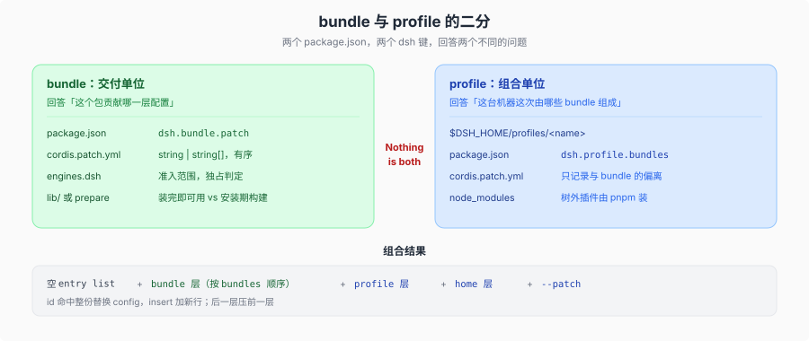

# 打包：bundle 与 profile 的二分

产品源码基线：`1f81c047fc48fa190a683e469daa699857e9afe8`（`dsh-v0.2.1-rc.3`）。

## 一句话

交付单位是 **bundle**，不是「插件包」。一个 npm 包要成为可交付的插件，必须在 `package.json` 里用 `dsh.bundle` 声明自己贡献哪一层配置；没有这声明的包照样能装进 profile，但它只是普通依赖，不会激活任何插件行。

「Nothing is both」是这条设计的原话：bundle 回答「怎么发货」，profile 回答「这次怎么组合」。两者都由 `package.json` 描述，但承载的是不同的问题，一个包不能同时是两者。

## 两个 manifest，两个问题

| 清单 | 键 | 回答的问题 | 类型真源 |
|------|----|------------|----------|
| bundle | `dsh.bundle.patch` | 这个包贡献哪一层配置？ | `packages/util/package-manifest/src/types.ts:69` |
| profile | `dsh.profile.bundles` | 这台机器上的这次启动由哪些 bundle 按什么顺序组成？ | `packages/util/package-manifest/src/types.ts:75` |

`patch` 是 `string | string[]`：一个文件，或一份**有序**文件列表，逐个相对包根解析，作为一个层顺次应用（`types.ts:71`）。多个文件存在的理由是同一份交付要分平台或分面插入行，而层内顺序必须可预测，所以不允许把顺序交给目录遍历。

`bundles` 是**有序**名字列表，用安装后的包名（`types.ts:77`）。顺序即层顺序，后面改顺序会改配置优先级，见 [`06-更新与启停.md`](./06-更新与启停.md)。

`dsh` 键下还有第三个角色 `dsh.client`（`types.ts:81`），声明客户端模块的平台、注入与构建信息。它不改变上面的二分：客户端包仍是包，仍然通过某个 bundle 的行进入组合。

## 准入声明写在哪

每个包的 `engines` 里可以声明 `dsh` 范围（`packages/util/package-manifest/src/types.ts:57`）。安装与启动都用它做准入，判定在 `packages/boot/app-boot/src/plugin-compatibility.ts:78` 的 `evaluatePluginCompatibility`，**不导入插件代码**就能得出结果。

规则只有三条，但都容易踩：

1. **自带的 `engines.dsh` 独占判定**，此时完全不看 `peerDependencies`（`:56`）。
2. 没有 `engines.dsh` 时，逐个检查名字为 `@deepseek-ai/dsh` 或 `@deepseek-ai/dsh-*` 的 peer 范围（`:63`–`:73`）。peer 上的 `workspace:^` / `workspace:~` / `workspace:*` 视为等于当前运行时版本。
3. **空串与非法范围一律算不满足**；`engines.dsh` 里写 `workspace:` 也非法（`:50`–`:52`）。预发布版本参与匹配。

想放宽准入不能用 `engines.dsh` 之外的写法——那是升级指南要写清楚的外部感知变化；运行期的精确豁免走 `compatibility.json`，见 [`03-安装.md`](./03-安装.md)。

## 三种交付形态，三种信任代价

同一个包可以走三条路到达用户，区别不在包内容，而在**谁能批准它执行代码**：

| 形态 | 安装期发生什么 | 谁批准 | 适合 |
|------|----------------|--------|------|
| npm 预构建 | 解包 | 不需要额外批准 | `lib/` 在 `pnpm publish` 时已构建 |
| tarball（`pnpm pack`） | 解包 | 不需要额外批准 | 不分发到 registry |
| git 地址 | **取源码**，再跑 `prepare` | 用户在 profile 的 `pnpm-workspace.yaml` 里写 `allowBuilds` | 内部分发、带构建步骤的包 |

git 这条路的两个前提是一对：

- **作者**必须提供自包含的 `prepare` 脚本，从 `src/` 直接产出发布入口，不能假设存在同仓 monorepo 检出或 dev-only 上下文。
- **用户**必须显式允许构建。pnpm ≥10 会拒绝运行 git 依赖的 `prepare`，第一次 `add` 失败，`dsh` 指出去 profile 的 `pnpm-workspace.yaml` 补 `allowBuilds` 再重跑。

这个允许是「安装期在本机执行该包代码」的授权，**不属于任何 sandbox 的范围**。所以配套建议是钉 commit（`github:you/hello-plugin#<sha>`），或干脆发预构建产物绕开这条路。插件管理器的构建批准是同一条边界的另一个入口，见 [`03-安装.md`](./03-安装.md)。

## 身份与命名

产品的包名是 `@deepseek-ai/dsh-<name>`。实验身份的命名规则是机械的：默认前缀 `@deepseek-ai/dsh-experimental-`，加一份「保留旧 npm 名」的例外表（`scripts/experimental-package-policy.ts:4`–`:16` 的 11 条，判据函数 `:27`）。实验身份与「是否随装出货」相互独立，见 [`experimental/00-map.md`](../experimental/00-map.md)。

官方插件的图标走 [`dsh-official-plugin-artwork`](../../.agents/skills/dsh-official-plugin-artwork/SKILL.md)，属于打包面的一部分，但不在本页展开。

## 本页的边界

仓库自己的发布序列（版本号顺序、发布通道、制品集合）是另一套流程，不属于插件生命周期；需要时看 [`_dsh_plugin_agent_ready_development/sdlc-reference/11-release-sequences-and-publish-lanes.md`](../../_dsh_plugin_agent_ready_development/sdlc-reference/11-release-sequences-and-publish-lanes.md)。本页只写到「包作为交付单位成立」为止。

下一段：[`02-分发.md`](./02-分发.md)。
