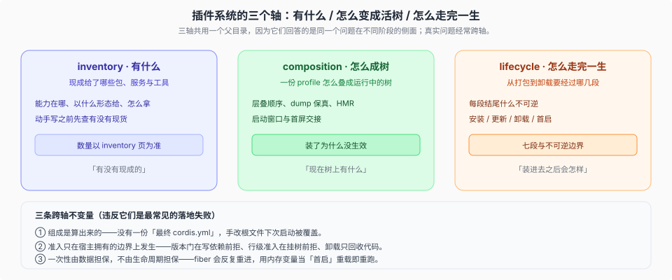

# 插件系统 · 三维架构诊断模型

## 一句话

插件系统由三个维度组成：**库存 (Inventory)**、**组装 (Composition)** 与 **生命周期 (Lifecycle)**。它们共同构成了一个可预测、类型安全的插件运行环境。

## 架构诊断视图

本系统不依赖“最终配置清单”，所有插件树都是运行时算出来的。如果你遇到装了没生效、版本冲突或首启行为异常，请按上述三个维度进行拆解分析。

## 架构免疫系统 (Invariants)

以下三条不变量是插件系统不被“熵增”腐蚀的根本，违背它们通常是导致系统不可预测的主因：

1. **计算确定性 (Composition)**: 没有任何一份“最终 cordis.yml”。系统启动时动态算出的插件树是唯一真相。
2. **所有权边界 (Permission)**: 插件的准入、版本锁定、卸载清理，均由宿主在“进入树前”的一致性边界内完成。
3. **状态一次性 (Statelessness)**: 插件对象（Fiber）可反复重载。插件不得用内存变量记录“首启”状态，必须依赖持久化数据源（Session/Projection）。

## 诊断导航与切片

| 症状诊断 | 进入切片 (阅读入口) |
|---|---|
| 我想找现有的能力、查契约 | [`inventory/`](./inventory/00-map.md) |
| 装了插件没生效、启动行为诡异 | [`composition/`](./composition/00-map.md) |
| 发布、安装、升级、插件卸载边界 | [`lifecycle/`](./lifecycle/00-map.md) |

## 另见：插件的外延 (Extensibility)

插件的运行时形态仅处理其“自身逻辑”，它对外暴露的能力（如 UI 组件、Wire 协议）归下列模块管理：
- **UI 投影**: [`../two-tree-runtime/client/00-map.md`](../two-tree-runtime/client/00-map.md)
- **跨域调用 (Remote)**: [`../two-tree-runtime/remote/00-map.md`](../two-tree-runtime/remote/00-map.md)

---
> 承重词按 [`canon/GLOSSARY.md`](../canon/GLOSSARY.md) 的 DSH 原文用；本页自己的分类与指标不是 DSH 的词。
