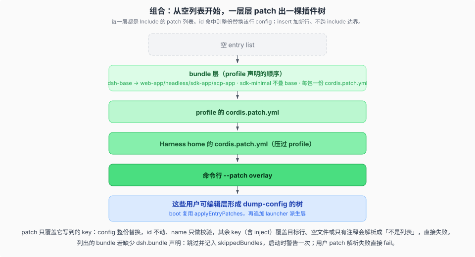
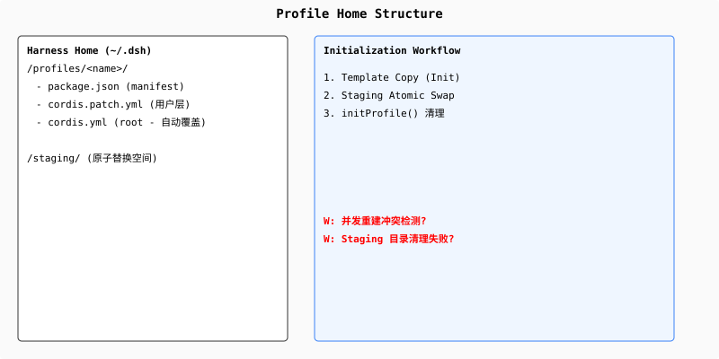

# Composition · 启动组合

## 一句话

一次正在跑的 `dsh` 是 boot 时按层**叠出来的插件树**。profile 是 Harness home 里的具名组合，bundle 是可安装的 patch 层，用户的 `cordis.patch.yml` 叠在所有 bundle 之上。仓库里没有一份「最终 cordis.yml」代表你机器上的树——**那棵树是算出来的**。

先修概念：Cordis 的 Loader / Include / patch 算法在 [`../../two-tree-runtime/framework/`](../../two-tree-runtime/framework/00-map.md)；各 launcher profile（五个内置模板 + desktop）各自装什么在 [`../../runtime-profiles/`](../../runtime-profiles/00-map.md)；本专题拥有**层叠算法与 patch 语义本身**，以及 boot、dump、HMR、profile 创建这条装载机制线。

## 从空列表开始叠

顺序固定：空 entry list → 各 bundle 的 `cordis.patch.yml`（profile 里写的顺序）→ 该 profile 的 `cordis.patch.yml` → home 的 `cordis.patch.yml` → 命令行 `--patch`。

两条机械规则决定一切层间交互：

- **id 命中：整份替换**该行 `config`。想保留的字段必须重写，没有深合并。
- **`insert`：加新行。** 同一次列表里，后面的 patch 必须能打到前面刚 insert 的行（这是 vendor Include 的本地修改之一）。

列出的 bundle 若没有 `dsh.bundle` 声明（或解析 / 兼容性 / patch 读取失败），会被 `loadProfileDirectory` 跳过并记入 `skippedBundles`，启动时通过 `reportSkippedBundles` 警告一次，不会悄无声息或卡死剩余 bundle（profile 清单或用户 patch 解析失败才直接终止启动）；Patch 文件必须是列表，要保留一个空层写 `[]`。这套 id/insert 算法的实现与 `!!js` 求值时序归 [`../../two-tree-runtime/framework/03-loader-include-and-javascript-expression-timing.md`](../../two-tree-runtime/framework/03-loader-include-and-javascript-expression-timing.md)。

`--dump-config` 展示用户可编辑层、launcher 派生层只在启动时追加——dump 与 boot 的保真差异归 [`02-dump-与boot-保真.md`](./02-dump-and-boot-fidelity.md)。

## Profile 住在 home，不在 git 仓库根

- **profile**：`$DSH_HOME/profiles/<name>`（未设 `DSH_HOME` 则为 `~/.dsh`）。里面有 `package.json`（`dsh.profile.bundles` + 树外插件）和用户自己的 `cordis.patch.yml`。
- **bundle**：npm 包，清单里写 `"dsh": { "bundle": { "patch": "./cordis.patch.yml" } }`。`dsh-base` 是 base-backed 组合的第一层。可安装能力分两个档位：`OPTIONAL_BUNDLES` 随安装出货、默认关断（清单归 [`../../experimental/00-map.md`](../../experimental/00-map.md)）；`ON_DEMAND_BUNDLES`（Codex / Claude Code provider）按需安装（机制归 [`../../capability-seams/03-subagent后台与产品provider.md`](../../capability-seams/subagent/01-subagent-provider.md)）。
- **模板**：五个内置 profile（web / headless / sdk / sdk-minimal / acp）首次使用自动初始化；模板清单与各 profile 差异的**家**在 [`../../runtime-profiles/00-map.md`](../../runtime-profiles/00-map.md)。其它名字必须先初始化，否则 fail loud；`--from-default-profile` 与保留名的机制见 [`04-profile-创建与保留名.md`](./04-profile-creation-and-reserved-names.md)。
- **preset**：会话级声明，id 与显示名**分离**——preset 行只带 id，shipped 显示文案经 locale 键解析（`packages/preset/agent-preset-registry/src/display.ts`），用户自建 preset 的自由文本名不做本地化。四个 shipped preset 是 `standard` / `ptc` / `minimal` / `cordis`（`cordis` 的显示名是 **Creator mode / 创造模式**，`packages/client/ui-agent-preset/src/client/locales.ts`；**PTC** = 用 `run_code` 跑模型写的脚本、再由脚本扇出子代理的模式），声明以 `presets/*.patch.yml` 随 `dsh-web-app` 携带，具体组合与隔离差异归 [`../../delegation-and-orchestration/preset-composition-and-contract-placement/`](../../delegation-and-orchestration/preset-composition-and-contract-placement/00-map.md)。
- **启动环境分层**：进程继承 > 项目 `.env` > home `.env`；bootstrap-only 变量不许来自项目 `.env`（home 层只豁免四个代理名）。分层机制与凭据来源链归 [`01-boot-时序.md`](./01-boot-sequence.md)；代理豁免的证据链归 [`../../capability-seams/06-外发代理策略.md`](../../capability-seams/integration/01-egress-proxy.md)。

`cordis:group` 与 Include 一起注册，使 provider 和 Consumer 可以处于同一个 **`isolate` realm**（隔离域：同一 key 在其中独立实例化的一套服务实例域）；agent preset 的服务隔离依赖这一点。

## 按问题找

| 你的问题 | 去哪 |
|---|---|
| 层叠顺序 / patch 语义 / `!!js` | 本页 + [`framework/03`](../../two-tree-runtime/framework/03-loader-include-and-javascript-expression-timing.md) |
| dump 与 boot 为什么不一致 | [`02-dump-与boot-保真.md`](./02-dump-and-boot-fidelity.md) |
| 改了 patch 没生效 / HMR | [`03-user-patch-hmr.md`](./03-user-patch-hmr.md) |
| 建 profile / 保留名 / `desktop` | [`04-profile-创建与保留名.md`](./04-profile-creation-and-reserved-names.md) |
| 启动窗口里插件能做什么 / 首屏交接 | [`05-启动窗口与首屏交接.md`](./05-startup-window-and-first-screen-handoff.md) |
| 某个 profile 具体装了什么 | [`../../runtime-profiles/`](../../runtime-profiles/00-map.md) |
| 包装进 profile / 更新 / 卸载 | [`../lifecycle/00-map.md`](../lifecycle/00-map.md) 的症状定位表 |

## 机制级正文

| 文件 | 内容 |
|------|------|
| [`01-boot-sequence.md`](./01-boot-sequence.md) | `runProfile` → `prepareProfile` → `boot()`；两段失败标签；`installFailLoud`；启动环境分层 |
| [`02-dump-and-boot-fidelity.md`](./02-dump-and-boot-fidelity.md) | 同一 `applyEntryPatches`；dump 不含 launcher 派生层；`!!js` 不求值 |
| [`03-user-patch-hmr.md`](./03-user-patch-hmr.md) | `hmr` 插件串行重算组合；应用前候选失败与应用后激活失败具有不同的状态保证 |
| [`04-profile-creation-and-reserved-names.md`](./04-profile-creation-and-reserved-names.md) | `--from-default-profile` 的复制语义与独占抢占；与 `dsh plugin` 初始化路径的分工；`desktop` 保留名 |
| [`05-startup-window-and-first-screen-handoff.md`](./05-startup-window-and-first-screen-handoff.md) | 六段流水线；作者四窗 A–D；首屏五步；硬限制与自证配方 |

## 源码入口

| 路径 | 角色 |
|------|------|
| `packages/boot/app-boot/` | `boot`、`loadProfile`、`loadProfileDirectory`、`initProfile`、`composeEntries`、`renderConfigDump` |
| `packages/util/package-manifest/` | `DshManifest` 等 profile / bundle manifest 类型 |
| `packages/boot/cmdline/` | CLI 如何选 profile / patch |
| `packages/bundle/base/` | base-backed 组合的第一层 |
| [`packages/boot/app-boot/README.md`](../../../packages/boot/app-boot/README.md) | profile 机器合同 |

Session 与 turn 驱动见 [`../../session-and-loop/00-map.md`](../../session-and-loop/00-map.md)。

> 承重词按 [`canon/GLOSSARY.md`](../../canon/GLOSSARY.md) 的 DSH 原文用；本页自己的分类与指标不是 DSH 的词。
