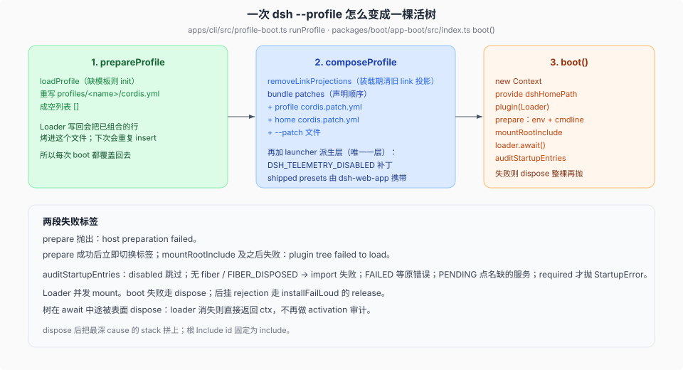

# `boot()` 时序

> [!IMPORTANT]
> 理解 `runProfile` 与底层 `boot()` 的交接是排查启动报错、环境变量代理失效的关键。本页按时间轴拆解启动链路。

## 链路与责任划分

`runProfile` (CLI 入口) 负责环境、补丁层解析；`boot()` 负责插件树的加载与审计。

### 关键阶段与 Watchpoints
1.  **prepareProfile**：初始化 profile 环境。
    *   **[Watchpoint]**：检查 `profiles/<name>/cordis.yml` 是否被意外覆盖。
2.  **composeProfile**：解析层叠顺序 (`bundle` > `profile` > `home` > `argv`)。
    *   **[Watchpoint]**：确认补丁 ID 冲突策略是否符合预期。
3.  **boot()**：加载 Context 与插件。
    *   **[Watchpoint]**：监听 `auditStartupEntries` 状态，排查 PENDING 插件缺失的服务。

## 失败诊断 (Two-Stage Labels)

| 阶段 | 标签 | 诊断核心 |
|---|---|---|
| prepare 之前 | `host preparation failed` | 环境解析或路径检查 |
| mount 之后 | `plugin tree failed to load` | 插件树加载或依赖 |

> [!NOTE]
> 对于任何加载失败，诊断应追踪最深层的 `cause` stack。

## 源码入口

| 路径 | 角色 |
|---|---|
| `apps/cli/src/profile-boot.ts` | 启动入口、出网代理安装 (`installProxyFromEnvironment`) |
| `packages/boot/app-boot/src/index.ts` | `boot()` 主逻辑与结算审计 |
| `packages/boot/app-boot/src/profile.ts` | 补丁解析与 resolve |

> [!TIP]
> 使用 `dsh --profile <name> --dump-config` 查看最终生成的层叠配置。
