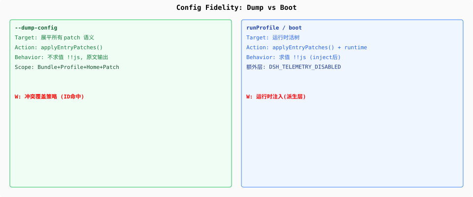

# dump 与 boot 保真

> [!IMPORTANT]
> `--dump-config` 保真的不是「运行态每一条额外补丁」，而是「所有 patch 层展平后单次索引匹配的语义」。读懂本页才能区分 dump 输出与实际运行行为。

## 组合算法与保真机制

`composeEntries` (用于 dump) 与启动链路 boot() 中调用的 `applyEntryPatches` 是完全一致的。

### 关键差异与 Watchpoints
*   **Launcher 派生层**：`DSH_TELEMETRY_DISABLED` 补丁仅在 `boot()` 期间动态生成，`dump` 不包含此层。
*   **`!!js` 求值**：`dump` 直接打印 `!!js` 原文，不求值；`boot()` 在 `inject` 完成后求值。
*   **[Watchpoint]**：若输出少了字段，核查是否存在“整块替换” (`id` 匹配) 导致旧补丁失效。

## 诊断要点

| 现象 | 诊断方向 |
|---|---|
| dump 没有 telemetry 补丁 | 正常（非 dump 覆盖范围） |
| `!!js` 原样输出 | 正常（dump 不求值） |
| 补丁不生效 | 核查是否因为前面有 ID 匹配导致该 patch 被 `skip` |

> [!TIP]
> 使用 `dsh --profile <name> --dump-default-config` 排除损坏的用户 patch 文件，进行纯净诊断。
