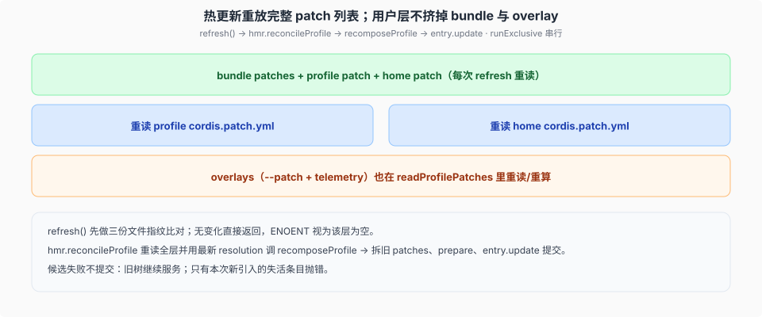
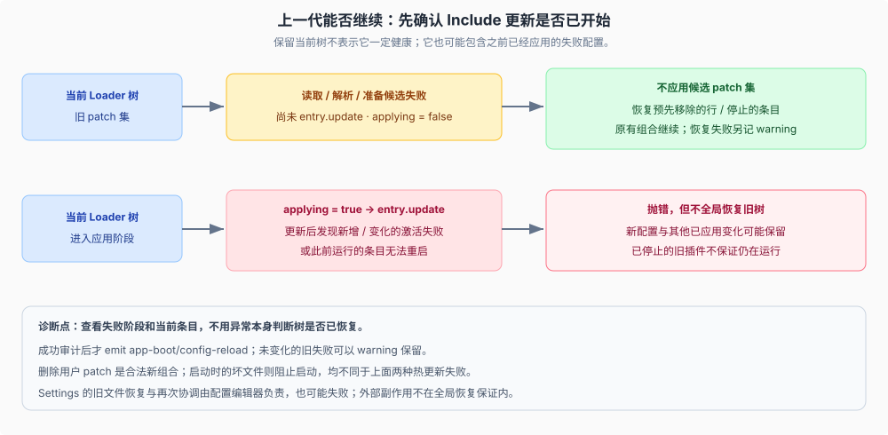

# 用户 patch 的 HMR

源码核验入口：`packages/boot/hmr/src/index.ts`（hmr 插件本体）、`packages/boot/app-boot/src/index.ts` 的 `recomposeProfile`（及 `config-editor` 使用的 `reconcileProfilePatches`）、`packages/boot/app-boot/src/profile-resolution/`（模块解析拦截层）、`apps/cli/tests/profile-hmr.spec.ts`。

boot 叠完的树不是一次性的。profile 的 `cordis.patch.yml`、home 层 patch 与 profile 的 `package.json` 改了要热更新；失败的候选不能把正在服务的树拆掉；bundle 层和 `--patch` / launcher overlays 不许被用户文件挤掉。

## 机制形状

**`hmr` 插件自己监视三份文件，经 `hmr.reconcileProfile()` 调 `recomposeProfile` 原子换入新 patch 集与运行时解析表**，模块热替换与配置重载共用同一条串行队列（`packages/boot/hmr/src/index.ts:1` "Serialized module and profile-configuration reloads"）。（`config-editor` 写配置走不重算 resolution 的 `reconcileProfilePatches`。）换代背景见 [`../../_change_log/0008-0.1.5-rc.2-to-0.1.7-rc.1.md`](../../_change_log/0008-0.1.5-rc.2-to-0.1.7-rc.1.md)。

## hmr 插件看哪三份文件

`hmr` 服务的 `[Service.init]`（`packages/boot/hmr/src/index.ts:355-408`）在 `profileContext` 在场时（`:367`）启动 profile 监视：

- profile 的 `cordis.patch.yml`（`profile.patchPath`）；
- home 层 patch（`$DSH_HOME/cordis.patch.yml`）；
- profile 的 `package.json`（bundle 清单变更也触发重载——`:384` 的 `manifestPath`、`:385` 的两个 patch 路径，`refresh(manifestOnly)` 对 bundle 变化单独比对 `:389-390`）。

**前提是应用就绪**：`appReady` 不在场直接抛 `Profile HMR requires application readiness`（`:369-370`）。`appReady` 由 `runProfile` 内部创建并提交——`createAppReady()`（`apps/cli/src/profile-boot.ts:295`）、经 `provideCmdline({ ready })` 注入（`:334-337`）、在 `ctx.fiber` ACTIVE 且 loader 在场时 commit（`:341-344`）。因此凡是走 `runProfile` 的宿主都满足这个前提：五个 launcher profile 如此，**desktop 的应用自有 profile 也如此**（desktop-host 经同一条 `runProfile` 起 profile，`apps/desktop-host/src/index.ts:25`，profile patch 热更行为与 web 相同，见 [`../../runtime-profiles/06-desktop.md`](../../runtime-profiles/06-desktop.md)）。这道闸真正拦的是绕过 `runProfile`、自行挂 `hmr` 行的嵌入式宿主；一次性 profile（headless / sdk-app / acp-app）则在自己的 bundle patch 里显式 `disabled: true` 该行（`packages/bundle/headless/cordis.patch.yml` 等），不依赖这道闸。

## 刷新做什么



任一被监视文件变化 → `refresh()`（`:388-405`）→ `this.reconcileProfile()`（`:399`；定义 `:925-971`）：

1. 重读三份文件内容做指纹比对，无变化直接返回；ENOENT 视为该层为空。
2. `readProfilePatches('dsh', profile)` 组出完整 patch 列表（bundle 层 + 用户两层由 profile 读取函数统一装配，bundle 与 overlay 不会被用户文件挤掉），并对比已加载模块与磁盘文件状态。
3. `recomposeProfile(this.ownerContext.root, patches, 'dsh', { requiredIds, running })`（`:969`；`packages/boot/app-boot/src/index.ts:307-311`，实现拆在 `:328` 起的 `recompose(..., true)`）：更新运行时解析表并从根 Include 提交完整 `patches`，重启先前活跃或导入失败的条目；等旧 fiber 收束、loader 静止后清点失活条目。
4. **失败大声**：只对「本次新引入或变化」的失活条目抛错（`app-boot/src/index.ts` 的新/变化失败判定）——启动时就坏的条目不会因为一次无关刷新把进程打死；先前已存在的失败以 warning 逐条记录（返回值）。
5. 成功后发出配置重载相关通知与事件（如 `SettingsForms` 监听并刷新表单，见 `packages/settings/settings/src/index.ts`）。

模块热替换与这条配置链共用 `watchConfig(filename, refresh)`（`:289`，同队列、重复路径抛错；watcher 失败记日志不致命）与 `hmr.runExclusive`（plugin-manager / config-editor 的写路径都从这条队列过，`packages/boot/plugin-manager/src/index.ts:852`、`packages/boot/config-editor/src/index.ts:153`）。

## 门控：哪些 profile 有 HMR

base bundle 的 `hmr` 行用 profileContext 门控（`packages/bundle/base/cordis.patch.yml:27-32`）：`disabled: !!js "!ctx.get('profileContext')"` + `config: { root: [] }`，行上注释 "Profile configuration reloads by default; module roots are opt-in"——即 launcher profile 默认开**配置重载**，模块热替换根（`root`）按部署显式给。headless（`:32-33`）、sdk-app（`:23-24`）、acp-app（`:22-23`）再显式 `disabled: true`；sdk-minimal 与 web-app 不带 `hmr` 行（web-app 只有 `client-hmr`，client 插件热重载归 client 资源管线）。非 launcher 语境（无 `profileContext`，如 webworker 宿主）整行关断。

## 候选失败：上一棵好树继续跑



reconcile 的事务边界在 Include / Loader：`entry.update` 的候选失败不提交，正在服务的树继续用旧 patch 集；本次刷新**新引入**的失败抛出后，该次刷新的其余效果不半途悬挂（旧的失活条目保持原样，不重试）。boot 时坏文件：`readProfilePatches` 直接抛，进程起不来。热更新时坏文件：正在跑的请求还在用上一棵树，失败经日志与事件可见。

删除用户文件是合法的新一代：compose 不再含那一层。写字面上的 `[]`（空数组 entry 列表）同样是「这一层关掉」。只有注释的文件（解析成非数组）、不是数组、读不了：在场的坏层，按新引入失败处理。

## 和 boot 时序的分工

| 窗口 | 坏配置的结局 |
|------|----------------|
| `composeProfile` / `boot()` | 抛，dispose 半棵树，进程起不来 |
| 后挂 `unhandledRejection` | `installFailLoud`：报错、还终端、`exit(1)` |
| HMR refresh | 保留好树，日志/事件可见，进程继续；只有**新引入**的失败升级为抛错 |

长寿命表面（web / desktop 经 `runProfile` 的启动）靠第三行；headless / sdk / acp 这类一次性表面显式关断，调试它们要重启。

## 自证配方

```sh
$EDITOR "$DSH_HOME/profiles/<name>/cordis.patch.yml"   # 改一行
# 有 HMR：日志出现 config-reload；无 HMR：重启才生效
```

判据：只有**本次新引入**的失活条目才抛错；先前已坏的条目只逐条 warning。候选失败不提交，正在服务的树继续用旧 patch 集。
