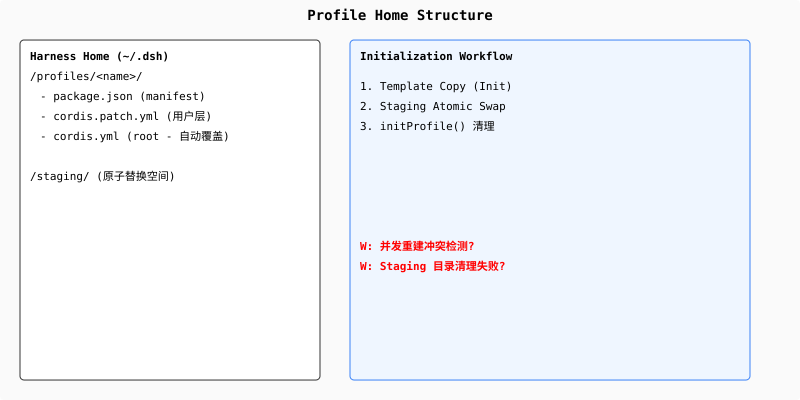

# profile 创建与保留名

> [!IMPORTANT]
> profile 目录自动初始化，但自定义派生 (`--from-default-profile`) 需通过模板原子复制。`desktop` 名由 Electron 应用独占，CLI 一律拒绝。

## 三条初始化路径

| 路径 | 场景 | 说明 |
|---|---|---|
| 自动初始化 | 首次启动 shipped profile 名 | 使用模板预设的 bundles |
| `--from-default-profile` | 需要自定义的派生 profile | 原子复制模板，移除旧数据，独立演化 |
| `dsh plugin` 初始化 | 首次运行 plugin 命令 | 初始化为 base-backed，按需对账 bundles |

### 原子化创建 (Watchpoints)
*   `--from-default-profile` 通过暂存目录 (staging) 实现原子改名替换，避免并发重建冲突。
*   **[Watchpoint]**：初始化过程中若发生进程终止，检查 `previous` 目录以回滚失败替换。

## 保留名机制

*   `desktop` 名由 Electron 独占。`rejectElectronProfile` 大小写不敏感拦截所有 CLI 入口。
*   **[Watchpoint]**：若 `dsh --profile desktop` 不被拦截，核查 CLI `manageDesktopProfile` 标志位是否在 Electron 环境中被正确设为 `true`。

## 源码入口

| 路径 | 角色 |
|---|---|
| `packages/boot/app-boot/src/profile.ts` | 模板定义与 `initProfile` 实现 |
| `apps/cli/src/profile-boot.ts` | `--from-default-profile` 替换逻辑 |
| `apps/cli/src/args.ts` | 保留名拒绝 (`rejectElectronProfile`) |

> [!TIP]
> 派生 profile 不记录继承关系，即刻独立演化。如有需要，使用 `--patch` 进一步定制。
