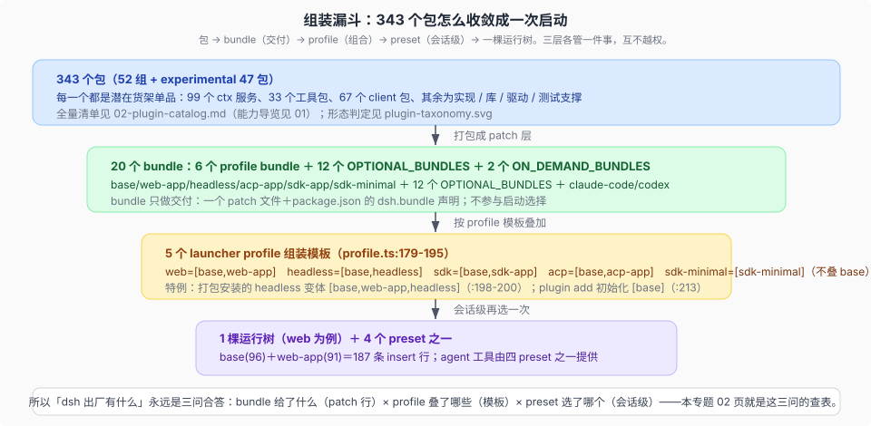

# 能力与场景导览

> [!IMPORTANT]
> harness 并非所有功能皆可随意替换，能力按「到货档位」分为：默认开 (base/web)、可选关 (opt-in) 和 按需装 (on-demand)。

## 三层组装模型 (Watchpoints)

1.  **Bundle (打包)**：代码逻辑单位。
2.  **Profile (组装)**：配置层叠 (`cordis.patch.yml`)。
3.  **Preset (模式)**：会话行为预设。

*   **[Watchpoint]**：检查 `ctx` 注入是否缺失，确认是否因 preset 未正确声明而导致工具不可见。

## 八大场景能力矩阵

| 场景 | 核心实现 | 到货档位 |
|---|---|---|
| 1. 对话循环 | `agent-loop` | Base |
| 2. LLM Provider | `ctx.llm` (Seam) | Base |
| 3. 文件/命令 | `ctx.fs` / `ctx.subprocess` (Seam) | Base |
| 4. 网络/文档 | `tool-web` | Base |
| 5. 自动化编排 | `tool-subagent` | Base / On-demand |
| 6. 记忆/检索 | `session-*` | Base |
| 7. 界面入口 | `client` / `host` | Base |
| 8. 扩展机制 | `boot` / `plugin` | Base |

## 动手前四问

1.  **查货架** → [`02`](./02-plugin-catalog.md)：能力已在吗？
2.  **对清单** → [`03`](./03-reference-lists.md)：它默认可见吗？
3.  **选出路** → [`04`](./04-reuse-paths-and-gaps.md)：需要调配置还是写新工具？
4.  **确认缺口** → [`04`](./04-reuse-paths-and-gaps.md) 末节：是否必须自写？

> [!TIP]
> 永远先核对 `claims.json` 中的包与工具指标，不要试图复写已有的 `ctx` 服务。
