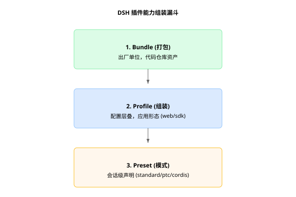

# 复用四条出路与缺口清单

> [!IMPORTANT]
> 拿到插件后，优先尝试配置替换，而非直接 Fork 或重写。本页按改造成本将复用划分为四条路径。

## 插件复用四路径

1.  **调配置**：修改环境变量或 `cordis.patch.yml`（最廉价）。
2.  **patch 换 Provider**：禁用原 Provider 行，插入新 Provider。
3.  **挂现成包**：使用 `dsh plugin add` 安装非出厂包。
4.  **写胶水插件**：基于现有 `ctx` 服务自行实现消费逻辑（最高成本）。

## 关键诊断与 Watchpoints

*   **[Watchpoint]**：如果插件无法生效，确认是否因前面行的 `id` 匹配导致该 patch 被 `skip`。
*   **[Watchpoint]**：核实 `dsh.profile.bundles` 是否包含了你的新包。

## 必须自写的“缺口”

若上述路径无法覆盖，则可能进入“必须自写”范畴。目前确认的典型缺口包括：

| 缺口场景 | 当前限制 |
|---|---|
| 无 GUI 部署的审批 | `ctx.approval` 缺 Provider |
| 新凭据流 (OAuth 等) | `ctx.authorization` 缺 Provider |
| 浏览器/桌面控制 | 现有实现均为 experimental |

> [!TIP]
> 动手写新插件前，必须遵循 [`capability-seams/00-map.md`](../../capability-seams/00-map.md) 的“定义/Provider/消费”分装合同，确保代码复用性。
