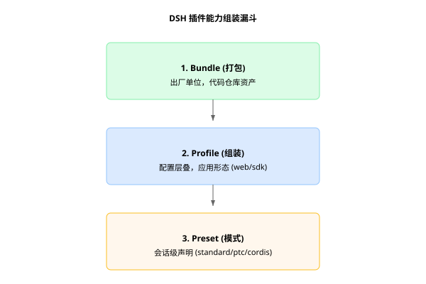

# 插件分类与设计思考

> [!IMPORTANT]
> 理解插件的「九种形态」与「四种 Role」，是避免“重复造轮子”的核心判据。

## 九种形态判据

| 形态 | 职责 | 核心判据 |
|---|---|---|
| **Def** | 定义服务合同 | `ctx.<key>` 注册表，扩展插件依赖的源头 |
| **Impl** | 合同实现 (Provider) | 对现有的 Def 提供具体逻辑 (如 SSH/Sandbox) |
| **Tool** | 模型可见工具 | `defineTool` 注册，schema 自动进 Prompt |
| **cmd** | 人类控制命令 | `/command` 入口 |
| **UI** | 浏览器 UI 插件 | Host + Client 罗盘行对齐 |
| **adapter** | 模型后端 | `ctx.llm` 的 Provider，可休眠挂载 |
| **bundle** | 交付打包单元 | `dsh.bundle.patch`，配置层叠基础 |
| **lib** | 零挂载纯库 | 仅 `import`，不参与 Cordis 挂载 |
| **驱动** | 启动路径逻辑 | 将现成服务编织成完整路径 |

## 四大设计决定 (Watchpoints)

1.  **复用优先**：对话、读写、模型、界面均为现成插件，新插件应仅作为 `ctx` 的扩展。
2.  **显式组合**：通过 `disabled` + `insert` 行进行替换，严禁通过代码硬编码替换逻辑。
3.  **模型可预测**：模型工具集完全由 `ctx.tools` 注册与 preset patch 决定，可静态审查。
4.  **职责分离**：Bundle 负责发货，Profile 负责启动，Preset 负责会话级行为。

*   **[Watchpoint]**：检查新写的插件是否符合“九种形态”之一，避免职责混乱导致依赖地狱。

> [!TIP]
> 如果你的插件仅为了“接线”，检查是否能直接使用现有驱动逻辑，无需新建仓库。
